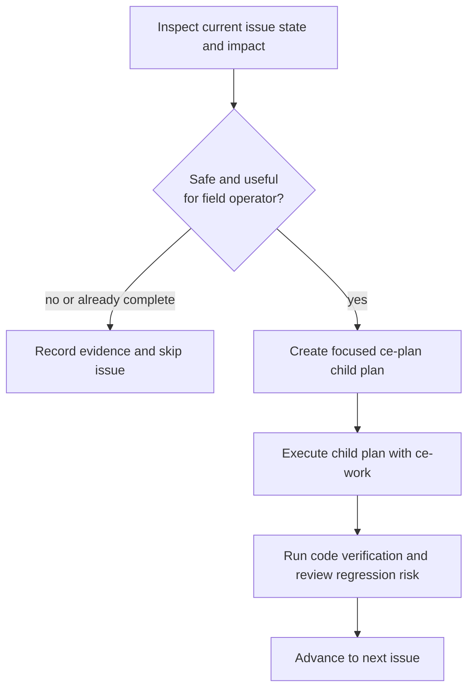
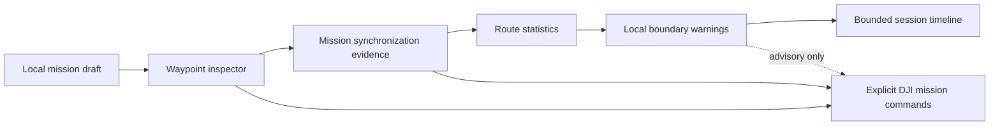

# Operator Mission Workflow Backlog - Plan

## Goal Capsule

- **Objective:** Let a field operator inspect, reconcile, assess, constrain, and review a waypoint mission without mistaking local app state for aircraft state or app-side advice for DJI-enforced safety.
- **Means:** Deliver GitHub issues #1, #5, #4, #6, and #11 one at a time through a repeated inspect-plan-execute-verify gate.
- **Authority:** The operator owns all flight commands. DJI and Cendence remain authoritative for flight, RTH, landing protection, and aircraft enforcement. `DjiDataHub` remains the sole owner of recurring DJI setter-based callbacks.
- **Execution profile:** KISS. Reuse the existing immutable mission model, `DjiDataHub` fan-out, bounded diagnostics, and MapLibre surface. Do not add a new service or callback path unless the issue-specific plan proves it is necessary.
- **Stop conditions:** Skip an issue when its current implementation is already complete, when its safe implementation would regress an existing flow, or when it cannot provide truthful field value without unavailable hardware evidence. Stop for a user decision if implementation evidence contradicts the issue scope.
- **Tail ownership:** After all five issues complete, the user performs one consolidated tablet and aircraft test. Build and unit checks run after each issue; no claim of hardware success is made before that test.

---

## Product Contract

### Summary

This plan completes the next operator-facing mission workflow slices in dependency order. Each slice must first prove that it is still needed and safe to add to the current app. It then receives its own focused `ce-plan` plan and `ce-work` execution before the next slice begins.

### Problem Frame

The current app can draft waypoints, set DJI Home, load/upload/start a mission, and display basic readiness. It does not yet give an operator a complete way to precisely inspect a route, know what mission is on the aircraft, assess route consequences, warn about local boundaries, or review a flight session.

### Requirements

**Execution protocol**

- R1. Before each tracked issue, inspect the current source, tests, issue body, and relevant UI state to classify the issue as absent, partial, complete, blocked, or unsafe to change.
- R2. Before coding an issue, assess its impact on callback ownership, explicit DJI command boundaries, mission lifecycle, local persistence, Transport persistence, and existing UI interactions.
- R3. Execute an issue only when the assessment finds no expected regression and the result provides real, understandable value to a field operator. Record a skip with evidence when this gate fails.
- R4. For every approved issue, create a new focused implementation-ready plan with `ce-plan` before invoking `ce-work`. The child plan must use the current baseline, not assumptions from this master plan.
- R5. Run the existing code-level verification after every approved issue. Defer one consolidated tablet and aircraft validation until all five approved issues are complete.

**Operator mission workflow**

- R6. Issue #1 must make each waypoint inspectable and editable with ordered map/list correspondence, exact WGS84 values, altitude control, route-level defaults, and visible dirty state.
- R7. Issue #5 must add an explicit Download from aircraft action and make local draft, loaded app mission, uploaded aircraft mission, executing mission, and remote-unknown state distinct. It must not overwrite aircraft state implicitly.
- R8. Issue #4 must show route distance, waypoint count, altitude range, estimated duration, and climb/descent summary. Any feasibility result must be advisory and must state its uncertainty.
- R9. Issue #6 must let the operator define local inclusion/exclusion circles and polygons, save them with a draft or named local profile, and see route-intersection warnings. The UI must state that DJI does not enforce these boundaries.
- R10. Issue #11 must record a bounded local timeline of mission, readiness, link, transport, and explicit operator events. It must distinguish event time sources and avoid raw-video recording by default.

### Key Flows

- F1. **Per-issue delivery gate:** Inspect current state → assess impact and operator value → skip or write child plan → execute child plan → run code verification → continue only when the result is clean.
- F2. **Mission preparation:** Edit the route → observe unsaved/unloaded state → load deliberately → upload deliberately → start only through the existing readiness gate.
- F3. **Post-session review:** Open the local timeline → inspect state transitions and operator actions → export or retain bounded local evidence without affecting Transport or live video.

### Acceptance Examples

- AE1. When a waypoint is selected, the operator can see its route number and exact coordinates, change its supported mission properties, or remove it without changing another waypoint.
- AE2. When the app cannot prove which mission is on the aircraft, it renders `REMOTE UNKNOWN` rather than presenting the local draft as uploaded.
- AE3. When a route crosses a local no-go boundary, the operator sees a warning before upload, while the UI makes clear that the aircraft will not autonomously avoid the boundary.
- AE4. When diagnostics are full or unavailable, mission UI and DJI callbacks remain responsive and the timeline reports bounded loss rather than blocking the operator.

### Scope Boundaries

#### Deferred to Follow-Up Work

- Offline map coverage (#3), import/export and library expansion (#7), transport-health UI (#10), payload controls (#8), and terrain/pattern planning (#9).
- Hardware-dependent validation of DJI mission download, upload, execution, Home, RTK, OcuSync, RTH, and landing behavior.

#### Outside This Plan

- Automatic takeoff, landing, RTH, mission start, gimbal movement, or virtual-stick flight commands.
- New Android-to-Edge protocols, video decoding/re-encoding, raw video logging, or any second direct DJI setter callback owner.

### Success Criteria

- Each approved issue adds one understandable operator capability without changing the authority of Cendence, DJI, or the existing explicit-command model.
- The app never reports unavailable, stale, local-only, or app-side warning data as confirmed aircraft state or DJI enforcement.
- The final consolidated hardware test can exercise all five completed features without reopening the individual design decisions.

---

## Planning Contract

### Key Technical Decisions

- KTD1. **Use a serial issue gate.** Complete #1, then #5, #4, #6, and #11. Each issue gets a fresh inspection and child plan before code changes. (session-settled: user-directed — chosen over batch implementation: the user requires current-state review, impact analysis, and operator-value proof before every issue.)
- KTD2. **Extend current seams before adding abstractions.** Mission model and map behavior stay in `missionplanner`; Mission screen state stays in `MissionMvpView`; recurring aircraft state stays in `DjiDataHub`; local diagnostics remain bounded through the existing diagnostics path.
- KTD3. **Treat aircraft synchronization as evidence, not inference.** A successful local `loadMission` does not prove upload. A completed upload does not prove the aircraft mission remains current after reconnect. A missing download/readback remains remote-unknown.
- KTD4. **Keep planning safety advisory-only.** Route statistics and local boundaries inform the operator. They do not gate manual Cendence operation or imply DJI geofence, terrain, collision, or battery-reserve enforcement.
- KTD5. **Use one bounded event vocabulary.** The session timeline subscribes to existing app state and records structured local events. It does not introduce a second telemetry stream or add raw RTP/H.264 to NDJSON.

### High-Level Technical Design

### Current-State Findings

- #1 is partial. `MissionRouteEditor` already supports append, insert, move, and delete. `MissionMvpView` exposes only map add/delete and a two-action waypoint popup. It lacks a visible inspector, exact coordinate editing, reordering UI, per-waypoint altitude UI, and durable dirty-state presentation.
- #5 is partial. `MissionMvpView` tracks local loaded/uploaded state and listens to the operator, but download updates are empty and it has no durable remote-state or reconciliation model.
- #4 is absent. The draft contains route geometry, altitude, and speed inputs, but no route-statistics reducer or advisory view.
- #6 is absent. No boundary domain, persistence, map rendering, or route-intersection warning exists.
- #11 is partial at infrastructure level. Readiness already emits bounded local events and the mission operator emits UI status. There is no unified, operator-readable session timeline.

### Sequencing

| Phase | Issue | Why this order | Child-plan gate |
|---|---|---|---|
| 1 | #1 Mission inspector | Makes the route precise before later state, statistics, or warnings refer to it. | Current editor/map behavior remains compatible. |
| 2 | #5 Mission synchronization | Makes mission lifecycle truthful before advisory and review surfaces build on it. | DJI operator callbacks and readback semantics are evidenced or remain remote-unknown. |
| 3 | #4 Route statistics | Uses the now-inspectable route without claiming aircraft feasibility. | Calculations need only valid local draft inputs. |
| 4 | #6 Local boundaries | Adds visual planning warnings on the stable route geometry. | Boundary persistence and map overlay do not obscure selection or command controls. |
| 5 | #11 Session timeline | Records the stabilized lifecycle and warnings without becoming a second transport pipeline. | Event sources remain bounded and truthful. |

### Risks and Mitigations

| Risk | Mitigation |
|---|---|
| A mission screen change lets a local draft look aircraft-confirmed. | Model explicit local, uploaded, executing, and remote-unknown states. Test reconnect and modified-draft paths. |
| New UI competes with DJI callbacks. | Subscribe through `DjiDataHub` for recurring aircraft data. Keep mission operator listeners scoped and detach them with the view lifecycle. |
| A statistic or boundary warning is mistaken for an aircraft safety guarantee. | Label it as advisory, disclose missing terrain/battery inputs, and retain explicit DJI commands. |
| Timeline logging adds lag or unbounded storage. | Reuse bounded asynchronous NDJSON, cap in-memory UI history, and omit raw video. |
| A child feature regresses current Mission or Operate behavior. | Require impact inspection and existing verification before code. Skip rather than force a conflicting change. |

---

## Implementation Units

### U1. Establish the serial issue delivery gate

- **Goal:** Make every child issue start from evidence, not the master plan's assumptions.
- **Requirements:** R1, R2, R3, R4, R5.
- **Dependencies:** None.
- **Files:** `docs/PLAN.md`, `docs/plans/`, GitHub issues #1, #5, #4, #6, and #11.
- **Approach:**
  1. Before each issue, read its current GitHub body and inspect the live source, related tests, and relevant UI entry points.
  2. Write a short baseline note in that issue's child plan: implemented, partial, absent, blocked, or unsafe.
  3. State expected interactions with Mission, Operate, `DjiDataHub`, Transport, persistence, and explicit DJI commands.
  4. Skip when the outcome is already complete, conflicts with current behavior, or has no field value.
  5. Invoke `ce-plan` for an approved issue with the current baseline and `confirm:auto`; then invoke `ce-work` with that child plan.
- **Execution note:** Do not batch child plans or code changes. Complete code-level verification and a diff review before beginning the next issue.
- **Test scenarios:**
  - An already-complete issue is documented and skipped without a speculative refactor.
  - An issue whose implementation would violate callback ownership is blocked before code changes.
  - An approved issue has a child plan with explicit scope, tests, and hardware limits before `ce-work` starts.
- **Verification:** Every completed or skipped issue has a child plan and an issue comment or update explaining the decision.

### U2. Deliver issue #1: Mission inspector and editable waypoint sequence

- **Goal:** Give the operator a precise editor for the same ordered route shown on the map.
- **Requirements:** R6, R1, R2, R3, R4, R5.
- **Dependencies:** U1.
- **Files:** Likely `Sample Code/app/src/main/java/com/dji/sdk/sample/operate/MissionMvpView.java`, `Sample Code/app/src/main/java/com/dji/sdk/sample/missionplanner/MissionRouteEditor.java`, `Sample Code/app/src/main/java/com/dji/sdk/sample/missionplanner/MissionDraft.java`, `Sample Code/app/src/main/java/com/dji/sdk/sample/missionplanner/map/MapLibreMissionMapView.java`, `Sample Code/app/src/main/res/layout/view_mission_mvp.xml`, and `Sample Code/app/src/test/java/com/dji/sdk/sample/missionplanner/MissionPlannerUnitTestSuite.java`.
- **Approach:** First create a focused child plan that checks whether existing editor methods and map markers can support an inspector without changing command controls. If approved, expose ordered selection, exact coordinate editing, insertion/reorder/delete, per-waypoint altitude override, and dirty-state behavior through the existing immutable draft/editor boundary.
- **Patterns to follow:** Existing map-marker numbering, `MissionRouteEditor` immutable replacement methods, and the current local-draft invalidation after edits.
- **Test scenarios:**
  - Editing one selected waypoint changes only that ordered entry and invalidates the loaded/uploaded state.
  - Insert, reorder, and delete preserve route order and marker numbering.
  - Invalid WGS84, altitude, and numeric inputs cannot replace a valid draft.
  - Closing and reopening the inspector does not silently discard a draft edit.
- **Verification:** The map and inspector show the same route order, and Load/Upload/Start still require their existing explicit states.

### U3. Deliver issue #5: Mission synchronization with aircraft

- **Goal:** Show the operator what is local, loaded in the app, uploaded, executing, or unknown on the aircraft.
- **Requirements:** R7, R1, R2, R3, R4, R5.
- **Dependencies:** U1, U2.
- **Files:** Likely `Sample Code/app/src/main/java/com/dji/sdk/sample/operate/MissionMvpView.java`, `Sample Code/app/src/main/java/com/dji/sdk/sample/missionplanner/MissionPreflight.java`, `Sample Code/app/src/main/java/com/dji/sdk/sample/missionplanner/MissionDraft.java`, a focused mission-state model under `Sample Code/app/src/main/java/com/dji/sdk/sample/missionplanner/`, and `Sample Code/app/src/test/java/com/dji/sdk/sample/missionplanner/MissionPlannerUnitTestSuite.java`.
- **Approach:** First create a focused child plan that examines MSDK V4 mission-operator download and execution evidence. If approved, add an explicit Download action, a synchronization model, and a visible reconciliation path. Preserve remote-unknown whenever the app lacks evidence. Do not implicitly download, overwrite, upload, or start a mission.
- **Patterns to follow:** The existing explicit `Load`, `Upload`, `Start`, `Pause`, and `Cancel` controls, plus the current callback lifecycle in `MissionMvpView`.
- **Test scenarios:**
  - A locally modified route becomes dirty and cannot remain marked uploaded.
  - Upload success moves only the appropriate local/remote evidence state.
  - Reconnect, callback loss, and unsupported download leave the aircraft state remote-unknown.
  - An explicit download failure preserves the existing local draft and reports the failure.
- **Verification:** No state label claims an aircraft mission exists without direct evidence, and existing explicit DJI command boundaries remain unchanged.

### U4. Deliver issue #4: Route statistics and conservative mission feasibility

- **Goal:** Show useful route consequences before upload without inventing battery, terrain, or aircraft guarantees.
- **Requirements:** R8, R1, R2, R3, R4, R5.
- **Dependencies:** U1, U2, U3.
- **Files:** Likely a pure statistics reducer under `Sample Code/app/src/main/java/com/dji/sdk/sample/missionplanner/`, `Sample Code/app/src/main/java/com/dji/sdk/sample/operate/MissionMvpView.java`, `Sample Code/app/src/main/res/layout/view_mission_mvp.xml`, and `Sample Code/app/src/test/java/com/dji/sdk/sample/missionplanner/MissionPlannerUnitTestSuite.java`.
- **Approach:** First create a focused child plan that defines only calculations supported by the stored WGS84 route, altitude overrides, and configured speed. If approved, render a compact advisory panel. Defer battery reserve and terrain clearance until their real inputs and datum are validated.
- **Patterns to follow:** Pure dependency-free mission validation and the current scrollable mission configuration layout.
- **Test scenarios:**
  - A two-waypoint route returns deterministic distance, altitude range, climb/descent, and duration estimates.
  - Zero-length legs and missing/invalid route inputs are explicit rather than producing misleading values.
  - Per-waypoint altitude overrides affect the altitude summary without changing the route default.
  - The advisory remains visible but does not block Load, Upload, or manual Cendence flight.
- **Verification:** Statistics update with the local route and state their uncertainty where required.

### U5. Deliver issue #6: Local planning safety boundaries

- **Goal:** Warn an operator when the planned route crosses an editable local boundary.
- **Requirements:** R9, R1, R2, R3, R4, R5.
- **Dependencies:** U1, U2, U4.
- **Files:** Likely new boundary domain and intersection helpers under `Sample Code/app/src/main/java/com/dji/sdk/sample/missionplanner/`, `MissionDraft` persistence files, `Sample Code/app/src/main/java/com/dji/sdk/sample/missionplanner/map/MapLibreMissionMapView.java`, `Sample Code/app/src/main/java/com/dji/sdk/sample/operate/MissionMvpView.java`, mission layout resources, and mission-planner tests.
- **Approach:** First create a focused child plan that validates circle and polygon interaction fit. If approved, add named local inclusion/exclusion circles and polygons, persist them with a draft or named local profile, and compute route intersections locally. Keep the warning separate from DJI geofence state and mission command eligibility.
- **Patterns to follow:** Immutable draft validation, MapLibre marker/route rendering, and waypoint popup positioning.
- **Test scenarios:**
  - A route segment crossing an exclusion boundary creates a visible advisory.
  - A route inside an inclusion boundary remains clear, while a route leaving it warns.
  - Circle and polygon boundaries use the same inclusion/exclusion warning semantics.
  - Editing or deleting a boundary recalculates warnings without mutating waypoint geometry.
  - Invalid or degenerate boundary input is rejected and cannot be saved.
- **Verification:** The map makes boundaries and their enforcement limit understandable without covering mission controls or changing DJI behavior.

### U6. Deliver issue #11: Flight-session timeline and operator log

- **Goal:** Provide a bounded, readable local account of operator actions and live state transitions.
- **Requirements:** R10, R1, R2, R3, R4, R5.
- **Dependencies:** U1, U3, U4, U5.
- **Files:** Likely a timeline model under `Sample Code/app/src/main/java/com/dji/sdk/sample/operate/`, `Sample Code/app/src/main/java/com/dji/sdk/sample/operate/MissionMvpView.java`, `Sample Code/app/src/main/java/com/dji/sdk/sample/operate/OperateMvpView.java`, `Sample Code/app/src/main/java/com/dji/sdk/sample/transport/diagnostics/AsyncNdjsonDiagnosticWriter.java`, and focused tests under `Sample Code/app/src/test/java/com/dji/sdk/sample/operate/` or `transport/diagnostics/`.
- **Approach:** First create a focused child plan that inventories existing readiness diagnostics, mission callbacks, `DjiDataHub` status changes, and Transport events. If approved, normalize only the minimum event set into one bounded local timeline with source-time labels. Keep timeline collection as subscribers to existing state; never add a direct recurring DJI callback or raw media capture.
- **Patterns to follow:** `FlightReadinessSession`, asynchronous bounded NDJSON, callback-rate diagnostics, and the current view attach/detach cleanup.
- **Test scenarios:**
  - Explicit Load, Upload, Start denial, Start success, Pause, Cancel, and Home-setting attempts append understandable operator events.
  - Link/readiness/transport transitions record Android receive time and distinguish DJI-reported versus operator-action time.
  - Queue overflow drops records according to the existing bounded policy and keeps UI/callback producers non-blocking.
  - The timeline excludes raw video, secrets, and unsupported inferred aircraft state.
- **Verification:** A local session can be reviewed without logcat, while transport and live video behavior remain unchanged.

---

## Verification Contract

| Gate | Applies to | Evidence |
|---|---|---|
| Current-state and impact gate | Before each issue | Child plan records implemented/partial/absent status, regression assessment, and skip or proceed decision. |
| Unit tests | Each approved issue | Extend focused mission, readiness, diagnostics, or callback tests for the changed behavior. |
| Callback ownership check | Each approved issue that touches state subscriptions | `scripts/verify_dji_callback_ownership.sh` remains passing. |
| Android code verification | After every approved issue | `scripts/test_android.sh --offline`, `scripts/build_android.sh :app:assembleDebug`, and `scripts/verify_apk.sh` pass. |
| Consolidated device test | After U2 through U6 | User validates tablet UI and connected DJI hardware. No issue is called hardware-proven before this step. |

---

## Definition of Done

- U1 through U6 either complete with their child plans and verification evidence, or are explicitly skipped with a concrete conflict, completion, or no-value reason.
- Each implemented issue remains aligned with its GitHub acceptance criteria and has an updated issue status or closure decision.
- Mission planning still uses explicit `Load`, `Upload`, `Start`, `Pause`, `Cancel`, and DJI Home actions.
- `DjiDataHub` remains the sole owner of shared recurring DJI setter callbacks.
- New data stays truthful: local state is not aircraft evidence, advisory safety is not DJI enforcement, and unknown data is not healthy.
- No raw video, credentials, or unrelated cleanup enters the implementation diffs.
- The ignored temporary `Sample Code/app/src/main/java/com/dji/sdk/sample/missionplanner/graphify-out/` research output is removed before implementation begins; it is not part of the product or this plan.
