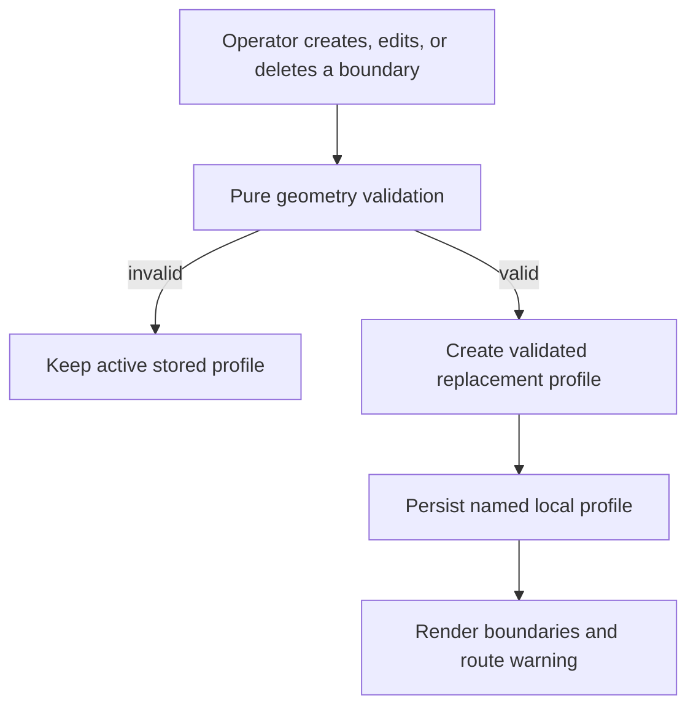
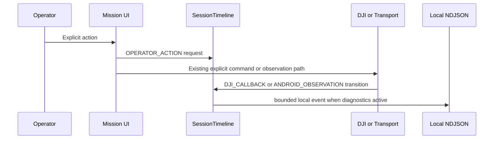

# Mission Planner Review Findings - Plan

## Goal Capsule

- **Objective:** Let an operator use local planning boundaries and a flight-session log without silent data loss, misleading geometry warnings, or incomplete operator evidence.
- **Means:** Strengthen the existing immutable mission-planner models, Mission UI, `SessionTimelineStore`, and bounded local diagnostics. (KTD1, KTD2)
- **Authority:** DJI and Cendence remain authoritative for aircraft state and commands. Boundaries remain local advice. The operator still initiates every DJI command.
- **Execution profile:** KISS and proof-first. Add pure-model tests before changing behavior. Reuse `DjiDataHub` fan-out and the current bounded NDJSON writer. Do not add a callback owner, a UDP field, or a service.
- **Stop conditions:** Stop if a proposed validation rejects a valid WGS84 operational area, if Android UI behavior cannot be proven with the available test surface, or if a hardware observation contradicts local-only advisory semantics.
- **Tail ownership:** Code-level verification completes in this plan. Tablet and aircraft validation remains a separate operator test.

---

## Product Contract

### Summary

The completed operator-workflow plan exposed gaps in local boundary editing, geometry validation, and session evidence. This plan corrects those gaps without changing mission-command authority or Android-to-Edge transport.

### Problem Frame

A second boundary saved under the same profile name currently replaces the first one. The operator cannot edit or remove an existing boundary. Degenerate polygons can be saved. The session log omits some commands and outcomes that matter during field review.

### Requirements

**Boundary integrity and operator workflow**

- R1. Saving a boundary into an existing named profile must append or deliberately replace a selected boundary. It must never discard a different boundary without a visible delete/replace action.
- R2. The Mission UI must let the operator inspect, edit, and delete a boundary in the active local profile. Every resulting profile change must update the map and advisory warning immediately.
- R3. A local polygon must have three or more distinct vertices, non-zero area, and no self-intersection. A failed edit or save must preserve the last valid stored profile.
- R4. Boundary warnings must remain advisory-only and state `NOT DJI ENFORCED`. They must not gate `Load`, `Upload`, `Start`, manual Cendence flight, or DJI Home.

**Session evidence**

- R5. The local timeline must record every explicit Mission action that can affect mission or Home state, including Set DJI Home request and completion/failure, plus lifecycle outcomes for Start, Pause, Cancel, Upload, and Download.
- R6. The local timeline must record aircraft link, RTH, readiness, Transport start/stop, and meaningful Transport health transitions without creating a second DJI callback or sending new UDP protocol data.
- R7. The timeline must visibly delimit a new aircraft session after a link-session reset while retaining only bounded local history. Exports must identify the time source and omit raw media.

### Acceptance Examples

- AE1. Given a profile with two boundaries, adding a third does not remove either prior boundary. Selecting one boundary and pressing Delete removes only that one.
- AE2. Given a polygon with duplicate vertices, zero area, or crossed edges, Save reports the geometry error and the last stored profile remains unchanged.
- AE3. Given a DJI Home attempt, the log shows the operator request and the DJI completion or failure with distinct time-source labels.
- AE4. Given a Transport socket-error transition, the log records one degraded transition rather than an event every second.

### Scope Boundaries

#### Deferred to Follow-Up Work

- Map-drawn boundary creation, terrain-aware constraints, DJI geofence integration, and map import/export remain outside this correction.
- A private project issue tracker may be configured later. Do not update numeric upstream DJI issues as if they were this app's backlog.

#### Outside This Plan

- Automatic takeoff, landing, RTH, mission start, gimbal movement, or virtual-stick commands.
- New Android-to-Edge protocol fields, raw video logging, or a new setter-based DJI callback owner.

### Success Criteria

- The operator can retain multiple boundaries in a profile and change one without risking the others.
- Invalid geometry cannot become active or persisted planning data.
- A session log explains operator action, DJI callback, and Android observation events well enough for post-flight review.

---

## Planning Contract

### Key Technical Decisions

- KTD1. **Keep boundaries as immutable profile values.** Build edits as a validated replacement profile and persist only after validation succeeds. This prevents a partial UI edit from corrupting stored advice. (session-settled: user-directed — chosen over a mutable live editor: field reliability and recoverability take priority.)
- KTD2. **Use the existing bounded timeline and diagnostics path.** Record only state transitions and explicit outcomes. This avoids callback contention, recurrent log spam, and a new transport contract. (session-settled: user-directed — chosen over a second logging pipeline: KISS and reliable field operation.)
- KTD3. **Use conservative local geometry validation.** Reject clearly invalid polygons before evaluation. Keep warnings advisory-only rather than attempting to infer aircraft geofence behavior. (Governs R3, R4)

### High-Level Technical Design

### System-Wide Impact

- Boundary changes remain within `missionplanner`, `MissionMvpView`, and `MapLibreMissionMapView`. They do not modify DJI mission serialization or callback registration.
- Timeline producers remain small and non-blocking. `TransportRuntime` receives events through the existing in-process listener and writes only to its local bounded queue.

### Sequencing

| Order | Unit | Dependency | Reason |
|---|---|---|---|
| 1 | U1 Boundary model integrity | None | Prevent data loss and invalid geometry before exposing edits. |
| 2 | U2 Boundary profile editor | U1 | UI can only operate on safe profile operations. |
| 3 | U3 Boundary map and advisory integration | U2 | Verify the field-visible effect of profile edits. |
| 4 | U4 Timeline completeness and session delimiting | None | Independent from geometry but touches shared lifecycle evidence. |
| 5 | U5 Regression verification | U1-U4 | Confirm no authority, callback, or transport regression. |

### Risks and Mitigations

| Risk | Mitigation |
|---|---|
| A valid operational polygon is rejected. | Use deterministic WGS84/local-planar tests near equator and mid-latitude. Keep tolerances documented in the validator. |
| A UI edit overwrites a profile. | Validate and construct the complete replacement list before calling the single profile save operation. |
| Timeline floods diagnostics. | Emit only changes in health/link/RTH state and keep the existing queue capacity/drop behavior. |
| A local warning is mistaken for a DJI restriction. | Preserve the advisory label in every boundary presentation and test that mission commands remain unchanged. |

---

## Implementation Units

### U1. Make local boundary profiles lossless and geometrically valid

- **Goal:** Guarantee that profile persistence cannot silently discard a boundary and cannot accept invalid local geometry.
- **Requirements:** R1, R3, R4. KTD1, KTD3.
- **Dependencies:** None.
- **Files:** `Sample Code/app/src/main/java/com/dji/sdk/sample/missionplanner/PlanningBoundary.java`, `Sample Code/app/src/main/java/com/dji/sdk/sample/missionplanner/PlanningBoundaryProfile.java`, `Sample Code/app/src/main/java/com/dji/sdk/sample/missionplanner/PlanningBoundaryProfileLibrary.java`, `Sample Code/app/src/main/java/com/dji/sdk/sample/missionplanner/BoundaryEvaluator.java`, `Sample Code/app/src/test/java/com/dji/sdk/sample/missionplanner/MissionPlannerUnitTestSuite.java`.
- **Approach:** Add pure profile operations for append, replace-at-index, and delete-at-index. Validate circles, duplicate points, non-zero polygon area, and non-adjacent polygon edge intersections before profile construction or decode. Decode malformed persisted values by skipping only the invalid profile, not overwriting a valid one.
- **Execution note:** Add the smallest failing JVM tests for overwrite preservation and invalid geometry before changing the model.
- **Test scenarios:**
  - Saving a new boundary into a profile with two entries produces three entries in order.
  - Replacing index one preserves index zero and index two.
  - Deleting index one preserves the other boundaries and rejects an invalid index.
  - Duplicate vertices, collinear vertices, bow-tie polygons, out-of-range coordinates, zero/negative radii, and non-finite values are rejected.
  - A valid concave polygon and valid circle survive encode/decode.
  - A failed validation leaves the prior in-memory and persisted profile unchanged.
- **Verification:** Mission planner JVM suite passes with explicit geometry and profile-operation coverage.

### U2. Provide a compact active-profile boundary editor

- **Goal:** Let an operator inspect, edit, append, and delete one named local boundary without ambiguity or accidental profile replacement.
- **Requirements:** R1, R2, R4. KTD1.
- **Dependencies:** U1.
- **Files:** `Sample Code/app/src/main/java/com/dji/sdk/sample/operate/MissionMvpView.java`, `Sample Code/app/src/main/res/layout/view_mission_mvp.xml`, `Sample Code/app/src/test/java/com/dji/sdk/sample/missionplanner/MissionPlannerUnitTestSuite.java`.
- **Approach:** Retain the current explicit coordinate-entry flow. When a profile is active, show its boundaries as numbered, named local entries. Selecting one opens its matching circle or polygon editor. Put Delete behind a confirmation. New Boundary appends to the active profile; a new profile is only created through an explicit `NEW PROFILE` choice.
- **Test scenarios:**
  - An active profile selection opens the same ordered boundary list that the map renders.
  - Saving an edit updates only the selected boundary.
  - Delete requires confirmation and updates the active profile only after confirmation.
  - Invalid form input leaves the active profile and map unchanged.
  - No boundary action invokes a DJI command, changes a mission draft, or changes Upload state.
- **Verification:** Code review of UI-to-profile data flow confirms every save route uses U1 replacement operations and every label retains the local/non-enforced warning.

### U3. Keep map rendering and warnings truthful after every boundary change

- **Goal:** Make the active profile and its route consequences understandable at a glance after create, edit, select, or delete.
- **Requirements:** R2, R4. KTD3.
- **Dependencies:** U1, U2.
- **Files:** `Sample Code/app/src/main/java/com/dji/sdk/sample/missionplanner/map/MapLibreMissionMapView.java`, `Sample Code/app/src/main/java/com/dji/sdk/sample/operate/MissionMvpView.java`, `Sample Code/app/src/test/java/com/dji/sdk/sample/missionplanner/MissionPlannerUnitTestSuite.java`.
- **Approach:** Render the active profile as the single source of map geometry. Recompute advisory details after route or profile changes. Extend the pure evaluator result only enough to identify which named boundaries warn, while retaining a compact count in the rail.
- **Test scenarios:**
  - Editing a crossing boundary to non-crossing clears its warning without modifying waypoints.
  - Deleting a warning boundary clears only that warning.
  - A collinear but disjoint route segment does not report an intersection.
  - Inclusion and exclusion warnings stay advisory and do not affect mission preflight results.
- **Verification:** Pure evaluator tests cover circle, polygon, tangent, disjoint-collinear, and route-crossing cases; code inspection confirms no command/preflight gate was added.

### U4. Complete bounded session evidence and session delimiting

- **Goal:** Produce a readable bounded log that records operator intent, observed result, and meaningful state transitions across a real aircraft session.
- **Requirements:** R5, R6, R7. KTD2.
- **Dependencies:** None.
- **Files:** `Sample Code/app/src/main/java/com/dji/sdk/sample/operate/SessionTimeline.java`, `Sample Code/app/src/main/java/com/dji/sdk/sample/operate/SessionTimelineStore.java`, `Sample Code/app/src/main/java/com/dji/sdk/sample/operate/FlightReadinessStore.java`, `Sample Code/app/src/main/java/com/dji/sdk/sample/operate/MissionMvpView.java`, `Sample Code/app/src/main/java/com/dji/sdk/sample/transport/TransportRuntime.java`, `Sample Code/app/src/main/java/com/dji/sdk/sample/transport/diagnostics/AsyncNdjsonDiagnosticWriter.java`, `Sample Code/app/src/main/java/com/dji/sdk/sample/transport/diagnostics/JsonEncoder.java`, `Sample Code/app/src/test/java/com/dji/sdk/sample/missionplanner/MissionPlannerUnitTestSuite.java`, `Sample Code/app/src/test/java/com/dji/sdk/sample/transport/TransportPrimitivesTest.java`.
- **Approach:** Define one small event vocabulary for requested, succeeded, failed, and state-transition events. Record Home, Mission command outcomes, RTH/link/readiness, and transport-health state changes only when the state changes. Add a bounded session delimiter at aircraft-session reset; do not silently erase prior evidence. Use the existing listener and asynchronous writer only when diagnostics are active.
- **Execution note:** Characterize current capacity/drop behavior first. Add unit tests around the pure timeline and JSON encoder before instrumenting Android callback seams.
- **Test scenarios:**
  - Set DJI Home logs request and success/failure with correct source labels.
  - Load, Upload, Start, Pause, Cancel, and Download log request plus completion/failure where callbacks provide it.
  - A RTH, aircraft-link, or transport-health state held for many callbacks creates one transition event, not repeated events.
  - A new aircraft session creates a visible delimiter while bounded capacity removes only oldest entries.
  - Timeline NDJSON is valid UTF-8 JSON, excludes raw RTP/H.264, and queue overflow does not block the producer.
- **Verification:** Timeline and transport diagnostics tests cover both in-memory event ordering and encoded local NDJSON records; callback ownership check remains clean.

### U5. Verify field safety and regression boundaries

- **Goal:** Establish code-level evidence that the corrections preserve explicit DJI authority and existing transport behavior.
- **Requirements:** R1-R7.
- **Dependencies:** U1-U4.
- **Files:** `scripts/verify_dji_callback_ownership.sh`, `scripts/test_android.sh`, `scripts/build_android.sh`, `scripts/verify_apk.sh`.
- **Approach:** Run the focused suites first, then the repository verification gates. Inspect the final diff for new DJI setter callbacks, network protocol changes, raw media records, or unrelated cleanup. Do not claim hardware proof.
- **Test scenarios:**
  - Existing mission draft, readiness, telemetry diagnostics, and transport primitive suites still pass.
  - Callback ownership remains exclusively in `DjiDataHub`.
  - Debug APK includes expected DJI native video libraries.
  - A manual tablet test can create, edit, delete, select, save, and reopen local profiles; review session log entries; and confirm no command occurs without a visible operator action.
- **Verification:** `scripts/test_android.sh --offline`, `scripts/build_android.sh :app:assembleDebug`, `scripts/verify_apk.sh`, `git diff --check`, and a final code review pass.

---

## Verification Contract

| Gate | Applies to | Evidence |
|---|---|---|
| Pure boundary regression tests | U1-U3 | Valid and invalid geometry, profile operations, and intersection edge cases pass. |
| Timeline/diagnostics tests | U4 | Event vocabulary, session delimiters, JSON validity, and bounded drop behavior pass. |
| Callback ownership | U4-U5 | `scripts/verify_dji_callback_ownership.sh` passes. |
| Android code verification | U1-U5 | `scripts/test_android.sh --offline`, `scripts/build_android.sh :app:assembleDebug`, and `scripts/verify_apk.sh` pass. |
| Consolidated tablet/drone check | After U5 | Operator validates UI behavior and DJI/Transport observations. No automatic flight command is tested or introduced. |

---

## Definition of Done

- A named local profile safely retains multiple boundaries and supports inspect, edit, and confirmed delete without silent replacement.
- Invalid or degenerate geometry cannot become active or persisted data.
- Map warnings update after each profile change and remain visibly advisory-only.
- The bounded local session log records the stated operator actions and state transitions, segments new aircraft sessions, and writes no raw media.
- `DjiDataHub` remains the only recurring DJI setter callback owner.
- All code-level verification gates pass, the diff contains no abandoned experimental code, and hardware claims remain deferred until the operator test.
