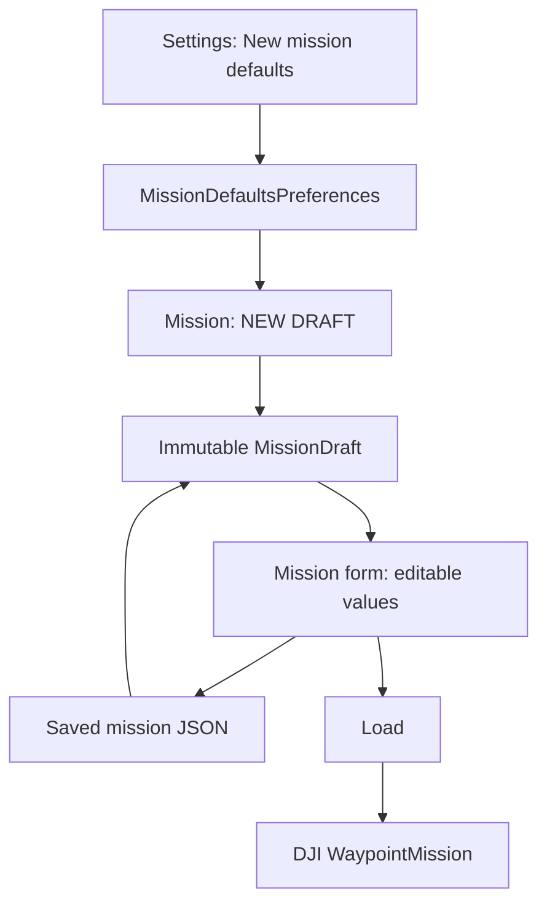

# New Mission Defaults in Settings

## Goal Capsule

- **Objective:** Let an operator start a new mission with their preferred, visible mission values without silently changing an existing route.
- **Means:** Persist an app-local `New mission defaults` profile, apply it only through an explicit New Draft action, and carry the selected heading mode through the local draft to the DJI waypoint builder. (KTD1, KTD2)
- **Authority:** The Mission Planner remains authoritative for every open draft. DJI remains authoritative for aircraft configuration and flight execution. Settings sends no DJI command.
- **Execution profile:** KISS and characterization-first. Extend the existing immutable draft, JSON library, pure JVM mission suite, and the current local Settings page; add no callback, service, transport field, or new dependency.
- **Stop conditions:** Stop and report if the installed MSDK does not support a chosen heading mode on the M210, or if a migration cannot retain existing saved drafts as `AUTO` safely.
- **Tail ownership:** Repository proof belongs to implementation. Tablet and aircraft behavior remain explicit operator validation; this work must not claim flight validation from a build.

---

## Product Contract

### Summary

Settings will gain one compact `NEW MISSION DEFAULTS` section. It stores default altitude, speed, heading mode, and finish action for future drafts only. A new explicit `NEW DRAFT` action in Mission creates an empty route from those values. Saved, opened, edited, loaded, uploaded, and executing missions retain their own values.

### Problem Frame

An operator needs to prepare common mission values once, then begin a fresh route quickly in the field. They must never discover that changing Settings rewrote an already planned route or a mission that was sent to the aircraft.

### Requirements

- R1. Settings exposes app-local defaults for altitude, speed, heading mode, and finish action under the clear label `NEW MISSION DEFAULTS`.
- R2. Default values are validated using the same altitude and speed limits as mission drafting, and an invalid save preserves the previous valid profile.
- R3. The only application point is an explicit `NEW DRAFT` action in Mission. It creates an empty route with the saved defaults and the standard untitled local name; it does not call DJI.
- R4. Opening a saved mission, editing the current draft, or returning to Mission preserves that draft's altitude, speed, heading, and finish action regardless of later Settings changes.
- R5. Heading mode becomes a first-class, visible and editable field of a mission draft. The supported initial set is `AUTO`, `INITIAL DIRECTION`, and `REMOTE CONTROLLER`; per-waypoint and point-of-interest heading are out of scope.
- R6. A saved/imported legacy mission without heading data opens safely as `AUTO`. New saves include the selected heading mode.
- R7. `LOAD` builds the DJI waypoint mission from the draft's heading mode. Defaults never bypass existing preflight, Load, Upload, Start, pause, cancel, Home, or readiness gates.

### Acceptance Examples

- AE1. Given defaults of 40 m, 5 m/s, `REMOTE CONTROLLER`, and `RETURN AND LAND DJI HOME`, when the operator selects `NEW DRAFT`, the Mission form shows those values and no waypoint.
- AE2. Given an opened mission with 30 m and `AUTO`, when Settings changes the defaults to 40 m and `REMOTE CONTROLLER`, the opened mission remains 30 m and `AUTO` until the operator explicitly creates a new draft.
- AE3. Given a legacy saved draft with no heading field, when it is opened, it remains valid and displays `AUTO`.
- AE4. Given a new draft whose heading is changed in Mission before Load, when it is loaded, the DJI builder receives the Mission selection rather than the Settings default.

### Scope Boundaries

#### Deferred for Follow-Up Work

- DJI Flight Controller settings for RTH height, battery thresholds, landing protection, and failsafe behavior.
- Per-waypoint heading, point-of-interest modeling, gimbal actions, camera actions, terrain following, and survey patterns.
- Changing already saved routes in bulk after a default profile changes.

#### Outside This Product Identity

- Automatic takeoff, landing, RTH, mission commands, or any Settings action that changes an aircraft setting without an explicit separate operator command.
- New direct DJI callbacks, transport payloads, or Edge/ROS behavior.

### Sources

- DJI's waypoint documentation confirms that heading mode, finish action, and speed are explicit waypoint-mission builder properties: [DJI waypoint mission tutorial](https://developer.dji.com/mobile-sdk/documentation/android-tutorials/GSDemo-Gaode-Map.html).

---

## Planning Contract

### Current-State Findings

- `MissionDraft` already owns altitude, speed, and finish action, but has no heading mode. `WaypointMissionFactory` currently hard-codes DJI `AUTO`.
- `MissionMvpView` initializes from the latest saved draft or `MissionDraft.empty()`, so a visible `NEW DRAFT` boundary is required before Settings defaults can be applied truthfully.
- `MissionDraftJson` rejects versions other than the current v1 format. Adding a field therefore requires backward-compatible decoding rather than invalidating the existing library.
- `LowBatteryAdvisoryPreferences` demonstrates the desired small, app-local `SharedPreferences` pattern. The dependency-free `MissionPlannerUnitTestSuite` is already invoked by `scripts/test_android.sh`.

### Key Technical Decisions

- KTD1. **Defaults are a construction profile, not an observer or mutator.** (session-settled: user-directed — chosen over changing the current Mission form when Settings saves: Settings must affect only a new draft.) `MissionDefaults` is read only when `NEW DRAFT` is pressed. Governs R1-R4.
- KTD2. **Persist heading in the app-owned draft contract.** (session-settled: user-approved — chosen over keeping a hidden hard-coded DJI `AUTO`: the operator must see and edit the heading that will be loaded.) The app enum maps narrowly to supported DJI heading modes in the existing factory. Governs R5-R7.
- KTD3. **Keep legacy files readable with an `AUTO` fallback.** Decode both current saved v1 files and the new format; encode only the new heading-bearing format after a save. Governs R6.
- KTD4. **Keep Settings local and compact.** Reuse Android preferences and the existing Settings view. No transport, lifecycle, DjiDataHub, or Flight Controller changes are needed. Governs R1-R3, R7.

### High-Level Technical Design

### Sequencing

| Order | Unit | Why |
|---|---|---|
| 1 | U1 | Establish the local profile and heading domain contract before UI wiring. |
| 2 | U2 | Make saved drafts and the DJI builder carry heading safely. |
| 3 | U3 | Add the explicit Mission creation boundary and editable heading control. |
| 4 | U4 | Wire the Settings form to the profile after the domain contract exists. |
| 5 | U5 | Run regression and tablet-facing verification without claiming aircraft proof. |

### Assumptions

- `WaypointMissionHeadingMode.AUTO`, `USING_INITIAL_DIRECTION`, and `CONTROL_BY_REMOTE_CONTROLLER` are available in the installed MSDK V4.18 artifact; implementation confirms this at compile time and omits unsupported choices rather than substituting behavior.
- “New mission” means an explicit blank local draft. It does not delete or alter the current route until the operator activates the new action.

---

## Implementation Units

### U1. Define local defaults and heading domain contracts

- **Goal:** Introduce immutable, validated app-owned values for new-draft construction and heading selection.
- **Requirements:** R1, R2, R5.
- **Dependencies:** None.
- **Files:** `Sample Code/app/src/main/java/com/dji/sdk/sample/missionplanner/MissionDefaults.java` (new), `Sample Code/app/src/main/java/com/dji/sdk/sample/missionplanner/MissionDefaultsPreferences.java` (new), `Sample Code/app/src/main/java/com/dji/sdk/sample/missionplanner/MissionHeadingMode.java` (new), `Sample Code/app/src/main/java/com/dji/sdk/sample/missionplanner/MissionDraftValidator.java`, `Sample Code/app/src/test/java/com/dji/sdk/sample/missionplanner/MissionPlannerUnitTestSuite.java`.
- **Approach:**
  1. Give the profile the current safe app defaults: 30 m, 3 m/s, `AUTO`, and hover at final waypoint.
  2. Reuse `MissionDraftValidator` limits for altitude and speed so Settings cannot create a draft the planner rejects.
  3. Store only valid profile values through one app-local preferences seam; failed parsing/validation leaves the stored profile unchanged.
  4. Keep the heading enum independent from DJI types so unit tests remain JVM-only.
- **Patterns to follow:** `LowBatteryAdvisory` and `LowBatteryAdvisoryPreferences` for immutable validation plus local persistence; existing missionplanner value types for no-DJI domain models.
- **Test scenarios:**
  - Default profile is 30 m, 3 m/s, `AUTO`, and hover.
  - Values at the supported altitude/speed boundaries are accepted.
  - Non-finite/out-of-range values are rejected without producing a profile.
  - Each visible heading option round-trips through the local enum.
- **Verification:** The pure suite proves a valid profile can create a draft and invalid values cannot enter the construction path.

### U2. Extend the persisted draft and DJI translation safely

- **Goal:** Make heading part of the same immutable local draft that already owns altitude, speed, finish action, and waypoints.
- **Requirements:** R4-R7.
- **Dependencies:** U1.
- **Files:** `Sample Code/app/src/main/java/com/dji/sdk/sample/missionplanner/MissionDraft.java`, `Sample Code/app/src/main/java/com/dji/sdk/sample/missionplanner/MissionDraftJson.java`, `Sample Code/app/src/main/java/com/dji/sdk/sample/missionplanner/MissionRouteEditor.java`, `Sample Code/app/src/main/java/com/dji/sdk/sample/missionplanner/WaypointMissionFactory.java`, `Sample Code/app/src/test/java/com/dji/sdk/sample/missionplanner/MissionPlannerUnitTestSuite.java`.
- **Approach:**
  1. Add heading to `MissionDraft` construction, equality, route-preserving copies, and `empty()` only through a defaults-aware construction path.
  2. Add heading as an optional field to the existing app-owned v1 JSON and decode records without it as `AUTO`; reject unknown versions and unknown heading strings truthfully.
  3. Map only the selected app heading enum to its corresponding `WaypointMissionHeadingMode`; remove the current hard-coded `AUTO` factory choice.
  4. Preserve all existing finish action, maximum speed envelope, safe goto-first-waypoint, and RC-signal-loss behavior.
- **Patterns to follow:** `MissionDraftJson`'s explicit version gate and `WaypointMissionFactory` as the sole local-draft-to-DJI translation boundary.
- **Test scenarios:**
  - Draft equality changes when heading changes.
  - Editing waypoints preserves the selected heading.
  - New JSON round-trips all four defaultable fields.
  - A v1 JSON fixture without heading decodes as `AUTO`.
  - Unknown version or heading is rejected rather than guessed.
  - Each app heading maps to the expected DJI builder configuration.
- **Verification:** Existing saved drafts remain openable, and no heading value is hidden or hard-coded between form and builder.

### U3. Add an explicit new-draft flow and visible Mission heading control

- **Goal:** Give defaults one safe application point while keeping the current form authoritative after creation.
- **Requirements:** R3-R5, R7.
- **Dependencies:** U1, U2.
- **Files:** `Sample Code/app/src/main/res/layout/view_mission_mvp.xml`, `Sample Code/app/src/main/java/com/dji/sdk/sample/operate/MissionMvpView.java`, `Sample Code/app/src/test/java/com/dji/sdk/sample/missionplanner/MissionPlannerUnitTestSuite.java`.
- **Approach:**
  1. Add a compact, plainly named `NEW DRAFT` control near the mission library/save actions, with a confirmation only when unsaved local changes would be discarded.
  2. Build the new empty route from `MissionDefaultsPreferences`, reset selected waypoint and local Load/Upload evidence, then render the values into the existing editable controls.
  3. Add a labeled heading spinner beside the existing finish control and include its current selection in `currentDraft()`, saved-mission opening, and route-change handling.
  4. Do not alter the current `loadInitialDraft()` behavior for a saved/opened draft; the new action is the sole defaults application boundary.
- **Patterns to follow:** `openSavedDraft()` for safely replacing the visible draft and `routeChanged()` for invalidating only local mission evidence after a deliberate edit.
- **Test scenarios:**
  - New Draft constructs an empty route from persisted defaults.
  - A saved/opened draft is unchanged by a later defaults save.
  - Changing a heading in Mission survives save/open and is the value passed to Load.
  - New Draft clears local loaded/uploaded proof but makes no DJI call.
  - Discard confirmation retains the current draft when cancelled.
- **Verification:** Manual tablet smoke shows all four values visibly editable in Mission before Load; source review shows `NEW DRAFT` has no MissionControl or FlightController command path.

### U4. Integrate a compact Settings editor for future drafts

- **Goal:** Let an operator review and save the profile with no ambiguity about its scope.
- **Requirements:** R1, R2, R4.
- **Dependencies:** U1.
- **Files:** `Sample Code/app/src/main/java/com/dji/sdk/sample/operate/OperateMvpView.java`, `Sample Code/app/src/main/java/com/dji/sdk/sample/missionplanner/MissionDefaultsPreferences.java`, `Sample Code/app/src/test/java/com/dji/sdk/sample/missionplanner/MissionPlannerUnitTestSuite.java`.
- **Approach:**
  1. Add a `NEW MISSION DEFAULTS` section below the existing landing-advisory setting with altitude, speed, heading, finish action, validation feedback, and one local save action.
  2. Display the statement `Applied only when you select NEW DRAFT. Existing missions are unchanged.` next to the save control.
  3. Retain the currently stored valid values if the operator enters invalid text; do not partially save a profile.
  4. Keep existing landing-advisory behavior and visual hierarchy unchanged.
- **Patterns to follow:** `createSettingsPage()` and `LowBatteryAdvisoryPreferences.saveThresholdPercent()` for explicit local save/rejection feedback.
- **Test scenarios:**
  - Saving a complete valid profile makes it available to the new-draft factory.
  - Invalid altitude, speed, or malformed numeric input does not overwrite prior settings.
  - Saving defaults does not mutate an existing `MissionDraft` instance.
  - Settings has no DJI API or transport sender reference.
- **Verification:** Reopening Settings displays the persisted profile, while a previously opened Mission still displays its own values.

### U5. Verify regression boundaries and prepare field checks

- **Goal:** Prove local behavior and make the field test unambiguous without treating builds as flight proof.
- **Requirements:** R1-R7, AE1-AE4.
- **Dependencies:** U1-U4.
- **Files:** `Sample Code/app/src/test/java/com/dji/sdk/sample/missionplanner/MissionPlannerUnitTestSuite.java`, `scripts/test_android.sh` only if a newly added dependency-free suite needs invocation, `docs/README.md` only if the current operator guide lacks the New Draft behavior.
- **Approach:** Preserve existing default constructors at each call site intentionally, add backward-compatibility fixtures, and audit the final diff for accidental DJI configuration or command calls.
- **Patterns to follow:** Existing dependency-free JVM suite execution in `scripts/test_android.sh` and callback-ownership verification.
- **Test scenarios:**
  - Existing mission planner, readiness, and transport tests still pass.
  - Legacy mission JSON opens as `AUTO` and new JSON retains selected heading.
  - New Draft does not send Load, Upload, Start, pause, cancel, RTH, or Home commands.
  - An operator can change every initial default in Mission before the normal preflight/Load/Upload flow.
- **Verification:** Run the Android test/build/APK/callback-ownership gates. On the tablet, create a new draft, edit it, save/open it, and visually confirm values; only with explicit operator authorization, load a harmless hardware mission and verify the selected heading appears in DJI behavior.

---

## Verification Contract

| Gate | Evidence |
|---|---|
| Mission domain suite | Defaults validation, legacy JSON fallback, heading persistence, and builder mapping pass. |
| Existing regression suites | Mission readiness, transport diagnostics, and callback ownership remain green. |
| Android build | `scripts/test_android.sh --offline`, `scripts/build_android.sh :app:assembleDebug`, `scripts/verify_apk.sh`, and `scripts/verify_dji_callback_ownership.sh` pass. |
| Tablet smoke | Settings persistence, New Draft construction, opened-draft isolation, and visible heading selection are verified without flight commands. |
| Controlled aircraft check | With explicit authorization, operator validates the selected heading mode and normal Load/Upload behavior on the actual M210. |

## Definition of Done

- Settings stores only valid New Mission Defaults for altitude, speed, heading, and finish action.
- Defaults apply only after an explicit `NEW DRAFT` action.
- Existing drafts and missions are never rewritten by Settings.
- Heading is visible, editable, saved, backward-compatible, and passed to the DJI waypoint builder.
- Legacy saved drafts remain readable as `AUTO`.
- No default-setting or new-draft path sends a DJI command, changes transport, or adds a callback owner.
- Repository gates pass and the tablet/aircraft validation checklist is ready; real-flight success is not claimed beforehand.
