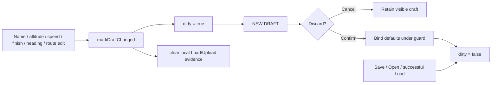

# Restore Mission Draft Integrity and Android Runtime Proof

## Goal Capsule

- **Objective:** Prevent `NEW DRAFT` from silently discarding any edited mission field, and prove the new local defaults and heading JSON contracts on Android rather than only through JVM stubs.
- **Means:** Make all Mission form edits participate in one conservative dirty-state path; add narrow Android instrumentation tests for SharedPreferences and `org.json`; preserve all existing DJI command and callback boundaries.
- **Authority:** This corrects the prior New Mission Defaults plan only. It does not change the mission model, Settings semantics, transport, DjiDataHub, or flight-control behavior.
- **Stop conditions:** Stop and report if the available Android test runner cannot be added offline without changing the legacy dependency baseline, or if an instrumentation test would need a connected aircraft/Cendence.

## Product Contract

### Requirements

- R1. Editing the mission name, altitude, speed, finish action, heading mode, or route marks the visible draft as locally changed before it can be replaced.
- R2. Selecting `NEW DRAFT` after any local change shows the existing discard confirmation. Cancelling retains every visible value, route point, and Load/Upload evidence state.
- R3. A successful Save, Open Saved Mission, New Draft, or successful Load establishes a clean local state; programmatic control population must not create a false dirty state.
- R4. Editing a loaded draft immediately prevents accidental reuse of prior local Load/Upload evidence, while the existing `requireCurrentLoadedDraft()` equality gate remains the final safety backstop.
- R5. `MissionDefaultsPreferences` persists a valid Android `SharedPreferences` round trip, and `MissionDraftJson` decodes legacy heading-less JSON as `AUTO` while retaining a newly selected heading after encode/decode.
- R6. The correction does not add DJI callbacks, send a DJI command from Settings or `NEW DRAFT`, alter transport, or change the current manual mission command gates.

### Acceptance Examples

- AE1. Given a saved route, when the operator changes only its name or heading and taps `NEW DRAFT`, the discard dialog appears; CANCEL leaves the edited form untouched.
- AE2. Given the same edits, when the operator confirms `NEW DRAFT`, the route becomes empty and the saved local defaults appear.
- AE3. Given a loaded mission, when altitude, speed, finish, heading, name, or a waypoint changes, Upload and Start require a fresh Load; no stale evidence is presented as valid.
- AE4. Given valid defaults saved on Android, when a new `MissionDefaultsPreferences` instance is created, it reads exactly the saved profile.
- AE5. Given app-owned legacy JSON without `heading_mode`, decode produces `AUTO`; a newly encoded `REMOTE_CONTROLLER` draft decodes as `REMOTE_CONTROLLER` on Android.

### Scope Boundaries

- Do not introduce automatic flight actions, alter `LOAD`/`UPLOAD`/`START` behavior, or issue any DJI command while binding form state.
- Do not migrate the whole Mission UI to a new architecture or add a general reactive framework.
- Do not make an aircraft or Cendence a prerequisite for local instrumentation tests.
- Do not claim tablet visual or aircraft validation from automated tests alone.

## Planning Contract

### Current-State Findings

- `MissionMvpView.routeChanged()` sets `draftDirty`, clears mission evidence, and refreshes the UI, but it is called only by waypoint edits.
- Name, altitude, speed, finish, and heading controls currently have no common edit listener. Altitude and speed only refresh on focus loss, so `NEW DRAFT` can bypass its confirmation after a non-route edit.
- `requireCurrentLoadedDraft()` still compares the whole visible `MissionDraft` with `loadedDraft`, so Upload/Start are safely blocked after a changed form; the missing behavior is truthful local-change state and confirmation.
- The existing planner tests are dependency-free JVM tests. Android's stubbed `org.json` prevents them from proving the actual JSON runtime; there is no `androidTest` source set or test runner dependency yet.

### Key Technical Decisions

- KTD1. **Use one conservative form-edit path.** A user edit marks the draft dirty until Save, Open, New Draft, or successful Load resets it; changing a value back to its former text may still show confirmation. This is intentionally safer than trying to infer semantic equality from partially typed or invalid form values.
- KTD2. **Suppress listener effects only while programmatically binding a whole draft.** A small `bindingDraft` guard prevents Open/New initialization from marking a clean draft dirty, without suppressing real operator interaction.
- KTD3. **Keep the existing whole-draft equality check.** Dirty state gives timely UI and discard protection; equality remains the authoritative last check before Upload/Start.
- KTD4. **Add only the minimum Android test harness.** Use AndroidX instrumentation for Android-only `SharedPreferences` and `org.json` behavior. Keep model and state logic in the present JVM suite.

### High-Level Design

## Implementation Units

### U1. Centralize editable-form dirty handling

- **Goal:** Ensure every Mission form edit uses the same non-command local state transition.
- **Requirements:** R1-R4, R6.
- **Files:**
  - `Sample Code/app/src/main/java/com/dji/sdk/sample/operate/MissionMvpView.java`
  - `Sample Code/app/src/test/java/com/dji/sdk/sample/missionplanner/MissionPlannerUnitTestSuite.java`
- **Approach:**
  1. Extract the current `routeChanged()` state mutation into a reusable internal method that clears local mission evidence, marks dirty, and refreshes without replacing the operator's current status text on each keystroke.
  2. Register guarded change listeners for name, altitude, speed, finish, and heading. Route editing continues through the same state mutation.
  3. Add a narrow binding guard around constructor initialization and complete visible-draft replacement in `replaceWithNewDraft()` and `openSavedDraft()`.
  4. Keep Save and successful Load as clean-state boundaries; failed validation or failed Load must remain dirty.
- **Tests:** Add a small dependency-free state helper only if needed to characterize clean/edited/reset transitions. Do not fake Android widgets in JVM tests.

### U2. Preserve current safety gates while correcting UX state

- **Goal:** Ensure early evidence invalidation complements rather than weakens existing Upload/Start protection.
- **Requirements:** R2-R4, R6.
- **Files:**
  - `Sample Code/app/src/main/java/com/dji/sdk/sample/operate/MissionMvpView.java`
  - `Sample Code/app/src/test/java/com/dji/sdk/sample/missionplanner/MissionPlannerUnitTestSuite.java`
- **Approach:**
  1. Verify `NEW DRAFT` reads the dirty flag after every form edit and shows the existing confirmation before calling `replaceWithNewDraft()`.
  2. Preserve `loadedDraft` comparison in `requireCurrentLoadedDraft()` exactly as the final gate.
  3. Confirm all programmatic binding paths reset dirty only after values and route have been applied, so a listener cannot race a clean reset.
  4. Add pure tests for evidence invalidation and clean/reset semantics where the extracted helper makes this observable.
- **Regression checks:** Route edits, loaded-draft mismatch, reconnect invalidation, and existing preflight gates must retain their present behavior.

### U3. Add Android-only persistence and JSON contract tests

- **Goal:** Exercise the code paths that cannot run under the JVM's Android stubs.
- **Requirements:** R5, R6.
- **Files:**
  - `Sample Code/app/build.gradle`
  - `Sample Code/app/src/androidTest/java/com/dji/sdk/sample/missionplanner/MissionDefaultsPreferencesInstrumentedTest.java` (new)
  - `Sample Code/app/src/androidTest/java/com/dji/sdk/sample/missionplanner/MissionDraftJsonInstrumentedTest.java` (new)
- **Approach:**
  1. Add the smallest compatible AndroidX test runner/JUnit dependencies and declare the instrumentation runner; do not upgrade AGP, Kotlin, or DJI dependencies.
  2. Isolate preferences with setup/teardown so tests cannot alter an operator's normal local profile.
  3. Test valid preference save/load, constructor-rejected invalid input leaving the prior saved profile intact, legacy JSON `AUTO` fallback, and selected-heading JSON round trip.
  4. Keep all tests local: no DJI registration, hardware product, network, map, or transport is required.
- **Stop condition:** If the legacy Gradle environment cannot resolve these already-compatible dependencies from its configured repositories, stop before introducing an alternative test framework; report the exact resolution failure.

### U4. Verify, smoke-test, and preserve delivery state

- **Goal:** Prove local behavior, separate device proof, and ensure no existing implementation file is omitted from the eventual commit.
- **Requirements:** R1-R6.
- **Files:**
  - `scripts/test_android.sh` only if it must invoke the new Android test task
  - existing mission-default implementation files and this plan, for staging review only
- **Local verification:**
  1. Run the JVM mission suite and all existing Android unit suites.
  2. Build debug APK and Android test APK; run instrumentation tests on a connected tablet only when the user authorizes device interaction.
  3. Run `scripts/verify_dji_callback_ownership.sh`, `git diff --check`, and inspect the diff for unintended `MissionControl`, Flight Controller, transport, or callback additions.
  4. Before any commit, explicitly review `git status --short` and stage every intended new defaults source file plus the plan; do not stage unrelated work.
- **Manual tablet smoke checklist:**
  1. Set visible defaults in Settings, save, leave and reopen Settings to confirm persistence.
  2. In Mission, create a new draft and verify the values and empty route.
  3. Independently edit name, altitude, speed, finish, and heading; after each, tap `NEW DRAFT`, choose CANCEL, and verify no value changes.
  4. Confirm `NEW DRAFT` once and verify the default profile replaces the form only after confirmation.
  5. With no aircraft required, verify no crash. With aircraft only under separate explicit authorization, verify a changed loaded draft requires a fresh Load before Upload/Start.

## Sequencing

| Order | Unit | Reason |
|---|---|---|
| 1 | U1 | Establish a single correct local-change state transition. |
| 2 | U2 | Verify confirmations and safety evidence use that transition. |
| 3 | U3 | Add Android proof for the two runtime-only contracts. |
| 4 | U4 | Run regression gates and controlled tablet validation. |

## Verification Contract

- Existing `scripts/test_android.sh --offline` remains green.
- New JVM tests prove dirty/reset behavior if a pure helper is introduced.
- New Android instrumentation tests prove preferences and JSON behavior on the Android runtime.
- `scripts/build_android.sh :app:assembleDebug`, `scripts/verify_apk.sh`, and `scripts/verify_dji_callback_ownership.sh` pass.
- The manual tablet checklist passes before reporting the correction end-to-end complete.

## Definition of Done

- Any user edit to Mission's name, altitude, speed, finish action, heading mode, or route is protected by the `NEW DRAFT` confirmation.
- Clean-state binding paths do not cause a false warning or invalidate a newly loaded/saved draft.
- Existing Load/Upload/Start and DJI callback ownership behavior remains unchanged.
- Android tests cover real `SharedPreferences` and `org.json` behavior for the new defaults contract.
- The complete intended defaults feature is visible in `git status` and ready for a deliberate, scoped commit.
