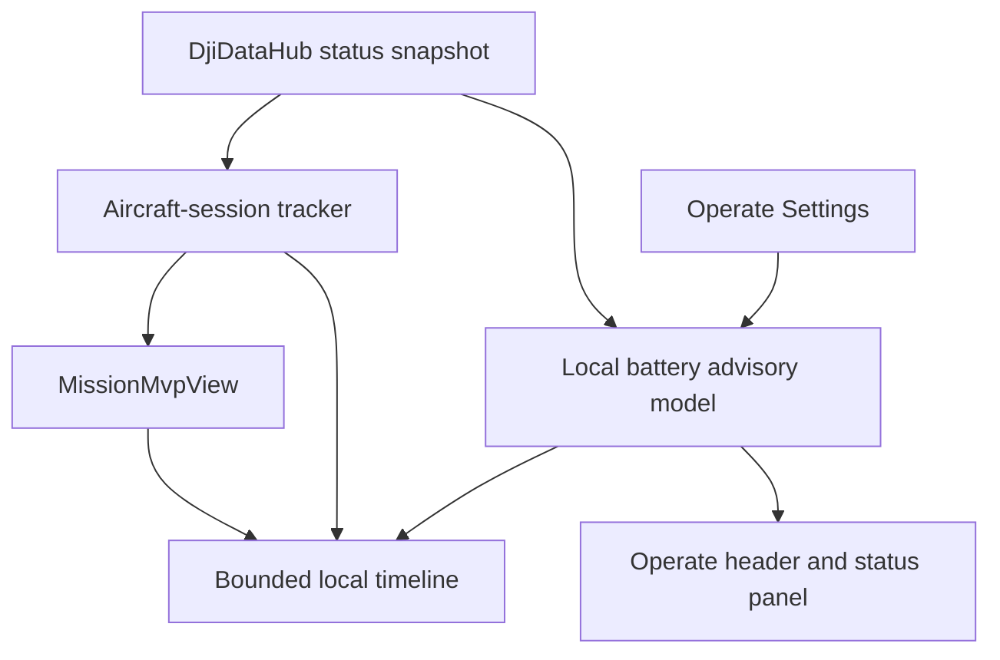

# Mission Reliability and Configurable Low-Battery Landing Alert

## Goal Capsule

- **Objective:** Make the Mission workflow truthful across reconnects, safe on Android callback threads, understandable when aircraft mission readback is unavailable, and explicit about when the operator should land for low aircraft battery.
- **Means:** Correct the Mission state lifecycle, finish the local-boundary identity and timeline coverage gaps, and add one local persisted battery-warning preference to the existing Operate Settings surface.
- **Authority:** DJI and the Cendence remain authoritative for aircraft battery protections, RTH, landing protection, and flight commands. The app only presents an operator warning; it must never start RTH, land, cancel a mission, or alter DJI battery thresholds automatically.
- **Execution profile:** Characterization-first and KISS. Reuse `DjiDataHub`, `FlightReadinessStore`, `OperateMvpView`, and existing bounded diagnostics. Do not add a DJI setter callback, service, or Android-to-Edge field.
- **Stop conditions:** Stop if MSDK V4 evidence shows a planned callback does not have a reliable main-thread delivery contract, if the requested local threshold conflicts with DJI battery protection semantics, or if a design would falsely claim an aircraft-confirmed mission after reconnect.
- **Tail ownership:** Unit/build proof completes here. Tablet and aircraft validation remains an explicit operator test, including a controlled low-battery observation only when the aircraft is safe to operate.

---

## Product Contract

### Summary

The current Mission screen has the right local editing primitives, route estimates, advisory boundaries, and a bounded session log. It still retains local upload evidence over an aircraft reconnect, updates some UI from mission callbacks without a guaranteed UI-thread handoff, cannot turn Download into a usable remote reconciliation result, and gives individually indistinguishable names to boundaries. The current battery state is visible and participates in readiness, but the alert thresholds are fixed and Settings cannot configure a landing warning.

### Problem Frame

A field operator must never be able to mistake an upload from a prior aircraft connection for current aircraft mission evidence. They also need an actionable low-battery indication that says to land while preserving DJI's native authority and avoiding automatic flight actions. Diagnostics and alerts must not make the live UI unstable or add another competing callback path.

### Requirements

**Mission truth and UI safety**

- R1. A loss or change of the aircraft connection invalidates app-local `loaded` and `uploaded this session` evidence before Upload or Start can proceed again. The local draft remains intact.
- R2. Every DJI mission completion callback that changes a visible Mission view is marshalled to the Android UI thread before touching view state.
- R3. Download remains explicit and must not overwrite a local draft. When the SDK does not provide a complete route readback, the UI must retain `REMOTE UNKNOWN` and state that limitation plainly.

**Boundary and session evidence**

- R4. The operator can give every local boundary an individual name, and that name appears in the boundary list and warning text. Changing a name or geometry must not affect other profile entries.
- R5. Timeline tests cover all event sources added by the Mission reliability work: Home request/result, Mission request/result, link-session reset, and one transport-health transition. Local NDJSON remains valid and excludes media and secrets.

**Low-battery landing advisory**

- R6. Operate shows a distinct, live aircraft-battery warning when either installed aircraft battery is at or below the configured landing-advisory threshold. The warning says to land soon and identifies the limiting battery/value.
- R7. The landing-advisory threshold is local app configuration, persists across app restart, defaults to the current DJI-aligned low-battery warning value of 30%, and cannot be set below the critical 15% threshold or above 100%.
- R8. At or below 15%, the display uses critical wording such as `LAND NOW`; above 15% and at/below the configured threshold, it uses `LAND SOON`. Missing or stale battery data is shown as unavailable/stale rather than healthy.
- R9. The preference affects only app-side presentation/readiness explanation. It must not call DJI configuration setters, alter the SDK's own low-battery behavior, emit transport data, or issue any flight command.

### Key Decisions

- KTD1. **Invalidate upload evidence on aircraft-session change.** (session-settled: user-directed — chosen over retaining a possibly stale upload flag: an aircraft reconnect must never look like proof that the current aircraft still has the local mission.) Governs R1.
- KTD2. **Keep Download truthful but non-destructive.** The app exposes the SDK request and records its result, but reports `REMOTE UNKNOWN` whenever a complete remote route cannot be proven. Governs R3.
- KTD3. **Use a local landing advisory, not a command.** (session-settled: user-directed — chosen over automatic landing: the user wants a configurable warning while DJI remains responsible for aircraft protection and every flight action stays explicit.) Governs R6, R7, R8, R9.

### Acceptance Examples

- AE1. Given a successful upload followed by aircraft disconnect/reconnect, the Mission screen displays `LOCAL DRAFT · REMOTE UNKNOWN`; Upload and Start require a fresh Load and Upload.
- AE2. Given a 24% B1 and a 30% configured threshold, Operate visibly shows `LAND SOON — B1 24%` without starting any flight action.
- AE3. Given the threshold setting is edited to `14`, Settings rejects it and preserves the previous valid local value; setting it to `15` is accepted.
- AE4. Given two exclusion circles in one profile, the operator can name them `Crane` and `Road`, edit only `Road`, and see the matching name in a route warning.

### Scope Boundaries

#### Deferred

- Full aircraft mission route reconstruction or replacement after DJI Download, until MSDK V4 hardware evidence proves the available readback content and semantics.
- DJI Flight Controller battery-threshold configuration, automatic RTH/landing policy, and battery-reserve route feasibility estimation.
- Audio/haptic alerts, Edge/ROS battery transport, offline maps, and new safety automation.

#### Outside This Plan

- Automatic takeoff, landing, RTH, mission start/pause/cancel, gimbal movement, or virtual-stick control.
- A second direct recurring DJI callback owner or a new transport protocol field.

---

## Planning Contract

### Current-State Findings

- `MissionMvpView` sets `uploaded` after Upload and uses it to permit Start, but receives only flight-state snapshots and does not invalidate it on aircraft link change.
- Upload and Start completion callbacks call `status.setText` directly; Download and Pause/Cancel already demonstrate the safer `post(...)` UI pattern.
- Download intentionally reports remote content as SDK-limited, so it cannot currently reconcile an idle aircraft mission.
- Local boundaries are immutable and validated, but `saveBoundary(...)` supplies the type string as the boundary name; the editor has no name field.
- `SessionTimeline` is bounded and thread-safe, while its tests only characterize capacity and source retention rather than current producer events or encoded NDJSON.
- `DjiDataHub.StatusSnapshot` already holds B1/B2/remote-controller battery state and timestamps. `FlightReadinessModel` and `OperateStatusModel` hard-code critical/low thresholds at 15%/30%. `OperateMvpView` has a Settings destination but currently renders placeholder text.

### High-Level Technical Design

### Sequencing

| Order | Unit | Why it must come now |
|---|---|---|
| 1 | U1 Characterize current mission/session and battery contracts | Locks the existing behavior before changing safety-visible state. |
| 2 | U2 Make mission lifecycle thread-safe and reconnect-safe | Removes the only route that can make stale upload evidence actionable. |
| 3 | U3 Clarify Download and complete boundary identity | Builds on truthful lifecycle state without changing aircraft data. |
| 4 | U4 Add configurable local low-battery landing advisory | Reuses known hub state and the existing Settings destination after critical mission safety corrections. |
| 5 | U5 Complete timeline/NDJSON coverage and regression verification | Verifies all new transitions and proves no callback or transport regression. |

### Key Technical Decisions

- KTD4. **Use one app-owned aircraft-session generation.** Derive it from existing `DjiDataHub.StatusSnapshot.aircraftConnected` notifications and compare it in `MissionMvpView`; do not subscribe to another DJI setter callback.
- KTD5. **Do not call `WaypointMissionOperator.downloadMission` as reconciliation unless its returned SDK evidence can be represented truthfully.** Keep the button explicit and capability-limited.
- KTD6. **Use a small immutable local preference/model for the landing-advisory threshold.** Clamp persistence and display through a pure reducer so the UI cannot send an unsafe value to DJI.
- KTD7. **Use the lower valid aircraft battery as the advisory source.** B1/B2 disagreement must be visible; Cendence battery remains a separate readiness/status concern and cannot trigger a drone-landing advisory.

### Risks and Mitigations

| Risk | Mitigation |
|---|---|
| A reconnect invalidates valid local draft data. | Invalidate only loaded/uploaded evidence; retain the immutable draft and make the next explicit Load straightforward. |
| DJI callback thread differs by device/SDK path. | Marshal every mission completion result through `post(...)`; unit-test state reducers, then tablet-smoke the UI. |
| Operator interprets `LAND SOON` as an automatic action. | Label it as app advisory, keep DJI authority language in Settings/status, and add no flight command path. |
| Invalid preference corrupts the threshold or creates a false healthy state. | Validate `15..100`, preserve the previous value on failed save, and expose stale/unavailable independently of percent. |
| Timeline work adds log pressure. | Emit only state transitions, reuse the current bounded queue, and assert overflow remains non-blocking. |

---

## Implementation Units

### U1. Characterize the existing contracts before changing them

- **Goal:** Create regression tests around Mission upload lifecycle, callback-to-UI handoff seams, current battery threshold classification, and preference validation before product behavior changes.
- **Requirements:** R1-R9.
- **Files:** `Sample Code/app/src/test/java/com/dji/sdk/sample/missionplanner/MissionPlannerUnitTestSuite.java`, `Sample Code/app/src/test/java/com/dji/sdk/sample/operate/FlightReadinessModelTest.java`, `Sample Code/app/src/test/java/com/dji/sdk/sample/transport/diagnostics/TelemetryDiagnosticsUnitTestSuite.java`.
- **Patterns:** Existing dependency-free executable suites and pure `FlightReadinessModel` input/output checks.
- **Test scenarios:** Upload evidence is visible before a simulated session reset; no threshold below 15 is accepted by the new pure configuration model; B1/B2 minimum selection is deterministic; stale/unavailable is not classified healthy.
- **Verification:** The tests fail for the missing behavior before U2-U4 change production code.

### U2. Make Mission lifecycle reconnect-safe and UI-thread-safe

- **Goal:** Ensure an aircraft-session change invalidates only local proof and all mission completion UI changes run on the view thread.
- **Requirements:** R1, R2.
- **Files:** `Sample Code/app/src/main/java/com/dji/sdk/sample/operate/MissionMvpView.java`, `Sample Code/app/src/main/java/com/dji/sdk/sample/operate/FlightReadinessStore.java` or a new small session-generation seam under `operate/`, `Sample Code/app/src/main/java/com/dji/sdk/sample/missionplanner/MissionSyncState.java`, focused mission/readiness tests.
- **Approach:** Expose a monotonic aircraft-session identity from the existing store or status listener. `MissionMvpView` records the session that produced its successful Load/Upload; a later session mismatch clears `loadedMission`, `loadedDraft`, and `uploaded`, then rerenders `LOCAL DRAFT · REMOTE UNKNOWN`. Wrap Upload and Start result handling in `post(...)`, preserving their current explicit command calls and timeline events.
- **Test scenarios:** Disconnect/reconnect invalidates upload evidence; a route edit still invalidates it; an unchanged connected session does not; a result handler updates state through the UI handoff seam; Start remains impossible without a fresh Upload.
- **Verification:** Mission unit suite, readiness suite, callback ownership check, and source review show no new DJI callback setter or automatic command.

### U3. Keep remote Mission evidence and boundaries identifiable

- **Goal:** Make the Download limitation explicit and allow each local boundary to be named and edited independently.
- **Requirements:** R3, R4.
- **Files:** `Sample Code/app/src/main/java/com/dji/sdk/sample/operate/MissionMvpView.java`, `Sample Code/app/src/main/java/com/dji/sdk/sample/missionplanner/PlanningBoundary.java`, `Sample Code/app/src/main/java/com/dji/sdk/sample/missionplanner/PlanningBoundaryProfile.java`, `Sample Code/app/src/test/java/com/dji/sdk/sample/missionplanner/MissionPlannerUnitTestSuite.java`.
- **Approach:** Preserve the explicit Download action but render a capability-specific explanation before/after request; never map a request result to remote route contents. Add a boundary-name field to create/edit dialogs, validate non-empty normalized names, and preserve the selected profile/index replacement behavior.
- **Test scenarios:** Download failure/success leaves local draft untouched and remote state unknown when content is unavailable; duplicate profile boundaries retain their distinct names; editing one named boundary preserves all other entries and warnings cite the edited name.
- **Verification:** No Download path calls Load/Upload/Start or changes waypoint geometry; invalid name/geometry preserves the prior persisted profile.

### U4. Add a local configurable aircraft low-battery landing advisory

- **Goal:** Give the operator a clear live `LAND SOON`/`LAND NOW` advisory with a safe local threshold setting.
- **Requirements:** R6-R9.
- **Files:** `Sample Code/app/src/main/java/com/dji/sdk/sample/operate/LowBatteryAdvisory.java` (new pure model), `Sample Code/app/src/main/java/com/dji/sdk/sample/operate/LowBatteryAdvisoryPreferences.java` (new local persistence seam), `Sample Code/app/src/main/java/com/dji/sdk/sample/operate/OperateMvpView.java`, `Sample Code/app/src/main/java/com/dji/sdk/sample/operate/FlightReadinessStore.java`, `Sample Code/app/src/main/java/com/dji/sdk/sample/operate/FlightReadinessModel.java`, `Sample Code/app/src/main/res/layout/view_operate_mvp.xml` or existing Operate panel resources, and focused operate tests.
- **Approach:** Default to 30%, retain DJI-aligned critical handling at 15%, validate the local integer range `15..100`, and preserve the previous saved value after invalid input. Derive the advisory from the lower fresh B1/B2 percent. Render an always-visible compact state in the existing top/status presentation and a Settings row that opens a local numeric editor with helper text: `App advisory only — DJI battery protection is unchanged.` Record only severity transitions in the existing session timeline.
- **Test scenarios:** 31% at threshold 30 is clear; 30%/24% is `LAND SOON`; 15%/14% is `LAND NOW`; B1 55/B2 24 identifies B2; stale/missing battery produces unavailable/stale; 14% configuration is rejected; restart restores a saved valid threshold; no DJI configuration or command API is called.
- **Verification:** Existing UI shows the active threshold and active limiting battery; source scan proves settings persistence does not reference a DJI setter or transport sender.

### U5. Complete evidence coverage and run the consolidated regression gates

- **Goal:** Prove the fixed behavior without claiming hardware validation.
- **Requirements:** R1-R9.
- **Files:** `Sample Code/app/src/main/java/com/dji/sdk/sample/operate/SessionTimeline.java`, `Sample Code/app/src/main/java/com/dji/sdk/sample/operate/SessionTimelineStore.java`, `Sample Code/app/src/main/java/com/dji/sdk/sample/transport/TransportRuntime.java`, `Sample Code/app/src/main/java/com/dji/sdk/sample/transport/diagnostics/AsyncNdjsonDiagnosticWriter.java`, `Sample Code/app/src/main/java/com/dji/sdk/sample/transport/diagnostics/JsonEncoder.java`, existing operate/transport test suites, `scripts/test_android.sh` only if the new suite requires a runtime classpath adjustment.
- **Approach:** Add bounded tests for event ordering/source labels and valid encoded timeline records. Add only transition-level battery-advisory timeline events. Review the final diff for direct DJI callbacks, new UDP schema fields, raw media, or command calls.
- **Test scenarios:** Home request/result, Upload/Start result, aircraft-session delimiter, one degraded transport event, one low-battery severity transition, queue overflow, escaped NDJSON text, and no raw RTP/H.264 in timeline records.
- **Verification:** `scripts/test_android.sh --offline`, `scripts/build_android.sh :app:assembleDebug`, `scripts/verify_apk.sh`, `scripts/verify_dji_callback_ownership.sh`, `git diff --check`, plus final code review.

---

## Verification Contract

| Gate | Evidence |
|---|---|
| Pure model and mission lifecycle tests | Reconnect invalidation, UI handoff seams, boundary names, and advisory threshold/severity cases pass. |
| Timeline/diagnostics tests | Bounded ordering, source labels, valid JSON, and no raw media are proven. |
| Callback ownership | `scripts/verify_dji_callback_ownership.sh` passes with `DjiDataHub` still sole setter owner. |
| Android build | `scripts/test_android.sh --offline`, `scripts/build_android.sh :app:assembleDebug`, and `scripts/verify_apk.sh` pass. |
| Tablet test | Operator verifies reconnect -> fresh Load/Upload requirement, boundary naming, Settings persistence, and visible battery advisory. No aircraft command is issued by the warning itself. |
| Aircraft test | In a controlled flight with the operator's explicit authorization, compare app B1/B2 values with DJI/Cendence, observe warning at the selected threshold, and confirm no automatic landing/RTH is initiated by the app. |

## Definition of Done

- A reconnect cannot leave stale upload evidence usable for Start.
- Mission callbacks cannot update Android views outside the UI handoff path.
- Download remains explicit and never fabricates aircraft route certainty.
- Boundaries have independent names and preserve other profile entries during edits.
- Operate has a persisted local landing-advisory threshold with a strict minimum of 15%, default 30%, and clear `LAND SOON`/`LAND NOW` semantics.
- The advisory never triggers flight commands, DJI battery configuration, or new Edge transport fields.
- All repository verification gates pass and a tablet/aircraft test checklist is ready; hardware success is not claimed before the operator runs it.
