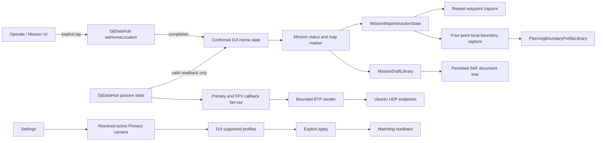

# Complete the Mission Field Workflow

## Goal Capsule

- **Objective:** Complete the Mission and Settings workflows that are currently partial, while preserving safe explicit aircraft control and the proven video/transport path.
- **Means:** Repair Home presentation, consolidate map modes, use a persisted SAF mission folder, and make payload profiles selected and verified from live DJI camera capability.
- **Authority:** Only the existing visible `SET DJI HOME`, mission, and `APPLY VIDEO SETTING` actions may call DJI commands. No automatic flight, landing, RTH, recording, or transport action is added.
- **Execution profile:** Characterize first, add focused tests for state/persistence/capability behavior, then prove the user flows on Tab S9 and props-off connected DJI hardware where required.
- **Stop conditions:** Stop and surface a blocker rather than guessing if the work needs a second DJI setter-callback owner, transport contract change, broad storage permission, boundary enforcement, or a hard-coded payload profile.

---

## Product Contract

### Summary

Finish the partially implemented operator workflow without widening aircraft authority: make DJI Home presentation trustworthy after an explicit command, complete map-based boundary capture, replace the preference-only draft library with a visible SAF-backed mission folder, and make Zenmuse video-profile settings capability-driven and readback-verified. Consolidate the already-added shell title, awake-screen, and batch-waypoint work through focused regression and tablet validation.

### Problem Frame

The current APK contains useful partial work, but several visible workflows stop before the operator can rely on them in the field:

- Mission can receive a successful `SET DJI HOME` completion yet still appear as `HOME UNAVAILABLE` in the Mission panel.
- Boundary capture stops after four taps without undo/review behavior required for a safe local-planning workflow.
- “Saved missions” remains a SharedPreferences library and only has preliminary folder-result handling; it neither shows an actual folder nor imports computer-copied JSON.
- Settings can query and set a camera profile, but it assumes camera index zero and declares success without verifying readback matches the requested pair.

The implementation must preserve the working Android-to-Edge transport, `DjiDataHub` as the only long-lived DJI callback owner, and all explicit operator-action boundaries.

### Scope Boundaries

In scope:

- Mission-shell title and foreground screen-awake regression proof.
- DJI Home presentation/reconciliation for the existing explicit `SET DJI HOME` action.
- Local-only named boundary capture from four map taps, including undo/cancel/review.
- Scoped Android document-tree storage for local mission JSON.
- Capability-driven connected-payload video resolution/frame-rate selection.
- Automated, tablet, and props-off device validation appropriate to each behavior.

Out of scope:

- Android-to-Edge protocol, RTP, video parsing, transport lifecycle, or `DjiDataHub` ownership changes.
- DJI geofencing, automatic boundary enforcement, automatic takeoff/landing/RTH, or automatic camera recording.
- Broad storage permissions, private `Android/data` paths, or presumed DJI Pilot file compatibility.
- Live-flight command testing unless the operator separately requests it.

---

### Requirements

- **R1:** The header names the active Operate-shell page, and the foreground Activity does not dim while monitoring.
- **R2:** After the existing explicit set-home command completes successfully, Mission immediately shows the confirmed DJI Home and map marker; a stale passive callback cannot erase it.
- **R3:** `ADD WAYPOINTS` remains a visible, cancellable repeat-entry map mode and cannot coexist with boundary capture.
- **R4:** A local boundary workflow is: choose/name profile, capture four positions, undo or cancel before confirmation, select inclusion/exclusion and circle/polygon, review, then explicitly save. It remains visibly local and non-enforced by DJI.
- **R5:** Saved mission files live in one user-selected, persisted SAF folder; the UI displays its real human-readable location and can list/load/save valid local JSON copied there from a computer.
- **R6:** Every camera profile shown in Settings is supported by the active Primary payload camera; a success state is shown only after matching DJI readback.
- **R7:** No change introduces a competing DJI setter callback, implicit aircraft command, transport modification, unbounded storage, or data loss on malformed mission files.
- **R8:** `DjiDataHub` remains the sole owner of all recurring DJI callbacks, including Primary and Secondary/FPV video feeds, physical video-source state, flight state, RTK, gimbal, batteries, Cendence/RC, and passive camera state. Operate, Mission, Settings, and Transport only fan out from the hub through bounded subscriptions.
- **R9:** When the app reports `video_socket_errors` or Ubuntu receives no video, the operator and diagnostics can distinguish feed, packet class, destination, local socket cause, callback/AU/RTP progression, and Edge reachability without logging raw video or changing the established ports/RTP contract without evidence.

---

## Planning Contract

### Key Technical Decisions

- KTD1. **Preserve `DjiDataHub` ownership for all telemetry and video.** `DjiDataHub` owns the primary/secondary `VideoFeed` listeners and physical-source listener as well as recurring state callbacks. It fans immutable callback data to the display and transport subscribers; those consumers may not register direct DJI feed/state callbacks or block the callback thread. Governs R7, R8.
- KTD2. **Confirmed Home is a local presentation bridge, not a replacement for DJI state.** Completion of the explicit command is enough to render immediate local confirmation; later valid DJI readback reconciles it, while invalid/absent passive state does not silently clear it. Governs R2.
- KTD3. **Boundaries are planning advisories only.** They neither alter DJI mission geometry nor prevent a command. UI wording must retain that distinction. Governs R4, R7.
- KTD4. **SAF is the storage boundary.** The user selects a document tree with persistable URI permission; the app shows the selected directory label and uses only that grant. Legacy preferences are retained until migration has been verified. Governs R5, R7.
- KTD5. **Camera profiles come from the actual Primary-camera selection.** No Zenmuse model/profile matrix is hard-coded and no arbitrary first camera is silently configured. Governs R6, R7.
- KTD6. **Proof levels stay explicit.** JVM/build success proves local logic; tablet proof verifies interaction; props-off connected hardware is required for DJI Home and camera claims. Governs R1-R7.
- KTD7. **Diagnose the existing video transport before changing it.** Keep UDP ports, RTP payload type, bounded queues, and no-decode/no-reencode architecture fixed while collecting bounded per-feed socket-failure evidence. A network or endpoint correction follows only the observed exception and end-to-end packet evidence. Governs R7, R8, R9.

---

## High-Level Technical Design

---

## Implementation Units

### U1. Characterize and repair immediate DJI Home presentation

**Goal:** Make a confirmed `SET DJI HOME` outcome visible immediately and durable across normal Mission rendering/recreation, without falsely inventing Home after a failed command.

**Requirements:** R2, R7, R8.

**Dependencies:** None.
**Files:** `Sample Code/app/src/main/java/com/dji/sdk/sample/operate/MissionMvpView.java`, `Sample Code/app/src/main/java/com/dji/sdk/sample/operate/ConfirmedDjiHomeState.java`, `Sample Code/app/src/main/java/com/dji/sdk/sample/djihub/DjiDataHub.java`, `Sample Code/app/src/test/java/com/dji/sdk/sample/operate/ConfirmedDjiHomeStateTest.java`, `Sample Code/app/src/test/java/com/dji/sdk/sample/transport/diagnostics/TelemetryDiagnosticsUnitTestSuite.java`.

**Approach:**

1. Trace the exact completion-to-render sequence and characterize the reported failure before changing it: command completion, state object, `renderConfirmedDjiHome`, passive state reconciliation, attach/recreate, and preflight.
2. Keep command completion as immediate presentation evidence, but make render ordering and main-thread delivery deterministic.
3. Reconcile only a valid authoritative Home readback; preserve a prior confirmed value through stale, absent, or unrelated flight-state updates.
4. Keep failed send/completion visible as an error without overwriting a previously confirmed Home.

**Patterns to follow:** Existing `DjiDataHub.setDjiHomeLocation`, `ConfirmedDjiHomeState`, and Mission’s existing explicit confirmation dialog.

**Test scenarios:**

- A successful completion immediately yields a visible available coordinate and map marker before passive readback.
- An absent or invalid later callback preserves the confirmed coordinate.
- A valid later DJI coordinate supersedes the local confirmation.
- A failed command preserves the prior confirmed state or remains unavailable, with an error.
- Mission recreation restores the hub-confirmed presentation but draft persistence alone never fabricates Home.

**Verification:** Focused state tests and full Android gates pass; with a props-off connected aircraft, operator sets Home at a waypoint, returns to Operate and Mission, and verifies status, marker, and preflight agree.

### U2. Complete mutually exclusive map modes and four-point boundary capture

**Goal:** Finish the existing map interaction work so repeated waypoint entry and boundary capture are clear, reversible, and safe for an operator planning at close zoom.

**Requirements:** R3, R4, R7, R8.

**Dependencies:** U1 is independent but should be complete before the final Mission usability pass.
**Files:** `Sample Code/app/src/main/java/com/dji/sdk/sample/missionplanner/MissionMapInteractionState.java`, `Sample Code/app/src/main/java/com/dji/sdk/sample/operate/MissionMvpView.java`, `Sample Code/app/src/main/java/com/dji/sdk/sample/missionplanner/map/MapLibreMissionMapView.java`, `Sample Code/app/src/main/res/layout/view_mission_mvp.xml`, `Sample Code/app/src/test/java/com/dji/sdk/sample/missionplanner/MissionPlannerUnitTestSuite.java`.

**Approach:**

1. Extend the single interaction-state model rather than adding booleans; every transition clears incompatible staged state and restores button/status text.
2. Preserve batch waypoint behavior, ordered rendering, dirty-state handling, and current no-command map taps.
3. Add `UNDO LAST` and `CANCEL` to staged boundary capture; neither may mutate the active persisted profile.
4. After the fourth point, present a compact review that explains the deterministic circle rule, selected inclusion/exclusion semantics, and local-only status before an explicit save.
5. Clear temporary markers and capture state on cancel, page detach, new draft, profile change, or successful save.

**Patterns to follow:** `MissionMapInteractionState`, `MapLibreMissionMapView.setBoundaryCapturePoints`, existing `PlanningBoundary` validation and profile persistence.

**Test scenarios:**

- Three repeat map taps in Add Waypoints append three numbered points; stopping prevents further edits.
- Starting boundary capture exits Add Waypoints and cannot append route points.
- Fewer than four boundary points cannot save; undo removes only the last temporary point.
- Cancel leaves the saved profile and route byte-for-byte unchanged.
- Four polygon points persist with type/name semantics; four circle points produce deterministic center/radius.
- Existing inclusion/exclusion warning evaluation still works after save/load.
- Page detach removes staged markers and returns to idle mode.

**Verification:** Mission planner tests and Android gates pass; tablet workflow creates each of the four kinds, uses undo/cancel, checks close-zoom marker visibility, and confirms all boundaries retain `NOT DJI ENFORCED` language.

### U3. Implement a durable SAF-backed local mission library

**Goal:** Replace the incomplete preference-only saved-mission experience with a single selected folder that is understandable, recoverable, and compatible with computer-copied local JSON.

**Requirements:** R5, R7, R8.

**Dependencies:** U2 only for the consolidated Mission UI validation; storage work itself is independent.
**Files:** `Sample Code/app/src/main/java/com/dji/sdk/sample/internal/controller/MainActivity.java`, `Sample Code/app/src/main/java/com/dji/sdk/sample/missionplanner/MissionDraftLibrary.java`, `Sample Code/app/src/main/java/com/dji/sdk/sample/missionplanner/MissionDraftJson.java`, new narrowly scoped folder preference/helper classes under `Sample Code/app/src/main/java/com/dji/sdk/sample/missionplanner/`, `Sample Code/app/src/main/java/com/dji/sdk/sample/operate/MissionMvpView.java`, `Sample Code/app/src/main/res/layout/view_mission_mvp.xml`, JVM and Android instrumentation tests under `Sample Code/app/src/test/java/com/dji/sdk/sample/missionplanner/` and `Sample Code/app/src/androidTest/java/com/dji/sdk/sample/missionplanner/`.

**Approach:**

1. Turn the preliminary activity-result event into a complete folder-selection flow using `ACTION_OPEN_DOCUMENT_TREE`, persistable read/write grants, and a persisted URI preference.
2. Present the actual selected folder name/path directly above the Mission save/library controls; when none is selected, show one compact setup action and an actionable unavailable message.
3. Make the library enumerate, decode, validate, atomically replace, and save local JSON files within the selected tree, keeping malformed files isolated from valid drafts.
4. Migrate valid legacy SharedPreferences drafts once only after successful folder write/read verification; retain legacy data until that success is established.
5. Remove the obsolete remote Download listener/wording as well as the button. Loading a local file must not call DJI; only existing explicit Load/Upload/Start actions retain their distinct meaning.

**Patterns to follow:** Existing `MissionDraftJson` validation, `MissionDraftLibrary` overwrite-by-name behavior, EventBus activity-to-view handoff, Android document-provider APIs.

**Test scenarios:**

- No selected folder gives a setup state without broad-storage permission.
- Selected folder URI survives Activity recreation and permission restoration.
- Valid JSON copied into the tree appears in Saved Missions and loads locally without DJI calls.
- Malformed, unreadable, or duplicate-name JSON leaves valid drafts intact and gives an actionable local error.
- Save, overwrite, and reload preserve all draft fields including heading and finish action.
- Successful migration retains legacy drafts; failed write or lost permission does not delete them.
- No `DOWNLOAD` button, listener, or remote-download wording remains in the Operate Mission path.

**Verification:** JVM and instrumentation coverage pass; on Tab S9, select a visible folder such as `Download/Matrice Missions`, copy a known JSON by MTP, reopen the library, load/edit/save it, and verify no broad file-access permission is requested.

### U4. Harden capability-driven Primary-camera video profiles

**Goal:** Show and apply only genuine resolution/frame-rate pairs for the active Primary payload camera, with truthful success/failure feedback.

**Requirements:** R6, R7, R8.

**Dependencies:** None.
**Files:** `Sample Code/app/src/main/java/com/dji/sdk/sample/operate/OperateMvpView.java`, new narrow camera-profile resolver/model under `Sample Code/app/src/main/java/com/dji/sdk/sample/operate/` or `Sample Code/app/src/main/java/com/dji/sdk/sample/djihub/`, relevant source-selection code under `Sample Code/app/src/main/java/com/dji/sdk/sample/demo/camera/`, `Sample Code/app/src/test/java/com/dji/sdk/sample/operate/`.

**Approach:**

1. Trace the actual camera associated with the Primary video source and isolate selection in a small resolver; do not use `getCameras().get(0)` as product behavior.
2. Query that camera’s current profile and advertised combined resolution/frame-rate range; render unavailable state for disconnected product, absent camera, null capabilities, or no profiles.
3. Keep one combined selector and one explicit apply action; block duplicate applies while pending.
4. After a successful setter callback, re-query and compare to the requested profile. Only equality yields `APPLIED`; a mismatched or unavailable readback is a visible non-success state retaining the last known profile.
5. Keep this one-shot explicit camera action separate from `DjiDataHub` callback ownership and make no video transport changes.

**Patterns to follow:** Existing Settings layout/style, `Camera.getCapabilities`, current `ResolutionAndFrameRate` use, and Primary-source routing in sample camera views.

**Test scenarios:**

- Disconnected aircraft, no camera, null capability, and empty range remain unavailable and disable apply.
- Only advertised profiles are selectable; current readback selects the matching option.
- Apply failure keeps current profile unchanged and reports the DJI reason.
- Setter success plus matching readback shows applied; setter success plus mismatch/readback failure does not claim verification.
- Repeated taps during pending apply send a single request.
- Resolver chooses the camera mapped to Primary rather than a hard-coded index.

**Verification:** Focused pure tests and Android gates pass; with props-off payload connected, compare current UI against DJI readback, apply two supported profiles, verify each matching readback and Primary feed recovery, and record any payload/recording restrictions.

### U5. Diagnose and correct Android-to-Edge video send failures

**Goal:** Characterize and correct the Android UDP video-send failure without weakening the hub architecture or guessing at an Ubuntu-side cause.

**Requirements:** R7, R8, R9.

**Dependencies:** None; it must establish evidence before U6’s integrated proof.
**Files:** `Sample Code/app/src/main/java/com/dji/sdk/sample/transport/network/VideoStreamSender.java`, `Sample Code/app/src/main/java/com/dji/sdk/sample/transport/TransportRuntime.java`, `Sample Code/app/src/main/java/com/dji/sdk/sample/transport/diagnostics/AsyncNdjsonDiagnosticWriter.java`, `Sample Code/app/src/main/java/com/dji/sdk/sample/transport/diagnostics/JsonEncoder.java`, `Sample Code/app/src/main/java/com/dji/sdk/sample/transport/network/TransportConfig.java`, focused tests under `Sample Code/app/src/test/java/com/dji/sdk/sample/transport/network/` and existing transport test suites.

**Approach:**

1. Characterize the failure from the current per-session Android NDJSON, health counter progression, selected Edge host, and Ubuntu receiver evidence before changing socket behavior.
2. Replace the swallowed send exception with bounded, structured local diagnostics: Primary/FPV feed, metadata versus RTP, destination IP/port, exception class/message, first/most-recent occurrence, and counter. Do not emit payload bytes or one record per RTP packet.
3. Keep the worker-thread send boundary and bounded queue intact. A send failure must never block a DJI callback, grow memory, or terminate the other feed’s worker.
4. Add test seams for socket send success/failure and independently verify metadata and RTP destinations. Preserve UDP telemetry, clock, RTP ports and payload type unless evidence proves a specific local configuration error.
5. Only after Android evidence shows packets leave without local socket failure, perform the coordinated Ubuntu check: socket bind/firewall/interface, per-port receipt, metadata correlation, and decoder recovery. If Android records a route/permission/socket exception, fix that Android cause first.

**Patterns to follow:** `DjiDataHub` video fan-out, `VideoStreamSender` bounded worker, compact health contract, local per-session NDJSON diagnostics, and the existing Android/Edge port contract.

**Test scenarios:**

- A Primary RTP send failure increments only the Primary RTP error detail and leaves callback/AU counters observable.
- A FPV metadata send failure is distinguished from an RTP failure and does not prevent the Primary worker from sending.
- Repeated identical errors are rate-limited/coalesced locally while health retains monotonic per-feed totals.
- A recovered sender records recovery and sends later metadata/RTP without restarting Transport.
- No error record contains H.264/RTP payload bytes or unbounded exception history.
- Hub ownership tests prove the sender still receives both feeds only through `DjiDataHub`.

**Verification:** Automated transport tests pass; a controlled tablet-to-Ubuntu bench run captures one Android session directory and one Ubuntu session directory. Acceptance requires either a precise Android-local cause with a targeted fix, or zero Android socket errors plus packet counts at ports 5600/5610 that localize the remaining issue to Edge. Do not call video fixed until Primary/FPV RTP and decoded frames are proven on Ubuntu.

### U6. Consolidate regression proof and field-readiness evidence

**Goal:** Close the plan with clear evidence separating local code correctness, tablet interaction, and connected-DJI proof.

**Requirements:** R1-R9.

**Dependencies:** U1, U2, U3, U4, U5.
**Files:** `scripts/test_android.sh`, `scripts/verify_dji_callback_ownership.sh`, targeted existing test suites, `docs/PLAN.md` only if its operator guidance needs the final folder/camera workflow described.

**Approach:**

1. Audit the final diff specifically for unintended transport protocol changes, new setter-callback owners, direct Primary/FPV feed listeners outside the hub, implicit aircraft commands, boundary enforcement, broad storage, or unrelated cleanup.
2. Make the current title and foreground-awake behavior part of the regression checklist, rather than modifying them again unless a failure is found.
3. Strengthen the ownership verifier to cover both `VideoFeeder` feeds, physical-source listeners, FlightController/RTK/gimbal/battery/RC passive setters, and the allowed hub fan-out subscription boundary. Keep narrowly documented legacy-demo exceptions outside Operate/Transport, or remove their reachability rather than silently allowing them.
4. Run the ownership, test, build, and APK verification gates after all units.
5. Produce one operator-facing props-off checklist covering Home, batch waypoint mode, all four boundary shapes, SAF folder/MTP import, camera profile truthfulness, page transitions, per-feed video socket health, and Primary/FPV transport continuity.

**Test scenarios:**

- Page title restores correctly after Mission, Transport, and Settings navigation; foreground monitoring does not dim, backgrounding clears only the display policy.
- Mission actions remain explicit: local library and boundaries send no DJI command; Set Home and profile Apply require their visible confirmations/actions.
- Primary and FPV callbacks are each registered only by `DjiDataHub`, reach both Operate rendering and Transport through hub fan-out, and one slow consumer cannot block the DJI callback thread.
- Existing transport and strengthened `DjiDataHub` ownership checks pass without weakening an exception list.
- A device disconnect/reconnect or unavailable payload presents an actionable unavailable state without data loss or fabricated health.

**Verification:** All automated gates pass; tablet usability proof is captured separately from props-off connected DJI proof; live-flight behavior is explicitly marked unverified unless separately authorized.

---

## Sequencing

1. U1 first because Mission readiness must be truthful before validating saved routes or applying hardware configuration.
2. U2 next: finish isolated local map state before introducing more Mission UI/storage behavior.
3. U3 and U4 can be implemented independently after U2’s state boundary is stable; verify each separately before the final integration pass.
4. U5 diagnoses and repairs the reported live video-send failure before any final installation claim.
5. U6 runs last and does not broaden implementation scope; it proves the final app rather than masking missing hardware validation behind a successful APK.

---

## Risks and Mitigations

- **Passive DJI Home state may lag or omit the requested location.** Preserve explicit success as presentation evidence until valid authoritative state supersedes it; do not pretend a failed command succeeded.
- **SAF/MTP behavior differs by tablet firmware or document provider.** Keep the SAF contract correct, show the actual selected label, and mark computer-copy support pending until Tab S9 proof.
- **Camera profile changes can interrupt video or be rejected while recording.** Apply only on explicit tap, preserve last known state, and require bench validation before calling it reliable.
- **Boundary geometry can be mistaken for an aircraft restriction.** Keep local/non-enforced wording in the creation, review, map, and warning surfaces.
- **Current working transport could regress through broad refactoring.** Treat transport as an exclusion zone and run the ownership/diff gate before installation.

---

## Deferred to Follow-Up Work

- Native import/export interchange with DJI Pilot, QGroundControl, or third-party mission formats.
- Terrain-following, survey patterns, or automatic geofence enforcement.
- Camera recording controls, exposure controls, or multi-camera switching.
- Live-flight validation and behavior changes beyond explicit operator requests.

---

## Verification Contract

| Gate | Applies to | Evidence |
| --- | --- | --- |
| Focused state and mission-planner tests | U1-U2 | Home reconciliation, interaction-mode transitions, temporary boundary handling, geometry, and persistence behavior are covered without DJI hardware. |
| SAF instrumentation tests | U3 | Persisted URI, valid/invalid JSON, permission loss, and one-time migration use a real Android document-provider boundary. |
| Camera profile tests | U4 | Camera-selection resolution, capability filtering, pending apply, failures, and matching-readback semantics are characterized independently of a payload. |
| Video transport diagnostic tests | U5 | Per-feed metadata/RTP send paths, bounded error evidence, recovery, and hub-only ingress are proven without raw media logging. |
| Callback ownership and scope review | U1-U6 | `scripts/verify_dji_callback_ownership.sh` proves the hub owns recurring telemetry and both Primary/FPV feed listeners; final diff contains no unintended transport protocol, competing callback owner, or implicit-command change. |
| Android test, build, and package | U1-U6 | `scripts/test_android.sh --offline`, `scripts/build_android.sh :app:assembleDebug`, and `scripts/verify_apk.sh` pass. |
| Tab S9 usability and transport pass | U2-U6 | Operator verifies titles, no dimming, waypoint/boundary modes, real displayed folder, MTP import, and per-feed socket/error/counter progression while switching pages. |
| Props-off connected DJI and Edge pass | U1, U4-U6 | Operator verifies set-home presentation/readback, two supported camera profiles with Primary feed recovery, and Primary/FPV packets plus decoded frames on Ubuntu; unproven hardware behavior stays marked pending. |

---

## Definition of Done

- `HOME UNAVAILABLE` cannot persist after a successful explicit set-home completion without a clearly presented later authoritative DJI invalidation.
- Waypoint and boundary map modes are mutually exclusive, reversible, local-only, and proven with focused tests and tablet interaction.
- The Mission UI presents a real SAF folder, safely loads/saves valid local JSON, protects legacy drafts, and has no misleading remote Download path.
- Settings uses the true Primary camera’s advertised profiles and only reports apply success after matching DJI readback.
- Any Android video socket failure has bounded, per-feed root-cause evidence and a targeted correction; both Primary and FPV are proven from hub callback through Android RTP to decoded Ubuntu frames.
- Shell title/screen-awake behavior, `DjiDataHub` single-owner enforcement for every recurring input including Primary/FPV video, transport, and explicit-action safety all pass regression review.
- Automated tests/build/APK gates pass, while tablet and props-off connected-DJI findings are recorded as verified or pending rather than inferred.
