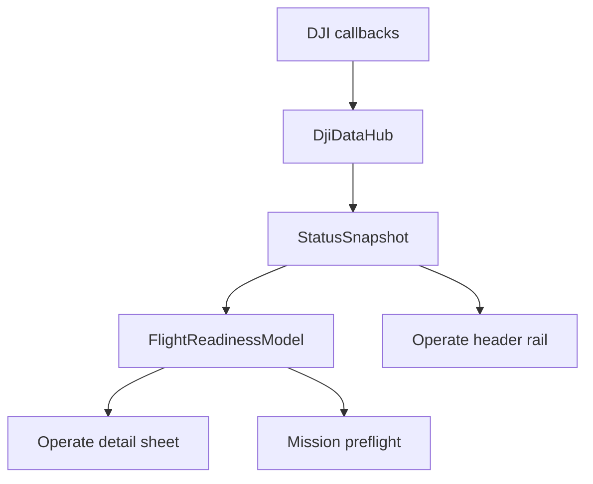

# Operate Status Details Refactor - Plan

## Goal Capsule

- **Objective:** Give the field operator one compact, truthful, real-time explanation of connection, navigation, power, and manual flight readiness without duplicated rows or misleading unavailable states.
- **Means:** Replace the current shared status-detail sheet with a single status model and one explicitly selected detail group.
- **Authority:** Read DJI state only through `DjiDataHub`; never issue a flight, motor, home, gimbal, or mission command from this feature.
- **Execution profile:** Characterize the current UI first, preserve the top status rail and its three chevrons, then verify on the Tab S9 with DJI hardware attached.

---

## Product Contract

### Summary

The Operate header keeps its compact status rail and three chevrons, but each chevron opens only its own live group.
The panel exposes a fourth internal `SAFETY` tab for the operator checklist and clearly labels which information is manual, live, unavailable, or stale.

### Problem Frame

The current panel mixes a global decision with group rows, has four internal tabs but only three top-level anchors, and anchors Safety as though it were Power.
It can show OcuSync as blocked merely because a downlink-quality sample has not arrived, even when the OcuSync component itself is present.
This makes it hard to distinguish a real aircraft problem from a missing telemetry sample or a manual inspection requirement.

### Key Decisions

- **Three top chevrons remain the primary entry points.** They map one-to-one to `LINK`, `NAV`, and `POWER`; a separate Safety chevron is not added because Safety is a review context rather than another permanent header metric. (session-settled: user-directed — chosen over a fourth top chevron: retain the minimal header.) Governs R1, R2.
- **Safety is a distinct internal tab.** It contains no duplicated connection, positioning, or battery rows. Governs R3, R6.
- **The app reports evidence, not physical certainty.** Propeller fit and safe takeoff area remain operator-confirmed items; the app may show motors off/on only as a live flight-controller fact. Governs R4, R6.
- **OcuSync component presence and downlink quality are separate.** Missing quality is `WAITING FOR SAMPLE` or `STALE`, never a false aircraft-link failure. Governs R5.

### Requirements

**Panel behavior**

- R1. Pressing the Link, Nav, or Power chevron opens the same detail panel under that chevron with the corresponding group selected.
- R2. The panel contains exactly four internal tabs, `LINK`, `NAV`, `POWER`, and `SAFETY`; switching tabs re-renders the selected group in place and updates the anchor position to the group that opened the sheet only when a top chevron initiated it.
- R3. A group renders only rows owned by that group plus a small group-local summary; it must not prepend a global `STATUS` explanation that makes every tab look identical.

**Truthful live evidence**

- R4. Every automatic row states its current evidence state: `LIVE`, `WAITING FOR SAMPLE`, `STALE`, `UNAVAILABLE`, `ATTENTION`, or `BLOCKED`; no row may label a component healthy from absent or old data.
- R5. Link separates `Aircraft`, `Cendence`, `OcuSync component`, and `OcuSync downlink quality`. The quality row must not block readiness until the product/capability contract proves that quality is required and fresh on this hardware.
- R6. Safety contains only current-session operator acknowledgements, the app's explicit scope disclaimer, and live flight-controller facts appropriate to takeoff review: motors on/off, flying/not flying, flight mode, and RTH/landing-confirmation state when received.
- R7. Nav contains only flight-state freshness, GPS, RTK status, DJI Home, heading, and current flight mode/location evidence needed to understand positioning and recovery.
- R8. Power contains only Cendence battery, B1, B2, battery sample freshness, DJI battery-threshold state if received, and the existing app-only landing advisory.
- R9. Battery freshness participates in the readiness calculation; an old or absent battery sample is `UNAVAILABLE` and cannot produce a ready indication.

**Operator outcome**

- R10. The panel header gives a group-specific result rather than one global label. The Safety tab says `REVIEW REQUIRED`, `REVIEW COMPLETE`, or `NOT READY` with the dominant reason.
- R11. A successful app assessment is labeled `APP CHECKS READY FOR MANUAL TAKEOFF` and includes a short statement that the operator must still use the Cendence/DJI flight warnings and physical inspection as the final authority.
- R12. `APP CHECKS READY FOR MANUAL TAKEOFF` is unavailable while any automatic blocker, stale required evidence, or incomplete physical checklist remains.

### Key Flows

- F1. Open a top-level group
  - **Trigger:** Operator taps the Link, Nav, or Power chevron.
  - **Steps:** The selected group becomes active, the panel is positioned below that chevron, and only that group's rows are rendered.
  - **Outcome:** A Link panel cannot appear as Nav or Power, and the current group is visually selected.
- F2. Review Safety
  - **Trigger:** Operator taps the Safety tab inside an open status panel.
  - **Steps:** The panel retains its current location, renders live flight-controller facts and the session checklist, and refreshes as hub snapshots change.
  - **Outcome:** Manual acknowledgements are visibly separate from live DJI evidence.
- F3. Evidence becomes stale or returns
  - **Trigger:** A hub sample ages past its threshold, a callback resumes, or a component disconnects/reconnects.
  - **Steps:** The status model recomputes the affected group and the open panel refreshes without closing.
  - **Outcome:** The operator sees the changed state and reason without reopening the panel.

### Acceptance Examples

- AE1. **Covers R1-R3.** Given the operator opens Link, when they switch to Safety and then reopen Power, then the panel appears below the Power chevron and shows Power selected rather than the previous Safety content.
- AE2. **Covers R4-R5.** Given OcuSync exists but quality has not yet callbacked, when Link opens, then it shows `OCUSYNC COMPONENT LIVE` and `DOWNLINK WAITING FOR SAMPLE`, not `OCUSYNC UNAVAILABLE`.
- AE3. **Covers R6, R10-R12.** Given all live checks are healthy but one physical checklist item is unchecked, when Safety opens, then it shows `REVIEW REQUIRED`; after all items are checked, it shows the qualified app readiness statement without claiming propellers were detected.
- AE4. **Covers R8-R9.** Given B2 has not reported within the freshness window, when Power opens, then B2 is `STALE` or `UNAVAILABLE` and no ready indication is shown.

### Scope Boundaries

- No automatic takeoff, motor start, landing, RTH, mission start, or configuration mutation.
- No claim that the app can inspect mounted propellers, ground clearance, weather, airspace, or obstacles.
- No new top-level header control beyond the existing three chevrons.
- DJI diagnostic/error-code integration is deferred until M210 hardware evidence confirms an available supported API path.

<!-- ce-section: work-relationships -->
### How This Work Fits Together

This plan owns only the Operate status-detail presentation and its read-only readiness reduction.

- It **shares** `DjiDataHub` with Operate, Mission, and Transport; it must not attach a new direct DJI callback.
- It **enables** safer Mission preflight wording by making the same readiness evidence truthful.
- It **depends on** a props-off and connected-hardware check to prove M210 OcuSync cadence and supported flight-controller fields.
- It **does not include** FPV/RTP transport diagnosis, camera controls, or Mission planner behavior.

---

## Planning Contract

### Key Technical Decisions

- KTD1. **One reducer owns status classification.** Extend the existing `FlightReadinessModel` input and decisions rather than allowing `OperateMvpView` and Mission to independently infer safety from snapshot fields. This preserves hub-only ownership and gives UI and Mission one interpretation of freshness. Governs R4-R12.
- KTD2. **Separate capability, sample, and severity.** Model OcuSync availability as a capability/component fact and quality as timestamped evidence. Apply the same pattern to batteries. Governs R4, R5, R9.
- KTD3. **The selected tab is state, not layout inference.** Add an explicit selected detail group and a fixed internal Safety tab; panel positioning is based only on the top-chevron origin. Governs R1, R2.
- KTD4. **Use `FlightControllerState` already forwarded by the hub.** Read `areMotorsOn()`, `isFlying()`, flight mode, `isGoingHome()`, and landing-confirmation state from the existing hub snapshot; do not add direct SDK listeners. Governs R6.

### Current-State Characterization

| Surface | Current behavior | Why it is wrong | Target behavior |
| --- | --- | --- | --- |
| Top chevrons | Three controls call `toggleDetail` with Link/Nav/Power. | The four internal tabs are not a one-to-one conceptual mapping. | Each control selects and anchors its group. |
| Panel header | All groups begin with global readiness state and reason. | The same explanation appears across unrelated tabs. | Group-local summary only. |
| Safety | Exists only as an internal tab; placement fallback is Power. | Safety is hidden and positioning semantics are accidental. | Safety stays internal and preserves the opening anchor. |
| OcuSync | Presence plus no quality callback becomes a stale/blocked row. | Component discovery is conflated with a missing quality sample. | Component and quality have distinct states. |
| Batteries | Header freshness is calculated, readiness uses only percentage. | Old values can be interpreted as healthy. | Same freshness rule drives header and readiness. |

### Data Ownership

---

## Implementation Units

### U1. Characterize and centralize the live status input

- **Goal:** Make the reducer consume every timestamp and live flight-controller fact necessary for truthful status rows.
- **Files:** `Sample Code/app/src/main/java/com/dji/sdk/sample/djihub/DjiDataHub.java`, `Sample Code/app/src/main/java/com/dji/sdk/sample/operate/FlightReadinessModel.java`, `Sample Code/app/src/main/java/com/dji/sdk/sample/operate/FlightReadinessStore.java`.
- **Approach:** Preserve the existing single `DjiDataHub` callback ownership. Extend the immutable snapshot/model input with per-battery freshness, OcuSync component availability versus quality freshness, and the read-only flight-controller facts needed by Safety.
- **Test scenarios:** A component-present/no-quality case is distinct from a component-absent case; stale B1/B2/RC cannot be healthy; motors-on is shown as live state but not as a propeller check; missing flight state produces an explicit unavailable state.

### U2. Define non-overlapping group rows and readiness wording

- **Goal:** Give Link, Nav, Power, and Safety one unique, useful job each.
- **Files:** `Sample Code/app/src/main/java/com/dji/sdk/sample/operate/FlightReadinessModel.java`, `Sample Code/app/src/main/java/com/dji/sdk/sample/operate/FlightReadinessSession.java`, `Sample Code/app/src/test/java/com/dji/sdk/sample/operate/FlightReadinessModelTest.java`, `Sample Code/app/src/test/java/com/dji/sdk/sample/missionplanner/MissionPlannerUnitTestSuite.java`.
- **Approach:** Introduce group-local summaries and explicit `APP CHECKS READY FOR MANUAL TAKEOFF` eligibility. Keep the existing physical checklist session-scoped and nonpersistent. Ensure Mission consumes the same automatic blockers but does not make manual Cendence takeoff dependent on an app command.
- **Test scenarios:** Each row belongs to one group; Safety is review-required until all manual items are acknowledged; all automatic live checks plus checklist yield qualified readiness; stale battery/flight state/link evidence removes readiness; RTK remains advisory unless the mission requires it.

### U3. Refactor panel selection, anchoring, and rendering

- **Goal:** Make each top chevron open the correct group and make all four tabs behave predictably.
- **Files:** `Sample Code/app/src/main/java/com/dji/sdk/sample/operate/OperateMvpView.java`, `Sample Code/app/src/main/res/layout/view_operate_mvp.xml`, `Sample Code/app/src/test/java/com/dji/sdk/sample/operate/OperateStatusModelTest.java` or a new focused view-state test.
- **Approach:** Replace implicit `expandedDetail` behavior with selected group plus opener anchor. Keep the three top chevrons. Render a minimal panel title, active-tab treatment, group-specific summary, unique rows, and Safety checklist. Do not add a new independent safety arrow.
- **Test scenarios:** Link/Nav/Power open the right tab; Safety switching preserves panel placement; all four tabs have mutually exclusive expected rows; the panel refreshes while open; an outside tap closes it; a fresh reopening starts at the tapped top group.

### U4. Align header indicators with the same evidence model

- **Goal:** Prevent the compact top rail from contradicting its detailed panel.
- **Files:** `Sample Code/app/src/main/java/com/dji/sdk/sample/operate/OperateMvpView.java`, `Sample Code/app/src/main/java/com/dji/sdk/sample/operate/OperateStatusModel.java`, related status-model tests.
- **Approach:** Map component presence, waiting sample, stale sample, warning, and critical states consistently to icon/text/color. Keep the header concise; detail remains in the panel.
- **Test scenarios:** OcuSync present/no quality says `LINK WAIT` with warning/unavailable semantics, not a false disconnected aircraft; a stale battery changes header and panel together; recovery changes both without reopening the panel.

### U5. Run hardware and visual acceptance

- **Goal:** Prove actual M210/Cendence callback behavior and the Tab S9 interaction geometry before claiming readiness.
- **Files:** no production changes unless runtime evidence exposes a supported mismatch; evidence belongs in the active test/session record.
- **Approach:** Use USB ADB visual verification after the user opens/Register APP/Open sequence. Do not tap takeoff, mission start, motor, gimbal, or RTH actions.
- **Test scenarios:** Capture each top-chevron open state; verify active tab and panel position; connect Cendence/aircraft and observe OcuSync, GPS, RTK, Home, B1/B2, RC, motor state; disconnect/reconnect and verify stale/recovered states; confirm no extra direct DJI listeners with the ownership script.

---

## Verification Contract

| Check | Covers | Expected result |
| --- | --- | --- |
| `scripts/test_android.sh --offline` | U1-U4 | Existing and new reducer/view-state tests pass. |
| `scripts/build_android.sh :app:assembleDebug` | U1-U4 | Debug APK builds with Java 11. |
| `scripts/verify_apk.sh` | U1-U4 | APK contains required native DJI video libraries. |
| `scripts/verify_dji_callback_ownership.sh` | U1-U5 | No non-hub direct DJI video/telemetry callback ownership is introduced. |
| Tab S9 visual review | U3-U5 | Correct chevron-to-tab mapping, panel anchoring, and live refresh are observed. |
| Props-off M210/Cendence bench | U1-U5 | Every claimed live value is observed or rendered as unavailable; no flight command is sent. |

---

## Definition of Done

- Each of the three header chevrons deterministically opens its own Link, Nav, or Power content.
- Safety is reachable inside the same panel, contains only Safety information, and does not claim to detect propellers.
- OcuSync component presence is not falsely labeled blocked due solely to an absent quality callback.
- Freshness rules are consistent between the header and readiness decision, including every battery.
- The app only presents manual-takeoff readiness when its stated evidence and all checklist items are complete, with an explicit Cendence/DJI and physical-inspection disclaimer.
- Unit/build/APK/ownership checks pass and the Tab S9 props-off visual bench verifies the final behavior.
