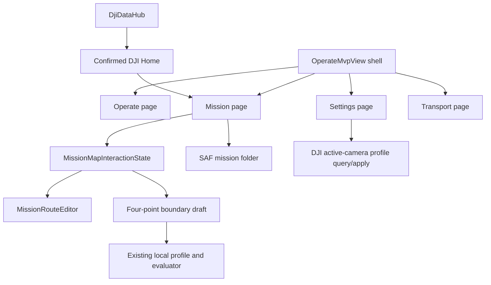

# Operator Mission Workflow, Camera Settings, and Foreground Display Reliability

## Goal Capsule

- **Objective:** Let an operator move between Operate, Mission, Transport, and Settings with truthful context, create and retain an accurate local mission plan efficiently, set DJI Home with immediate visible confirmation, select a real supported camera video profile, and keep the foreground display awake while monitoring the aircraft.
- **Means:** Keep the existing Operate shell and `DjiDataHub` callback ownership; add explicit local interaction state for the map, durable file-backed mission-library access, and camera configuration based on DJI-reported capabilities rather than hard-coded Zenmuse assumptions. (KTD1, KTD4, KTD6)
- **Authority:** Existing `LOAD`, `UPLOAD`, `START`, `PAUSE`, `CANCEL`, and `SET DJI HOME` remain distinct, visible operator actions. No unit may create an automatic flight, mission, landing, RTH, gimbal, or camera-recording action.
- **Execution profile:** Characterize current behavior before each affected unit, add focused pure/JVM coverage before or with behavior changes, then run the Android build gates. A wired-tablet usability pass and a connected-aircraft camera/home pass are required before claiming physical proof.
- **Stop conditions:** Stop and revise the relevant unit if a proposed change would add a second DJI setter callback owner, alter Android-to-Edge transport, require broad storage permission, misrepresent local boundaries as DJI geofences, or send a camera/aircraft command without an explicit operator tap.

---

## Product Contract

### Problem Frame

The current persistent Operate shell renders Mission, Transport, and Settings inside its content overlay, but its header label is static. The Mission UI still contains one-shot waypoint entry, manual-coordinate local-boundary editing, a DJI mission-download button that does not return route contents, and a DJI Home status that can remain stale after a successful set-home completion. The local mission library lives only in `SharedPreferences`, so there is no truthful operator-visible folder for computer-to-tablet mission import. Settings has no real camera video-profile control. Android may dim while the foreground UI is being used as a live video monitor.

### Requirements

**Operate shell and display**

- R1. The header label beside the hamburger must identify the current Operate-shell destination: `OPERATE`, `MISSION`, `TRANSPORT`, or `SETTINGS`; it must change when the overlay changes and return to `OPERATE` on back/close.
- R2. While this app is visibly in the foreground, the screen must remain awake without using a background wakelock; normal device dim/sleep behavior must resume when the activity is no longer foregrounded.

**DJI Home truthfulness**

- R3. An explicit successful `SET DJI HOME` at a waypoint must immediately show `HOME READY`, draw that coordinate as the DJI Home marker, and make the same in-memory/home-hub state available to manual flight and Mission preflight without requiring draft save/load/upload.
- R4. A failed command, invalid coordinate, disconnected flight controller, or later DJI readback contradiction must remain visible and must never present `HOME READY` falsely.

**Waypoint and local-boundary map workflow**

- R5. `ADD WAYPOINTS` must be a visible toggle mode: while on, every map tap appends a numbered waypoint; pressing it again, leaving the Mission page, or entering another map-edit mode ends it.
- R6. `LOCAL BOUNDARIES` must guide the operator through: name a local profile, tap exactly four map positions, inspect a map preview, choose inclusion/exclusion and polygon/circle, then explicitly confirm to save/render the boundary.
- R7. A polygon boundary uses the four tapped vertices in order. A circle boundary encloses the four tapped positions using their centroid as center and the farthest tapped point as radius. This deterministic interpretation preserves the requested four-tap flow. (session-settled: user-directed — chosen over raw coordinate entry: the operator requested direct map construction with four presses before choosing shape.)
- R8. Local boundaries remain advisory-only planning objects. Every relevant view must retain `LOCAL PLANNING WARNING — NOT DJI ENFORCED`; they must not alter a DJI mission, flight controller, Cendence control, Transport, or aircraft geofence.

**Saved mission workflow**

- R9. Remove the misleading DJI `DOWNLOAD` route action. The Mission page must instead show the persistent mission-folder location above local save/load controls and explain that a computer can add supported mission JSON files to that folder.
- R10. The app must safely list, validate, load, save, and overwrite local draft JSON files from a user-selected mission folder without broad-storage access. Existing `SharedPreferences` drafts must remain recoverable during migration.
- R11. Selecting or loading a local draft changes only local planner state. It never sends `LOAD`, `UPLOAD`, or `START` to the aircraft automatically.

**Real camera video settings**

- R12. Settings must display the currently reported active payload camera video resolution/frame-rate pair and only offer pairs DJI reports as supported for that connected camera.
- R13. Changing video configuration requires a distinct `APPLY VIDEO SETTING` operator action. The app must wait for DJI completion, read back the current pair, and show either verified success or the DJI error; it must not claim a visual-only change succeeded.
- R14. When no supported camera/capability/current setting is available, Settings must show an unavailable reason and disable apply. It must not invent a Zenmuse model, resolution, frame rate, or supported pair.

### Scope Boundaries

- No change to the compact Android-to-Edge telemetry/video contract, Edge IP persistence, RTP ports, FPV parser, transport background service, or `DjiDataHub` callback ownership.
- No automatic flight, takeoff, landing, RTH, mission upload/start/pause/cancel, gimbal motion, recording, or camera mode change.
- No online map/provider redesign, terrain processing, mission-pattern generator, DJI Pilot mission-file compatibility promise, or remote DJI-mission download/reconstruction.
- No claim that JVM/build success proves a connected camera, a real DJI Home command, Cendence control, or field touch ergonomics.

### Acceptance Flows

- F1. **Shell context and awake display**
  - **Trigger:** Operator opens Mission from the Operate menu, then returns.
  - **Outcome:** Header changes to `MISSION`, returns to `OPERATE`, and the foreground tablet display stays awake without keeping the process awake after the app is backgrounded.
  - **Covers:** R1, R2.
- F2. **DJI Home**
  - **Trigger:** Operator taps a waypoint, chooses `SET DJI HOME`, and confirms.
  - **Outcome:** Only after successful DJI completion does the Mission page immediately show `HOME READY` and a Home marker; the status persists across view recreation and later readback reconciles truthfully.
  - **Covers:** R3, R4.
- F3. **Batch route and boundary creation**
  - **Trigger:** Operator enables `ADD WAYPOINTS`, taps a sequence, disables it, then creates a named boundary and taps four positions.
  - **Outcome:** Every tap in waypoint mode appends the next numbered marker; four boundary points yield a preview and explicit shape/type confirmation; no route tap leaks into another edit mode.
  - **Covers:** R5-R8.
- F4. **Mission-file workflow**
  - **Trigger:** Operator sees the displayed mission folder, copies a valid JSON file there from a computer, returns to Mission, and opens Saved Missions.
  - **Outcome:** The saved list validates and offers the local draft; choosing it displays it for editing only. There is no DJI `DOWNLOAD` control or implied remote-route recovery.
  - **Covers:** R9-R11.
- F5. **Camera settings**
  - **Trigger:** Operator opens Settings with a connected supported payload, selects a listed combined profile, and taps apply.
  - **Outcome:** The control contains only DJI-reported pairs; completion plus readback marks it applied or shows a specific failure without changing the selection silently.
  - **Covers:** R12-R14.

---

## Planning Contract

### Current-State and Impact Gate

| Surface | Current state | Planned impact / guardrail |
| --- | --- | --- |
| Operate header | `view_operate_mvp.xml` contains a static `OPERATE` label; overlay pages are selected inside `OperateMvpView`. | Make the shell own one current-destination value; do not route through `MainActivity` back-stack titles. |
| DJI Home | `MissionMvpView` already calls `DjiDataHub.setDjiHomeLocation` and keeps a `ConfirmedDjiHomeState`, but observed UI remains unavailable. | Add a characterization test and repair only the callback-to-render/reconciliation path; draft saving remains unrelated. |
| Waypoint entry | `addMode` is reset after one map tap. | Replace with an explicit interaction mode, mutual exclusion, and testable state transitions. |
| Local boundaries | Existing local boundary models/geometry/rendering exist, but editor collects typed coordinates and chooses type before map geometry. | Reuse models/evaluator and add a staged four-point map draft; preserve advisory-only semantics. |
| Mission library | `MissionDraftLibrary` persists a JSON array in `SharedPreferences`. | Add a user-selected persisted document-tree folder and compatibility import; never request broad filesystem access. |
| Camera configuration | No current-camera video-profile API exists in Operate Settings. | Query SDK capabilities at runtime and apply a supported combined profile only after an explicit tap. |
| Transport / callbacks | `DjiDataHub` is the callback hub and transport is persistent. | No callback registration, source selection, or transport lifecycle changes in this plan. |

### Key Technical Decisions

- KTD1. **Operate-shell context is a local shell state.** `OperateMvpView` will expose a small destination/title rendering helper used by `showOperatePage`, `showPage`, and back navigation rather than trying to infer nested overlay state in `MainActivity`. This fixes the actual ownership boundary and keeps non-Operate Activity pages unchanged.
- KTD2. **Keep awake uses the Activity window flag, not a wakelock.** Add `FLAG_KEEP_SCREEN_ON` only while the app activity is resumed/visible and clear it in pause. This prevents dimming during active monitoring without pretending to keep Android processing alive in the background. (session-settled: user-directed — chosen over screen dimming during monitoring: the operator must be able to watch live video without interaction.)
- KTD3. **DJI Home is command-completion plus readback reconciliation.** A successful explicit completion updates the common confirmed-home state and immediately renders it on the Mission main thread; later `FlightControllerState` confirms or corrects it. Saving a local draft is never evidence of DJI Home.
- KTD4. **Map edits use one explicit mode at a time.** Use a small pure interaction-state model (`IDLE`, `ADD_WAYPOINTS`, `CAPTURE_BOUNDARY_POINTS`) so taps cannot append waypoints while a boundary is being captured. The UI renders the active mode and turns it off deterministically.
- KTD5. **Boundaries are generated from a four-point staging preview.** The map view renders transient numbered points and preview geometry. Confirming creates the existing local boundary object; cancelling or leaving Mission discards the staging object. No typed coordinate editor is needed in the normal creation flow.
- KTD6. **Mission files use a persisted Storage Access Framework tree.** On first use, the operator chooses a folder (recommended `Download/Matrice Missions`) once; its persisted URI permission gives the app only that folder. The UI shows its human-readable location above saved-mission controls. This supports copying files from a computer without a broad storage permission or a misleading download action.
- KTD7. **Camera options are complete valid pairs.** Query the currently active `Camera` and its capability-reported `ResolutionAndFrameRate` range, present one combined selector, call DJI’s video-profile setter only when the operator taps apply, then re-query/read back. Do not expose independent resolution and FPS menus that can form invalid combinations.

### Technical Design

### Sequencing

1. Establish the small shell/UI and Home-state corrections before map workflow work, so page context and readiness feedback are reliable.
2. Introduce one map interaction state and reuse it for persistent waypoint entry before layering four-point boundary capture onto the same tap surface.
3. Replace the local-library persistence/visible-path workflow independently of DJI mission commands.
4. Add capability-driven camera settings after the existing Settings surface is stable.
5. Run automated gates after each behavior-bearing unit and perform one consolidated tablet/aircraft usability pass last.

### Risks and Mitigations

- **DJI Home status may lag passive flight-state callbacks.** Treat explicit successful `setHomeLocation` completion as immediate local confirmation, then reconcile rather than clearing it on an absent/stale callback.
- **Four points are naturally polygonal but not circular.** The centroid/farthest-point circle rule is deterministic, previewable, and tested; the UI explains this before confirmation.
- **Android scoped storage can make a hard-coded path unusable.** Use a persisted SAF folder URI and display a human-readable path; test actual MTP copying on the Tab S9 before calling computer import complete.
- **Changing camera profile can momentarily interrupt video or be unsupported while recording.** No automatic apply; disable or show the DJI reason when unavailable, retain the prior known profile after failure, and require connected-payload hardware validation.
- **Mission control is safety-sensitive.** All plan work is local UI/state except the pre-existing explicit `SET DJI HOME` and new explicit camera-profile apply; no automatic aircraft action is introduced.

---

## Implementation Units

### U1. Synchronize the Operate shell title and foreground display policy

- **Goal:** The header always names the visible Operate-shell page, and a foreground operator screen never dims.
- **Requirements:** R1, R2.
- **Files:** `Sample Code/app/src/main/java/com/dji/sdk/sample/operate/OperateMvpView.java`, `Sample Code/app/src/main/java/com/dji/sdk/sample/internal/controller/MainActivity.java`, `Sample Code/app/src/main/res/layout/view_operate_mvp.xml`, and a focused JVM test under `Sample Code/app/src/test/java/com/dji/sdk/sample/operate/` if title state is extracted.
- **Approach:** Characterize every `showPage`, `showOperatePage`, back, and menu selection path. Centralize the display title in a small shell helper and update the existing header `TextView` as the overlay changes. Apply and clear the Activity window keep-screen-on flag at foreground lifecycle boundaries; do not create a `PowerManager.WakeLock` or background service.
- **Test scenarios:** Mission/Transport/Settings/Operate title transitions; title restoration after back; title remains correct after a menu dismiss; flag applied only in foreground; transport/callback code absent from the diff.
- **Verification:** Run focused tests, then `scripts/test_android.sh --offline`, `scripts/build_android.sh :app:assembleDebug`, `scripts/verify_apk.sh`, and a Tab S9 visual walk through all shell destinations while leaving the display idle longer than the normal dim threshold.
- **Unit Done:** The visible header never says `OPERATE` on Mission, Transport, or Settings; app foreground monitoring stays awake; backgrounding clears the display-only policy; no transport or flight behavior changes.

### U2. Repair immediate, durable DJI Home presentation

- **Goal:** A successful explicit set-home command changes Mission status and map state immediately, while later DJI state remains the final authority.
- **Requirements:** R3, R4.
- **Files:** `Sample Code/app/src/main/java/com/dji/sdk/sample/operate/MissionMvpView.java`, `Sample Code/app/src/main/java/com/dji/sdk/sample/djihub/DjiDataHub.java`, `Sample Code/app/src/main/java/com/dji/sdk/sample/operate/ConfirmedDjiHomeState.java`, and focused tests under `Sample Code/app/src/test/java/com/dji/sdk/sample/operate/`.
- **Approach:** First add a characterization test for command success, absent/stale flight-state readback, valid later readback, and failed command. Trace the existing completion callback through `ConfirmedDjiHomeState`, hub persistence, `renderConfirmedDjiHome`, and `renderFlightState`; repair the smallest broken handoff. Ensure UI rendering happens on the main thread and uses the confirmed coordinate until valid DJI readback supersedes it.
- **Test scenarios:** successful command immediately produces available state/map marker; command failure preserves unavailable or prior confirmed state with error; stale callback does not erase success; invalid later readback does not create home; recreation restores hub-confirmed home; draft save/load does not fabricate home.
- **Verification:** Focused JVM tests and full Android gates. With a connected props-off aircraft, set home at a waypoint, return to Operate/Mission, and confirm `HOME READY`, map marker, and Mission preflight all agree before any upload/start test.
- **Unit Done:** `HOME UNAVAILABLE` cannot remain after a confirmed set-home completion unless a later authoritative DJI error/readback invalidates it visibly; draft persistence is demonstrably unrelated to home state.

### U3. Implement persistent Add Waypoints mode and safe map-mode transitions

- **Goal:** The operator can add an ordered sequence by repeatedly tapping the map until deliberately ending the mode.
- **Requirements:** R5.
- **Files:** `Sample Code/app/src/main/java/com/dji/sdk/sample/operate/MissionMvpView.java`, new pure interaction-state class under `Sample Code/app/src/main/java/com/dji/sdk/sample/missionplanner/`, `Sample Code/app/src/main/res/layout/view_mission_mvp.xml`, `Sample Code/app/src/test/java/com/dji/sdk/sample/missionplanner/MissionPlannerUnitTestSuite.java`, and/or a dedicated interaction-state JVM test.
- **Approach:** Replace the one boolean `addMode` with a single mode model. Toggle `ADD WAYPOINTS` on/off, make its active state visible, append on each map tap while active, and force `IDLE` when the page detaches, a new draft opens, a boundary flow starts, or the operator chooses another map action. Preserve current `routeChanged`, dirty-draft, numbering, and no-command behavior.
- **Test scenarios:** three consecutive taps append three points; toggling off stops append; boundary capture cannot append waypoints; leaving/reopening Mission resets mode; waypoint numbers equal immutable draft order; map tap while idle has explanatory status and no mutation.
- **Verification:** Focused JVM tests, full Android gates, and tablet touch test at both high and close map zooms with route numbering visible after every tap.
- **Unit Done:** `ADD WAYPOINTS` is the visible, cancellable batch mode and produces only the expected local numbered route points.

### U4. Replace manual-coordinate boundary creation with the four-point map workflow

- **Goal:** An operator creates a named advisory local boundary from four deliberate map taps and a final explicit shape/type confirmation.
- **Requirements:** R6, R7, R8.
- **Files:** `Sample Code/app/src/main/java/com/dji/sdk/sample/operate/MissionMvpView.java`, `Sample Code/app/src/main/java/com/dji/sdk/sample/missionplanner/map/MapLibreMissionMapView.java`, existing boundary/profile/geometry classes under `Sample Code/app/src/main/java/com/dji/sdk/sample/missionplanner/`, `Sample Code/app/src/main/res/layout/view_mission_mvp.xml`, and boundary-focused JVM tests under `Sample Code/app/src/test/java/com/dji/sdk/sample/missionplanner/`.
- **Approach:** Keep existing persisted profile/evaluator classes. On `LOCAL BOUNDARIES`, ask for a profile name (or select a named profile), enter capture mode, render each of four staged numbered vertices, and automatically open a concise confirmation when point four arrives. The confirmation chooses inclusion/exclusion plus polygon/circle, explains the circle construction, previews the generated result, and saves only on `CONFIRM`. Provide `UNDO LAST` and `CANCEL`; both leave saved profiles untouched. Existing profile deletion and advisory warnings remain available.
- **Test scenarios:** fewer than four points cannot save; four ordered polygon vertices persist and render; four points generate deterministic circle center/radius; cancel/undo do not modify prior profile; inclusion/exclusion semantics survive round trip; all boundary captures leave routes untouched; warning evaluator still detects crossings/outside cases.
- **Verification:** Focused geometry/persistence tests, full Android gates, and tablet usability pass: create each of the four types, cancel a fifth attempt, reload profile, verify preview clarity at close zoom, and confirm the `NOT DJI ENFORCED` wording stays visible.
- **Unit Done:** The requested name → four map taps → option → confirm flow works reliably, remains compact, and only creates local advisory geometry.

### U5. Make saved missions a simple, durable folder workflow

- **Goal:** Saved missions have one visible local folder, work with computer-copied JSON files, and do not imply DJI remote download.
- **Requirements:** R9, R10, R11.
- **Files:** `Sample Code/app/src/main/java/com/dji/sdk/sample/missionplanner/MissionDraftLibrary.java`, `Sample Code/app/src/main/java/com/dji/sdk/sample/missionplanner/MissionDraftJson.java`, `Sample Code/app/src/main/java/com/dji/sdk/sample/operate/MissionMvpView.java`, `Sample Code/app/src/main/res/layout/view_mission_mvp.xml`, any narrowly scoped folder-preference/helper class under `missionplanner`, and JVM/instrumentation tests for migration and document-tree access.
- **Approach:** Remove `mission_mvp_download`, `download()`, its listener, and obsolete remote-download wording. Replace the current preference-only library with a file-backed library rooted at a persisted SAF document-tree URI; recommend and display `Download/Matrice Missions` after selection. Show a short path line immediately above `SAVE DRAFT`, `SAVED MISSIONS`, `LOAD`, and `UPLOAD`, with a clear unavailable/setup state when no folder is selected. Migrate valid legacy drafts once, retain legacy data until successful verification, validate every external JSON before listing it, and leave all loaded data local until the explicit existing DJI buttons are pressed.
- **Test scenarios:** first-run folder not chosen; persisted folder restored; valid computer-style JSON listed; invalid JSON ignored/reported without losing valid entries; save then reload round trip; same-name overwrite; migration preserves old drafts; folder permission loss gives actionable state; selecting a draft performs no DJI call; `DOWNLOAD` no longer exists in resources or code.
- **Verification:** JVM tests where possible, Android instrumentation with a test document provider/tree, full Android gates, and Tab S9 MTP test: select `Download/Matrice Missions`, copy a known JSON from Ubuntu/desktop, reopen Saved Missions, load/edit/save it, and confirm no broad-storage permission prompt appears.
- **Unit Done:** The operator sees the actual mission-folder location, can manage local JSON drafts through it, and cannot confuse a local file operation with DJI aircraft mission download.

### U6. Add capability-driven Zenmuse video profile controls to Settings

- **Goal:** Settings truthfully displays and applies only the video resolution/frame-rate pairs the connected active payload camera supports.
- **Requirements:** R12, R13, R14.
- **Files:** `Sample Code/app/src/main/java/com/dji/sdk/sample/operate/OperateMvpView.java`, new narrow camera-settings helper under `Sample Code/app/src/main/java/com/dji/sdk/sample/operate/` or `djhub/`, existing relevant camera-selection patterns in `Sample Code/app/src/main/java/com/dji/sdk/sample/demo/camera/VideoFeederView.java`, and focused tests under `Sample Code/app/src/test/java/com/dji/sdk/sample/operate/`.
- **Approach:** First trace the actual connected aircraft camera list and the camera selected for Primary; do not assume index/model. Query the chosen `Camera` for current `ResolutionAndFrameRate` and its DJI capability-reported valid range. Render a compact `CURRENT VIDEO` readout plus one combined supported-profile selector and explicit `APPLY VIDEO SETTING`. On apply, reject unavailable/disconnected/unsupported state locally, call DJI once, then re-query on callback and mark success only if readback matches. Keep request state separate from callback ownership; no recurring direct setter callback is introduced.
- **Test scenarios:** disconnected product; no cameras; null/empty capability; current profile shown; only advertised pairs selectable; unsupported selection blocked; DJI apply failure preserves current readback; success requires matching readback; repeated apply is disabled while pending; no flight/mission/transport changes.
- **Verification:** Focused helper tests with fakes, full Android gates, and connected payload validation: compare Settings readout with DJI-reported current pair, apply two supported pairs while safely on the bench, confirm visual feed recovery and readback, then test one documented unsupported/unavailable condition without forcing a profile.
- **Unit Done:** No profile is invented or merely cosmetic; every displayed/applicable pair comes from the attached camera and every success is DJI-confirmed.

### U7. Conduct integration, usability, and safety regression validation

- **Goal:** Prove the combined flow is usable on the target tablet and does not regress existing video, transport, hub, or explicit command boundaries.
- **Requirements:** R1-R14.
- **Files:** targeted tests added by U1-U6, `docs/PLAN.md` only if the active operator guide needs a concise current folder/camera workflow update, and no unrelated refactor files.
- **Approach:** Review the final diff against the scope boundaries before installation. Build one test script/checklist that distinguishes code proof, tablet UI proof, DJI hardware proof, and unverified hardware-limited behavior. Preserve the current `DjiDataHub` ownership verifier and transport verification unmodified.
- **Test scenarios:** all acceptance flows F1-F5; app foreground/background display behavior; page-title transitions; mission map no-tap-leak paths; legacy draft migration; invalid file; no product camera unavailable state; real camera/profile update; Primary/FPV/transport active while switching pages; no automatic action in logs.
- **Verification:** `scripts/verify_dji_callback_ownership.sh`, `scripts/test_android.sh --offline`, `scripts/build_android.sh :app:assembleDebug`, `scripts/verify_apk.sh`, source/diff review, wired installation, visual tablet smoke test, then a props-off connected DJI test. Run no live flight command except an operator explicitly requesting it.
- **Unit Done:** All automated gates pass; the Tab S9 workflow is visually usable; connected-device-only claims are recorded as verified or explicitly pending rather than inferred from the APK.

---

## Verification Contract

| Gate | Applies to | Evidence required |
| --- | --- | --- |
| Focused pure/JVM tests | U1-U6 | State transitions, home reconciliation, boundary geometry, draft migration, and camera-option filtering pass without DJI hardware. |
| Callback ownership | U1-U7 | `scripts/verify_dji_callback_ownership.sh` passes and the diff adds no competing DJI setter callback. |
| Android test suite | U1-U7 | `scripts/test_android.sh --offline` passes. |
| Build and package | U1-U7 | `scripts/build_android.sh :app:assembleDebug` and `scripts/verify_apk.sh` pass. |
| Code/diff safety review | U1-U7 | No transport contract, RTP, Edge endpoint, `DjiDataHub` ownership, implicit mission command, or local-boundary enforcement regression. |
| Tablet usability | U1, U3-U5, U7 | Target Tab S9 proves labels, tap targets, batch waypoint entry, four-point boundary flow, visible folder path, and no foreground dimming. |
| Connected payload/controller | U2, U6, U7 | Props-off hardware proves DJI Home readback and actual camera pair query/apply; live-flight behavior remains outside this plan unless explicitly requested. |

## Definition of Done

- U1 is done when title and screen-awake behavior meet its Unit Done criteria and both automated and tablet foreground checks pass.
- U2 is done when command completion, hub state, Mission UI, map marker, and preflight agree for an explicit set-home test, including failure/readback cases.
- U3 is done when batch waypoint mode is repeatable, visible, mutually exclusive with other map modes, and maintains correct ordered numbering.
- U4 is done when named four-point boundaries save/load/render as advisory inclusion/exclusion circles/polygons with tested geometry and no DJI side effect.
- U5 is done when the displayed SAF-backed folder supports safe local JSON save/load and a real Tab S9 computer-copy test, with no `DOWNLOAD` UI or code path remaining.
- U6 is done when current/supported video pairs come from DJI at runtime and an actual supported pair is applied then verified by readback on hardware.
- U7 is done when all verification gates pass, the final diff respects the stated boundaries, and the result clearly separates code proof from remaining hardware evidence.
- The whole plan is complete only when every unit above is done; a compiling APK alone is not completion.

## Appendix

### Relevant Existing Patterns

- `Sample Code/app/src/main/java/com/dji/sdk/sample/operate/OperateMvpView.java` owns the persistent Operate shell and nested page overlay.
- `Sample Code/app/src/main/java/com/dji/sdk/sample/operate/MissionMvpView.java` owns local mission editing and explicit mission/Home UI actions.
- `Sample Code/app/src/main/java/com/dji/sdk/sample/djihub/DjiDataHub.java` is the shared DJI callback/state authority.
- `Sample Code/app/src/main/java/com/dji/sdk/sample/missionplanner/map/MapLibreMissionMapView.java` is the Mission map rendering/tap boundary.
- `Sample Code/app/src/main/java/com/dji/sdk/sample/missionplanner/MissionDraftLibrary.java` is the legacy local-draft persistence boundary to evolve safely.

### External SDK Constraints

- DJI’s Android camera documentation requires applications to query available video resolution/frame-rate combinations from the connected camera rather than assuming a universal matrix: [Camera concepts](https://developer.dji.com/doc/mobile-sdk-tutorial/en/basic-introduction/basic-concepts/camera.html) and [Camera parameter reference](https://developer.dji.com/api-reference/android-api/Components/Camera/DJICamera_DJICameraParameters.html).
- Android document-tree access is intentionally folder-scoped and persistable; implementation must use the platform document-provider APIs instead of broad storage access.

### Deferred Questions

- The precise installed Zenmuse model and any recording-state restriction can only be confirmed while the aircraft/payload is connected. This is not a blocker because U6 intentionally queries its live capability and shows unavailable state safely.
- Computer MTP visibility of the selected `Download/Matrice Missions` folder must be proven on the Tab S9 in U5. If firmware prevents that selected folder from being visible, retain SAF correctness and show the actual selected folder label rather than falling back to unrestricted storage.

### Review Record

- The plan was manually reviewed against the current Operate shell, Mission map/edit flow, draft library, Home-state path, and DJI camera capability constraints. This harness has no plan-review subagent primitive, so no delegated document-review pass was available.
- The highest-risk decisions are deliberately contained: DJI Home remains explicit and reconciled, local boundaries remain advisory, mission files use a scoped document tree, and camera profiles are runtime capability-driven with hardware proof required.
