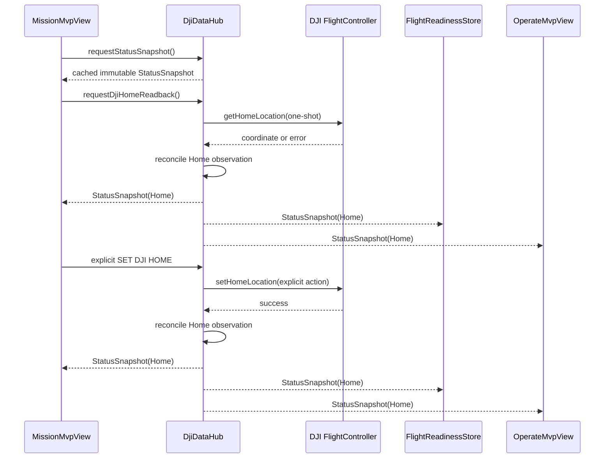

# Reliable Global DJI Home State for Mission and Readiness

## Goal Capsule

- **Objective:** The operator can see and use the aircraft's real DJI Home Point reliably from Mission and Operate, whether it was already set on the aircraft or was just explicitly set from a waypoint.
- **Means:** Make `DjiDataHub` own the one-shot Home readback, cache an immutable Home observation in its status snapshot, and have Mission and readiness consume that shared state. (KTD1)
- **Authority:** The aircraft Flight Controller remains authoritative. The app may only request `getHomeLocation` through the hub and perform the existing explicit operator-triggered `setHomeLocation`; it must never set Home automatically, issue RTH, take off, land, move the gimbal, or start a mission.
- **Execution profile:** Characterization-first, hub-only, and KISS. No new recurring DJI setter callback, no transport schema change, no Edge change, and no persistent app claim across an aircraft disconnect.
- **Stop conditions:** Stop if MSDK V4's one-shot Home readback cannot distinguish a valid Home from an unavailable result, if the requested change would require a second direct `FlightController` callback owner, or if a proposed cache could treat a pre-disconnect coordinate as proof after reconnection.
- **Tail ownership:** Local tests and APK verification complete the code work. A connected-aircraft test remains required to prove the actual M210/Cendence readback and command timing.

---

## Product Contract

### Summary

Mission currently has two partial Home representations: `FlightControllerState.isHomeLocationSet()` and a Mission-local record of an accepted `setHomeLocation` command. The hub does not replay its latest snapshot to a newly opened Mission screen, and readiness does not consume the command-confirmed Home. This lets the UI or Start gate show `HOME UNAVAILABLE` even when the aircraft accepted the requested Home location.

### Requirements

**One global Home truth**

- R1. `DjiDataHub` is the sole owner of every DJI Home read/write interaction used by app UI: existing explicit `setHomeLocation`, plus any new one-shot `getHomeLocation` readback.
- R2. The hub publishes an immutable Home observation with its availability, coordinate when valid, source, and monotonic observation time as part of `StatusSnapshot`.
- R3. A successful explicit `SET DJI HOME` immediately updates the shared Home observation and notifies all status consumers; Mission, Operate, and flight readiness must converge without waiting for a later recurring flight-state callback.
- R4. On entry to Mission, the view requests both an immediate cached status delivery and a hub-owned one-shot DJI Home readback. It must show a truthful waiting/checking state until evidence arrives rather than a false `HOME UNAVAILABLE`.
- R5. A valid `FlightControllerState` Home readback and a valid one-shot `getHomeLocation` result both reconcile the same hub state. An unavailable/stale passive callback must not erase an accepted command or valid readback during the same connected-aircraft session.
- R6. The Home observation is cleared when the aircraft disconnects or changes. After reconnection, a fresh DJI readback is required before treating Home as available again.
- R7. Mission preflight and the global readiness decision use the shared Home observation, not separate local booleans. An accepted Home command therefore affects Load/Upload/Start checks consistently, while RTH state still comes only from current flight state.
- R8. Command failure, invalid coordinate, missing Flight Controller, invalid readback, and readback error remain visibly distinct from successful Home availability. No local draft save/load/upload can substitute for DJI confirmation.

### Acceptance Examples

- AE1. Given the aircraft already has a valid DJI Home Point and Mission opens after the latest recurring callback, Mission first shows `CHECKING DJI HOME`, then shows `HOME READY` after its hub readback without needing another direct callback owner.
- AE2. Given the operator confirms `SET DJI HOME` for waypoint 3 and DJI returns success, Mission's Home label, Operate navigation status, and readiness decision all become available immediately; the map shows the same coordinate.
- AE3. Given a failed Home command or a readback error, the existing valid Home remains visible only if it was already confirmed in this connected session; otherwise Mission reports the relevant unavailable/error state and blocks preflight.
- AE4. Given the Cendence/USB aircraft link disconnects after Home was confirmed, the app clears the availability claim. After reconnection it reads Home from the Flight Controller again before enabling mission preflight.

### Scope Boundaries

- No automatic Home changes from the map, mission load, mission upload, or aircraft connection.
- No change to DJI RTH configuration, landing confirmation, takeoff, landing, mission execution, video, RTK, gimbal, transport, Edge/ROS, or persistent mission file format.
- No direct `FlightController` listener, getter, or callback in Mission, Operate, or transport; all future Home interactions go through `DjiDataHub`.

---

## Planning Contract

### Current-State Findings

- `DjiDataHub.addListener(...)` intentionally starts consumers at the next recurring native event and has no cached-snapshot replay, so Mission can open without a Home-bearing state event. (`Sample Code/app/src/main/java/com/dji/sdk/sample/djihub/DjiDataHub.java`)
- `DjiDataHub.setDjiHomeLocation(...)` caches the successful command coordinate, but it does not publish a new `StatusSnapshot`; only `MissionMvpView` restores that private hub value. (`Sample Code/app/src/main/java/com/dji/sdk/sample/djihub/DjiDataHub.java`, `Sample Code/app/src/main/java/com/dji/sdk/sample/operate/MissionMvpView.java`)
- `FlightReadinessStore` derives Home only from `FlightControllerState.isHomeLocationSet()`, so it can disagree with the Mission-local success path. (`Sample Code/app/src/main/java/com/dji/sdk/sample/operate/FlightReadinessStore.java`)
- The bundled DJI sample demonstrates `FlightController.getHomeLocation(...)` as an asynchronous one-shot request. The request belongs in the hub, not in Mission. (`Sample Code/app/src/main/java/com/dji/sdk/sample/demo/timeline/TimelineMissionControlView.java`)

### Technical Design

### Key Technical Decisions

- KTD1. **Represent Home in the hub snapshot, not as view-local state.** (session-settled: user-directed — Mission must request the hub when opened and successful Home actions must change relevant global states.) One immutable observation prevents Mission, Operate, and readiness from deciding differently. Governs R1-R7.
- KTD2. **Use a hub-owned one-shot `getHomeLocation` refresh, not a new recurring callback.** This fills the no-replay gap while preserving `DjiDataHub` as the only setter-callback owner. Governs R1, R4, R5.
- KTD3. **An accepted explicit Home command is immediately available for the current connected session.** The hub publishes it before waiting for passive flight-state readback; a later valid DJI readback refreshes it, while an invalid passive update cannot regress it. Governs R3, R5, R7.
- KTD4. **Disconnect resets trust.** The coordinate may physically persist on the drone, but the app must not claim it until the newly connected Flight Controller returns fresh evidence. Governs R6, R8.

### State Model

| State | Meaning | Mission presentation | Preflight/readiness |
|---|---|---|---|
| `WAITING_FOR_SAMPLE` | Mission requested cached/readback evidence but no definitive response yet. | `CHECKING DJI HOME` | Blocked without claiming absence. |
| `AVAILABLE` | Valid coordinate came from the current Flight Controller state, one-shot readback, or accepted explicit command in this connected session. | `HOME READY` | Home requirement passes. |
| `UNAVAILABLE` | Current-session DJI evidence says no valid Home, Flight Controller is missing, or readback failed without a prior valid observation. | `HOME UNAVAILABLE` plus concise cause when available. | Blocked. |
| `STALE` | A previously observed state is too old for readiness and has not been refreshed. | `HOME STALE — CHECKING` | Blocked until fresh readback. |

### Sequencing

| Order | Unit | Dependency reason |
|---|---|---|
| 1 | U1 Characterize and model shared Home state | Defines the source of truth before wiring views. |
| 2 | U2 Extend the hub with snapshot replay and one-shot refresh | Supplies the sole UI-facing data path. |
| 3 | U3 Consume shared Home state in readiness, Mission, and Operate | Removes diverging local booleans. |
| 4 | U4 Verify regression and connected-aircraft behavior | Confirms safety semantics and no callback regression. |

---

## Implementation Units

### U1. Characterize and model current-session Home evidence

- **Goal:** Add a dependency-free Home state model and tests that define accepted command, valid readback, waiting, stale, unavailable, and disconnect behavior before UI wiring changes.
- **Requirements:** R2, R3, R5, R6, R8.
- **Files:** `Sample Code/app/src/main/java/com/dji/sdk/sample/djihub/DjiDataHub.java`, a new small Home observation model under `Sample Code/app/src/main/java/com/dji/sdk/sample/djihub/`, `Sample Code/app/src/test/java/com/dji/sdk/sample/operate/ConfirmedDjiHomeStateTest.java` or a focused new hub-state test, `Sample Code/app/src/test/java/com/dji/sdk/sample/transport/diagnostics/TelemetryDiagnosticsUnitTestSuite.java`.
- **Approach:** Replace the split command-only cache with a named immutable value owned by the hub. Keep coordinate validation and monotonic timestamps inside the pure model. Define a source only for diagnostics/presentation; never emit it to transport.
- **Test scenarios:** Valid command success makes Home available; valid one-shot readback refreshes coordinates; invalid readback cannot erase current-session availability; readback error without existing valid evidence is unavailable; disconnect clears availability; stale time is distinguishable from unavailable.
- **Verification:** The new pure tests fail before production wiring and pass after U2.

### U2. Publish and refresh Home only through DjiDataHub

- **Goal:** Give any consumer a current immutable snapshot and let the hub request authoritative DJI Home readback without adding a competing recurring callback.
- **Requirements:** R1-R6.
- **Files:** `Sample Code/app/src/main/java/com/dji/sdk/sample/djihub/DjiDataHub.java`, focused hub tests under `Sample Code/app/src/test/java/com/dji/sdk/sample/djihub/` or the existing diagnostics suite.
- **Approach:** Add a hub request method that dispatches a defensive-copy cached `StatusSnapshot` immediately to existing listeners, plus a hub-owned `requestDjiHomeReadback(...)` that calls `FlightController.getHomeLocation(...)` once. The readback and `setDjiHomeLocation` success must reconcile the same Home observation under the existing lock, then publish one updated snapshot. Clear that observation only in the existing aircraft detach/session-reset path. Preserve callback ordering by updating the snapshot cache before notifying listeners.
- **Test scenarios:** A late subscriber/request sees a cached Home-bearing snapshot; a successful set command produces a snapshot notification without a flight-state callback; readback error preserves a valid command within one session; detach clears data; missing Flight Controller reports an explicit unavailable result; no request registers `setStateCallback`.
- **Verification:** Source review and `scripts/verify_dji_callback_ownership.sh` prove only `DjiDataHub` owns DJI setter callbacks.

### U3. Render and gate from the shared observation

- **Goal:** Make Mission, readiness, and Operate show the same Home truth and request it at the correct operator-visible moments.
- **Requirements:** R3, R4, R7, R8.
- **Files:** `Sample Code/app/src/main/java/com/dji/sdk/sample/operate/MissionMvpView.java`, `Sample Code/app/src/main/java/com/dji/sdk/sample/operate/FlightReadinessStore.java`, `Sample Code/app/src/main/java/com/dji/sdk/sample/operate/FlightReadinessModel.java`, `Sample Code/app/src/main/java/com/dji/sdk/sample/operate/OperateMvpView.java`, existing operate and mission test suites.
- **Approach:** Have Mission render from `onStatusSnapshot` rather than an independent `onFlightState` Home path. On attachment, subscribe, request the cached snapshot, then request hub Home readback; render `CHECKING DJI HOME` until a definitive state. Route every current and future Mission `SET DJI HOME` UI action through one helper that calls the hub's explicit command and lets the shared snapshot update all consumers. Derive Home rows and mission Start readiness from the snapshot observation, while keeping RTH and flight-state freshness independent. Operate's navigation/status display consumes the same field.
- **Test scenarios:** Mission opening after a prior state event renders Home from requested snapshot/readback; successful `SET DJI HOME` makes Mission and readiness agree; a failed set keeps prior valid current-session Home but never creates one; stale and unavailable are visibly different; reconnect returns to waiting/unavailable until fresh readback; map marker follows the shared valid coordinate.
- **Verification:** Mission `LOAD`, `UPLOAD`, and `START` use one shared Home decision; no view calls a DJI Flight Controller method directly.

### U4. Run regression gates and prepare hardware proof

- **Goal:** Verify the state transitions, build integrity, and physical test procedure without claiming unobserved aircraft behavior.
- **Requirements:** R1-R8.
- **Files:** focused tests from U1-U3, `scripts/test_android.sh` only if a test-suite registration change is necessary, `docs/README.md` only if it is the retained operator guide.
- **Approach:** Keep test coverage pure where possible and add a narrow fake/seam for hub request ordering only if needed. Review the final change for direct DJI callbacks, commands outside the existing explicit Home action, and unrelated transport/UI changes.
- **Test scenarios:** Existing DJI Home before opening Mission; no existing Home; set success; set failure; passive readback after set; late passive invalid event; aircraft disconnect/reconnect; view detach/reattach; readiness and Mission agreement.
- **Verification:** Run `scripts/test_android.sh --offline`, `scripts/build_android.sh :app:assembleDebug`, `scripts/verify_apk.sh`, `scripts/verify_dji_callback_ownership.sh`, and `git diff --check`. On hardware, verify labels/map/readiness before and after an explicit waypoint Home set, then disconnect/reconnect and confirm the app re-reads Home.

---

## Verification Contract

| Gate | Proof required |
|---|---|
| Home state tests | Every current-session transition produces the expected availability and never turns invalid coordinates into Home. |
| Hub tests | Cached snapshot request and one-shot readback publish globally without a new recurring DJI callback. |
| Mission/readiness tests | Mission label, map, Load/Upload checks, Start readiness, and Operate navigation state agree for waiting, available, stale, and unavailable. |
| Callback ownership | `scripts/verify_dji_callback_ownership.sh` passes. |
| Android gates | `scripts/test_android.sh --offline`, `scripts/build_android.sh :app:assembleDebug`, `scripts/verify_apk.sh`, and `git diff --check` pass. |
| Hardware smoke test | With the M210/Cendence connected and props-off or otherwise safe, open Mission with an existing Home, perform one explicit `SET DJI HOME`, verify all three surfaces, then reconnect and verify fresh readback. |

## Definition of Done

- Mission opens by requesting the hub's cached status and a hub-owned Home readback; it does not wait indefinitely for another recurring callback.
- A DJI-accepted Home command becomes the one global current-session Home state immediately and consistently across Mission, Operate, and readiness.
- A valid DJI readback refreshes Home; transient invalid/stale passive evidence cannot erase it during the same connection session.
- Disconnect or aircraft change clears the claim until the new Flight Controller supplies fresh evidence.
- `HOME UNAVAILABLE`, `CHECKING DJI HOME`, and stale state are distinguishable to the operator and safely block mission preflight where appropriate.
- No direct DJI callback owner is introduced outside `DjiDataHub`, and no automatic flight action, transport change, or unrelated feature change is made.
- All local gates pass and the physical validation checklist is ready; real aircraft success is not claimed without the controlled hardware test.
