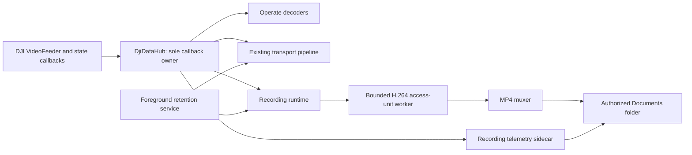

# Local Primary Recording - Plan

## Goal Capsule

- **Objective:** Let an operator retain a playable local recording of the live Primary feed and its time-aligned aircraft position independently of the Edge connection.
- **Product authority:** Recording is passive and explicitly operator-controlled. It must not issue aircraft commands, add competing DJI callbacks, or degrade Primary display and Edge transport.
- **Means:** Add a Primary-only MP4 recorder and telemetry sidecar behind the existing `DjiDataHub`, retained by the existing foreground-service lifecycle.
- **Open blockers:** None. Hardware validation requires a connected aircraft that provides a live Primary H.264 feed.

---

## Product Contract

### Summary

Operate gains a compact recording dropdown beside `SOURCES`. The operator starts and stops one Primary-video recording session, then retrieves the MP4, timestamped telemetry sidecar, and diagnostics from an authorized shared folder.

### Problem Frame

Primary video and position are valuable flight evidence while the Edge video path is under diagnosis. Current diagnostics are app-specific and there is no operator-facing way to retain the displayed feed locally.

### Key Decisions

- KTD1. **Record Primary only.** (session-settled: user-directed — chosen over Primary and FPV: Primary is the reliable evidence source.) Governs R2, R8.
- KTD2. **Use Record/Stop only.** (session-settled: user-directed — chosen over pause/resume segments: one continuous capture is clearer and safer.) Governs R3, R6.
- KTD3. **Retain active recording outside the visible UI.** (session-settled: user-directed — chosen over view-owned capture: evidence must continue through navigation and Android backgrounding.) Governs R5.
- KTD4. **Use a user-authorized shared folder.** (session-settled: user-approved — chosen over app-specific storage: the output must remain easy to retrieve with MP4 and telemetry together.) Governs R13.

### Requirements

**Operator control and visibility**

- R1. Operate shall show a compact recording dropdown immediately beside `SOURCES`, with `RECORD` while idle and `STOP` while active.
- R2. `RECORD` shall begin Primary-only recording and expose active state plus elapsed duration.
- R3. `STOP` shall finalize the active MP4 and sidecar, then return the control to idle.
- R4. The control shall explain why recording cannot start when the Primary stream, authorized storage, capacity, or output writer is unavailable.

**Capture integrity**

- R5. A recording shall continue while the operator navigates screens or backgrounds the app, with an ongoing system notification.
- R6. The app shall not present a pause state. It shall record an unexpected storage or process interruption without claiming that an unfinalized MP4 is playable.
- R7. Video writing shall begin only at a decodable Primary boundary containing codec configuration and an IDR.
- R8. Capture shall consume the hub-distributed Primary feed passively. It shall not add a direct DJI `VideoFeeder` listener, decode/re-encode video, alter RTP, or block the callback.
- R9. Recording failure shall stop only recording and leave Primary display and Edge transport independent.

**Telemetry evidence and retrieval**

- R10. Every session shall contain UTF-8 telemetry records with monotonic timestamped flight position, heading, RTK position, and RTK-use state when available.
- R11. Telemetry shall preserve validity and distinguish usable RTK, GPS fallback, and unavailable values.
- R12. Video presentation time and telemetry time shall derive from the same Android monotonic time basis.
- R13. The operator shall choose and persist a shared recording folder through Android's system picker; the recommended target is `Documents/MatriceTransport`, with session outputs grouped below it.

### Key Flows

- F1. **Start capture** — `RECORD` validates persistent folder access, free capacity, and a healthy Primary feed; it starts only when a decodable access unit arrives. Covers R1, R2, R4, R7, R8, R10.
- F2. **Background capture** — while active, changing views or pressing Home retains the service and its hub subscriptions until `STOP` or an interruption. Covers R5, R8, R12.
- F3. **Finalize capture** — `STOP` flushes and finalizes all outputs, records completion, and exposes the idle control. Covers R3, R6, R10, R13.

### Acceptance Examples

- AE1. **Healthy capture:** Given a live Primary feed and writable selected folder, when the operator records then stops, one playable MP4 and one telemetry sidecar appear in the same session directory. Covers R2, R3, R7, R10, R13.
- AE2. **Background continuity:** Given active recording, when the operator opens Mission or presses Home then returns, duration continues and the final file includes that interval. Covers R5, R8.
- AE3. **Failure containment:** Given active display and Edge transport, when recording loses writable storage, recording ends with an explanation while display and Edge transport continue. Covers R4, R9.

### Scope Boundaries

- FPV, audio, cloud upload, automatic recording on takeoff, and Mission recording controls are deferred.
- This does not replace camera SD-card recording or modify camera recording settings.
- User force-stop, tablet shutdown, and system process termination may interrupt an in-progress MP4; finalized files remain intact.

<!-- ce-section: work-relationships -->
### How This Work Fits Together

This work owns local Primary evidence capture. It shares the centralized hub and foreground lifecycle with transport but does not alter the FPV investigation, Edge receiver, ROS pipeline, or flight-control behavior.

---

## Planning Contract

### Context and Research

- `DjiDataHub` is the sole owner of DJI video and telemetry callback registration; its listener fan-out is the required capture boundary.
- `EncodedVideoRtpPipeline` already turns bounded encoded chunks into complete H.264 access units and recovers only from IDR after discontinuity. The recorder should reuse this parsing/assembly behavior without sharing RTP state.
- `TransportForegroundService` already uses `START_STICKY` and reattaches the hub in background, but it currently stops when no Edge endpoint is selected. Recording retention must become an independent keep-alive reason.
- `DjiTelemetryCollector` already maps Flight Controller and RTK events to valid/invalid fields with a monotonic Android clock. The recording sidecar should retain that semantic model without sending Edge packets.
- Android requires H.264 codec-specific data in the `MediaFormat` passed to `MediaMuxer`; AVC is supported in MP4. Android scoped storage requires a persisted Storage Access Framework tree permission to write arbitrary user-visible Documents folders. [MediaCodec](https://developer.android.com/reference/android/media/MediaCodec.html), [MediaMuxer](https://developer.android.com/reference/android/media/MediaMuxer), [Storage Access Framework](https://developer.android.com/training/data-storage/shared/documents-files)

### Key Technical Decisions

- KTD5. **Extract a reusable access-unit pipeline.** Keep existing bounded parser and assembler semantics, but make complete access units available to independent sinks. RTP and recording own separate queues/workers so slow disk never blocks or mutates transport. Governs R7, R8, R9.
- KTD6. **Mux encoded AVC without decode/re-encode.** Convert complete access units into the container sample representation required by `MediaMuxer`; cache SPS/PPS as codec configuration, derive dimensions from accepted AVC configuration, and use session-relative monotonic presentation timestamps. Governs R3, R7, R12.
- KTD7. **Persist an SAF directory URI, not a filesystem path.** A one-time folder chooser grants durable read/write access to the selected folder; all session files are created beneath it through `DocumentFile` and content descriptors. Governs R4, R13.
- KTD8. **Extend the one foreground retention service.** The service remains alive while either an Edge endpoint is selected or recording is active, but each subsystem owns only its own runtime. It never resumes an interrupted MP4 after process recreation. Governs R5, R6, R9.
- KTD9. **Write a recording-specific NDJSON sidecar.** The sidecar receives only flight and RTK hub events plus recording lifecycle entries; it uses existing validity semantics and does not duplicate the Edge wire contract or rich parser diagnostics. Governs R10, R11, R12.
- KTD10. **Model arming separately from active recording.** `RECORD` enters an `ARMING` state while waiting for SPS/PPS + IDR; `STOP` cancels arming safely, and the duration begins only after the muxer starts. Governs R2, R3, R7.
- KTD11. **Guard shared-folder muxing by platform capability.** The app targets a current Android tablet but retains `minSdk 23`; recording requires the API 26 file-descriptor muxer path needed for a persisted SAF folder and shall show an unavailable reason on older devices. Governs R4, R13.

### High-Level Technical Design

The recording runtime is an independent hub listener. Its input boundary only copies incoming bytes into a bounded queue. `RECORD` creates an arming session, and its worker waits for SPS/PPS and an IDR before configuring the muxer and advancing to active recording. The telemetry writer receives the same hub events independently and writes bounded asynchronous records to the session sidecar from one session-relative monotonic origin.

### Dependencies and Sequencing

1. First make H.264 access-unit output reusable and prove it preserves existing RTP behavior.
2. Build recorder state, AVC-to-MP4 conversion, and local sidecar writing behind pure interfaces.
3. Add SAF folder persistence and foreground-service retention before exposing the control.
4. Add the Operate dropdown last, then verify full device flow with a live Primary feed.

### Deferred to Implementation

- Tune the minimum free-space reserve against measured Primary bitrate; start with a conservative fixed reserve visible in the rejected-start reason.
- If live Primary SPS cannot produce valid muxer dimensions, preserve diagnostics and reject start rather than guessing resolution.

---

## Implementation Units

### U1. Reuse bounded H.264 access units

- **Goal:** Make existing Annex-B/AVCC parser and assembler usable by both RTP and recording without changing DJI callback ownership. Covers R7, R8, R9; F1; AE1, AE3.
- **Files:** `Sample Code/app/src/main/java/com/dji/sdk/sample/transport/video/EncodedVideoRtpPipeline.java`, new access-unit pipeline/support classes under `Sample Code/app/src/main/java/com/dji/sdk/sample/transport/video/`, `Sample Code/app/src/main/java/com/dji/sdk/sample/transport/network/VideoStreamSender.java`, `Sample Code/app/src/test/java/com/dji/sdk/sample/transport/video/TransportPrimitivesTest.java`, new recording-pipeline unit test.
- **Approach:** Extract only generic bounded ingress, parser, discontinuity, and access-unit drain behavior. Keep RTP packetization transport-specific. Give recording its own bounded queue and worker, with explicit drop/discontinuity recovery to the next IDR.
- **Test scenarios:** Existing Annex-B and AVCC paths remain packetizable; recorder consumer receives SPS/PPS/IDR access units in decode order; recorder queue overflow does not alter RTP counters or emitted RTP; discontinuity causes recorder recovery at next IDR.
- **Verification:** Existing transport primitive suite and callback-ownership verifier remain green.

### U2. Implement a passive Primary MP4 recorder

- **Goal:** Convert complete encoded Primary access units into a finalized playable MP4 without decoding or re-encoding. Covers R3, R6, R7, R8, R9, R12; F1, F3; AE1, AE3.
- **Files:** new `Sample Code/app/src/main/java/com/dji/sdk/sample/recording/` recorder, AVC configuration/sample adapter, recorder state model, diagnostics classes, JVM tests under `Sample Code/app/src/test/java/com/dji/sdk/sample/recording/`, and Android tests under `Sample Code/app/src/androidTest/java/com/dji/sdk/sample/recording/`.
- **Approach:** Cache valid SPS/PPS, enter arming on Record, then start muxer only when an IDR arrives. Create AVC track with codec configuration and submit ordered samples with non-regressing session-relative monotonic timestamps. Stop/failure finalizes/releases exactly once and reports whether output is usable.
- **Test scenarios:** Arming does not create MP4 before IDR; Stop during arming cancels cleanly; build codec configuration from parameter sets; preserve NAL payload order in MP4 samples; reject timestamp regression; Stop is idempotent; writer failure becomes visible without invoking transport; instrumentation opens finalized fixture with `MediaExtractor`.
- **Verification:** Unit tests prove container preparation/lifecycle; connected-tablet smoke records at least 30 seconds and plays output locally or through extracted media inspection.

### U3. Add recording telemetry and session evidence

- **Goal:** Persist flight and RTK state beside MP4 with reviewable monotonic timestamps and validity. Covers R6, R10, R11, R12; F1, F3; AE1.
- **Files:** new recording telemetry writer/model classes under `recording/`; existing telemetry model/diagnostic helpers only where shared serialization prevents validity drift; matching JVM and instrumentation tests.
- **Approach:** Subscribe through `DjiDataHub`, capture only flight and RTK events during recording, and write asynchronous bounded NDJSON plus lifecycle records. Store raw validity rather than choosing RTK or GPS for reviewer.
- **Test scenarios:** Flight valid/invalid fields serialize without NaN or invented values; RTK use and invalid fusion remain distinct; timestamps share recorder monotonic basis; queue overflow is counted and never blocks hub callback; close flushes accepted records.
- **Verification:** Inspect one recorded sidecar for session header, flight/RTK events, monotonic times, and terminal outcome.

### U4. Add authorized shared storage and retention lifecycle

- **Goal:** Let operator choose retrievable recording destination and retain capture while UI is backgrounded. Covers R4, R5, R6, R9, R13; F2, F3; AE2, AE3.
- **Files:** new recording folder preferences/session-output classes; `Sample Code/app/src/main/java/com/dji/sdk/sample/internal/controller/MainActivity.java`; `Sample Code/app/src/main/java/com/dji/sdk/sample/transport/TransportForegroundService.java`; `Sample Code/app/src/main/java/com/dji/sdk/sample/transport/TransportSessionManager.java`; `Sample Code/app/src/main/AndroidManifest.xml`; string resources; instrumentation tests for persisted URI permissions/lifecycle state.
- **Approach:** Launch `ACTION_OPEN_DOCUMENT_TREE` from explicit Settings action, take persistable URI permission, and create session MP4/NDJSON/diagnostics through selected tree. Start retention service from explicit Record action; change its stop policy from “no endpoint” to “no endpoint and no active recording”. Use the file-descriptor muxer only on API 26+; on recreation mark unfinished session interrupted rather than appending unsafe MP4.
- **Test scenarios:** Unsupported platform yields actionable rejection; no authorized folder yields actionable rejection; selected tree URI survives recreation; output names remain inside generated session folder; recording keep-alive survives navigation/background; clearing Edge endpoint does not stop active recording; an interruption marker appears when startup finds unfinished state.
- **Verification:** On tablet, choose `Documents/MatriceTransport`, record while pressing Home, return, stop, and retrieve session through file manager or USB transfer.

### U5. Expose recording in Operate and Settings

- **Goal:** Give operator small Record/Stop control and one-time folder setup without disturbing Sources, status, gimbal, FPV, or menu interactions. Covers R1, R2, R3, R4, R5; F1, F2, F3; AE1, AE2, AE3.
- **Files:** `Sample Code/app/src/main/res/layout/view_operate_mvp.xml`, `Sample Code/app/src/main/java/com/dji/sdk/sample/operate/OperateMvpView.java`, `Sample Code/app/src/main/java/com/dji/sdk/sample/operate/OperateShellState.java`, Settings rendering in `OperateMvpView.java`, new UI state tests and targeted Android UI smoke coverage.
- **Approach:** Add one mutually exclusive dropdown beside Sources. Closed label is state-derived; open panel exposes Record, Stop, `ARMING` while waiting for decodable video, elapsed duration after start, capacity, destination readiness, and one concise failure reason. Add Settings action `CHOOSE RECORDING FOLDER`; it never opens picker automatically.
- **Test scenarios:** Idle/arming/active labels render correctly; Record cannot start without readiness and explains why; Stop cancels arming or finalizes active recording; opening recording closes Sources/other exclusive panels; returned folder selection updates readiness; status refresh does not replace active control mid-touch.
- **Verification:** Test-mode tablet smoke validates touch targets, panel placement, state changes, and unchanged Sources/FPV/gimbal behavior.

### U6. Verify integration, ownership, and recovery

- **Goal:** Prove recording is independent from transport and respects hub contract under live conditions. Covers R5, R8, R9, R10, R12; AE1, AE2, AE3.
- **Files:** `scripts/test_android.sh`, existing `scripts/verify_dji_callback_ownership.sh`, targeted Android instrumentation registration, and concise operator documentation in `README.md` or current operator guide.
- **Approach:** Extend ownership checks so no recording class can register DJI setter/video callbacks. Add recording tests to existing runner. Document one-time folder choice, Record/Stop, expected files, background behavior, and interruption limitation.
- **Test scenarios:** Full suite passes; APK builds/verifies; recording while Edge configured does not alter Primary RTP count/socket state; recording without Edge endpoint works; background recording persists; Stop creates playable MP4/sidecar; no direct callbacks appear outside `DjiDataHub`.
- **Verification:** Run Android test/build/APK checks, install tablet build, and complete connected-aircraft smoke without flight command.

---

## Verification Contract

| Gate | Applies to | Evidence of success |
| --- | --- | --- |
| JVM regression suite | U1-U6 | Existing transport, hub, operate, and new recording tests pass through `scripts/test_android.sh`. |
| Callback ownership | U1, U3, U4, U6 | `scripts/verify_dji_callback_ownership.sh` reports recording uses only `DjiDataHub` subscriptions. |
| Debug build and APK verification | U1-U6 | `scripts/build_android.sh :app:assembleDebug` and `scripts/verify_apk.sh` pass. |
| Android runtime tests | U2-U5 | Instrumentation covers persisted tree URI, muxed fixture extraction, and local state persistence. |
| Tablet UI smoke | U4-U5 | Folder chooser, Record/Stop state, panel placement, and background continuation work without drone commands. |
| Connected-aircraft capture | U1-U6 | One finalized Primary MP4 plays, sidecar timestamps correlate, and display/Edge transport remain healthy. |

---

## Risks and Operational Notes

- **MP4 framing risk:** DJI delivers encoded chunks rather than files. Mitigation: accept only completed access units after SPS/PPS + IDR, test container adaptation, reject starts without valid track.
- **Storage risk:** Shared Documents needs persisted grant and can become unavailable. Mitigation: preflight capacity/access, explicit state, isolated stop behavior.
- **Background risk:** Android can terminate a foreground service exceptionally. Mitigation: ongoing notification, `START_STICKY`, interruption markers, no unsafe append after recreation.
- **Performance risk:** Disk I/O can cause callback pressure. Mitigation: bounded queue, dedicated worker, drop accounting, no disk work inside hub dispatch.
- **Transport regression risk:** Parsing/writing must not alter Edge video. Mitigation: independent pipeline state, unchanged RTP sender, concurrent recording/transport validation.

## Definition of Done

- Operator authorizes a shared `MatriceTransport` folder once, records Primary, backgrounds app, returns, stops, and retrieves a playable MP4 plus synchronized telemetry sidecar.
- Recorder has no direct DJI callback registration, does not decode/re-encode, and issues no flight commands.
- Missing folder access, no valid Primary boundary, low storage, and writer failure give clear recording-only feedback while display/transport remain independent.
- JVM, instrumentation, build, APK, callback-ownership, and live-tablet smoke gates in Verification Contract pass.
