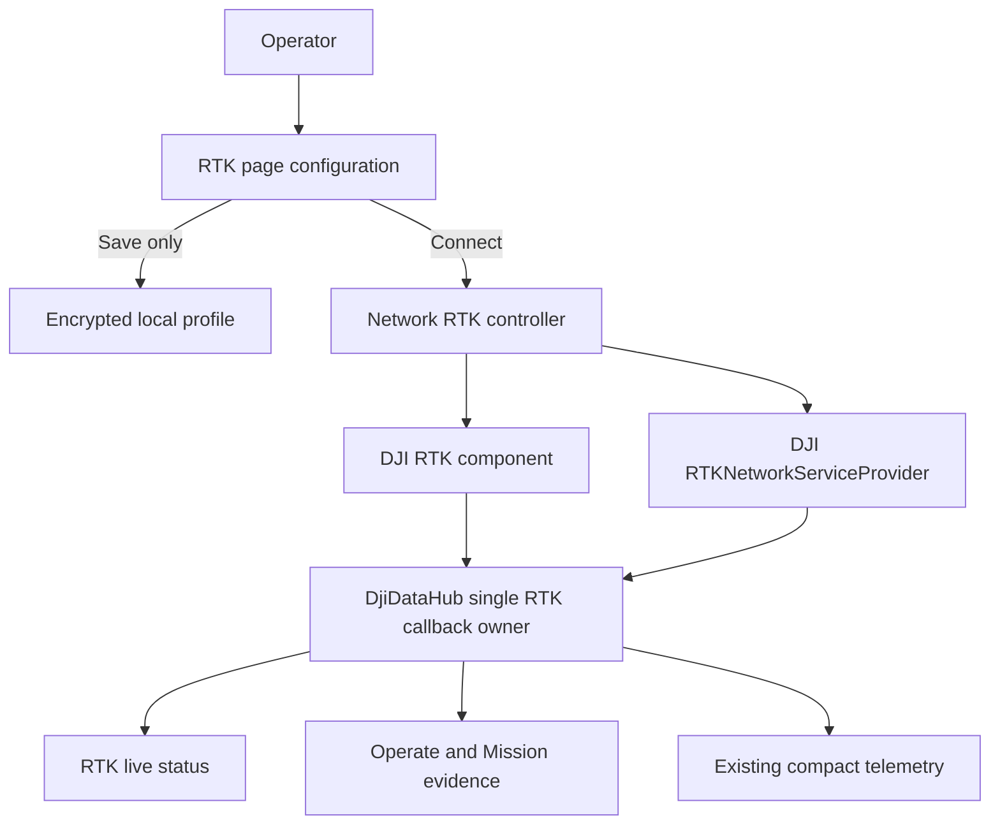

# Custom Network RTK (NTRIP)

## Goal Capsule

- **Objective:** The operator can configure a third-party NTRIP caster, explicitly connect or disconnect its DJI RTK service, and see a truthful live RTK solution and correction-channel state without losing the ability to run ordinary GPS work when RTK is unavailable.
- **Means:** Add a `RTK` page immediately before `SETTINGS` in the Operate menu, backed by DJI Mobile SDK 4.18's custom network RTK service and the existing process-wide `DjiDataHub` RTK fan-out.
- **Product authority:** The supplied DJI Pilot screens define the configuration fields and the two-part configuration/status workflow. The current Operate light, compact visual system remains the visual authority.
- **Open blocker:** The final hardware proof requires a reachable NTRIP caster and valid credentials while the M210 RTK V2 is connected. The app must report DJI's returned error instead of treating a successful button press as a FIX.

---

## Product Contract

### Summary

The app will expose DJI custom network RTK/NTRIP as an operator-controlled service, not as an Android-built NTRIP client.
It will persist a reusable profile locally, let the operator connect or disconnect deliberately, and present connection health, positioning quality, coordinates and satellite evidence in one scrollable page.
RTK is advisory in this app: loss of FIX is visible, but does not add an app-side block to ordinary mission upload/start or manual Cendence control.

### Problem Frame

The current app receives live RTK samples but only reduces them to a compact header/status value.
It has no operator-facing way to configure a third-party correction service, distinguish a failed NTRIP login from a non-FIX solution, or inspect the evidence that DJI is actually using RTK corrections.
The field test also showed that the operator must be able to separate an app readiness message from an aircraft firmware/Cendence refusal.

### Key Decisions

- KTD1. **DJI owns the NTRIP transport.** The app passes a `NetworkServiceSettings` profile to `RTKNetworkServiceProvider`; it will not open a second NTRIP socket or relay RTCM itself. Governs R6, R7.
- KTD2. **One callback authority.** `DjiDataHub` remains the only owner of `RTK.setStateCallback`; it also owns lifecycle-safe source and network-service subscriptions before fanning immutable state out to UI, recording and transport. Governs R8, R9.
- KTD3. **RTK is informative, not an app flight lock.** The new page and existing readiness summaries may warn about non-FIX or unavailable RTK, but they must not block manual control or ordinary GPS mission actions on that basis. This does not bypass an aircraft or Cendence firmware refusal. (session-settled: user-directed — chosen over RTK-required mission gating: the operator wants ordinary flight available without RTK.) Governs R10, R14.
- KTD4. **Persist the profile safely.** Host, port, username and mountpoint are retained; the password is stored with Android Keystore-backed encryption and never rendered, exported, logged or transported to Ubuntu. Governs R3, R5, R13.

### Requirements

**Menu and configuration**

- R1. The Operate menu has an `RTK` entry directly before `SETTINGS`, and the shell title changes to `RTK` while its page is shown.
- R2. The RTK page is a single vertically scrollable surface with a compact configuration section above the live-status section.
- R3. Configuration accepts NTRIP Host, Port, User, Password and Mountpoint, validates only locally knowable form errors before an explicit action, and restores the saved profile without displaying the stored password as plain text.
- R4. `SAVE CONFIGURATION` saves a valid profile without connecting to DJI or changing flight state.
- R5. `CONNECT RTK` is an explicit operator action that uses the currently shown profile; `DISCONNECT` is an explicit action that stops only the DJI network RTK service.

**DJI integration and state**

- R6. On Connect, the app verifies the connected aircraft exposes RTK, applies `NetworkServiceSettings`, enables RTK only through the DJI API when needed, selects the supported custom-network reference source, and starts the DJI provider in the documented order.
- R7. Every asynchronous DJI completion result maps to a specific live UI state and actionable message, including unavailable aircraft/RTK, invalid local form, connecting, transmitting, authentication failure, caster/network unreachable, source-selection failure and generic DJI error.
- R8. `DjiDataHub` remains the sole setter-callback owner for `RTKState`, and it exposes fresh immutable snapshots for the page, Operate header, Mission, recorder and Edge telemetry.
- R9. The page shows the selected reference source and provider channel state from centrally owned subscriptions; it must remove subscriptions cleanly on aircraft session replacement or app shutdown.
- R10. Positioning status is live and truthful: `NONE`, `SINGLE`, `FLOAT`, `FIX`, `UNKNOWN`, `RTK IN USE` and the sample age are distinct facts. A connected NTRIP channel must never be presented as a FIX, and a non-FIX state is advisory rather than an app-side flight lock.

**Live visualisation**

- R11. The status section identifies the correction service state at the top, then shows two labeled columns: aircraft/mobile RTK and reference/base when DJI exposes that value.
- R12. The coordinate table presents latitude, longitude and altitude only when the corresponding DJI value is valid. Unavailable or unsupported values render as `--`; it never invents a base coordinate from the NTRIP profile.
- R13. The satellite table shows each supported constellation separately for the aircraft/mobile receiver and base/reference receiver: GPS, BeiDou, GLONASS and Galileo. Unsupported constellations render as `--`, and credentials never appear in status, diagnostics or Edge packets.
- R14. Existing Operate and Mission status may link to the RTK page and show concise live RTK evidence, but absence of RTK/FIX alone cannot make the app reject an ordinary GPS mission action. Other existing safety, mission validity and DJI firmware responses remain intact.

**Reliability and observability**

- R15. The UI coalesces high-rate hub state onto the main thread and has no direct DJI setter callback, blocking networking or credential logging on the UI thread.
- R16. The session timeline and local diagnostics record sanitized operation/result names and DJI error descriptions, never NTRIP host credentials, password or correction payload.

### Actors

- **Operator:** enters a caster profile, deliberately connects/disconnects it, reads the real RTK state and decides whether its precision is adequate for the task.
- **DJI RTK/network provider:** applies the reference-source configuration, connects to the caster, streams corrections and returns channel/state errors.
- **DjiDataHub:** owns callback lifecycle, creates a coherent state snapshot and fans it out without competing setters.
- **Aircraft firmware/Cendence:** remains authoritative for hardware-level readiness and may still reject an operation independently of this app's advisory RTK presentation.

### Key Flows

- F1. Save a profile
  - **Trigger:** Operator enters a valid NTRIP profile and presses `SAVE CONFIGURATION`.
  - **Steps:** The page validates required text and port range, encrypts the secret, persists the profile, and confirms that it was saved without contacting DJI.
  - **Outcome:** The next visit restores the non-secret fields and presents an obscured password state. Covers R3, R4, R13.

- F2. Connect NTRIP
  - **Trigger:** Operator presses `CONNECT RTK`.
  - **Steps:** The controller verifies the current aircraft/RTK capability, obtains the saved/current secret, configures DJI's custom network settings, performs compatible RTK/source setup, starts the provider and reports each result.
  - **Outcome:** The page moves through `CONNECTING` to the received provider state. It does not call a flight, arm, takeoff, mission or gimbal command. Covers R5, R6, R7.

- F3. Observe RTK quality
  - **Trigger:** DJI publishes RTK or network service state.
  - **Steps:** `DjiDataHub` updates the immutable snapshot and fans it out; the attached page renders coalesced state on the main thread.
  - **Outcome:** The operator can distinguish transport-channel status, positioning solution, whether RTK is used, sample freshness, coordinates and constellation counts. Covers R8-R13, R15.

- F4. Work without FIX
  - **Trigger:** RTK is disconnected, stale, `SINGLE`, `FLOAT` or `UNKNOWN`.
  - **Steps:** The page and concise Operate/Mission status show an advisory state with available DJI error detail.
  - **Outcome:** The app does not add an RTK-only rejection to ordinary GPS mission/manual paths; any DJI hardware refusal remains visible as DJI-originated. Covers R10, R14.

### Acceptance Examples

- AE1. **Saved caster profile:** Given a valid profile was saved, when RTK page is reopened, then host, port, user and mountpoint are restored, the password remains obscured, and no connection starts by itself. Covers R3, R4.
- AE2. **No aircraft:** Given no compatible aircraft is attached, when Connect is pressed, then the page remains usable and reports `AIRCRAFT/RTK UNAVAILABLE` without attempting an NTRIP connection. Covers R5-R7.
- AE3. **Bad credentials:** Given the DJI provider reports login/authentication failure, when its state arrives, then the page shows the error and never claims that RTK data is in use. Covers R7, R10.
- AE4. **Channel but no fix:** Given the provider is transmitting and `RTKState` is `FLOAT`, when the page renders, then it shows `CONNECTED` and `FLOAT` separately, with `RTK IN USE` only if DJI says so. Covers R10-R12.
- AE5. **Valid correction solution:** Given `RTKState` reports `FIXED_POINT` and `isRTKBeingUsed=true`, when fresh state arrives, then the page shows `FIX`, `RTK IN USE`, mobile values and each available constellation count. Covers R10-R13.
- AE6. **GPS work without RTK:** Given RTK has no FIX, when an ordinary GPS mission action is initiated, then the app does not reject it solely for RTK; any existing non-RTK validation and DJI response remain unchanged. Covers R14.

### Scope Boundaries

**Deferred for later**

- Caster discovery/sourcetable browsing, multiple named profiles, automatic reconnect policy, base-station survey workflows and precision-health thresholds beyond DJI's own state.
- Exporting a sanitized RTK status summary to recordings or the Edge dashboard beyond the existing compact RTK telemetry contract.

**Outside this product's identity**

- Implementing an independent Android NTRIP/RTCM client, relaying correction payloads to Ubuntu, or sending NTRIP credentials outside the tablet.
- Bypassing, suppressing or modifying DJI aircraft/Cendence firmware safety restrictions, flight authorization or manual stick logic.
- Claiming an NTRIP connection, GPS signal or UI checklist makes the aircraft ready to fly.

### Dependencies and Assumptions

- DJI Mobile SDK 4.18 documents `RTKNetworkServiceProvider` custom NTRIP configuration and lists Matrice 210 RTK V2 as supported; actual source-selection behavior must be proven on the connected aircraft because some older API reference text has narrower product notes.
- A reachable NTRIP caster, valid credentials, cellular/Wi-Fi network access and sufficient satellite visibility are external prerequisites for a FIX.
- The current app's `DjiDataHub` and its RTK snapshot are the compatibility seam; direct `RTK.setStateCallback` registrations outside the hub are a regression.

---

## Planning Contract

- KTD5. **Separate commands from observations.** `NetworkRtkController` serializes explicit Connect/Disconnect requests and reports results to the hub model. `DjiDataHub` owns RTK-state, reference-source and provider-state observations. This avoids hidden reconnects and callback ownership ambiguity.
- KTD6. **Use a small presentation model.** `NetworkRtkUiState` derives display strings and freshness from raw DJI values so `OperateMvpView` renders the page without API-specific branches.
- KTD7. **Keep the profile local.** A profile repository owns validation, `SharedPreferences` storage and Android Keystore encryption. It exposes masked display data, not secrets.
- **Execution note:** Characterize the existing hub/readiness behavior before changing it. Test pure state and profile code on the JVM; use the existing Java 11 Android scripts for integration/build proof. Aircraft/caster connection remains a hardware acceptance gate.

---

## Implementation Units

### U1. RTK service state and profile boundary

- **Goal:** Represent one valid NTRIP profile and one truthful UI state without retaining/logging an exposed password.
- **Files:** `Sample Code/app/src/main/java/com/dji/sdk/sample/rtk/NetworkRtkProfile.java`, `NetworkRtkProfileStore.java`, `NetworkRtkUiState.java`, and focused tests under `Sample Code/app/src/test/java/com/dji/sdk/sample/rtk/`.
- **Patterns:** Follow `MissionDefaults`/settings persistence for non-secret values and Android Keystore conventions already available in the app; profile validation must be pure and testable.
- **Test scenarios:** missing host/mountpoint; port outside 1–65535; valid IP and DNS host; password never present in masked status; unsupported receiver information renders unavailable; FIX, FLOAT and channel errors remain distinct.
- **Verification:** JVM unit suite proves validation, masking and state mapping.

### U2. Central DJI RTK coordinator

- **Goal:** Add one coordinator that executes explicit DJI NTRIP operations and extend `DjiDataHub` with centrally owned reference-source/provider-state observations.
- **Files:** `Sample Code/app/src/main/java/com/dji/sdk/sample/djihub/DjiDataHub.java`, new `Sample Code/app/src/main/java/com/dji/sdk/sample/rtk/NetworkRtkController.java`, and hub/controller tests.
- **Patterns:** Match existing `DjiDataHub` identity checks, listener subscriptions and session clearing. The controller calls `setCustomNetworkSettings`, compatible custom source selection, `setRtkEnabled(true)` only after an explicit Connect, `startNetworkService`, and `stopNetworkService`; it never calls flight or mission APIs.
- **Test scenarios:** no aircraft/RTK; ordered success chain; first DJI error stops subsequent steps; session replacement ignores late completion; disconnect only stops provider; callbacks are subscribed/unsubscribed once; no second `RTK.setStateCallback` exists.
- **Verification:** source-level callback ownership verifier plus focused tests and build.

### U3. Operate menu and RTK page

- **Goal:** Add the compact, scrollable RTK page immediately before Settings, with configuration above live status.
- **Files:** `Sample Code/app/src/main/res/layout/view_operate_mvp.xml`, `Sample Code/app/src/main/java/com/dji/sdk/sample/operate/OperateShellState.java`, `OperateMvpView.java`, and UI/presentation tests where practical.
- **Patterns:** Reuse the existing page overlay, shell title, menu buttons, compact neutral background, and main-thread render coalescing. Do not add a persistent video renderer or feed callback to this page.
- **Test scenarios:** menu ordering/title; saved profile restoration with masked password; save does not connect; Connect/Disconnect render pending and result states; status renders source/channel/solution/age; coordinate and constellation cells show `--` if unavailable; scrolling exposes the full status table.
- **Verification:** layout/resource build plus tablet smoke test through `TEST` entry when no aircraft is attached.

### U4. RTK advisory policy and operator diagnostics

- **Goal:** Remove RTK-only app-side blocking while preserving all non-RTK readiness and DJI firmware outcomes.
- **Files:** `Sample Code/app/src/main/java/com/dji/sdk/sample/operate/FlightReadinessModel.java`, `FlightReadinessStore.java`, `MissionMvpView.java` only if it passes an RTK-required flag, diagnostic/timeline seam and tests.
- **Patterns:** Keep RTK rows and warnings; normalize any internal `rtkRequired` input to advisory behavior rather than delete unrelated aircraft, battery, home, route or physical-review checks.
- **Test scenarios:** no RTK/FLOAT/FIX each affect advisory presentation; an ordinary GPS mission is not rejected solely for RTK; unrelated critical battery/home/route errors still reject as before; sanitized connection result reaches diagnostics.
- **Verification:** existing readiness and mission JVM tests plus manual test of error/result text on tablet.

---

## Verification Contract

| Gate | Applies to | Evidence of success |
| --- | --- | --- |
| Focused JVM tests | U1, U2, U4 | Profile validation/masking, RTK state mapping, coordinator sequencing and advisory readiness assertions pass. |
| Existing Android test suite | U1-U4 | `scripts/test_android.sh --offline` passes on Java 11. |
| Debug APK build | U1-U4 | `scripts/build_android.sh :app:assembleDebug` succeeds. |
| APK verification | U1-U4 | `scripts/verify_apk.sh` accepts the built APK. |
| Callback ownership scan | U2 | `scripts/verify_dji_callback_ownership.sh` confirms no direct RTK setter callback outside the hub. |
| No-aircraft UI smoke | U3 | Through the tablet `TEST` entry, RTK page opens, scrolls, saves/restores a masked profile and reports unavailable hardware without a crash. |
| Connected NTRIP bench | U2-U4 | On an M210 RTK V2 with a reachable caster, Connect exposes source/channel progress; credentials failure, network failure and `FIXED_POINT` are distinguishable; `isRTKBeingUsed` is shown only when true. |
| Flight behavior check | U4 | The app adds no RTK-only rejection to a GPS mission action. Any Cendence/aircraft refusal is recorded as a DJI result and not misrepresented as app policy. |

---

## Definition of Done

- The `RTK` menu page appears directly before `SETTINGS` and is usable in the no-aircraft test entry.
- A valid NTRIP profile persists without exposing its password in UI, logs, recordings or Edge transport.
- Connect and Disconnect are visible, explicit actions that use the supported DJI MSDK 4.18 custom network RTK API.
- Network channel, selected source, solution, RTK-in-use fact, freshness, available coordinates and available constellation counts come from live DJI state through the hub.
- RTK absence or non-FIX is advisory in the app and cannot alone produce an app-side manual/GPS-mission rejection.
- No automatic flight, arm, takeoff, landing, mission or gimbal command is added.
- All listed automated checks pass, and the hardware NTRIP bench result is reported separately from build success.
