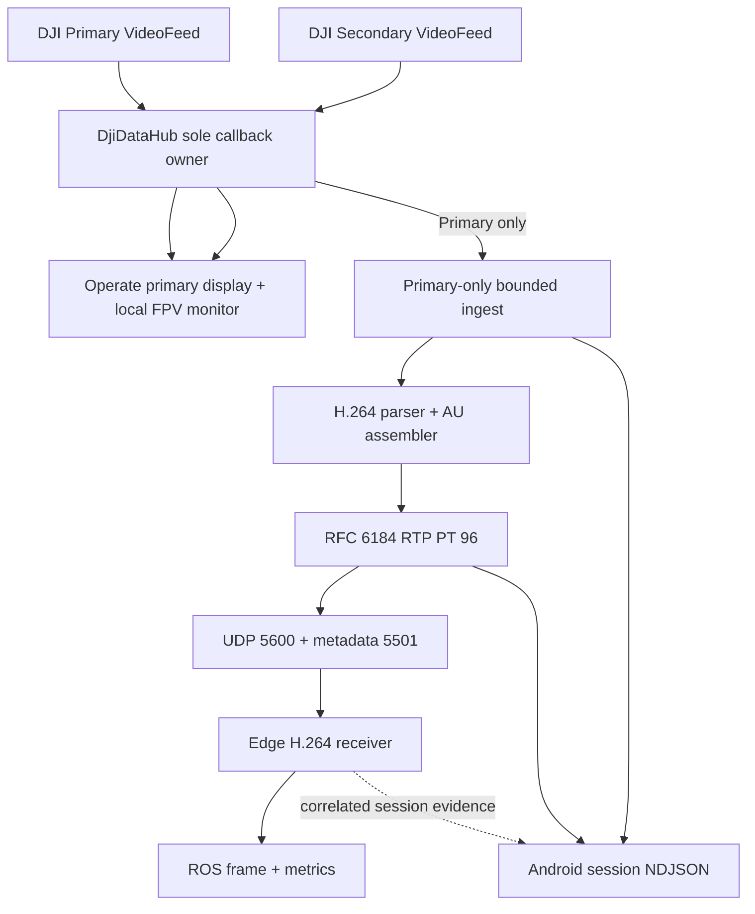

# fix: Make Primary-only Edge video transport reliable

## Execution status — 2026-09-14

- **Android U1–U3 source implementation:** complete and build-verified. Transport now creates one Primary sender, no Android transport code references UDP 5610/Secondary counters/FPV metadata, and local FPV remains in `OperateMvpView` through `DjiDataHub`.
- **Android local evidence:** the Transport page now separates connection intent from a compact Primary dashboard: callback/ingest, H.264/AU, Android UDP acceptance/errors, and local incident/reconcile evidence. It deliberately does not claim Edge receipt.
- **Android verification:** `scripts/test_android.sh --offline`, `scripts/build_android.sh :app:assembleDebug`, `scripts/verify_apk.sh`, `git diff --check`, and callback-ownership verification passed on 2026-09-14.
- **Still required:** Edge U4 implementation and one correlated tablet/Edge baseline + fault/soak session. The Edge repository had uncommitted work from its owner during this execution, so it was not overwritten.

## Goal Capsule

- **Objective:** Make the Android-to-Ubuntu transport carry one reliable Primary H.264 video feed plus the existing compact telemetry, metadata, and clock traffic. Remove all Secondary/FPV transport work so it cannot consume CPU, memory, Wi-Fi airtime, sockets, health fields, diagnostics, or Edge receiver resources.
- **Scope:** FPV remains a local Operate feature: `DjiDataHub` owns the DJI Secondary listener and `OperateMvpView` decodes/renders the movable FPV surface. Transport consumes only `DjiDataHub.Feed.PRIMARY`.
- **Means:** Simplify `TransportRuntime` to one Primary sender, one RTP port (5600), Primary-only access-unit metadata (5501), Primary-only health counters, bounded per-session diagnostics, and a small socket-recovery policy. Preserve endpoint/foreground-service lifecycle and hub ownership.
- **Authority:** Passive transport and diagnostics only. No DJI flight, camera, RTK, mission, source-selection, or network configuration command is added. The plan does not change local FPV behavior or attempt HEVC/H.265 transport.
- **Stop condition:** A successful APK is not proof of delivery. Completion requires Android and Edge to agree, for the same session, that Primary moved from DJI callback through H.264 access unit, RTP packetization, Android socket acceptance, UDP receipt, decoding, and ROS publication without unresolved local sender faults. Every reproduced interruption must identify its last progressing boundary; a clean run that does not reproduce the intermittent freeze is reported only as a clean soak.

---

## Product Contract

### Problem Frame

`TransportRuntime` currently creates two `VideoStreamSender` instances: Primary on UDP 5600 and Secondary on UDP 5610. Both use an H.264-only parser and packetizer. Field evidence in `docs/TODO.md` establishes that Secondary `FPV_CAM` bytes are HEVC/H.265, so its H.264 sender creates no valid access units or RTP. Keeping that transport branch adds callback copies, queue/parser work, a worker thread, a UDP socket, metadata traffic, health fields, and diagnostics without operational value.

Primary is the only stream needed by the Edge now. It is already H.264 and previously reached the Ubuntu bench. The report that RTP/UDP stopped cannot be safely fixed by guessing at ports or GStreamer: the sender catches socket exceptions with only aggregate evidence, while the UI does not distinguish runtime lifecycle, missing DJI callbacks, H.264 keyframe recovery, local send failure, or Edge reception/decoder failure.

The plan reduces the system rather than adding HEVC. Local FPV remains independent because `OperateMvpView` uses `DJICodecManager` through the hub fan-out—not the Android-to-Edge RTP path.

Primary failure investigation must explicitly cover four boundaries. On Android: DJI/SDK callbacks can stop, bounded ingest can drop chunks, the H.264 parser/assembler can wait for an SPS/PPS/IDR boundary, or the UDP sender can fail. Across the network: UDP/RTP can be lost, reordered, or arrive in bursts; H.264 cannot reconstruct a damaged access unit and must wait for the next IDR. On Edge: the socket can receive packets while the RTP caps, depayloader, parser, `nvh264dec`, or downstream ROS path rejects or stalls. The plan records a distinct measurement at every boundary so no layer is changed based on a symptom from another.

Current Edge evidence shifts the priority toward an interruption before the decoder: when RTP is present, `decoded_count == published_count`; the UDP socket has no queue/backlog or old frames; `pipeline_error` is empty; and the stream resumes by itself after seconds with no GStreamer error. This does not prove that the Edge can never fail, but it proves that the observed freeze did not accumulate delay in its decode/publish path. The next Primary investigation must capture why RTP becomes absent at the Edge: Android callback/queue/parser/sender state versus network loss/burst evidence.

The current Android counter is not sufficient evidence. In `VideoStreamSender.acceptPacket()`, `rtpPacketCount` is incremented after `send()` even though `send()` catches its exception and returns no result. A failed datagram therefore still increments `primary_rtp_packets`. The implementation must correct this before using Android-versus-Edge deltas to diagnose loss. Packetization, attempted send, successful handoff to the Android UDP socket, and Edge receipt are four different facts.

The conclusive diagnosis target is not “add more logs.” It is a bounded incident record that freezes the relevant stage counters and monotonic timestamps before parser/socket recovery changes them. For every multi-second Primary outage, one Android incident and one Edge incident must identify the last stage that continued making progress. This must distinguish a stopped DJI callback, ingest loss, parser/AU starvation, local socket failure, network delivery gap, and Edge decode/publish failure without recording video payloads or adding acknowledgements to the live RTP path.

### Current Diagnosis Baseline

| Confidence | Finding | Consequence for this plan |
| --- | --- | --- |
| Proven from source | Secondary/FPV transport is sent through an H.264-only pipeline although captured FPV bytes are HEVC; it cannot produce useful RTP in the current implementation. | Remove the Secondary transport branch and keep FPV local only. |
| Proven from Edge evidence for the observed freeze | RTP receipt stops for seconds and resumes; whenever RTP exists, decoded and published counts match, with no receive backlog, stale-frame accumulation, or GStreamer pipeline error. | Do not begin by changing GStreamer/ROS. Diagnose the boundary before Edge decode. |
| Proven from Android source | `primary_rtp_packets` increments even after a caught send exception, so its present value is an attempt-like count and can falsely appear successful. | Correct counter semantics before comparing Android and Edge. |
| Proven from Android source | The media worker and diagnostic-rate loop have no outer non-fatal exception guard, while foreground-service reconciliation currently suppresses its exception. | Add bounded worker/monitor liveness and exception evidence so an upstream thread failure cannot be silent. |
| Proven from Android source | Each completed AU is buffered, then its RTP packets are sent in a tight worker loop through a socket requesting a 4 MiB send buffer; effective buffer size, send duration, and burst shape are not measured. | Instrument this behavior. Do not change pacing or buffer size until loss correlation proves it contributes. |
| Not yet proven | Whether the real interruption begins at DJI callback, bounded ingest, parser/AU, Android socket, Android network routing/Wi-Fi, or Edge socket availability. | The next reproduced incident must classify the last progressing boundary. No layer-specific “fix” closes the issue without that evidence. |

### Requirements

**Primary-only transport**

- R1. `TransportRuntime` shall process only `DjiDataHub.Feed.PRIMARY` bytes. It shall not instantiate a Secondary sender, copy Secondary bytes into a transport queue, parse Secondary bytes, emit FPV metadata, or open/send UDP 5610.
- R2. The Android media contract shall be: Primary H.264 Annex-B to RTP RFC 6184 on UDP 5600 with payload type 96; one `video_au` metadata record per Primary access unit on UDP 5501 with `feed: "primary"`; compact telemetry/health on UDP 5500; and the existing clock responder on UDP 5502.
- R3. Remove Secondary/FPV transport configuration, counters, health fields, diagnostic records, UI labels, test fixtures, documentation claims, and Edge expectations. Retain no unused 5610 setting in the Android transport contract.
- R4. Primary remains bounded and asynchronous. The DJI callback only timestamps/copies into a bounded queue and wakes a worker; parsing, packetization, diagnostics, retries, and I/O never run on the callback thread.
- R5. Removing Secondary transport must not alter local FPV callback ownership, source selection, decode, display, drag/collapse behavior, stale/no-signal behavior, or Operate screen state.

**Primary reliability and observability**

- R6. The selected Edge endpoint remains process-wide intent across Operate, Mission, Settings, Transport, Activity recreation, and normal tablet backgrounding. Endpoint removal/replacement, force-stop, uninstall, or device shutdown end it normally.
- R7. Primary state shall be explicit: `WAITING_FOR_ENDPOINT`, `WAITING_FOR_AIRCRAFT`, `WAITING_FOR_PRIMARY_CALLBACK`, `WAITING_FOR_H264_KEYFRAME`, `EMITTING_PRIMARY`, `PRIMARY_SEND_DEGRADED`, `PRIMARY_ENDPOINT_INVALID`, and `STOPPED`.
- R8. Each Primary local UDP failure shall create bounded, payload-free evidence: leg (`metadata` or `rtp`), configured destination IP/port, exception class/message, monotonic first/last failure, total failures, and last socket-accepted send. Repeated identical failures are coalesced; raw H.264/RTP is never recorded.
- R9. A classified transient Primary socket failure can recreate only the Primary UDP resource from its worker with capped backoff. It preserves endpoint intent, session accounting, bounded queues, and recovers output at the next SPS/PPS/IDR. It must not restart the hub, reconnect DJI, change endpoint, or block UI/DJI threads.
- R10. Reclaimed Secondary resources reduce contention; they do not justify blindly increasing buffers. Primary queue capacity stays bounded and unchanged unless measured Primary drops justify a narrowly tested adjustment. Low latency wins over hiding a slow receiver with a large queue.
- R10a. Primary diagnostics shall separately expose: hub callbacks, accepted chunks, callback/ingest drops, parser-emitted NALs, access units, RTP packets accepted by the Android socket, local sender exceptions, and monotonic transition timestamps. They shall identify whether an interruption occurred before or after the Android UDP boundary.
- R10b. Telemetry shall remain four logical streams sharing UDP 5500: Flight, RTK, gimbal, and health. The application shall forward each native DJI callback rather than impose a synthetic fixed rate. It shall measure per-stream callback and send rates at Android and Edge; historical Flight rate near 5 Hz is an observation, not a limit.
- R10c. Primary video metadata on 5501 shall be measured against complete Primary access units and normally follows frame rate (for example, near 30 datagrams/s at 30 FPS). RTP packet metrics shall distinguish packets from frames/access units and retain the actual byte count and inter-arrival distribution, not infer bitrate from frame rate.
- R10d. Replace the ambiguous RTP accounting with separate monotonic counters for packetized packets, RTP send attempts, RTP sends accepted by `DatagramSocket.send()`, and RTP send failures. Do the same separation for metadata. Keep the compact health field `primary_rtp_packets`, but define and test it strictly as RTP datagrams accepted by the Android socket; keep the additional breakdown in local diagnostics. A failed send shall never increment `primary_rtp_packets`. Android socket acceptance does not prove network or Edge delivery.
- R10e. Detect a Primary outage from lack of stage progress using at most the latest 120 healthy AU intervals and a threshold of `max(2 seconds, 10 × median AU interval)`. This threshold creates evidence only; it shall not stop transport, block callbacks, declare the Edge disconnected, or trigger flight-related behavior.
- R10f. On outage start, capture one payload-free, session-scoped incident snapshot before recovery. It shall contain an incident ID; start/last-progress monotonic times; endpoint and runtime state; aircraft/hub availability; callback, accepted-chunk, queue-depth/high-water/drop/discontinuity, parser NAL/SPS/PPS/IDR, AU, packetized, metadata/RTP attempt-success-failure counters; media-worker/monitor liveness; requested/effective UDP send-buffer size; send-call duration; current/last AU packet and byte counts; socket state/error; last RTP sequence/timestamp range; and app foreground/background state. Coalesce the episode until progress resumes, then write one recovery snapshot with duration and counter deltas. Raw H.264/RTP and credentials are forbidden.
- R10g. Recovery and diagnosis shall be ordered: snapshot first, then the narrowly classified parser/socket recovery. Repeated recovery must not erase the first failure evidence, restart `DjiDataHub`, create a callback owner, or produce unbounded NDJSON/logcat output.
- R10h. A diagnostic classifier shall report the last progressing boundary and one of: `DJI_CALLBACK_STALLED`, `INGEST_DROPPING`, `PARSER_OR_AU_STALLED`, `WAITING_FOR_IDR`, `ANDROID_WORKER_STALLED_OR_FAILED`, `ANDROID_SOCKET_SEND_FAILED`, `NETWORK_DELIVERY_GAP`, `EDGE_DEPAY_OR_DECODE_STALLED`, `ROS_PUBLICATION_STALLED`, or `MULTIPLE_CONTRIBUTING_FAILURES`. Unknown or overlapping evidence must remain explicit; the system shall not force a misleading single cause.
- R10i. The media worker and diagnostic monitor shall expose a monotonic heartbeat and their last non-fatal exception. A `RuntimeException` from parsing, packetization, diagnostics encoding/writing, health emission, or foreground-service reconciliation must be bounded and visible; it shall not silently terminate all future diagnosis or Primary sending. Recovery must be scoped to the failed worker/resource and capped so a deterministic defect cannot create a tight crash loop.
- R10j. Measure per-AU packet/byte count, keyframe flag, worker drain duration, individual UDP send duration, requested/effective `SO_SNDBUF`, and Android socket-accepted burst rate. Do not infer network loss from burst shape alone. Add packet pacing or change socket-buffer size only if a controlled baseline shows that accepted Android microbursts correlate with missing RTP sequence ranges at Edge, and keep any such mitigation within an explicit latency budget.
- R10k. Local diagnostic storage shall be bounded as well as its in-memory queue. Rotate `transport.ndjson` at 16 MiB and retain at most four segments in the current session directory (64 MiB total). Rotation occurs only on the diagnostic writer thread; failure to rotate increments a visible writer error and must not block or terminate video transport.

**Edge integration and proof**

- R11. Edge shall bind only UDP 5600 for video as Primary H.264/RFC 6184/PT96. It shall no longer run or reserve an FPV/5610 pipeline for this application.
- R12. Edge shall report Primary socket packets/bytes, arrival burst/gap observations, RTP sequence gaps, access units, decoded frames, ROS publications, and the last structured GStreamer/decoder error. It must distinguish UDP receipt from successful depayload, H.264 parse, `nvh264dec` decode, and ROS publication; it must tolerate Android/decoder restarts by waiting for SPS/PPS/IDR.
- R13. End-to-end validation requires a shared Android session ID and time interval. Android socket-acceptance evidence and Edge receipt/decode evidence must be compared without treating them as identical; neither side may overwrite the other’s fact.
- R14. Every Primary RTP datagram shall remain at most 1200 bytes at the RTP/UDP payload boundary: 12-byte RTP header plus at most 1188 bytes H.264 payload for a single-NAL packet, or 12-byte RTP plus 2-byte FU-A header plus at most 1186 bytes H.264 payload for FU-A. Edge network accounting shall add IPv4+UDP overhead of 28 bytes per datagram before link-layer framing when computing actual wire rate.
- R15. Edge shall create the matching bounded outage episode from its own first/last packet, RTP sequence, AU, decode, and ROS-publication progress. Android and Edge incidents correlate by session, SSRC, RTP sequence/timestamp range, and the existing monotonic clock mapping. No RTP acknowledgement, resend protocol, RTCP dependency, or new live-path control channel is added.
- R16. Measure the normal Primary IDR/GOP interval. After network loss, the expected decoder blackout may extend until the next IDR; the report must distinguish this recovery wait from a continued transport outage. Android shall continue prepending cached SPS/PPS to IDR as already designed. Forcing camera keyframes or changing encoder settings is outside this fix unless later supported by captured evidence and an explicit plan.

### Scope Boundaries

- Secondary/FPV stays on the tablet only. This plan removes its Edge path, not the local FPV monitor.
- Do not implement HEVC/H.265 parser, assembler, RFC 7798, codec-selection UI, or Edge H.265 work.
- Do not alter flight/RTK/gimbal telemetry except removing Secondary-video health values; do not alter mission, recording, DJI Home, safety, or manual-flight behavior.
- Do not add a direct DJI `VideoFeeder` listener outside `DjiDataHub`, decode/re-encode Primary, add RTCP, change endpoint semantics, or use broadcast discovery.

---

## Planning Contract

### Key Technical Decisions

- KTD1. **Primary is the sole transported video.** Primary H.264 is the operational requirement. Removing known-incompatible Secondary transport is lower-risk and more useful than building HEVC now. Governs R1-R3, R10-R13.
- KTD2. **Local FPV is not transport.** `DjiDataHub` and `OperateMvpView` keep serving FPV locally. Only the transport consumer ignores Secondary bytes, preserving the UI without a second callback owner. Governs R1, R5.
- KTD3. **Android emission and Edge receipt are different facts.** Diagnosis proceeds through lifecycle, callback, keyframe/AU, sender, and receiver stages—not a generic “video stopped” label. Governs R7-R9, R12-R13.
- KTD4. **Recover only the Primary UDP resource.** A capped worker-side socket refresh is appropriate for transient local failure. Recreating the runtime or hub would risk callback loss and conceal lifecycle defects. Governs R6-R9.
- KTD5. **No latency trade for unused capacity.** Removing Secondary frees a worker, socket, parser, metadata, health encoding, diagnostics, and media network traffic. Preemptively enlarging queues would increase latency and hide congestion. Governs R4, R10.
- KTD6. **An outage is diagnosed at the last advancing boundary.** A counter snapshot is taken before recovery and paired with the Edge episode. Android socket acceptance is not called delivery, and Edge absence is not called an Android socket error without supporting evidence. Governs R10a-R10k, R12-R16.

### High-Level Technical Design

### Before/After Transport Contract

| Concern | Current code | Target contract |
| --- | --- | --- |
| DJI video consumer | Transport receives Primary and Secondary fan-out | Transport ignores Secondary; Operate still receives both locally. |
| Sender workers/sockets | Primary + Secondary sender, one UDP socket each | One Primary sender and one UDP socket. |
| RTP video ports | 5600 Primary, 5610 attempted FPV | 5600 Primary only; 5610 removed from app transport and Edge. |
| Codec support | H.264 implementation applied to HEVC FPV | H.264 only, explicitly for Primary. |
| UDP 5501 metadata | Primary and attempted FPV AUs | Primary AUs only, `feed: "primary"`. |
| UDP 5500 health | Primary + Secondary callback/drop/AU/RTP fields | Primary fields only, compact and coordinated with Edge. |
| Local FPV monitor | Hub → `OperateMvpView` → `DJICodecManager` | Unchanged. |
| Diagnostics | Secondary parser/socket evidence plus Primary | Primary lifecycle, parser, sender, and recovery evidence only. |

### Stream Rate and Packet Budget

| Stream | Port | Production rule | What must be measured |
| --- | --- | --- | --- |
| Flight | 5500 | One compact datagram for each native Flight Controller callback | Android callback/send rate and Edge receive rate; no assumed 5 Hz limit. |
| RTK | 5500 | One compact datagram for each native RTK callback | Android callback/send rate, Edge receive rate, validity/use-state transitions. |
| Gimbal | 5500 | One compact datagram for each native gimbal callback | Android callback/send rate and Edge receive rate. |
| Health | 5500 | One compact heartbeat per existing health cadence | Datagram size after Secondary removal, Android send and Edge receive times. |
| Primary metadata | 5501 | One `video_au` per complete Primary AU | AU rate, normally close to actual Primary frame rate; sequence gaps and delivery timing. |
| Primary RTP | 5600 | One or more RTP packets per Primary AU | packet rate, bytes, inter-arrival gaps/bursts, RTP sequence gaps, AUs and decoded frames. |

At the IP layer, a full 1200-byte RTP/UDP datagram becomes 1228 bytes before Ethernet/Wi-Fi framing. This budget is a maximum packet size, not a fixed bitrate; I-frame size, fragmentation, actual frame rate, and packet loss determine the real load.

### Primary Failure Matrix

| Boundary | What can fail | Evidence to collect | Correct response |
| --- | --- | --- | --- |
| DJI / Android hub | Primary callback stops or feed becomes unavailable | `DjiDataHub` availability, callback count/rate, last callback monotonic time | Reconcile hub/product connection; do not alter UDP, parser, or Edge until callbacks resume. |
| Android bounded ingest | Callback keeps growing but accepted chunks/AUs lag; queue drops rise | accepted chunks, ingestion drops, discontinuities, queue high-water mark | Preserve bounded behavior; investigate producer/worker load. Tune capacity only with measured drop and latency evidence. |
| Android H.264 parse / assembly | Chunks arrive but NAL/AU output stops; sender has no socket error | start-code/NAL counters, SPS/PPS/IDR observations, malformed/discontinuity/AU-drop counters | Drop partial data and wait for next SPS/PPS/IDR; fix parser only if a captured Primary fixture proves framing incompatibility. |
| Android media worker / monitor | Callback or queue progresses but worker heartbeat or diagnostic-monitor heartbeat stops; last non-fatal exception is present | worker/monitor alive flags, last loop progress, drain duration, exception, foreground-service reconcile transition | Snapshot the fault, guard non-fatal loop failures, and recover only the failed worker/resource with capped backoff; never silently swallow it. |
| Android UDP sender | AUs and packetized packets rise but successful socket handoffs stall or send failures rise | destination, metadata/RTP attempts, accepted sends, failures, exception, last success, retry/recovery state | Classify invalid endpoint versus transient socket fault; snapshot first, then retry only the Primary socket with capped worker backoff. |
| Wi-Fi / LAN | Android socket handoffs continue but Edge sees gaps, loss, or bursts | Android accepted-send count/timing and RTP sequence range versus Edge packet count, sequence gaps, inter-arrival/burst metrics | Do not enlarge Android queues. Measure interface/routing/RSSI/network contention and recover decoder at next IDR. |
| Edge GStreamer / decoder / ROS | Edge receives packets but AU, decode, or ROS count stalls | socket count, depay/AU count, caps, GStreamer bus error, `nvh264dec` error, ROS publish count | Fix the receiving caps/pipeline/downstream consumer; preserve Android sender unless its own counters contradict it. |
| Observed current freeze | RTP disappears for seconds, then resumes; decoded equals published whenever RTP is present; no socket backlog or pipeline error | Correlated Android callback/AU/RTP timestamps, Edge first/last receipt time, gap/burst and RTP sequence evidence | Treat Edge decode/publish as healthy for this incident and locate interruption before it: Android production/send or Wi-Fi/LAN delivery. |

### Conclusive Incident Diagnosis Contract

“Conclusive” means the evidence identifies the last boundary that continued progressing during the same outage interval. It does not mean crashing the app, stopping transport, or guessing from one aggregate counter.

| Incident evidence during the same interval | Classification | Proven conclusion |
| --- | --- | --- |
| Primary callback timestamp stops; aircraft/hub availability changes or callback count is flat | `DJI_CALLBACK_STALLED` | Failure is before the transport queue. UDP, Wi-Fi, and Edge changes are not justified yet. |
| Callbacks continue; queue depth/high-water/drop or discontinuity rises; parser input cannot keep pace | `INGEST_DROPPING` | Android worker cannot consume the bounded input path fast enough. Preserve newest-data policy and investigate worker contention. |
| Accepted chunks continue; NAL/AU counters stop, malformed/discontinuity rises, or assembler is waiting for IDR | `PARSER_OR_AU_STALLED` or `WAITING_FOR_IDR` | Bytes reach Android transport but no complete decodable AU is available. Socket/network changes are not the primary fix. |
| Callback/queue or prior stages progress; media-worker or monitor heartbeat stops or reports an uncaught loop failure | `ANDROID_WORKER_STALLED_OR_FAILED` | An Android background thread failed or stalled. Network and decoder changes are not justified until the worker is restored. |
| AUs/packetized RTP continue; send attempts rise while accepted sends stop and failures rise | `ANDROID_SOCKET_SEND_FAILED` | Android local UDP handoff failed. Capture the first error before recreating the socket. |
| Android accepted sends and RTP sequence range continue; Edge receives no matching sequence range | `NETWORK_DELIVERY_GAP` | The datagrams left the app for the Android kernel but did not reach the Edge receiver. This localizes the remaining fault to Android routing/interface, Wi-Fi/LAN, firewall, socket binding, or Edge process availability; it does not prove physical Wi-Fi loss by itself. |
| Edge packets continue; depayload/AU or decode stops | `EDGE_DEPAY_OR_DECODE_STALLED` | The fault is inside RTP/GStreamer/decoder handling. |
| Edge decoded frames continue; ROS publications stop or lag | `ROS_PUBLICATION_STALLED` | The transport and decoder are healthy; the downstream ROS path is responsible. |
| More than one boundary fails or the two clocks/sessions cannot be correlated | `MULTIPLE_CONTRIBUTING_FAILURES` | Preserve all evidence and do not claim one root cause until a controlled reproduction isolates it. |

Each incident is one coalesced NDJSON `primary_outage` record followed by at most one `primary_recovered` record. The detailed record remains local to Android/Edge and is not added to the 1 Hz health datagram. The existing compact health schema carries only operational counters.

### Implementation Sequence

1. Freeze Primary-only schema and tests before deleting live-path code.
2. Remove Secondary from Android transport end-to-end while proving the local FPV boundary is untouched.
3. Correct counter semantics and add a deterministic incident recorder before adding automatic recovery.
4. Harden Primary state and bounded recovery after the first-failure evidence is preserved.
5. Reduce Edge to Primary-only reception and add the matching incident recorder.
6. Apply only the correction selected by the captured boundary evidence, then repeat the failing scenario.
7. Run regression and field verification; update documentation to state only proven behavior.

---

## Implementation Units

### U1. Define and characterize the Primary-only contract

- **Goal:** Establish the exact Android/Edge schema, observability vocabulary, and regression safety net before removing Secondary transport. Covers R1-R5, R7-R8, R11-R13.
- **Dependencies:** None.
- **Files:** `Sample Code/app/src/main/java/com/dji/sdk/sample/transport/network/TransportConfig.java`, `Sample Code/app/src/main/java/com/dji/sdk/sample/transport/network/JsonWireEncoder.java`, `Sample Code/app/src/main/java/com/dji/sdk/sample/transport/network/TelemetryUdpSink.java`, `Sample Code/app/src/main/java/com/dji/sdk/sample/transport/TransportRuntime.java`, `Sample Code/app/src/main/java/com/dji/sdk/sample/transport/ui/TransportView.java`, `Sample Code/app/src/test/java/com/dji/sdk/sample/transport/network/JsonWireEncoderTest.java`, `Sample Code/app/src/test/java/com/dji/sdk/sample/transport/TransportEndpointPolicyTest.java`, plus focused Primary transport-state tests under `Sample Code/app/src/test/java/com/dji/sdk/sample/transport/`.
- **Approach:**
  1. Write Primary-only health and metadata fixtures first. Remove Secondary fields from expected JSON and make `video_au` unconditionally encode `feed: "primary"`.
  2. Define a small immutable Primary state/reason model from endpoint selection, aircraft connectivity, callback/AU/RTP counters, timestamps, and sender diagnostics. It must not infer Edge receipt from Android-local observations.
  3. Update Android documentation and prepare a matching Edge fixture. Network ports become 5500, 5501, 5502, and 5600 only; 5610 is explicitly retired.
  4. Preserve tests characterizing Primary H.264 parsing, AU assembly, packetization, metadata timing, session sequencing, bounded ingestion, and endpoint replacement before runtime edits.
- **Test scenarios:**
  - Health contains no Secondary/FPV keys and is valid UTF-8 JSON below the datagram limit.
  - The Primary-only health fixture is smaller than the current approximately 465-byte Secondary-inclusive fixture, while preserving required Primary, telemetry-drop, telemetry-socket-error, and video-socket-error counters.
  - Primary metadata always names `primary`; no secondary-to-fpv translation remains.
  - No endpoint, no aircraft, no callback, no keyframe/AU, emission, endpoint-invalid, and sender-degraded states are distinguishable.
  - Existing H.264 Primary fixtures still create packetizable SPS/PPS/IDR AUs and correct final RTP markers.
  - Endpoint replacement creates one new Primary session; navigation with the same endpoint retains its session.
- **Verification:** Focused contract/model tests pass before runtime deletions; diff review confirms no Operate FPV class or `DjiDataHub` Secondary listener changes.

### U2. Remove Secondary from Android transport without affecting local FPV

- **Goal:** Delete the full Secondary transport branch and its resource footprint while preserving local FPV display. Covers R1-R5, R10.
- **Dependencies:** U1.
- **Files:** `Sample Code/app/src/main/java/com/dji/sdk/sample/transport/TransportRuntime.java`, `Sample Code/app/src/main/java/com/dji/sdk/sample/transport/network/TransportConfig.java`, `Sample Code/app/src/main/java/com/dji/sdk/sample/transport/network/VideoStreamSender.java`, `Sample Code/app/src/main/java/com/dji/sdk/sample/transport/network/JsonWireEncoder.java`, `Sample Code/app/src/main/java/com/dji/sdk/sample/transport/network/TelemetryUdpSink.java`, `Sample Code/app/src/main/java/com/dji/sdk/sample/transport/diagnostics/AsyncNdjsonDiagnosticWriter.java`, `Sample Code/app/src/main/java/com/dji/sdk/sample/transport/diagnostics/JsonEncoder.java`, `Sample Code/app/src/main/java/com/dji/sdk/sample/transport/ui/TransportView.java`, relevant transport tests, `scripts/verify_dji_callback_ownership.sh`, `README.md`, `docs/PLAN.md`, and `docs/TODO.md`.
- **Approach:**
  1. Remove Secondary sender construction/close/source updates/counters/health arguments/parser diagnostics from `TransportRuntime`.
  2. Change the hub fan-out consumer to offer bytes only when `feed == DjiDataHub.Feed.PRIMARY`. It may observe the feed solely to ignore Secondary; it never copies Secondary bytes or allocates a Secondary transport object.
  3. Remove `secondaryRtpPort`, 5610 configuration, FPV metadata behavior, Secondary health values, and Secondary diagnostic encoder/writer calls. Simplify `VideoStreamSender` to Primary-only facts.
  4. Close FPV/HEVC transport as intentionally unsupported rather than deleting the evidence. Preserve a short historical note that the captured Secondary feed was HEVC and incompatible with this H.264 pipeline; remove only active TODOs, runtime claims, and expectations that imply FPV should reach Edge. Documentation must explicitly say local FPV exists while Edge transport is Primary-only.
  5. Update callback ownership verification: `DjiDataHub` keeps both DJI feed listeners for local UI, while transport consumes only Primary fan-out.
  6. Do not change `DjiDataHub`, `OperateMvpView`, `FloatingFpvView`, `DJICodecManager` setup, local source controls, or local stream warning code; verify they stay outside the diff.
- **Test scenarios:**
  - Starting transport creates one video worker/socket and no UDP destination for 5610.
  - A Secondary hub callback during transport does not affect Primary callback/AU/RTP/drop counts and does not enqueue/copy media.
  - Primary callback/AU/RTP/metadata/health continues through page changes and foreground-service reconciliation.
  - Local FPV display keeps its listener/source/decoder binding.
  - No released transport JSON or documentation contains `secondary_rtp_packets`, `secondary_access_units`, FPV metadata, or `secondaryRtpPort`.
  - Removing FPV sender lowers resource count without enlarging Primary queue or introducing a callback owner.
- **Verification:** Full Android unit suite, ownership verifier, build, and APK verification pass. Static diff review confirms FPV display files are untouched and 5610 is absent from Android transport.

### U3. Make the remaining Primary sender conclusively diagnosable, then recoverable

- **Goal:** Correct misleading counters, capture the first failing boundary, and only then harden the single remaining media sender without masking persistent configuration failures. Covers R4, R6-R10k, R15-R16.
- **Dependencies:** U1, U2.
- **Files:** `Sample Code/app/src/main/java/com/dji/sdk/sample/transport/network/VideoStreamSender.java`, a small package-private UDP socket/send seam under `Sample Code/app/src/main/java/com/dji/sdk/sample/transport/network/`, `Sample Code/app/src/main/java/com/dji/sdk/sample/transport/network/VideoSocketDiagnostics.java`, small pure-Java `PrimaryTransportSnapshot`, `PrimaryOutageDetector`, and `PrimaryIncidentClassifier` types, `Sample Code/app/src/main/java/com/dji/sdk/sample/transport/video/EncodedVideoRtpPipeline.java`, `Sample Code/app/src/main/java/com/dji/sdk/sample/transport/video/BoundedVideoIngestor.java`, `Sample Code/app/src/main/java/com/dji/sdk/sample/transport/video/AnnexBParser.java`, `Sample Code/app/src/main/java/com/dji/sdk/sample/transport/video/H264AccessUnitAssembler.java`, `Sample Code/app/src/main/java/com/dji/sdk/sample/transport/TransportRuntime.java`, `Sample Code/app/src/main/java/com/dji/sdk/sample/transport/TransportForegroundService.java`, `Sample Code/app/src/main/java/com/dji/sdk/sample/transport/diagnostics/AsyncNdjsonDiagnosticWriter.java`, `Sample Code/app/src/main/java/com/dji/sdk/sample/transport/diagnostics/JsonEncoder.java`, `Sample Code/app/src/main/java/com/dji/sdk/sample/transport/ui/TransportView.java`, `Sample Code/app/src/main/java/com/dji/sdk/sample/operate/OperateMvpView.java`, and focused sender/diagnostic/parser tests.
- **Approach:**
  1. Keep network resources behind a narrow test seam. `VideoStreamSender` retains destination validation, DNS result, socket lifecycle, and retry timing; no global network manager is added.
  2. Change the send seam to return success/failure. Count packetizer output, metadata/RTP attempts, accepted socket sends, bytes accepted, and failed sends separately. Increment accepted counters only after `DatagramSocket.send()` returns normally. Keep `primary_rtp_packets` in compact health and redefine it explicitly as accepted RTP socket sends; add the detailed counters only to local diagnostics and tests.
  3. Record monotonic last-progress times for hub callback, accepted chunk, parser NAL, SPS, PPS, IDR, completed AU, packetized RTP, metadata attempt/success/failure, RTP attempt/success/failure, and socket recreation. Expose current queue depth in addition to its high-water/drop counters.
  4. Record media-worker and diagnostic-monitor heartbeat, loop duration, and last non-fatal exception. Replace the foreground service's silent reconciliation catch with one bounded transition record while preserving its reconnect loop. Guard the rate/diagnostic loop so one encoding or local-file failure cannot silently stop health and incident observation.
  5. Implement a small `PrimaryOutageDetector` over immutable snapshots. Establish recent healthy AU cadence from at most the latest 120 AU intervals; open an incident after no progress for `max(2 seconds, 10 × the recent median AU interval)`. If no healthy cadence exists yet, keep `WAITING_FOR_PRIMARY_CALLBACK` or `WAITING_FOR_H264_KEYFRAME` rather than calling it an outage.
  6. At incident open, assign an incident ID and write one payload-free snapshot before changing parser or socket state. Include session, endpoint, source/feed identity, runtime/lifecycle state, app foreground state, aircraft/hub availability, all stage counters/timestamps, queue state, socket error, SSRC, and last packetized/accepted RTP sequence and timestamp. Coalesce repeated polls; on recovery write one closing record with duration and per-stage deltas.
  7. Keep rich incident detail only in bounded local NDJSON. The 1 Hz health packet remains compact and contains operational counters—not exceptions, parser dumps, hex, destinations, or incident snapshots. Add diagnostic-writer rotation at 16 MiB with four current-session segments maximum; never log media payloads, NTRIP credentials, or DJI secrets.
  8. Run the deterministic classifier from the Conclusive Incident Diagnosis Contract. It may classify an Android-local cause from Android evidence alone. `NETWORK_DELIVERY_GAP`, Edge decoder, and ROS classifications require the matching Edge interval; the Android UI must call its side `EMITTING_PRIMARY` or `PRIMARY_SEND_DEGRADED`, never “Edge live.”
  9. Classify invalid host/DNS construction as `PRIMARY_ENDPOINT_INVALID`. It waits for explicit endpoint edit; no endless retry loop.
  10. Classify post-start send failure as `PRIMARY_SEND_DEGRADED`. Only after the first incident snapshot is durable, the worker—not the DJI callback—closes/recreates its UDP resource with capped exponential backoff and a maximum retry cadence. Incomplete buffered AU packets are discarded; parser/assembler continuity is reset and H.264 resumes at the next complete SPS/PPS/IDR boundary.
  11. Keep metadata and RTP failure states independent. Metadata failure degrades latency/correlation evidence but must not suppress otherwise valid RTP. RTP failure is the media outage. A failure while sending one AU must not allow the remaining packets of that AU to be reported as a complete successful frame.
  12. Add one explicit worker-only discontinuity operation to `EncodedVideoRtpPipeline`. It clears partial parser/assembler state, marks the assembler as waiting for IDR, and never runs concurrently with `drain()`. Invoke it after a failed RTP AU—not for metadata-only failure—so subsequent P-frames are not advertised as decoder recovery.
  13. Measure the sender mechanics that can mimic network lag: effective `SO_SNDBUF` after the current 4 MiB request, per-AU packet/byte count, keyframe size, worker drain duration, send-call duration, and packet burst distribution. Do not change the buffer or pace RTP in the initial implementation.
  14. Add a conditional mitigation gate: only when the controlled report shows contiguous Android socket acceptance but Edge losses cluster with Android send bursts or prolonged send calls, implement a minimal worker-side pacing/buffer adjustment in a separate measured commit. It must reduce Edge RTP gaps without increasing glass-to-Edge latency beyond the agreed test budget; otherwise revert it.
  15. Preserve bounded queue/sender buffers. Measure Primary drops and AU/RTP continuity before any capacity change; any tuning needs before/after latency and drop rationale. Record the normal IDR/GOP interval so an Edge wait for the next keyframe is not confused with ongoing packet loss.
  16. Render compact status, e.g. `EMITTING PRIMARY TO 172.20.10.2:5600`, plus a concise reason when degraded. Keep details in the existing expandable diagnostics surface instead of adding a large Operate overlay.
- **Test scenarios:**
  - Configured IP/port are used for Primary RTP 5600 and metadata 5501.
  - A forced `DatagramSocket.send()` failure increments attempt and failure exactly once, never accepted-send or accepted-byte counters. A successful send increments attempt and accepted exactly once.
  - Simulated metadata/RTP failures retain separate evidence and cannot block producers or grow memory; metadata-only failure does not stop RTP.
  - Transient RTP failure persists the opening incident before socket recreation, produces bounded recovery, then a complete IDR AU and exactly one recovery record.
  - RTP failure on the middle packet of a fragmented AU stops that AU, marks discontinuity once, sends no remaining fragments from it, and emits no later non-IDR AU before recovery.
  - Invalid endpoint never tight-retries; edited endpoint creates one replacement session.
  - Discontinuity drops only incomplete media and never creates a false marker/AU.
  - Characterization fixtures independently stop callback progress, overflow bounded ingest, omit IDR, stall parser/AU output, and fail socket sends. Each produces its unique classification and does not collapse into a generic video error.
  - A combined failure produces `MULTIPLE_CONTRIBUTING_FAILURES` and retains both facts instead of selecting whichever counter is checked first.
  - A forced parser/packetizer runtime exception and a forced diagnostic-writer exception each create bounded evidence; neither silently kills future media/monitor progress or tight-retries.
  - Incident polling does not write repeatedly while the same outage remains open; recovery closes the same incident ID and a second outage receives a new ID.
  - Diagnostic output rotates on the writer thread at 16 MiB, retains no more than 64 MiB for the session, and a forced rotation/write failure is observable without stopping media.
  - Flight, RTK, gimbal, and health rates are observed and reported independently; no test or UI assumes Flight is fixed at 5 Hz.
  - Metadata/AU rate and RTP packetized/attempted/accepted rates remain distinct at a fixture 30 FPS Primary stream; FU-A packet counts may exceed frame/AU count without being classified as a burst failure.
  - IDR interval is measured from the fixture and live diagnostics; a receiver recovery delay shorter than the next-IDR interval is reported as `WAITING_FOR_IDR`, not as continuing network loss.
  - A large synthetic IDR records AU size, packet burst, effective send buffer, and send-call duration without recording payload bytes; no pacing/buffer change is enabled merely because the AU is large.
  - Navigation/backgrounding preserves runtime; force-stop/endpoint removal stops it normally.
- **Verification:** Injected socket/stage tests, parser/packetizer tests, ownership verifier, build, and APK verification pass. A tablet bench session produces one bounded opening/closing NDJSON pair for each induced incident, with correct counters and no raw media.

### U4. Align the Edge and complete cross-boundary diagnosis

- **Goal:** Remove obsolete FPV receiver work in Ubuntu and make Primary receipt, interruption, keyframe recovery, decode, and ROS proof unambiguous. Covers R2, R11-R16.
- **Dependencies:** U1-U3 Android contract and test results.
- **Files:** Android documentation: `README.md` and `docs/PLAN.md`; Edge implementation/tests are owned by the `edge-matrice-transport` agent/repository.
- **Approach:**
  1. Edge removes the application FPV/Secondary pipeline: UDP 5610 listener, depayloader/decoder, ROS publisher, dashboard state, and `feed: "fpv"` metadata expectation.
  2. Edge keeps UDP 5500, 5501, 5502, and 5600 bound on reachable IPv4 LAN—not loopback—verifies firewall allowance, and ensures no other process owns them.
  3. Edge configures 5600 as H.264 RTP RFC 6184 PT 96, handles `video_au.feed = "primary"` from 5501, and treats no FPV metadata as normal.
  4. Edge tracks one active Android session and safely resets correlation on session rollover. It waits for H.264 SPS/PPS/IDR after startup/recovery.
  5. Edge reports UDP packets/bytes, first/last received RTP sequence and timestamp, inter-arrival/burst statistics, RTP gaps, AUs, decoded frames, ROS publications, GStreamer bus errors, decoder errors, receive times, and active Android session. Telemetry/clock/dashboard stay off the media receive thread.
  6. Preserve the current no-backlog proof in the report: socket queue depth, maximum frame age, `decoded_count == published_count` while video is present, and empty/non-empty `pipeline_error`. This prevents an upstream RTP gap from being misdiagnosed as decoder-induced latency.
  7. Add a bounded Edge outage detector using the same session interval and a locally generated incident ID. On first missing-RTP threshold, snapshot socket/interface binding, source IP, session, SSRC, last sequence/timestamp, packet/AU/decode/publish counters, queue/frame age, and pipeline error. Coalesce until RTP or downstream progress resumes.
  8. Correlate after collection, not in the live receive thread. Use session + SSRC + RTP sequence/timestamp ranges and the existing clock mapping. Do not add RTP acknowledgements or require clock readiness for video operation; when clock is not ready, classify correlation confidence as limited rather than inventing latency.
  9. Produce one combined diagnosis report that applies the decision table. If Android accepted sends cover an RTP sequence range absent at Edge, report `NETWORK_DELIVERY_GAP`; if Edge received it but depayload/decode did not advance, report the exact Edge stage. Preserve Android and Edge facts separately in the report.
- **Test scenarios:**
  - Edge starts with only 5500/5501/5502/5600 relevant and identifies occupied, loopback-bound, or firewalled ports clearly.
  - Primary RTP/metadata correlate by `session + rtp_ssrc + rtp_ts`; short UDP reordering does not discard valid AU.
  - Controlled RTP loss and bursty arrival increment Edge loss/inter-arrival evidence and recover at a subsequent IDR without falsely reporting an Android socket failure.
  - No FPV traffic/metadata is expected or reported as failure.
  - Edge restart waits for Primary IDR and does not mix old/new Android sessions.
  - A malformed RTP caps/depayload/`nvh264dec`/ROS-publish failure is reported at its exact Edge stage while socket receipt remains visible.
  - Android successful-send with no Edge receipt identifies interface/firewall/receiver as the next boundary—not a blind Android change.
  - Controlled Edge receiver pause while Android socket sends continue is classified as `NETWORK_DELIVERY_GAP` or receiver unavailable, never `ANDROID_SOCKET_SEND_FAILED`.
  - Controlled decoder failure while RTP reception continues is classified as `EDGE_DEPAY_OR_DECODE_STALLED`; controlled ROS publisher pause is `ROS_PUBLICATION_STALLED`.
  - A network-loss recovery records both the actual no-RTP interval and any subsequent `WAITING_FOR_IDR` interval so they are not added together as one unexplained freeze.
- **Verification:** Edge agent returns one session-scoped report: interface/IP, bound ports, caps, session ID, receipt/AU/decode/ROS metrics, loss, decoder errors, outage episodes, and a classification for each controlled fault and any observed live interruption.

### U5. Apply the evidence-selected Primary correction

- **Goal:** Convert a conclusive incident classification into one narrow correction, avoiding simultaneous changes that destroy causal proof. Covers R4, R9-R10k, R12-R16.
- **Dependencies:** U1-U4.
- **Files:** Only the files that own the classified boundary; Android and Edge changes remain separate commits and separate repository ownership.
- **Approach:**
  1. Capture a healthy 30–60-second baseline, then attempt to reproduce the real freeze for at least 10 minutes on the intended tablet/Edge network with the new Android and Edge incident recorders active.
  2. If no natural incident occurs, do not invent a cause-specific patch. Record U5 as `DIAGNOSTIC_READY_NO_REPRODUCTION`, retain the known structural corrections from U1-U4, and continue to U6 without claiming the intermittent freeze fixed.
  3. If an incident occurs, write its ID, classification, exact last-progressing stage, relevant counter deltas, and rejected alternative causes into the change note before editing code.
  4. Select exactly one primary correction path:
     - `DJI_CALLBACK_STALLED`: repair `DjiDataHub`/product reconnect lifecycle while preserving it as sole DJI callback owner; do not touch RTP or Edge.
     - `INGEST_DROPPING` or `ANDROID_WORKER_STALLED_OR_FAILED`: remove worker contention or guard the failing loop. Change queue capacity only when measured queue pressure remains after the worker defect is removed.
     - `PARSER_OR_AU_STALLED`: preserve a bounded encoded fixture from a controlled props-off bench capture, add a failing parser/AU test, then correct only the proven framing/boundary rule. The fixture remains local and is not logged continuously.
     - `WAITING_FOR_IDR`: verify loss ended and compare blackout against measured GOP. Preserve SPS/PPS-before-IDR behavior; do not force keyframes or change camera settings in this plan.
     - `ANDROID_SOCKET_SEND_FAILED`: use the already planned Primary-only socket recreation/backoff and verify the first error survives recovery.
     - `NETWORK_DELIVERY_GAP`: verify Android route/interface, Edge bind/firewall/process availability, and RTP sequence ranges. Only if loss correlates with Android AU microbursts, trial the minimal pacing/buffer adjustment behind a test seam and retain it only when repeated measurements reduce gaps without latency regression beyond baseline noise.
     - `EDGE_DEPAY_OR_DECODE_STALLED` or `ROS_PUBLICATION_STALLED`: hand the incident to the Edge owner and change no Android media code.
     - `MULTIPLE_CONTRIBUTING_FAILURES`: reproduce with one controlled fault removed at a time; do not ship a broad multi-layer patch.
  5. Add a regression test or repeatable bench procedure that fails before and passes after the selected correction.
  6. Repeat the same scenario with identical endpoint, stream settings, network, and measurement window. Compare callback/AU/socket-accepted/Edge-received/decode/publish progression and latency.
  7. If the correction moves the failure to another boundary, open a new incident and repeat U5 for that new classification; do not rewrite the prior incident.
- **Test scenarios:**
  - The chosen regression fails against the pre-fix implementation and passes after the narrow change.
  - Unrelated controlled faults retain their prior classifications.
  - Primary packet loss/gap and frame-age metrics improve without increased queue growth or unexplained latency.
  - No local FPV, mission, RTK, recording, callback ownership, telemetry, or flight behavior changes.
  - A no-reproduction run produces no speculative code change and is labeled accurately.
- **Verification:** When reproduced, preserve the before/after incident pair and focused regression; accept a correction only when it changes the intended boundary metric and all earlier pipeline stages remain healthy. When not reproduced, preserve the clean run and the explicit `DIAGNOSTIC_READY_NO_REPRODUCTION` result.

### U6. Prove behavior and close obsolete FPV transport work

- **Goal:** Verify the simplified system under operator lifecycle changes and ensure documentation does not overclaim FPV transport. Covers R1-R16.
- **Dependencies:** U2-U4 and U5 outcome (cause-specific correction or `DIAGNOSTIC_READY_NO_REPRODUCTION`).
- **Files:** `scripts/test_android.sh`, `scripts/build_android.sh`, `scripts/verify_apk.sh`, `scripts/verify_dji_callback_ownership.sh`, `README.md`, `docs/PLAN.md`, `docs/TODO.md`, Android and Edge test reports.
- **Approach:**
  1. Run Android test/build/package gates and review final diff for accidental flight, mission, RTK, local-FPV, callback, or telemetry changes.
  2. On tablet with selected endpoint, verify persistence through Operate → Mission → Transport, Android Home/background → return, and Cendence reconnect. Only endpoint removal stops the session.
  3. First run a 30–60-second healthy baseline to capture normal callback/AU/packet rate, queue depth, send/receive delta, IDR interval, and metadata rate. This establishes the expected cadence before applying an outage threshold.
  4. Run controlled fault injection one boundary at a time: stop synthetic hub input, slow the test worker until bounded drops occur, omit IDR after discontinuity, force metadata send failure, force RTP send failure, pause the Edge receiver/network path, break the decoder input, and pause ROS publication. Never perform these injections during flight.
  5. For every injected fault, require one expected classification, one bounded opening record, and one recovery/terminal record. Review that the opening snapshot precedes recovery and that no unrelated layer restarts.
  6. Test controlled endpoint failure/restoration. Confirm bounded diagnostics/recovery without crash, queue growth, direct callback addition, or local FPV regression.
  7. Run a Primary-only tablet/Edge soak of at least 10 minutes on the intended field network, including Operate → Mission → Transport, Android Home/background → return, and one USB/Cendence disconnect/reconnect. If the natural freeze occurs, preserve and classify it. If it does not occur, report the soak as clean but do not claim the intermittent defect reproduced or eliminated.
  8. Update documentation to state Primary proof only at the observed level. Mark HEVC/FPV Edge transport as an intentional non-goal while preserving the evidence that explains the decision.
- **Test scenarios:**
  - Primary reaches Edge while local FPV is displayed, collapsed, stale, or unavailable; local FPV never alters Primary transport counters.
  - Page transitions/backgrounding do not stop Primary RTP/metadata/telemetry with endpoint selected.
  - Endpoint removal stops sender/foreground retention; reselection starts one new session after aircraft availability.
  - Local Primary socket error is visible and recovers or stays precisely classified; no crash or unlimited NDJSON.
  - Edge receives/decodes/publishes Primary and never waits for, displays, or errors about FPV/5610.
  - Every induced outage is classified at the intended boundary; Android accepted-send and Edge receipt are never conflated.
  - The 10-minute soak has no unexplained interval: every RTP absence above threshold has a paired incident or is explicitly identified as missing instrumentation and blocks completion.
- **Verification:** Preserve the healthy baseline, fault-injection matrix, and one correlated Android/Edge soak report. Update operator guidance from evidence. Mark unreproduced intermittent behavior and untested DJI behavior as pending, never inferred.

---

## Verification Contract

| Gate | Applies to | Evidence required |
| --- | --- | --- |
| Primary-only protocol tests | U1-U2 | No Secondary configuration/health/metadata fields; valid compact JSON; Primary H.264 fixtures preserved. |
| Hub ownership and local-FPV exclusion review | U2 | `scripts/verify_dji_callback_ownership.sh` proves hub owns both DJI feeds while transport consumes only Primary; FPV display files are unchanged. |
| Counter semantics tests | U3 | Packetized, attempted, accepted, failed, and received counts are distinct; failed sends never increment accepted counts. |
| Primary incident and recovery tests | U3 | Independent callback, ingest, parser/IDR, metadata, RTP socket, overlapping-failure, recovery, coalescing, bounded queue, and no-callback-thread I/O scenarios classify correctly. |
| Android build/package gates | U1-U6 | `scripts/test_android.sh --offline`, `scripts/build_android.sh :app:assembleDebug`, and `scripts/verify_apk.sh` pass. |
| Android lifecycle bench | U3-U6 | Endpoint survives navigation/background/reconnect; Primary NDJSON is coherent; no Secondary transport work occurs. |
| Evidence-selected correction | U5 | If reproduced: one pre-fix incident, one narrow cause-matched change, one focused regression, and one post-fix comparison. If not reproduced: explicit `DIAGNOSTIC_READY_NO_REPRODUCTION` and no speculative patch. |
| Edge contract and fault bench | U4-U6 | Edge binds 5500/5501/5502/5600; controlled receive, decoder, and ROS faults classify at the correct boundary for the same Primary session. |
| Primary field-network soak | U6 | At least 10 minutes of correlated Android/Edge evidence; every above-threshold RTP gap has an incident pair and classification, or completion remains blocked. |

---

## Definition of Done

- Android transport has exactly one video feed: Primary H.264/RFC 6184/PT96 on UDP 5600. It emits Primary-only metadata on 5501; no code opens, sends, documents, health-reports, or expects RTP on 5610.
- Secondary stays fully usable as local FPV via `DjiDataHub` and `OperateMvpView`, but has zero transport queue, sender, parser, socket, health, metadata, diagnostics, or Edge receiver footprint.
- Primary is bounded, callback-safe, session-persistent, and clear about lifecycle, callback, keyframe, endpoint, sender, and Edge-receipt boundaries.
- Transient Primary socket failures use capped worker recovery without stopping app, hub, local FPV, or transport intent.
- `primary_rtp_packets` is no longer a false-success counter: packetization, attempted send, Android socket acceptance, failure, and Edge receipt are separately measurable and tested.
- Controlled failures at callback, ingest, parser/IDR, Android socket, Edge receive, decoder, and ROS publication produce the expected bounded incident classification without raw-media logging or live-path acknowledgements.
- Android and Edge provide one correlated session proving Primary callback → H.264 AU → RTP packetization → Android socket acceptance → UDP receipt → decode → ROS publication. Any naturally observed freeze has a conclusive boundary classification; if the freeze is not reproduced, the result is explicitly a clean soak rather than proof that the intermittent defect is gone. The app makes no FPV transport claim.

---

## Appendix

### Instructions for the Edge Agent

Apply this as a reduction, not a new video feature.

1. Remove the application FPV/Secondary receiver pipeline: no UDP 5610 listener, depayloader, decoder, ROS publisher, dashboard state, or `feed: "fpv"` metadata expectation.
2. Keep only UDP 5500 (telemetry/health), 5501 (Primary `video_au` metadata), 5502 (clock), and 5600 (Primary H.264 RTP). Bind IPv4 on reachable LAN, not `127.0.0.1`; permit these ports through firewall.
3. Configure 5600 as RTP H.264 RFC 6184, payload type 96. Accept 5501 only when `feed == "primary"`; no missing-FPV alert should exist.
4. Keep per-session evidence: Android session ID, source IP, first/last packet time, first/last RTP sequence/timestamp, packets/bytes, RTP gaps, AUs, decoded frames, ROS publications, and decoder errors. Reset safely on new Android session and wait for SPS/PPS/IDR after restart.
5. Do not let dashboard, ROS visualization, clock, NDJSON disk writes, or telemetry block RTP receive.
6. Add one bounded outage record per episode. Correlate it after capture with the Android incident by session, SSRC, RTP sequence/timestamp range, and monotonic-clock mapping. Do not add ACKs, RTCP dependence, or work to the RTP receive thread.
7. Exercise controlled receiver pause, packet loss/burst, decoder failure, and ROS publication pause. Each must identify the intended stage; record the separate wait for the next IDR after packet delivery resumes.
8. Return a healthy 30–60-second baseline plus a minimum 10-minute field-network soak report with interface/IP, bound ports, codec caps, session ID, Primary packetized/Android-accepted/Edge-received counters, errors, incidents, classification, and timestamp interval. Absence of 5610 traffic is expected success.
