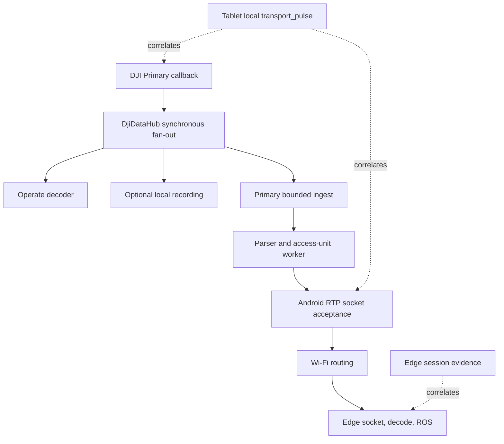

# Android Edge Transport Pause Diagnosis - Plan

## Goal Capsule

- **Objective:** Prove the last progressing boundary during an intermittent complete Android-to-Edge pause, then make the smallest boundary-specific reliability correction.
- **Scope:** Primary H.264 transport only, its compact telemetry/health, AU metadata, foreground lifecycle, and local bounded diagnostics.
- **Authority:** Passive observation and transport only. No DJI camera, flight, mission, RTK, or network-control command is introduced.
- **Stop condition:** Do not change callback architecture, queues, RTP framing, MTU, IDR policy, or Edge decoding until one correlated Android/Edge incident identifies the failed boundary.

---

## Product Contract

### Problem Frame

The Edge observes occasional approximately eight-second periods with no Primary RTP, video-AU metadata, telemetry, or health, followed by spontaneous recovery.

The present evidence does not distinguish an Android callback/lifecycle interruption, parser or sender stall, or loss after Android UDP socket acceptance.

### Requirements

**Evidence collection**

- R1. The next test shall keep the established wire contract unchanged: UDP 5500 for telemetry/health, UDP 5501 for Primary AU metadata, UDP 5502 for clock, and RTP/H.264 Primary PT 96 on UDP 5600.
- R2. The tablet shall produce bounded local one-second `transport_pulse` NDJSON records for the active session without adding verbose data to normal health or recording raw video/RTP.
- R3. Each pulse shall state session, endpoint, runtime/foreground state, rate-writer interval, Primary hub-ingress and transport-listener callback counts/ages, maximum hub fan-out duration, transport-offer last/maximum duration, AU/socket ages, bounded queue evidence, Android UDP acceptance/bytes/errors, and last/maximum send durations.
- R4. Each pulse shall include diagnostic-writer queue depth, drop count, worker-alive state, last successful persistence age, and terminal I/O failure state. Missing local pulses remain inconclusive until this evidence is healthy.
- R5. Transition-only evidence shall record runtime creation/closing, an initial Primary binding snapshot, subsequent Primary hub binding attach/detach, Primary callback stale/recovered, telemetry sender stale/recovered, and foreground-service reconcile age.
- R6. Every local pulse and transition shall contain Android elapsed-realtime and wall-clock epoch time. Edge evidence shall retain wall-clock time and session UUID. Cross-device comparisons are exact only after clock synchronization is verified; otherwise they use stated wall-clock uncertainty while each device retains monotonic ages locally.
- R7. The pulse shall distinguish the native Flight callback/collector enqueue path from telemetry sender acceptance. Health acceptance alone shall not be treated as proof that Flight, RTK, or gimbal callbacks progressed.

**Diagnosis and change control**

- R8. Android UDP acceptance must be described as local socket acceptance, never Edge delivery.
- R9. The outcome shall classify each reproduced pause by its last progressing boundary, or report that the evidence remains insufficient.
- R10. A correction may touch only the proven failing boundary and must preserve hub ownership, Primary-only transport, bounded queues, and the wire contract in R1.

### Scope Boundaries

- No Secondary/FPV transport work, no UDP 5610, and no HEVC/H.265 work.
- No blind queue/buffer expansion, packet pacing, socket recreation policy change, callback offloading, or Wi-Fi configuration change.
- No camera, flight, mission, gimbal, RTK, or ROS feature change.

---

## Planning Contract

### Key Technical Decisions

- KTD1. **Treat the next field session as a boundary experiment.** (session-settled: user-directed — chosen over an immediate architectural rewrite: a simultaneous loss needs proof before introducing a more complex callback design.) Governs R1-R10.
- KTD2. **Keep diagnostics local to the tablet.** `transport.ndjson` is an Android forensic artifact and never an additional Ubuntu protocol. Edge continues to observe its own socket/decode/publication facts. Governs R1-R6.
- KTD3. **Keep the one hub.** `DjiDataHub` remains the sole DJI callback owner; the diagnostic work measures synchronous fan-out rather than adding a direct `VideoFeeder` listener. Governs R4, R8.
- KTD4. **Use bounded periodic evidence.** One pulse per second and coalesced transitions are enough to locate multi-second pauses without creating the per-packet logging load that could change the failure. Governs R2-R4.

### High-Level Technical Design

The synchronous hub is intentional ownership control, but every consumer must complete without waiting. The existing diagnostic build measures the transport `offer` duration; a reproduced pause determines whether decoder/recording fan-out requires separate characterization.

### Current Evidence and Open Boundary

| Finding | Confidence | Consequence |
| --- | --- | --- |
| `DjiDataHub` dispatches subscribers synchronously from the DJI video callback. | Source-proven | A slow UI, recording, or transport subscriber can delay later subscribers. |
| `BoundedVideoIngestor.offer()` copies bytes and performs an Annex-B signature scan on that callback path. | Source-proven | Measure before moving diagnostic scan work or changing ingestion. |
| Video RTP and telemetry use separate sender threads. | Source-proven | Their simultaneous absence points to shared upstream/lifecycle state or post-socket network loss. |
| Foreground reconciliation runs every two seconds and keeps a same-endpoint runtime. | Source-proven | Lifecycle records must prove whether an actual replacement/detach occurs. |
| Android accepted counters are not receiver acknowledgements. | Contract-proven | Compare them with Edge receipt, never equate them. |

---

## Implementation Units

### U1. Complete and characterize the diagnostic boundary

- **Goal:** Make local evidence sufficient to distinguish source, synchronous hub fan-out, transport worker, telemetry, lifecycle, diagnostic-writer, and post-socket boundaries without altering live transport behavior.
- **Files:** `Sample Code/app/src/main/java/com/dji/sdk/sample/djihub/DjiDataHub.java`, `Sample Code/app/src/main/java/com/dji/sdk/sample/djihub/CallbackMulticaster.java`, `Sample Code/app/src/main/java/com/dji/sdk/sample/transport/TransportRuntime.java`, `Sample Code/app/src/main/java/com/dji/sdk/sample/transport/TransportForegroundService.java`, `Sample Code/app/src/main/java/com/dji/sdk/sample/transport/diagnostics/AsyncNdjsonDiagnosticWriter.java`, `Sample Code/app/src/main/java/com/dji/sdk/sample/transport/diagnostics/JsonEncoder.java`, `Sample Code/app/src/main/java/com/dji/sdk/sample/transport/telemetry/DjiTelemetryCollector.java`, and focused JVM tests under `Sample Code/app/src/test/java/com/dji/sdk/sample/transport/`.
- **Approach:** Add bounded local counters/timing at hub ingress and fan-out completion, label existing subscribers only for diagnostics, add an initial binding-state snapshot after `TransportRuntime` subscribes, expose foreground last-reconcile time, writer health, and native telemetry callback/collector enqueue evidence. Include Android wall-clock time alongside elapsed-realtime. Preserve one hub, existing queues, and all UDP/RTP wire fields.
- **Test scenarios:**
  - A healthy start emits `RUNTIME_CREATED`, a Primary binding initial-state record, pulses near one second apart, a configured endpoint, healthy writer state, and no port/health-schema change.
  - A hub ingress event that reaches transport records non-negative fan-out and offer durations.
  - A writer queue drop or terminal writer I/O failure makes missing-pulse interpretation explicitly inconclusive.
  - Rolling maximum send/offer durations are consumed once per interval and transition records are deduplicated.
  - Flight callback/collector evidence remains distinguishable from the health heartbeat.
- **Verification:** Add JVM coverage for pulse/transition JSON validity and required fields, duration draining, writer state, binding initial state, and stale/recovered de-duplication. Then install the diagnostic APK and confirm local valid NDJSON plus the same session UUID at Edge.

### U2. Run a controlled baseline and pause capture

- **Goal:** Collect a two-to-three minute baseline and at least one pause without changing screens, endpoint, or Edge receiver ownership during the capture.
- **Files:** `Sample Code/app/src/main/java/com/dji/sdk/sample/transport/TransportForegroundService.java`, `Sample Code/app/src/main/java/com/dji/sdk/sample/transport/TransportSessionManager.java`, `Sample Code/app/src/main/java/com/dji/sdk/sample/transport/network/VideoStreamSender.java`, `Sample Code/app/src/main/java/com/dji/sdk/sample/transport/network/BoundedUdpSender.java`.
- **Approach:** Keep tablet and Edge on the same Wi-Fi, selected endpoint unchanged, and Edge receiving only through its normal process. Record test start/end wall time, session UUID, device foreground/background transitions, and the precise observed outage window. Do not run a competing receiver on UDP 5600.
- **Test scenarios:** A healthy baseline shows advancing Android callback/AU/RTP/telemetry acceptance and advancing Edge receipt. A reproduced pause has a bounded before/during/after window with no restart or manual endpoint change.
- **Verification:** Export the entire matching tablet session directory and preserve Edge evidence as a separate session directory, not a mixed append-only file.

### U3. Classify the incident by the last progressing boundary

- **Goal:** Produce one evidence table for each pause with Android/Edge timestamps correlated by UUID and wall-clock uncertainty, or by a validated clock offset, plus counter deltas and a supported classification.
- **Files:** `Sample Code/app/src/main/java/com/dji/sdk/sample/djihub/DjiDataHub.java`, `Sample Code/app/src/main/java/com/dji/sdk/sample/djihub/CallbackMulticaster.java`, `Sample Code/app/src/main/java/com/dji/sdk/sample/transport/video/BoundedVideoIngestor.java`, `Sample Code/app/src/main/java/com/dji/sdk/sample/transport/PrimaryTransportMonitor.java`.
- **Approach:** Compare the final healthy pulse, all outage pulses, first recovery pulse, transition records, and corresponding Edge ingress/decode/publication state. First exclude writer queue loss, writer termination, and missing exported segments before interpreting a missing pulse; do not infer a network loss from it alone.
- **Test scenarios:**
  - Hub ingress advances while the transport listener stalls: `SYNCHRONOUS_HUB_FANOUT_BEFORE_TRANSPORT`.
  - Hub ingress itself stalls without a binding/runtime transition: `DJI_SOURCE_OR_PRIMARY_BINDING_STALLED`.
  - The current transport-listener callback freezes without hub-ingress evidence: `DJI_PRIMARY_DID_NOT_REACH_TRANSPORT`; do not attribute it to DJI versus fan-out until U1 is present.
  - Callbacks advance while AU age grows: `PARSER_OR_AU_WORKER_STALLED`.
  - AUs advance while local RTP acceptance age grows: `ANDROID_VIDEO_SOCKET_WORKER_STALLED`.
  - Flight callback stalls while health continues: `TELEMETRY_HUB_OR_FLIGHT_CALLBACK_STALLED`.
  - Collector enqueue advances while telemetry acceptance stalls: `BOUNDED_UDP_SENDER_STALLED`.
  - Video, telemetry, health acceptance, pulse execution, and reconcile activity all stop: `COMMON_ANDROID_LIFECYCLE_SCHEDULING_OR_NETWORK_INTERFACE`.
  - Android RTP and native telemetry continue locally while Edge is empty: `POST_SOCKET_WIFI_OR_ROUTING_LOSS`.
- **Verification:** First exclude diagnostic-writer loss before interpreting a missing pulse. Every classification names the last advancing counter/timestamp, wall-clock correlation uncertainty, and contradictory or missing evidence.

### U4. Apply only the smallest confirmed correction

- **Goal:** Convert the U3 classification into one narrowly scoped correction, then reproduce the same test to verify it.
- **Files:** Determined only after U3; expected candidates are `Sample Code/app/src/main/java/com/dji/sdk/sample/transport/video/BoundedVideoIngestor.java`, `Sample Code/app/src/main/java/com/dji/sdk/sample/transport/network/VideoStreamSender.java`, `Sample Code/app/src/main/java/com/dji/sdk/sample/djihub/CallbackMulticaster.java`, or lifecycle code named in U2.
- **Approach:**
  - For slow ingestion only, move diagnostic-only Annex-B scanning out of the callback worker while retaining the required bounded byte copy.
  - For a parser/worker failure, repair only that worker's failure handling and preserve bounded discontinuity recovery.
  - For a local socket worker failure, repair only its lifecycle/error handling.
  - For post-socket loss, do not modify Android architecture; hand the correlated evidence to the network/Edge owner.
  - For lifecycle replacement, repair only the proven reconcile/runtime transition.
- **Test scenarios:** Regression coverage reproduces the specific state transition, keeps all counters monotonic per session, and proves no change to ports, payload type, MTU, or health payload.
- **Verification:** Repeat U2 and demonstrate either no outage over a stated soak duration or an incident whose last progressing boundary has moved/changed with an explicit explanation.

---

## Verification Contract

| Gate | Applies to | Evidence required |
| --- | --- | --- |
| Source ownership check | U1-U4 | `scripts/verify_dji_callback_ownership.sh` continues to pass; no direct DJI video callback is added outside `DjiDataHub`. |
| Android regression/build | U1 and any U4 change | `scripts/test_android.sh --offline`, `scripts/build_android.sh --offline :app:assembleDebug`, and `scripts/verify_apk.sh`. |
| Local diagnostic smoke | U1 | Valid per-session `transport.ndjson` with pulses and lifecycle transitions, no raw video payload. |
| Correlated healthy baseline | U2 | Android accepted deltas and Edge received deltas advance for the same session. |
| Pause classification | U3 | Before/during/after timestamps with stated correlation uncertainty or a validated clock offset, plus the decision-table outcome. |
| Post-fix field proof | U4 | A repeat capture; build success alone never closes the transport fault. |

## Definition of Done

- A current diagnostic APK is installed and produces bounded local pulses for a known session.
- One pause is captured, or a clearly reported soak duration fails to reproduce one.
- Android and Edge evidence are compared without conflating socket acceptance with packet receipt.
- The pause is classified at the last progressing boundary, or its remaining ambiguity is stated precisely.
- No transport-architecture change is made before the classification.
- If a boundary-specific correction is authorized, it passes the Android checks and a repeat correlated field test.
