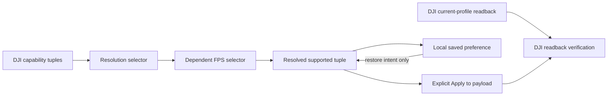

# Persistent Settings and Primary Video Profile Controls

## Goal Capsule

- **Objective:** Make the Settings page understandable and durable: an operator can select a valid Primary payload resolution and frame rate, explicitly apply it to DJI, save the preference locally, and find every existing Settings decision unchanged after reopening the app.
- **Means:** Replace the opaque combined-profile selector with dependent Resolution and Frame Rate selectors backed by the DJI capability tuples, add an app-local preferred-video-profile store, and characterize/fix Mission Defaults persistence without creating a generic settings framework.
- **Authority:** DJI camera capabilities and readback remain authoritative for the actual payload profile. Local preferences express only the operator's saved intent. No saved setting may silently issue a DJI command on app start.
- **Execution profile:** KISS, capability-driven, persistence-first. Keep the existing programmatic Settings page and `SharedPreferences` pattern. Add no callback owner, transport behavior, recording behavior, or new dependency.
- **Stop conditions:** Stop the camera-specific path if the connected payload does not expose `videoResolutionAndFrameRateRange()` or if readback and the capability list use incompatible MSDK values; present this truthfully rather than inventing a profile.

---

## Product Contract

### Summary

The `PRIMARY PAYLOAD VIDEO` section becomes a compact control card with a current DJI status, a Resolution dropdown, a dependent Frame Rate dropdown, and explicit `SAVE PREFERENCE` and `APPLY TO PAYLOAD` actions.

The app remembers the saved preferred pair and all existing settings-page values across app close/reopen.

The camera changes only after the operator presses Apply; saving a preference never changes the aircraft or payload by itself.

### Problem Frame

The current Settings UI exposes one flat DJI profile list and a "highest supported" shortcut.

It gives the operator no clear resolution/FPS model, can render an unhelpful unknown frame-rate label, and does not preserve a chosen profile as app intent.

Mission Defaults already has a local store, but its reported restart regression must be reproduced and corrected rather than assumed away.

### Requirements

- R1. The Primary video section shows the actual DJI-reported profile separately from the operator's selected and saved preference.
- R2. Resolution lists every distinct resolution advertised by the connected Primary payload.
- R3. Frame Rate lists only rates valid for the currently selected resolution; the UI never constructs an unsupported resolution/FPS cross-product.
- R4. The labels use clear values such as `3840 × 2160` and `30 fps`; unavailable/readback failures explain the DJI reason instead of displaying an ambiguous `unknown` value.
- R5. `APPLY TO PAYLOAD` sends exactly the selected valid capability tuple through `Camera.setVideoResolutionAndFrameRate`, then reads DJI back and reports verified, mismatched, or failed truthfully.
- R6. `SAVE PREFERENCE` stores the selected capability identity locally and restores it after process restart without automatically applying it to a camera.
- R7. If the saved pair is not supported by the currently connected payload, the saved preference remains intact, the UI explains the incompatibility, and the operator must choose a supported pair before Apply.
- R8. Every current control in the Settings page has an explicit persistence contract: landing advisory threshold, recording folder, New Mission Defaults, and Primary video preference.
- R9. Mission Defaults persists altitude, speed, heading and finish action across app recreation. A failed parse or validation must retain the prior valid defaults.
- R10. Existing draft missions remain independent from Settings; changing or saving defaults only affects a later explicit `NEW DRAFT`.
- R11. The section remains compact and touch-friendly in landscape: labels above controls, no raw enum names, no duplicated "highest" action, and one status line that explains the next operator action.

### Acceptance Examples

- AE1. Given a payload reporting `3840 × 2160 @ 24/25/30` and `1920 × 1080 @ 24/25/30/60`, selecting `1920 × 1080` reveals only its valid FPS values.
- AE2. Given a saved `3840 × 2160 @ 30 fps` preference, closing and reopening the app restores that choice as `SAVED PREFERENCE`; it does not send a camera command until Apply is pressed.
- AE3. Given a connected camera currently at `1920 × 1080 @ 30 fps`, pressing Apply for `3840 × 2160 @ 30 fps` reports `APPLIED` only after DJI readback confirms that exact pair.
- AE4. Given an unsupported saved preference after a payload swap, reopening Settings preserves the saved intent and shows `NOT SUPPORTED BY CONNECTED PAYLOAD`; no fallback profile is silently saved.
- AE5. Given valid New Mission Defaults, after app recreation the same altitude, speed, heading and finish action are shown. An existing mission draft remains unchanged.

### Scope Boundaries

#### Deferred for Follow-Up Work

- Automatic camera-profile application on product connection.
- Per-stream encoder-only frame dropping, bitrate configuration, or live-stream transcoding.
- Camera recording settings unrelated to the Primary encoded feed.
- A single global schema/registry for every preference in the app.

#### Outside This Product Identity

- Altering RTP transport ports, video packetization, decoder behavior, telemetry, or Edge/ROS contracts.
- Any automatic flight, mission, gimbal, or camera command triggered by app launch, page navigation, or a saved preference.

---

## Planning Contract

### Current-State Findings

- `OperateMvpView.createSettingsPage()` rebuilds Settings on each visit. Landing advisory already reads/writes `LowBatteryAdvisoryPreferences`; recording folder is stored through `RecordingFolderPreferences`; New Mission Defaults uses `MissionDefaultsPreferences`.
- The Primary video UI currently reads DJI `Camera.getCapabilities().videoResolutionAndFrameRateRange()`, places every `ResolutionAndFrameRate` in one spinner, and calls `setVideoResolutionAndFrameRate()` only from an explicit Apply action.
- `MissionDefaultsPreferences` already commits four fields atomically enough for this small profile. The reported restart problem therefore needs characterization across page rebuild, process death, parse/validation failure, and `NEW DRAFT` consumption before changing its storage design.
- The camera profile is a tuple. Two independent unfiltered dropdowns would create invalid requests, so frame-rate availability must depend on the chosen resolution.

### Key Technical Decisions

- KTD1. **Model video choice as a supported DJI tuple.** (session-settled: user-directed — chosen over a single opaque profile list: the operator needs separate resolution and FPS controls without invalid combinations.) The UI derives both dropdowns from the capability list and resolves back to one exact tuple before Apply. Governs R2-R5.
- KTD2. **Separate saved intent from actual camera state.** (session-settled: user-directed — chosen over auto-applying saved settings at startup: saved settings must persist, but aircraft/payload changes require a visible operator action.) `SAVE PREFERENCE` is local; `APPLY TO PAYLOAD` is the only camera command path. Governs R1, R5-R7.
- KTD3. **Keep persistence narrow and section-owned.** (session-settled: user-directed — chosen over a generic settings manager: current small preference stores are simpler, isolated, and already fit the app.) Add one video-profile store and repair/characterize Mission Defaults at its existing seam. Governs R6, R8-R10.
- KTD4. **Use camera readback as proof.** The UI may say selected or saved before Apply, but it only says applied after `getVideoResolutionAndFrameRate()` confirms the exact requested tuple. Governs R1, R4-R5.

### High-Level Technical Design

### Settings Persistence Matrix

| Settings control | Current owner | Required persisted meaning | Command side effect |
| --- | --- | --- | --- |
| Landing advisory threshold | `LowBatteryAdvisoryPreferences` | Threshold after restart | None; app advisory only |
| Recording folder | `RecordingFolderPreferences` | SAF folder URI after restart | None |
| New Mission Defaults | `MissionDefaultsPreferences` | Altitude, speed, heading, finish action | None; used only by `NEW DRAFT` |
| Primary payload video | New `PrimaryVideoProfilePreferences` | Operator's desired supported tuple identity | None on Save; DJI command only on Apply |

### Sequencing

| Order | Unit | Why |
| --- | --- | --- |
| 1 | U1 | Establish and test tuple selection/persistence semantics before UI changes. |
| 2 | U2 | Characterize Mission Defaults storage and correct only the confirmed restart defect. |
| 3 | U3 | Replace the video section using the tested model and explicit status states. |
| 4 | U4 | Audit the whole Settings page and prove persistence/restart behavior on device. |

---

## Implementation Units

### U1. Define Primary video capability and preference contracts

- **Goal:** Make tuple selection, display formatting, compatibility and persistence testable without putting capability logic into the Settings view.
- **Requirements:** R1-R7, R11. **Decision:** KTD1-KTD4.
- **Files:** `Sample Code/app/src/main/java/com/dji/sdk/sample/operate/PrimaryVideoProfileSelection.java` (new), `Sample Code/app/src/main/java/com/dji/sdk/sample/operate/PrimaryVideoProfilePreferences.java` (new), `Sample Code/app/src/main/java/com/dji/sdk/sample/operate/OperateMvpView.java`, `Sample Code/app/src/test/java/com/dji/sdk/sample/operate/PrimaryVideoProfileSelectionTest.java` (new), `scripts/test_android.sh` if the existing direct JVM entrypoint needs this new test invoked.
- **Approach:** Represent the selected/saved profile by stable DJI enum identities, not `toString()` output. Build distinct ordered resolutions from the capability tuples, derive valid FPS choices for the active resolution, resolve only an advertised tuple, and format human-facing labels separately. Store a complete pair only after it resolves against capabilities; tolerate a stored pair that is not present on the connected payload without overwriting it.
- **Test scenarios:** Duplicate tuples collapse into one resolution/FPS option; changing resolution picks a valid FPS deterministically; invalid resolution/FPS combinations cannot resolve; stored enum names round-trip; malformed stored data is rejected without crashing; unsupported saved pair remains visible as incompatible.
- **Verification:** Pure unit coverage proves selection never produces an unsupported tuple and preference parsing does not depend on a physical camera.

### U2. Characterize and make Mission Defaults restart-safe

- **Goal:** Reproduce the reported loss of New Mission Defaults and fix the exact boundary while preserving draft isolation.
- **Requirements:** R8-R10. **Decision:** KTD3.
- **Files:** `Sample Code/app/src/main/java/com/dji/sdk/sample/missionplanner/MissionDefaultsPreferences.java`, `Sample Code/app/src/main/java/com/dji/sdk/sample/operate/OperateMvpView.java`, `Sample Code/app/src/main/java/com/dji/sdk/sample/operate/MissionMvpView.java`, `Sample Code/app/src/test/java/com/dji/sdk/sample/missionplanner/MissionPlannerUnitTestSuite.java`, `Sample Code/app/src/test/java/com/dji/sdk/sample/missionplanner/MissionDefaultsPreferencesTest.java` (new or expanded).
- **Approach:** First verify whether loss happens during save, page reconstruction, preference read, process recreation, or draft construction. Preserve the existing four-field local profile when it is correct; make one minimal correction if a confirmed overwrite, stale view value, invalid default fallback, or save-result handling bug exists. Keep save atomic from the operator perspective: validate every field before writing any field, and reload stored values on page creation.
- **Test scenarios:** Valid four-field values survive a new preference-store instance; invalid input preserves the prior profile; save feedback agrees with later load; `NEW DRAFT` consumes the stored profile; an existing draft remains unchanged after Settings saves.
- **Verification:** JVM tests cover model/serialization behavior. Tablet smoke explicitly changes defaults, leaves Settings, recreates the app, returns to Settings and then creates a New Draft.

### U3. Rebuild the Primary payload video Settings section

- **Goal:** Give the operator a compact, legible, truthful camera control surface.
- **Requirements:** R1-R7, R11. **Decision:** KTD1, KTD2, KTD4.
- **Files:** `Sample Code/app/src/main/java/com/dji/sdk/sample/operate/OperateMvpView.java`, `Sample Code/app/src/main/java/com/dji/sdk/sample/operate/PrimaryVideoProfileSelection.java`, `Sample Code/app/src/main/java/com/dji/sdk/sample/operate/PrimaryVideoProfilePreferences.java`.
- **Approach:** Replace the combined profile spinner and highest-profile action with two clearly labelled dropdowns. Display three distinct states: `DJI CURRENT`, `SAVED PREFERENCE`, and `SELECTED`. Refresh capabilities/readback only when entering Settings or by a visible retry control, preserve selection during asynchronous readback, disable Apply until one valid resolved tuple exists, and show progress/errors beside the section rather than silently resetting a selector.
- **Interaction contract:** Selecting a resolution immediately repopulates FPS from that resolution's supported tuples. `SAVE PREFERENCE` stores the selected pair and updates Saved Preference. `APPLY TO PAYLOAD` calls DJI, temporarily disables only that action, then readbacks and reports the outcome. No control silently changes camera settings, transport FPS, recording state, or Edge behavior.
- **Test scenarios:** Disconnected camera shows a compact unavailable state; capabilities with two resolutions render separate dropdown contents; Apply rejects no selection; DJI apply failure leaves saved preference unchanged; verified readback updates Current; mismatched readback is not presented as success.
- **Verification:** Source review confirms the sole `setVideoResolutionAndFrameRate()` path is the Apply button. Tablet smoke with payload connected verifies the controls use actual capability values and survive page navigation.

### U4. Audit Settings persistence and operator feedback

- **Goal:** Make persistence consistent and observable across all current Settings controls without introducing a broad refactor.
- **Requirements:** R8-R11. **Decision:** KTD3.
- **Files:** `Sample Code/app/src/main/java/com/dji/sdk/sample/operate/OperateMvpView.java`, `Sample Code/app/src/main/java/com/dji/sdk/sample/operate/LowBatteryAdvisoryPreferences.java`, `Sample Code/app/src/main/java/com/dji/sdk/sample/recording/RecordingFolderPreferences.java`, `Sample Code/app/src/main/java/com/dji/sdk/sample/missionplanner/MissionDefaultsPreferences.java`, `Sample Code/app/src/main/java/com/dji/sdk/sample/operate/PrimaryVideoProfilePreferences.java`, `Sample Code/app/src/test/java/com/dji/sdk/sample/operate/OperateShellStateTest.java` only if a pure shell-state assertion is useful, and `scripts/test_android.sh` for any new direct JVM entrypoint.
- **Approach:** Give every section a concise "saved" or "not saved" result tied to its own persistence boundary. Verify the existing landing threshold and recording folder behavior rather than rewriting working stores. Keep RTK profiles and Transport endpoint persistence in their dedicated pages/stores; they are audited for regression but not moved into Settings by this feature.
- **Test scenarios:** Each current Settings section reloads its stored display value after recreating the page; failed validation does not change the stored value; selecting a folder preserves its URI; no Settings save introduces DJI callback or command ownership.
- **Verification:** Run the existing callback-ownership gate and tablet persistence walkthrough with app close/reopen. Inspect preferences only through app behavior; do not expose RTK credentials in logs or test output.

---

## Verification Contract

| Gate | Evidence |
| --- | --- |
| Selection and preference unit tests | Capability filtering, tuple resolution, labels, invalid stored values, and saved-pair compatibility pass. |
| Mission defaults tests | Four-field restart round-trip, invalid-save preservation, and New Draft isolation pass. |
| Existing regression gates | `scripts/test_android.sh --offline` and `scripts/verify_dji_callback_ownership.sh` pass. |
| Android build and APK | `scripts/build_android.sh :app:assembleDebug` and `scripts/verify_apk.sh` pass. |
| Tablet Settings smoke | Each section is saved, app is closed/reopened, values are visually reloaded; no command is sent by page entry. |
| Connected-payload smoke | DJI capabilities, exact apply/readback, saved intent, and payload-swap incompatibility state are checked with explicit operator action. |

## Definition of Done

- Resolution and FPS are separate, readable controls derived only from DJI-supported tuples.
- The Primary video UI never displays an unexplained unknown profile or attempts an unsupported pair.
- Save persists desired video intent locally; Apply is the only visible camera-change action and is verified by DJI readback.
- The saved profile and all current Settings-page choices remain after closing and reopening the app.
- Mission Defaults persistence has a reproduced root cause and a minimal verified correction, while existing drafts remain isolated.
- No transport, RTP, telemetry, callback ownership, recording pipeline, or automatic DJI command behavior changes.
- Repository gates and the device persistence checklist pass; physical payload configuration is reported only after hardware verification.
