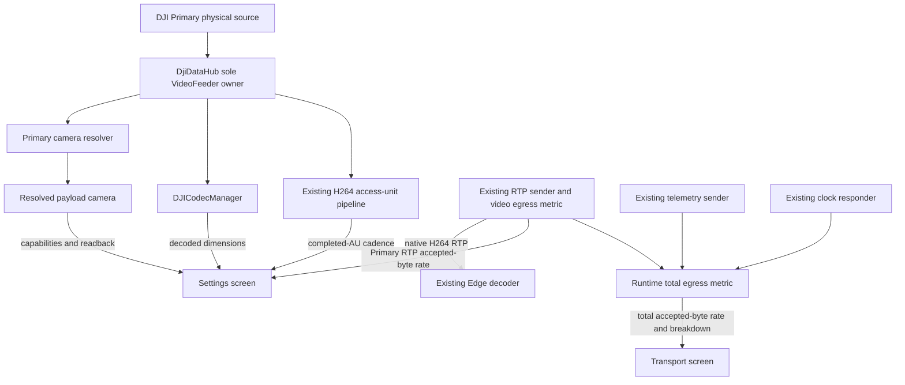
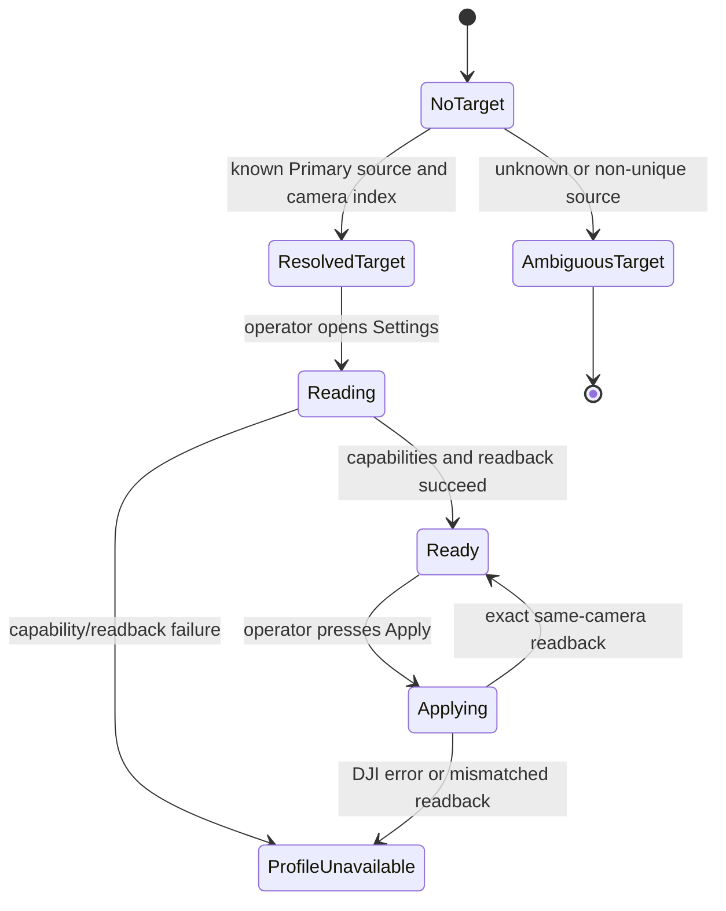

# Truthful Primary Camera Profile and Live Feed Metrics

## Goal Capsule

- **Objective:** Let the operator distinguish the Zenmuse recording configuration from the actual Primary live feed, while the Transport page reports total Android-to-Edge egress, so a successful setting change is never mistaken for a live-video resolution, FPS, or transport-volume change.
- **Means:** Bind camera controls to the physical source selected by `DjiDataHub`, preserve supported DJI resolution/FPS tuples as recording-profile controls, expose observed Primary dimensions, frame cadence, and video-only RTP egress in Settings, and expose aggregate egress in Transport from existing sender evidence.
- **Authority:** The connected camera capability list and camera readback are authoritative for recording configuration. Decoded live dimensions and assembled H.264 access-unit cadence are authoritative for the live feed. The Edge remains authoritative for what it receives.
- **Execution profile:** KISS and passthrough-first. Reuse the existing hub, decoder, H.264 parser, assembler, and RTP sender. Do not add a callback owner, reencode video, change RTP framing, or make an automatic DJI camera command.
- **Stop conditions:** If the Primary physical source cannot be mapped unambiguously to a connected camera, disable camera-profile Apply and say why. If Primary transport is inactive, report live FPS as unobserved instead of inventing a value.

---

## Product Contract

### Summary

The Settings page will have three explicitly separate truths: `PAYLOAD RECORDING PROFILE`, `PRIMARY LIVE FEED`, and video-only `PRIMARY RTP EGRESS`. The Transport page separately reports `TOTAL EGRESS → EDGE`.

Resolution and frame-rate selectors remain camera recording controls. They will list only pairs reported by the exact camera serving the Primary source and will not imply that the tablet preview or Ubuntu video must change.

The app will display observed live-feed dimensions and cadence without creating a synthetic FPS selector. The transport continues forwarding the intact DJI H.264 stream at its native cadence.

### Problem Frame

The existing Settings page labels a camera recording tuple as `PRIMARY PAYLOAD VIDEO`, selects `aircraft.getCameras().get(0)`, and calls it `APPLIED` after camera readback.

That is insufficient on a multi-payload M210 because the first item in DJI's camera list is not a reliable Primary-feed identity. It also encourages an incorrect expectation that a 1080p or 4K recording choice will change the 720p-class live feed decoded by the tablet and Edge.

### Requirements

**Primary camera identity and recording profile**

- R1. Settings resolves the camera profile target from the current Primary physical source and connected camera component index; it never silently selects the first camera in a list.
- R2. Known M210 mappings for `LEFT_CAM` and `RIGHT_CAM` use the corresponding DJI camera component indices. `MAIN_CAM`, `UNKNOWN`, or an unsupported/ambiguous source remains visible but cannot enable Apply until the app can prove a single target.
- R3. The recording controls display the target source, camera index, and camera display name before showing resolution or frame-rate options.
- R4. Resolution and frame rate remain a dependent, capability-derived recording tuple. Saving is local intent only; only the visible `APPLY TO PAYLOAD` action calls DJI and then verifies readback from that same resolved camera.
- R5. A preference saved for one resolved camera/source is not silently preselected or applied to another payload. Existing two-field preferences remain readable as legacy intent and require an explicit operator selection before Apply is enabled for a newly identified camera.

**Live-feed and transport truth**

- R6. Settings displays the observed Primary live-feed resolution independently from the recording profile, using the existing Primary decoder when it has decoded valid video.
- R7. Settings displays observed Primary FPS as a rolling measurement of complete H.264 access units, never as the number of DJI callback chunks. If the transport pipeline has no current observation, the value is `UNOBSERVED`, not `UNKNOWN`, `0`, or a guessed camera FPS.
- R8. `PRIMARY LIVE FEED` displays observed FPS and current Primary RTP-only egress side by side. Egress is explicitly labelled as Android UDP socket acceptance, not confirmation that Edge received it.
- R9. The Transport page displays native Primary H.264 cadence and total Android-to-Edge egress: Primary RTP, video-AU metadata, telemetry/health, and accepted clock pongs. It provides a compact breakdown and does not provide a generic 5/10/15/20/25/30 transport-FPS selector.
- R10. A recording-profile Apply that succeeds but leaves the live feed at 1280 x 720 is reported as expected distinct behavior, not as a failed Edge or GStreamer update.

**Safety and regression boundaries**

- R11. No work in this plan may add a direct DJI callback outside `DjiDataHub`, alter Primary RTP port 5600, payload type 96, packetization, Edge decoder behavior, local recording behavior, or mission/manual-flight commands.
- R12. The app continues to persist Settings choices, but loading a saved recording profile never commands the payload and a transport observation never changes a camera setting.

### Product Decisions

- **Native H.264 transport is preserved.** (session-settled: user-approved — chosen over an artificial 5/10/15/20/25/30 transport-FPS control: arbitrary thinning of predictive H.264 frames can make later frames undecodable.) Governs R7-R10.
- **Live FPS is an observation, not a camera promise.** The UI will show the measured cadence of the feed that actually reaches the transport path, separate from the camera recording FPS. Governs R6-R9.

### Acceptance Examples

- AE1. Given Primary source `LEFT_CAM` with camera indices 0 and 1 connected, Settings identifies and reads capabilities from index 0, not list position 0 by coincidence.
- AE2. Given an unmapped or ambiguous Primary source, Settings names the source, marks the recording target unavailable, preserves the saved preference, and sends no camera command.
- AE3. Given a supported payload tuple `3840 x 2160 · 25 fps`, Apply reports `RECORDING PROFILE APPLIED` only after that camera reads back the same tuple. `PRIMARY LIVE FEED` may still report `1280 x 720 · observed 29.97 fps · egress 3.20 Mb/s`.
- AE4. Given an active Primary RTP pipeline with access units spaced near 33.4 ms, Settings renders observed FPS near 29.9 and does not render the `VideoFrameRate.value()` protocol code.
- AE5. Given no active transport observation, Settings shows live dimensions from the decoder when present and `OBSERVED FPS — UNOBSERVED (transport inactive)` rather than estimating FPS from camera recording configuration.
- AE6. Given an existing saved profile without source identity, Settings preserves it as legacy intent but does not use it to auto-target a different camera.

### Scope Boundaries

#### Deferred for Follow-Up Work

- A higher-resolution live feed source through verified Cendence HDMI/SDI capture hardware.
- Android decode/reencode or an encoder-aware, keyframe-safe low-FPS stream designed as a coordinated Android/Edge feature.
- Any claim that a recording-profile change changes OcuSync live-feed resolution or frame rate before physical payload evidence confirms it.

#### Outside This Product Identity

- Arbitrary H.264 frame dropping, RTP packet dropping, or NAL dropping to simulate a lower FPS.
- A new direct `VideoFeeder` listener, a new DJI callback owner, or a camera command caused by entering Settings, restoring preferences, or observing transport metrics.
- Edge GStreamer scaling, decoder changes, port changes, or ROS changes.

---

## Planning Contract

### Current-State Findings

- `OperateMvpView.configureVideoProfileControls()` currently obtains `aircraft.getCameras().get(0)`, reads `videoResolutionAndFrameRateRange()`, and uses one explicit `setVideoResolutionAndFrameRate()` Apply path with readback verification.
- `DjiDataHub` owns the Primary `VideoFeeder` listener and publishes current physical source changes to subscribers. Operate preview, local recording, and `TransportRuntime` are subscribers; the hub must remain the only DJI callback owner.
- `OperateMvpView` sends Primary bytes to `DJICodecManager`, which exposes decoded width and height. `TransportRuntime` forwards the same Primary bytes to `VideoStreamSender`.
- `EncodedVideoRtpPipeline` assembles complete H.264 access units before `H264RtpPacketizer` emits RTP. `VideoStreamSender` already records access-unit completion intervals and exposes a median interval as diagnostics.
- `TransportView` already presents Primary RTP accepted-byte egress rate. The Edge pipeline has no scaler or resolution cap, so its reported decoded dimensions describe the incoming RTP stream.
- DJI MSDK 4.18 camera capabilities expose supported recording tuples, but MSDK V4 does not expose an equivalent per-live-frame `getFps()` API. MSDK V5 has such metadata but is not compatible with this aircraft baseline.

### Key Technical Decisions

- KTD1. **Resolve target camera from Primary physical source.** (session-settled: user-approved — chosen over `getCameras().get(0)`: multi-payload camera-list order does not establish feed ownership.) A small resolver maps only known M210 source/index relationships and returns an explicit unavailable state for every other case. Governs R1-R5.
- KTD2. **Keep recording, decoded live feed, video egress, and total transport egress as separate models.** Recording uses camera capability/readback tuples; dimensions use `DJICodecManager`; FPS uses completed access units; Settings egress uses Primary RTP accepted bytes; Transport egress aggregates accepted bytes across all Android sender paths. No model is a fallback for another. Governs R3-R10.
- KTD3. **Measure live FPS at the access-unit boundary.** (session-settled: user-approved — chosen over callback counting: a DJI callback can contain fragments or multiple NAL units and does not equal a frame.) Use a bounded rolling window from existing H.264 access-unit completion timestamps. Governs R7-R8.
- KTD4. **Compute both egress rates in the transport runtime.** Settings consumes the monotonic Primary-RTP-only snapshot; Transport consumes a monotonic total snapshot plus its sender-category breakdown. Neither rate is view-local or resets when a page opens or closes. Both mean Android socket acceptance, never Edge receipt. Governs R8-R9.
- KTD5. **Do not rate-limit passthrough H.264 by dropping predictive frames.** A lower output rate requires a verified camera/encoder capability or a future coordinated reencode design; it is not hidden behind a UI control. Governs R9-R11.
- KTD6. **Scope saved intent to a physical target without automatic migration.** Existing preferences remain intact; target identity makes compatibility explicit and preserves the explicit-operator-action rule. Governs R4-R5 and R12.

### High-Level Technical Design

The implementation is directional: it preserves the current video path and adds read-only interpretation at existing boundaries.

### System-Wide Impact

| Surface | Preserved behavior | Planned change | Proof boundary |
| --- | --- | --- | --- |
| `DjiDataHub` | Sole DJI callback registration and fan-out | Expose/use its already-owned Primary physical-source state; no new listener/callback | Callback ownership gate |
| Settings | Explicit save/apply semantics | Truthful target, profile, live, and egress labels | JVM + tablet UI smoke |
| Operate preview | Existing Primary decoder | Read width/height only; no decoder mode or callback change | Tablet live preview |
| Android transport | Native H.264 and RFC 6184 RTP | Read existing AU cadence, Primary-RTP egress, and total accepted-byte egress only; no packet policy change | Unit pipeline tests + Edge capture |
| Local recording | Existing Primary access-unit recording | No behavior change | Recording regression smoke |
| Edge | Existing GStreamer/ROS contract | No code or configuration change | Existing dashboard comparison |

### Sequencing

| Order | Unit | Why it precedes the next unit |
| --- | --- | --- |
| 1 | U1 | Defines a trustworthy camera identity before any camera capability/readback work. |
| 2 | U2 | Makes target-scoped preference and tuple semantics testable before changing the Settings UI. |
| 3 | U3 | Adds bounded live-feed observation to existing decoder/pipeline seams without changing transport behavior. |
| 4 | U4 | Renders the three distinct truths using the tested models. |
| 5 | U5 | Verifies source selection, setting application, live-feed observation, and Edge compatibility on real hardware. |

### Risks and Dependencies

- **Hardware-dependent mapping:** Exact mounted Zenmuse model, source allocation, and available tuples are runtime DJI facts. The resolver must make uncertainty visible rather than guessing.
- **Legacy demo isolation:** `demo/lookat/LookAtMissionView.java` also uses a first-list camera assumption, but it is a separate legacy demo and does not control Operate Primary recording, preview, recording, or transport. Do not change its semantic default incidentally; log a follow-up hardening task after this focused correction.
- **Saved-profile migration:** Existing preferences lack source identity. Preserve them but never treat them as a safe automatic selection for another payload.
- **Live measurement availability:** Access-unit FPS requires an active Primary transport runtime. The absence of that runtime is an observable state, not an error hidden by a camera FPS fallback.
- **Decoder dimensions:** `DJICodecManager` dimensions indicate a decoded feed only after valid decoder output; Settings must tolerate null/zero dimensions during startup and signal loss.
- **Predictive H.264:** Dropping full access units is not reliably decodable without reference-frame knowledge or reencoding. This plan deliberately avoids it.

### Sources and Research

- `docs/plans/2026-09-16-1745-feat-persistent-settings-and-primary-video-profile-plan.md` establishes existing tuple persistence and explicit Apply behavior; this corrective plan supersedes only its assumption that a generic Primary payload is an adequate target.
- `Sample Code/app/src/main/java/com/dji/sdk/sample/djihub/DjiDataHub.java` establishes the source and callback-ownership boundary.
- `Sample Code/app/src/main/java/com/dji/sdk/sample/transport/video/EncodedVideoRtpPipeline.java` and `Sample Code/app/src/main/java/com/dji/sdk/sample/transport/network/VideoStreamSender.java` establish the completed-access-unit and accepted-byte egress metrics seam.
- [DJI Camera concepts](https://developer.dji.com/doc/mobile-sdk-tutorial/en/basic-introduction/basic-concepts/camera.html) distinguishes camera recording parameters from typically 720p live video and requires capability-driven resolution/FPS pairs.
- [DJI Android Camera settings](https://developer.dji.com/api-reference/android-api/Components/Camera/DJICamera_DJICameraSettingsDef.html) defines MSDK V4 recording frame-rate values and says availability is product/capability dependent.
- [DJI Android DJICodecManager](https://developer.dji.com/api-reference/android-api/Components/CodecManager/DJICodecManager.html) provides decoded video width and height but no live-FPS getter in the V4 API.
- [DJI Android Aircraft API](https://developer.dji.com/api-reference/android-api/Products/Aircraft/DJIAircraft.html) and local MSDK 4.18 API inspection establish component-indexed payload access and the unreliability of list ordering as a Primary-source identity.

---

## Implementation Units

### U1. Resolve and expose the Primary payload camera safely

- **Goal:** Replace the list-position assumption with a pure, testable source-to-camera resolution result. Covers R1-R3 and KTD1.
- **Files:** Create `Sample Code/app/src/main/java/com/dji/sdk/sample/operate/PrimaryCameraBinding.java`; create `Sample Code/app/src/test/java/com/dji/sdk/sample/operate/PrimaryCameraBindingTest.java`; modify `Sample Code/app/src/main/java/com/dji/sdk/sample/djihub/DjiDataHub.java`; modify `Sample Code/app/src/main/java/com/dji/sdk/sample/operate/OperateMvpView.java`.
- **Approach:** Preserve `DjiDataHub` listener ownership. Give consumers a stable current Primary physical-source value or a defensive equivalent derived from the existing source state. The pure binding model maps known M210 `LEFT_CAM` and `RIGHT_CAM` sources to component indices, treats a single-camera `MAIN_CAM` as resolved only when unique, and otherwise returns a reasoned unresolved result. Resolve camera instances by component index, not by their order in `getCameras()`.
- **Test scenarios:** Left and right sources resolve to their expected indices; a single-camera main source resolves; a multi-camera main source is ambiguous; unknown/FPV/external source disables profile Apply; a missing component-index camera remains unavailable with a useful reason; source changes invalidate any previous binding.
- **Verification:** Source review proves no new `VideoFeeder` or camera setter callback is registered. The existing callback-ownership verifier remains green.

### U2. Make saved recording intent target-aware and preserve legacy preferences

- **Goal:** Keep profile persistence while preventing an old tuple from being silently interpreted as a preference for a different physical payload. Covers R4-R5 and KTD6.
- **Files:** Modify `Sample Code/app/src/main/java/com/dji/sdk/sample/operate/PrimaryVideoProfile.java`; modify `Sample Code/app/src/main/java/com/dji/sdk/sample/operate/PrimaryVideoProfilePreferences.java`; modify `Sample Code/app/src/main/java/com/dji/sdk/sample/operate/PrimaryVideoProfileSelection.java`; modify `Sample Code/app/src/main/java/com/dji/sdk/sample/operate/OperateMvpView.java`; extend `Sample Code/app/src/test/java/com/dji/sdk/sample/operate/PrimaryVideoProfileSelectionTest.java`; create or extend `Sample Code/app/src/test/java/com/dji/sdk/sample/operate/PrimaryVideoProfilePreferencesTest.java`.
- **Approach:** Persist the tuple together with the resolved source/index identity after an explicit Save. Parse the prior two-field format as legacy intent without data loss. Only auto-select a saved tuple when its target identity matches the resolved Primary camera and it remains in that camera's capability list. A legacy or mismatched preference leaves Apply disabled until the operator explicitly selects one supported tuple. Keep Apply explicit and read back the same camera object that supplied capabilities.
- **Test scenarios:** Target-aware preference round-trips; a legacy pair loads visibly but does not auto-target another camera; legacy/mismatched state keeps Apply disabled until selection; unsupported current-payload tuple remains saved but unavailable; malformed target data preserves prior valid stored state; save never calls DJI; Apply failure does not replace saved intent.
- **Verification:** Existing mission defaults, recording folder, and battery-advisory stores are left untouched; their current persistence tests remain part of the regression suite.

### U3. Add read-only live Primary dimensions, observed FPS, and runtime egress metrics

- **Goal:** Provide live-feed facts plus truthful video-only and total transport egress without a new DJI callback or a transport behavior change. Covers R6-R9 and KTD2-KTD5.
- **Files:** Create `Sample Code/app/src/main/java/com/dji/sdk/sample/transport/video/PrimaryLiveFeedMetrics.java`; create `Sample Code/app/src/main/java/com/dji/sdk/sample/transport/TransportEgressMetrics.java`; create focused tests for both; move or generalize `Sample Code/app/src/main/java/com/dji/sdk/sample/transport/ui/ByteRateMeter.java` into a non-UI transport metrics package; update its test path accordingly; modify `Sample Code/app/src/main/java/com/dji/sdk/sample/transport/network/VideoStreamSender.java`, `BoundedUdpSender.java`, `TelemetryUdpSink.java`, and `AndroidClockResponder.java`; modify `Sample Code/app/src/main/java/com/dji/sdk/sample/transport/TransportRuntime.java`; modify `Sample Code/app/src/main/java/com/dji/sdk/sample/transport/TransportSessionManager.java`; modify `Sample Code/app/src/main/java/com/dji/sdk/sample/operate/OperateMvpView.java`; modify `Sample Code/app/src/main/java/com/dji/sdk/sample/transport/ui/TransportView.java`; extend the focused transport tests.
- **Approach:** At the existing assembler-to-packetizer boundary, record only completion timestamps of emitted Primary access units into a fixed-size rolling metric. In the existing sender workers, record accepted bytes by category: Primary RTP, video-AU metadata, telemetry/health, and clock pong. The runtime owns two bounded monotonic rates: Primary RTP only for Settings, and their sum for Transport. Expose total, category totals, and rate snapshots through the existing transport status model. Read dimensions from the existing Primary `DJICodecManager` only after it reports valid positive values. Do not parse/add data on the DJI callback thread beyond work already performed by the existing bounded transport pipeline.
- **Test scenarios:** A 33.37-ms source cadence reports approximately 29.97 FPS; 40-ms reports 25 FPS; startup with fewer than two access units is unobserved; stale observations expire; discontinuity clears the sample window; a 1,000,000-byte one-second RTP accepted delta reports 8.00 Mb/s; mixed RTP/metadata/telemetry/clock accepted deltas sum exactly to total egress; counter reset/recreated runtime does not produce a negative or fabricated rate; a dropped/failed send does not increase accepted egress; resolution stays unavailable until decoder values are positive.
- **Verification:** `VideoStreamSender.offer()` remains bounded ingress only. Source review confirms packetization and RTP bytes are unchanged, measured FPS is derived before packet send accounting rather than from callback or RTP packet counts, and every egress value means Android socket acceptance rather than Edge receipt.

### U4. Rebuild the Settings video section around three truths

- **Goal:** Give the operator a compact control surface that says exactly what each value controls. Covers R3-R10 and KTD1-KTD6.
- **Files:** Modify `Sample Code/app/src/main/java/com/dji/sdk/sample/operate/OperateMvpView.java`; extend `Sample Code/app/src/test/java/com/dji/sdk/sample/operate/PrimaryVideoProfileSelectionTest.java`; add Android UI coverage under `Sample Code/app/src/androidTest/` only if the present instrumentation harness can create the Settings view without a DJI product.
- **Approach:** Rename `PRIMARY PAYLOAD VIDEO` to `PAYLOAD RECORDING PROFILE`. Present its target identity, current camera readback, saved preference, dependent Resolution/FPS controls, and explicit Save/Apply actions. Below it, add a read-only `PRIMARY LIVE FEED` row with decoder dimensions, observed access-unit FPS, and Primary-RTP-only `EGRESS` in Mb/s on the same compact line. The egress label explicitly says it is Android-local socket acceptance. The Transport page shows `TOTAL EGRESS → EDGE` with a compact RTP/metadata/telemetry/clock breakdown from the runtime-owned total snapshot. Use `UNAVAILABLE`, `UNOBSERVED`, and `STALE` precisely; never say `APPLIED` for the live feed merely because recording readback succeeded.
- **Test scenarios:** Resolved target shows its source/index/name; ambiguous target disables only recording controls; saved preference and current payload state have distinct labels; an applied recording tuple does not overwrite observed live dimensions/FPS/video-only egress; transport-inactive view remains legible; a 29.97 FPS source label never renders as `3 fps`; Settings video egress and Transport total egress remain correctly distinct.
- **Verification:** Tablet visual smoke checks landscape spacing, readable labels, no control overlap, and page navigation without a camera command. No UI action enables a generic transport-FPS cap.

### U5. Validate the exact connected-payload and Edge behavior

- **Goal:** Prove the three values against the real M210/Cendence/Zenmuse path, without treating source or build evidence as hardware proof. Covers R1-R12.
- **Files:** Modify `README.md`, `docs/PLAN.md`, and `docs/TODO.md` with the operator-visible distinction, hardware checklist, and an isolated legacy LookAt camera-target hardening follow-up; do not modify the Edge repository.
- **Approach:** With the real payload connected, record the Primary physical source, resolved camera index/name, capability tuples, current camera readback, decoded live dimensions, observed Primary FPS, Android-local Primary-RTP egress, Android-local total egress and breakdown, and Edge-decoded dimensions. Apply one supported recording profile only through the visible UI, verify same-camera readback, and compare the before/after live observation. If the live feed remains 1280 x 720, document it as the expected live-stream boundary. Over a shared timed window, compare Android total egress and its RTP component with the Edge ingress dashboard as separate observations; UDP means they need not be byte-identical. Record the legacy `LookAtMissionView` first-list camera assumption as a separate demo hardening task rather than altering its semantics inside this focused correction.
- **Test scenarios:** Single and dual payload configurations; supported Apply/readback; rejected/unsupported tuple; source swap after a saved preference; transport active versus endpoint inactive; ten-minute normal Primary transport with no increase in callback drops, parser resets, or socket errors; local recording regression if recording is active.
- **Verification:** Run the existing Android unit/build/APK/callback-ownership gates. Then perform a tablet smoke and an Edge capture in the same session. The Edge must continue receiving Primary RTP on 5600 with unchanged payload type 96 and show the decoded dimensions actually received.

---

## Verification Contract

| Gate | Units | Observable proof |
| --- | --- | --- |
| Pure camera binding tests | U1 | Source/index ambiguity cannot select an unintended camera. |
| Profile preference tests | U2 | Target-aware and legacy preferences preserve intent without auto-commanding DJI. |
| Live metric tests | U3 | Observed FPS derives from completed AUs; Settings egress derives from accepted RTP bytes; Transport egress sums accepted RTP, metadata, telemetry, and clock bytes; none is callback rate or Edge receipt. |
| Existing transport primitive tests | U3 | H.264 parsing, IDR recovery, packetization, and existing RTP behavior remain unchanged. |
| Callback ownership gate | U1-U4 | `DjiDataHub` remains the single recurring DJI callback owner. |
| Android build/APK gates | U1-U5 | Java compilation, packaging, and APK verification succeed. |
| Tablet Settings smoke | U4 | Labels and controls distinguish recording, live feed, and egress without issuing a command on entry. |
| Connected-payload check | U1-U5 | Exact source/index, capability tuple, Apply/readback, decoded dimensions, and observed FPS are captured. |
| Edge integration check | U3-U5 | Edge still decodes the unchanged Primary RTP stream and its dimensions match the incoming feed, not a claimed recording profile. |

## Definition of Done

- Settings never targets a camera through list position alone.
- The operator can see which physical source/camera a recording profile controls and whether that profile was actually read back by DJI.
- The app shows live Primary dimensions only from a valid decoder, live FPS only from a bounded access-unit measurement, Settings video-only egress from a process-wide Android socket-accepted RTP byte rate, and Transport total egress from the process-wide sum of accepted RTP, metadata, telemetry, and clock bytes.
- The UI clearly distinguishes recording configuration, observed live feed, video-only egress, and total transport egress; a 4K/1080p recording selection never implies a 4K/1080p Edge stream.
- No artificial transport FPS control, H.264 frame/NAL/RTP dropping, reencode, new callback owner, packetization change, Edge change, or automatic DJI command is introduced.
- Existing build, tests, callback ownership checks, tablet smoke, connected-payload verification, and Edge decoding evidence pass.
