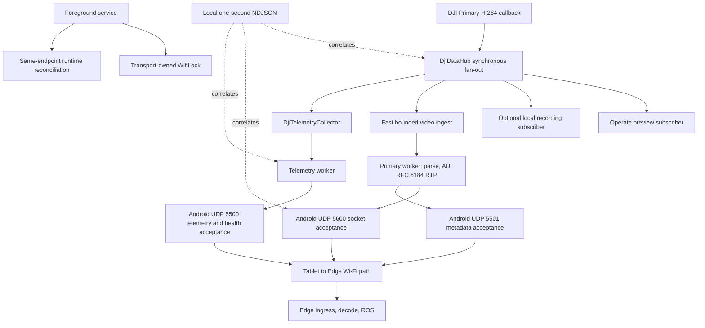
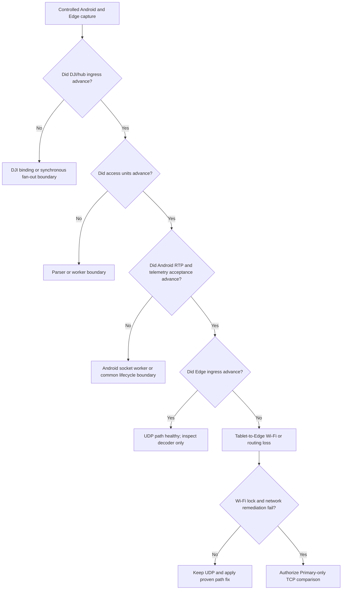

# Primary RTP Gap Delivery - Plan

## Goal Capsule

- **Objective:** Deliver a Primary video and navigation transport that an operator can rely on during the next field test, with each Android-to-Edge interruption attributed to a proven boundary rather than guessed from a missing frame.
- **Means:** Keep the existing Primary H.264/RTP-over-UDP contract, add only bounded sender-side reliability evidence and a transport-scoped Wi-Fi power policy, then apply the smallest correction supported by a correlated tablet/Edge capture. (KTD1, KTD2)
- **Authority:** This work is passive transport only. It must not issue camera, aircraft, gimbal, mission, RTK, or network-selection commands.
- **Execution profile:** Two-day delivery. Day 1 produces a buildable diagnostic/hardening APK and a controlled capture. Day 2 either validates the smallest UDP correction or reaches the TCP contingency gate with the evidence required to make that choice.
- **Stop condition:** Do not replace the working RTP/UDP path with TCP merely because Edge misses UDP. A TCP contingency is authorized only by KTD6 after the Android socket-acceptance versus Edge-ingress boundary has been demonstrated.

---

## Product Contract

### Summary

The application shall retain Primary H.264/RTP on UDP 5600 and compact UDP telemetry/health on 5500 while making the Android-to-Edge path observable enough to resolve the recurrent complete pauses within two days.

It shall favor current video over buffered video, retain the sole `DjiDataHub` callback owner, and avoid synthetic camera-profile, bitrate, or keyframe controls that the DJI pass-through feed cannot truthfully provide.

### Problem Frame

Normal field intervals show Android and Edge progressing together, while fault intervals show approximately eight seconds without Primary RTP, AU metadata, telemetry, or health at Edge before recovery.

The current local counters prove only that Android's UDP socket accepted a datagram; they do not prove that the Edge NIC received it.

The source contains useful local pulse diagnostics, but it lacks a transport-scoped Wi-Fi lock, a one-second local RTP sequence window, and a decision gate that turns the next correlated capture into either a narrow UDP fix or an evidence-backed fallback decision.

### Requirements

**Transport contract and lifecycle**

- R1. Preserve the established wire contract: telemetry/health UDP 5500, Primary AU metadata UDP 5501, clock UDP 5502, and RFC 6184 H.264 Primary RTP payload type 96 on UDP 5600.
- R2. Preserve the Primary RTP datagram MTU of 1200 bytes, SPS/PPS plus IDR recovery behavior, and Primary-only Edge video scope.
- R3. A transport-scoped Wi-Fi lock shall be requested only while a selected Edge endpoint keeps the foreground transport service alive, released exactly once when the service stops, and reported locally as requested, held, unavailable, or failed.
- R4. The foreground service, `TransportSessionManager`, `DjiDataHub`, and all views shall continue to own no competing DJI video callback. Screen navigation and Android backgrounding shall not recreate a same-endpoint runtime.

**Latency and observability**

- R5. The Primary callback path shall remain non-blocking: it may stamp, make the necessary bounded copy, enqueue, and wake its worker, but shall not send UDP, parse H.264, write NDJSON, or perform unbounded diagnostic work.
- R6. The Primary queue shall have a measured short-latency policy. It must never grow unbounded or deliberately accumulate stale video; a dropped byte segment shall cause existing discontinuity and next-IDR recovery rather than a partial access unit.
- R7. Local per-session NDJSON shall emit one compact RTP sequence-window record per second with generated/successfully accepted sequence range, count, local discontinuity count, send failures, and send-duration aggregate. It shall not log every RTP packet or alter the network health schema.
- R8. The Transport screen shall show only compact Android-local truth: endpoint, service/Wi-Fi-lock state, total egress, Primary RTP egress, callback/AU freshness, local queue state, and an attention state when local send health degrades. It shall never label local socket acceptance as Edge receipt.

**Controllable versus source-owned video behavior**

- R9. The app shall not claim it can impose CBR, a live downlink bitrate cap, an arbitrary fps, or an IDR interval on the existing raw DJI Primary feed unless a supported M210/Zenmuse API is proven on the connected hardware.
- R10. The existing Payload Recording Profile controls shall remain labelled as payload recording configuration. They shall not be used as evidence that the tablet-to-Edge live feed was changed.
- R11. Before any optional queue-capacity or access-unit dropping adjustment, the implementation shall use local queue age/high-water/drop and Edge receipt evidence to show that sender backlog, rather than post-socket loss, is the active boundary.

**Decision gate and field proof**

- R12. The first controlled field capture shall produce one matching Android session UUID, tablet NDJSON directory, and Edge session/PCAP evidence for a healthy baseline and, if reproduced, a pause.
- R13. A pause shall be classified as DJI/hub ingress, parser/access-unit worker, Android socket sender, telemetry sender, service/runtime lifecycle, or post-socket Wi-Fi/routing loss using the last progressing counter and timestamp on both sides.
- R14. TCP shall be considered only if the Android process continues accepting Primary RTP and telemetry while the Edge NIC/receiver demonstrably receives neither, the Wi-Fi lock is held or truthfully unavailable, queues are not backlogged, and network remediation cannot make UDP sustainable in the delivery window.

### Acceptance Examples

- AE1. With the selected endpoint unchanged, navigating Operate → Mission → Transport or backgrounding the Activity leaves the same transport session alive; Primary callbacks, Android socket-acceptance counters, and Edge receipt continue when connectivity exists. Covers R3, R4.
- AE2. During an Android sender backlog, the app does not deliver delayed video. It reports the bounded overflow/discontinuity locally and resumes at a decodable source IDR. Covers R5, R6.
- AE3. During a post-socket outage, the Android one-second records show advancing accepted RTP and telemetry while Edge ingress is absent; the result is reported as path loss, not parser failure. Covers R7, R12, R13.
- AE4. A user sees a real payload profile readback and a separate observed live egress/fps value. A payload recording resolution does not imply a live transport resolution. Covers R9, R10.

### Scope Boundaries

- No FPV/secondary transport, UDP 5610, HEVC/H.265 work, camera selection redesign, or Cendence/OcuSync configuration change.
- No decode/re-encode, synthetic IDR insertion, blind frame-rate dropping, blind buffer expansion, or per-packet log persistence.
- No new DJI command, flight-control action, mission action, RTK action, camera-profile write, or network-selection command.

### Deferred to Follow-Up Work

- A supported M210/Zenmuse live-downlink bitrate or keyframe API, if later hardware/API research demonstrates one.
- An adaptive application-level Primary frame-rate governor, only after a measured bandwidth budget proves it is needed and a full access-unit policy can preserve decodability.
- FPV transport revival and its distinct source/framing investigation.

---

## Planning Contract

### Current-State Audit

| Requested point | Current source state | Planning consequence |
| --- | --- | --- |
| RTP/UDP and MTU 1200 | Implemented. `VideoStreamSender` creates `H264RtpPacketizer(1200, 96, ...)`; the packetizer covers single-NAL and FU-A. | Preserve it. Do not change MTU, payload type, ports, or framing in the first correction. |
| `WifiLock` while transport is active | Not implemented. The manifest lacks `WAKE_LOCK`; neither service nor runtime refers to `WifiManager.WifiLock`. | Implement one lifecycle-owned low-latency request with truthful state reporting. |
| Video and telemetry use separate workers/sockets | Implemented. `VideoStreamSender` has a dedicated video thread/socket; `BoundedUdpSender` has a dedicated telemetry thread/socket. | A simultaneous pause remains evidence of shared ingress/lifecycle/network, not ordinary worker contention. |
| Limited CBR instead of VBR | Not implemented and not an Android pass-through control. Current camera profile API changes payload recording profile, not proven live downlink encoding. | Do not fabricate a CBR control. Measure actual egress and investigate a DJI-supported live encoder control only as a hardware-gated follow-up. |
| Sustainable live video profile | Partial. Android exposes observed completed-AU FPS and socket-accepted RTP egress, but no proven live bitrate/fps control exists. | Use measured egress and receipt to establish a sustainable operating point; do not infer it from displayed or recording resolution. |
| IDR every 0.5–1 s | Not implemented and not controllable in the current sender. The assembler only waits for the next source IDR after a discontinuity. | Record observed IDR recovery timing. Do not manufacture or request an IDR without a verified DJI API. |
| Latest-video queue semantics | Partial. The 64-entry ingest queue drops the oldest **chunk**, not a complete frame/access unit, then invokes safe IDR recovery on a gap. | Add queue-age evidence first. Tune only if backlog is proven; never describe chunk eviction as a true frame selector. |
| One-second local RTP sequence window | Not implemented. Packetizer has cumulative emitted counters and socket diagnostics have accepted bytes, but no local accepted sequence-window aggregate. | Add a bounded in-memory window plus one NDJSON record per second. |

### Key Technical Decisions

- KTD1. **Keep RTP/UDP as the delivery path for this two-day effort.** (session-settled: user-directed — chosen over immediately changing everything to TCP: the existing Primary stream works and the missing boundary is not yet proven.) UDP preserves low latency and existing RFC 6184/Edge integration; a successful Android `DatagramSocket.send` remains local acceptance, not delivery. Governs R1, R2, R12-R14.
- KTD2. **Acquire a low-latency Wi-Fi lock from the foreground-service lifetime, not an Activity.** (session-settled: user-directed — chosen over screen-owned lifecycle: transport must survive screen navigation and backgrounding.) On API 29+ use `WIFI_MODE_FULL_LOW_LATENCY`; use the legacy high-performance mode only where that is the platform-compatible fallback. Android may make low-latency effective only while the screen/app are foreground, so held state is evidence of the request, not a guarantee of radio behavior. Governs R3, R4.
- KTD3. **Keep one video worker and one telemetry worker.** (session-settled: user-approved — chosen over one shared sender thread: a blocked video send must not serialize compact flight state behind H.264.) Each worker retains its own socket and bounded queue; no worker sends on a DJI callback. Governs R4-R7.
- KTD4. **Treat the raw DJI feed as an encoded source, not an app-owned encoder.** The app transports Annex-B H.264 without decode/re-encode. CBR/VBR, arbitrary fps, and forced IDR are unavailable until the exact connected payload exposes a supported live-feed API and a hardware test confirms readback plus transport effect. Governs R9-R11.
- KTD5. **Measure queue age before tuning queue capacity.** (session-settled: user-approved — chosen over blindly shrinking buffers: a 64-chunk queue can hide latency, but shrinking it can create more H.264 discontinuities.) The safe immediate improvement is removing diagnostic work from the callback path; changing capacity or trimming needs captured evidence. Governs R5, R6, R11.
- KTD6. **Use TCP only as a narrow, reversible Primary-only contingency.** (session-settled: user-directed — chosen over an unconditional all-stream rewrite: TCP can convert packet loss into head-of-line latency and would require an Edge receiver change.) If R14 is met, prototype RTP-over-TCP framing for Primary behind an explicit endpoint mode while leaving compact navigation telemetry UDP; do not replace the accepted UDP contract until a field comparison proves the trade-off is better. Governs R14.

### High-Level Technical Design

The video callback has one synchronous producer path, but neither parsing nor network I/O belongs there. The two sender workers are intentionally separate; a simultaneous loss is therefore classified using upstream and post-socket evidence instead of being blamed on normal sender serialization.

### Two-Day Sequencing

| Window | Outcome | Gate |
| --- | --- | --- |
| Day 1, first half | Add Wi-Fi lock ownership, compact RTP window evidence, queue-age evidence, and callback-path diagnostic reduction. | Android tests/build/package/ownership pass; no wire-schema change. |
| Day 1, second half | Install and capture 10 minutes healthy plus a reproduced pause when available. | Export one tablet session directory and matching Edge session plus NIC capture. |
| Day 2, first half | Classify the pause and apply only the associated minimal correction. | Same test shows the corrected boundary progressing or no recurrence for a declared soak duration. |
| Day 2, final decision | Keep UDP if it passes, or authorize the isolated TCP comparison only when R14 is proven. | No all-stream TCP rewrite without a side-by-side field result. |

### Risks and Dependencies

- Android's low-latency Wi-Fi lock is a request to the OS, not a guarantee of throughput or delivery. It needs `WAKE_LOCK`, an access point, and platform support. Its background behavior must be reported as a limitation rather than assumed.
- The 64-slot queue is measured in incoming chunks, which are not frames. Reducing it blindly could make IDR recovery more frequent; its capacity is not changed until queue age implicates it.
- The current DJI `VideoFeeder` documentation exposes `isFetchKeyFrameNeeded()` as a feed condition but does not provide this sender a method to command a 0.5–1 second IDR cadence. A forced-keyframe claim needs exact M210/Zenmuse evidence.
- Android local socket acceptance is not receiver acknowledgement. Edge NIC/receiver counters and a narrowly scoped PCAP are required for a post-socket classification.
- A TCP fallback can eliminate RTP sequence gaps while producing longer visible freezes under loss. It is a delivery-risk contingency, not a success criterion.

### Sources and Research

- `Sample Code/app/src/main/java/com/dji/sdk/sample/transport/network/VideoStreamSender.java` — existing MTU 1200 packetizer, dedicated video worker/socket, AU-batched RTP send, socket diagnostics, and 64-chunk pipeline.
- `Sample Code/app/src/main/java/com/dji/sdk/sample/transport/video/BoundedVideoIngestor.java` and `Sample Code/app/src/main/java/com/dji/sdk/sample/transport/video/EncodedVideoRtpPipeline.java` — oldest-chunk eviction and discontinuity-to-IDR recovery.
- `Sample Code/app/src/main/java/com/dji/sdk/sample/transport/network/BoundedUdpSender.java` and `Sample Code/app/src/main/java/com/dji/sdk/sample/transport/network/TelemetryUdpSink.java` — independent telemetry sender worker/socket and local-acceptance semantics.
- `Sample Code/app/src/main/java/com/dji/sdk/sample/transport/TransportRuntime.java`, `Sample Code/app/src/main/java/com/dji/sdk/sample/transport/TransportForegroundService.java`, and `Sample Code/app/src/main/java/com/dji/sdk/sample/transport/TransportSessionManager.java` — per-session diagnostics and persistent same-endpoint lifecycle.
- `Sample Code/app/src/main/java/com/dji/sdk/sample/djihub/DjiDataHub.java` and `Sample Code/app/src/main/java/com/dji/sdk/sample/djihub/CallbackMulticaster.java` — synchronous fan-out and existing ingress/fan-out duration measurement.
- [Android Wi-Fi lock API](https://developer.android.com/reference/android/net/wifi/WifiManager) — `WIFI_MODE_FULL_LOW_LATENCY` limitations and the API-34 treatment of high-performance locks.
- [Android `WifiLock` API](https://developer.android.com/reference/android/net/wifi/WifiManager.WifiLock) — `WAKE_LOCK` permission and non-reference-counted acquire/release behavior.
- [DJI VideoFeeder reference](https://developer.dji.com/api-reference/android-api/BaseClasses/DJIVideoFeeder.html) — fetch-keyframe condition and original versus transcoded feed limitation.

---

## Implementation Units

### U1. Add transport-owned Wi-Fi performance retention

- **Goal:** Request the most appropriate Android Wi-Fi performance mode while passive transport is actually retained, without coupling the lock to a screen or creating an extra network connection.
- **Requirements:** R3, R4.
- **Dependencies:** None.
- **Files:** `Sample Code/app/src/main/AndroidManifest.xml`, `Sample Code/app/src/main/java/com/dji/sdk/sample/transport/TransportForegroundService.java`, create `Sample Code/app/src/main/java/com/dji/sdk/sample/transport/TransportWifiLock.java`, create `Sample Code/app/src/test/java/com/dji/sdk/sample/transport/TransportWifiLockPolicyTest.java`, `Sample Code/app/src/main/java/com/dji/sdk/sample/transport/TransportRuntime.java`, `Sample Code/app/src/main/java/com/dji/sdk/sample/transport/ui/TransportView.java`.
- **Approach:**
  1. Add only the `WAKE_LOCK` permission required by Android's Wi-Fi lock API.
  2. Give the foreground service one non-reference-counted lock owner; request low latency on supported releases, use the legacy compatible mode only where required, and release in every service stop/error path.
  3. Keep lock state as local diagnostics/UI state, including the requested mode and an exception/unavailable reason, without placing it in health UDP.
  4. Let `TransportRuntime` include the lock state in its local pulse so a field pause can be correlated with service and radio-policy state.
- **Patterns to follow:** `TransportForegroundService` idempotent `startForSelectedEndpoint`/`stopForNoEndpoint` lifecycle and `TransportSessionManager` same-endpoint retention.
- **Test scenarios:**
  - Starting a selected endpoint requests exactly one lock; repeated foreground-service reconciliation does not increment ownership.
  - Removing the endpoint or stopping the service releases a held lock exactly once.
  - Unsupported service acquisition or a thrown platform error produces `UNAVAILABLE`/`FAILED` local state without stopping transport.
  - Backgrounding the Activity does not itself release the service-owned lock.
- **Verification:** Android unit coverage proves policy/lifecycle decisions; a Tab S9 smoke check shows the foreground notification, stable endpoint session, and truthful lock state with no added DJI callback ownership.

### U2. Reduce callback-path work and make backlog measurable

- **Goal:** Keep the DJI callback fast while exposing enough queue age and fan-out cost to decide whether a queue adjustment is justified.
- **Requirements:** R5, R6, R11.
- **Dependencies:** U1.
- **Files:** `Sample Code/app/src/main/java/com/dji/sdk/sample/transport/video/BoundedVideoIngestor.java`, `Sample Code/app/src/main/java/com/dji/sdk/sample/transport/video/EncodedVideoRtpPipeline.java`, `Sample Code/app/src/main/java/com/dji/sdk/sample/transport/network/VideoStreamSender.java`, `Sample Code/app/src/main/java/com/dji/sdk/sample/transport/TransportRuntime.java`, `Sample Code/app/src/main/java/com/dji/sdk/sample/transport/diagnostics/AsyncNdjsonDiagnosticWriter.java`, `Sample Code/app/src/main/java/com/dji/sdk/sample/transport/diagnostics/JsonEncoder.java`, `Sample Code/app/src/test/java/com/dji/sdk/sample/transport/video/TransportPrimitivesTest.java`, `Sample Code/app/src/test/java/com/dji/sdk/sample/transport/diagnostics/TelemetryDiagnosticsUnitTestSuite.java`.
- **Approach:**
  1. Retain the one indispensable callback-side byte copy and non-blocking enqueue.
  2. Move recurring Annex-B signature counting out of `offer`, or bound it to the already-limited initial diagnostic samples, so a normal callback does not scan every byte twice.
  3. Extend queue snapshots with oldest queued receive age and a per-window maximum age; retain high-water, chunk/byte drops, and discontinuity counts.
  4. Emit queue age in the existing one-second local transport pulse, then leave capacity at 64 unless a capture proves queuing is the active latency source.
  5. If and only if that proof exists, select a smaller tested chunk capacity and retain the current parser/assembler discontinuity-to-IDR behavior; no partial frame forwarding and no arbitrary source-frame dropper.
- **Execution note:** Characterize the existing ingress behavior before changing capacity. This is a latency containment change, not a throughput optimization by assumption.
- **Patterns to follow:** `BoundedVideoIngestor` oldest-first bounded policy and `EncodedVideoRtpPipeline.signalDiscontinuity()` recovery semantics.
- **Test scenarios:**
  - A normal callback copies/enqueues data while queue age remains zero or near-zero when the worker drains immediately.
  - Four initial hex samples remain bounded and later callbacks do not perform full signature scans on the callback path.
  - A filled queue reports positive oldest age, high-water mark, dropped chunks/bytes, and a downstream sequence discontinuity.
  - A discontinuity suppresses non-IDR output and resumes with cached SPS/PPS plus the next IDR.
  - Invalid/empty inputs preserve existing validation and do not alter queue counters incorrectly.
- **Verification:** Focused primitive and diagnostics tests prove no unbounded queue/log path; local pulses expose queue age and existing callback/fan-out timing without changing health JSON or RTP bytes.

### U3. Add local RTP sequence-window evidence

- **Goal:** Report the sequence continuity generated and accepted by Android once per second without introducing per-packet persistence or claiming Edge receipt.
- **Requirements:** R1, R2, R7, R8, R13.
- **Dependencies:** U2.
- **Files:** create `Sample Code/app/src/main/java/com/dji/sdk/sample/transport/network/RtpSequenceWindowMetrics.java`, `Sample Code/app/src/main/java/com/dji/sdk/sample/transport/network/VideoStreamSender.java`, `Sample Code/app/src/main/java/com/dji/sdk/sample/transport/TransportRuntime.java`, `Sample Code/app/src/main/java/com/dji/sdk/sample/transport/diagnostics/AsyncNdjsonDiagnosticWriter.java`, `Sample Code/app/src/main/java/com/dji/sdk/sample/transport/diagnostics/JsonEncoder.java`, `Sample Code/app/src/main/java/com/dji/sdk/sample/transport/ui/TransportView.java`, create `Sample Code/app/src/test/java/com/dji/sdk/sample/transport/network/RtpSequenceWindowMetricsTest.java`, `Sample Code/app/src/test/java/com/dji/sdk/sample/transport/diagnostics/TelemetryDiagnosticsUnitTestSuite.java`.
- **Approach:**
  1. Keep metrics in memory on the existing video worker; record the RTP sequence only after a `DatagramSocket.send` returns successfully for that packet.
  2. Drain an immutable one-second window into local NDJSON with first/last accepted sequence, accepted count/bytes, expected modulo-16-bit continuity, locally skipped sequence count, local send failure count, and maximum send duration.
  3. Keep current health compact. The window is tablet forensic evidence and is not another Edge packet or a receiver acknowledgement.
  4. Render only summary freshness and egress in Transport UI; detailed sequence values remain exportable evidence.
- **Patterns to follow:** `VideoSocketDiagnostics` rolling max drain and `TransportRuntime.writeRates()` one-second cadence.
- **Test scenarios:**
  - Consecutive 16-bit sequences produce zero local gap count.
  - A sequence wrap from 65535 to 0 is continuous.
  - A skipped accepted sequence increments only the local gap calculation, not the global packetizer counter.
  - A failed send is counted separately and does not masquerade as Edge loss.
  - Empty windows serialize as explicit no-acceptance state rather than invalid numeric data.
- **Verification:** JSON is valid NDJSON, records no raw packet data, and preserves every current network-health field and port.

### U4. Prove the failing boundary with one controlled field capture

- **Goal:** Use the hardened Android build and aligned Edge evidence to decide the smallest correct UDP change instead of treating all RTP gaps as one fault.
- **Requirements:** R4, R8, R12, R13.
- **Dependencies:** U1, U2, U3.
- **Files:** `Sample Code/app/src/main/java/com/dji/sdk/sample/transport/TransportRuntime.java`, `Sample Code/app/src/main/java/com/dji/sdk/sample/transport/TransportForegroundService.java`, `Sample Code/app/src/main/java/com/dji/sdk/sample/transport/network/VideoStreamSender.java`, `docs/PLAN.md`, `README.md`.
- **Approach:**
  1. Run a single selected endpoint and normal Edge receiver for a fixed 10-minute baseline, then a 20-minute pause-reproduction interval if necessary; do not change screens, ports, endpoint, or receiver ownership during each interval.
  2. Export the Android session directory containing `transport.ndjson`, record the session UUID/time window, and ask the Edge owner to retain receiver counters plus a short NIC capture for that same window.
  3. Classify each pause using the decision diagram: callback ingress, fan-out, queue/AU worker, Android socket acceptance, telemetry worker, service/runtime, or post-socket path.
  4. Update `docs/PLAN.md` and `README.md` only with a fact that the capture proves; do not turn a build result into a reliability claim.
- **Execution note:** This unit is a hardware/integration characterization step. Do not make a TCP switch or buffer/MTU change before its classification.
- **Patterns to follow:** `docs/plans/2026-09-15-android-edge-pause-diagnosis-plan.md` local/Edge boundary language and per-session NDJSON layout.
- **Test scenarios:**
  - Healthy baseline: Android callback, AU, accepted RTP, telemetry, metadata, and Edge receipt all advance with stated rates.
  - Callback/hub pause: Android ingress or fan-out age becomes stale before socket acceptance.
  - Parser/worker pause: callbacks advance while AU age becomes stale.
  - Android sender pause: AUs advance while local accepted RTP/telemetry stops or a local send failure grows.
  - Post-socket path pause: Android accepted RTP/telemetry and local sequence windows advance while Edge NIC/receiver is empty.
  - Lifecycle pause: `RUNTIME_CLOSING`, binding detach, or service/reconcile evidence coincides with the gap.
- **Verification:** A compact evidence table names exact before/during/after timestamps, session UUID, last progressing Android counter, last progressing Edge counter, queue/lock/service state, and the one supported boundary classification.

### U5. Apply the smallest confirmed UDP correction

- **Goal:** Fix only the boundary demonstrated by U4 and prove it with a repeat capture.
- **Requirements:** R1-R8, R11-R13.
- **Dependencies:** U4.
- **Files:** Determined by the classification; expected limited candidates are `Sample Code/app/src/main/java/com/dji/sdk/sample/transport/video/BoundedVideoIngestor.java`, `Sample Code/app/src/main/java/com/dji/sdk/sample/transport/network/VideoStreamSender.java`, `Sample Code/app/src/main/java/com/dji/sdk/sample/transport/network/BoundedUdpSender.java`, `Sample Code/app/src/main/java/com/dji/sdk/sample/transport/TransportForegroundService.java`, or `Sample Code/app/src/main/java/com/dji/sdk/sample/transport/TransportSessionManager.java`, plus focused tests.
- **Approach:**
  1. For callback fan-out cost, isolate only diagnostic work proven expensive; do not move preview, recording, or transport to competing DJI callbacks.
  2. For parser/worker stalls, repair the observed failure/recovery path while preserving one worker, bounded ingest, and IDR recovery.
  3. For local socket failures, fix only the socket lifecycle/error path and maintain current endpoint/ports/packetizer.
  4. For foreground lifecycle replacement, make reconciliation keep the same runtime and prove no close/create transition occurred in the gap.
  5. For post-socket Wi-Fi/routing loss, do not rewrite Android transport; provide the correlated evidence to the Edge/network owner and retest after their targeted remedy.
- **Test scenarios:**
  - The regression test reproduces the proven failure state and the fixed state without altering other sender behavior.
  - Primary packet size remains at or below 1200 bytes and payload type stays 96.
  - Telemetry remains asynchronous from video and health stays compact.
  - Local queue and socket errors remain bounded under a controlled send failure.
- **Verification:** Repeat U4's capture. UDP remains the selected delivery method only when Android and Edge show continuous advancing counters through the former fault window or the remaining failure is explicitly proven external.

### U6. Execute the TCP contingency only if the UDP gate fails

- **Goal:** Provide a reversible, primary-only comparison path if U4/U5 prove persistent post-socket UDP loss that cannot be remediated within the delivery window.
- **Requirements:** R1, R2, R9, R14.
- **Dependencies:** U4 and an explicit user decision after its evidence table.
- **Files:** expected Android candidates are `Sample Code/app/src/main/java/com/dji/sdk/sample/transport/network/TransportConfig.java`, `Sample Code/app/src/main/java/com/dji/sdk/sample/transport/network/VideoStreamSender.java`, `Sample Code/app/src/main/java/com/dji/sdk/sample/transport/TransportRuntime.java`, `Sample Code/app/src/main/java/com/dji/sdk/sample/transport/ui/TransportView.java`, `Sample Code/app/src/test/java/com/dji/sdk/sample/transport/network/VideoStreamSenderTest.java`; Edge receiver work belongs in `edge-matrice-transport` and must be planned/reviewed by its owner before implementation.
- **Approach:**
  1. Do not change the UDP default or normal ports. Add an explicitly labelled experimental Primary-only mode that preserves RTP packet bytes through TCP framing and has bounded reconnect/failure behavior.
  2. Keep compact flight/RTK/gimbal/health UDP during the comparison; switching every stream would expand the protocol without proving a benefit for video.
  3. Have Edge implement the paired receiver and expose decoded-frame age, send/receive throughput, reconnect count, and head-of-line stall duration next to current UDP metrics.
  4. Compare equal-duration UDP and TCP field sessions using the same source, endpoint, and resolution; select TCP only if its observed delivery/freshness gain outweighs its stall latency.
- **Test scenarios:**
  - Disabled mode leaves the existing UDP ports, RTP bytes, and Edge behavior unchanged.
  - A TCP disconnect does not block the DJI callback and discards stale pending data rather than replaying old frames.
  - Edge reconnect receives only a decodable IDR-started sequence and reports bounded recovery time.
  - UDP telemetry continues if experimental Primary TCP reconnects or fails.
- **Verification:** This unit is not complete from a build. It requires a side-by-side field evidence table and explicit operator approval to make TCP the default.

---

## Verification Contract

| Gate | Applies to | Evidence required |
| --- | --- | --- |
| Callback ownership | U1-U6 | `scripts/verify_dji_callback_ownership.sh` passes; no direct `VideoFeeder` listener or shared setter callback is introduced outside `DjiDataHub`. |
| Android regression | U1-U5 | `scripts/test_android.sh --offline` passes, including focused Wi-Fi-lock, primitive, and RTP-window tests. |
| Build/package | U1-U5 | `scripts/build_android.sh --offline :app:assembleDebug` and `scripts/verify_apk.sh` pass using the existing Java/SDK environment. |
| Wire regression | U2-U5 | Source tests prove MTU 1200, payload type 96, UDP ports 5500/5501/5502/5600, valid health JSON, and no extra normal-health payload. |
| Tablet smoke | U1-U3 | Foreground service survives Operate/Mission navigation and Android backgrounding; Transport reports local lock/egress state without asserting Edge receipt. |
| Correlated capture | U4-U5 | One Android UUID/time window, matching Edge counters/PCAP, and a boundary evidence table. |
| TCP comparison | U6 only | Paired Android/Edge implementation, reconnect tests, side-by-side field result, and explicit approval before default selection. |

## Definition of Done

- U1-U3 are implemented, tested, and packaged without changing the UDP/RTP contract or DJI callback ownership.
- The active Transport view reports bounded local truth and makes the absence of Edge acknowledgement explicit.
- At least one controlled Android/Edge session has an exported UUID-correlated evidence set; if no pause reproduces, the soak duration and all progressing boundaries are recorded.
- A reproduced pause is classified at the last progressing boundary and U5 either proves the smallest correction or records why the boundary is outside Android.
- The team has a binary decision: keep validated UDP, or proceed to the gated U6 TCP comparison. There is no unverified all-stream TCP migration.
- No abandoned experimental callback, queue, protocol, or TCP code remains in the final diff.
