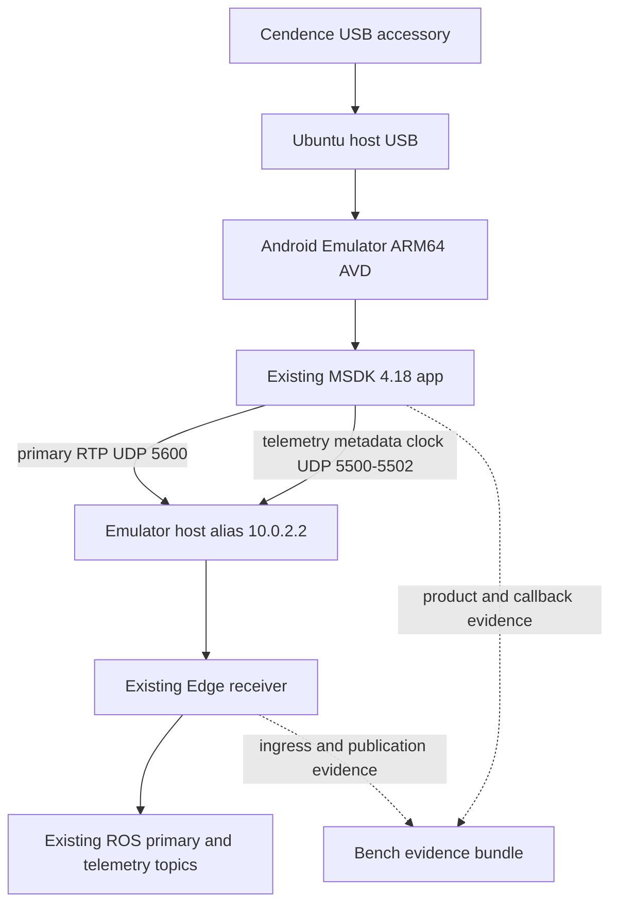
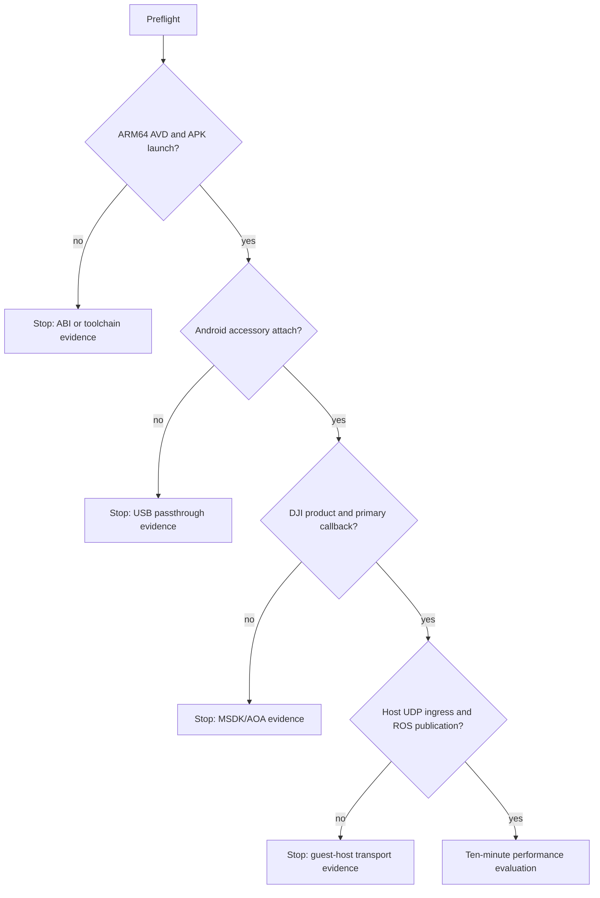

# Cendence Emulator Passthrough MVP - Plan

## Goal Capsule

- **Objective:** prove, on the bench, whether the existing Android application can receive the M210/Cendence connection inside an Android Emulator running on the Ubuntu Edge laptop, then deliver the primary stream and telemetry to the existing local Edge/ROS receiver without the physical tablet-to-Ubuntu Wi-Fi hop.
- **Means:** pass the Cendence USB accessory through to an ARM64 Android 13 AVD and reuse the current app's bounded RTP/UDP transport to the host-only emulator gateway. (KTD1, KTD2)
- **Authority:** the current Android wire contract, existing MSDK 4.18 application behavior, and the safety rules in `AGENTS.md` override this plan. The tablet app remains the operational baseline until all success criteria pass.
- **Execution profile:** bench-only, props-off. No code path may issue takeoff, landing, flight, mission, or gimbal commands automatically.
- **Stop conditions:** stop at the first failed physical gate, preserve its evidence, release the Cendence USB device, and do not modify the established tablet deployment to compensate for an unsupported AVD/accessory combination.

---

## Product Contract

### Summary

This plan creates a contained, reversible bench MVP for Cendence-to-AVD USB passthrough. If it works, the same Android app will send its existing primary RTP and JSON telemetry from the emulator guest to the Ubuntu host's local Edge receiver; if it does not, the experiment ends with evidence rather than a new transport architecture.

### Problem Frame

The present transport crosses a real Wi-Fi link between the physical Android tablet and Ubuntu. Live evidence has shown RTP continuity gaps and pauses on that link. Running the app in an emulator on the Edge laptop would remove that radio leg, but a DJI Android Open Accessory connection through generic emulator USB passthrough is not a guaranteed supported DJI configuration and must be demonstrated before it can be adopted.

### Requirements

**Reproducible bench environment**

- R1. Install and use an isolated Android Emulator 37.1.11 runtime, Android Platform Tools 37.0.1, the existing project Java 11 toolchain, and `system-images;android-33;default;arm64-v8a` revision 2.
- R2. Keep the current application contract unchanged for the first proof: DJI MSDK 4.18, `targetSdkVersion 33`, ARM-only APK packaging, existing accessory intent handling, and existing Android transport ports.
- R3. Discover the actual Cendence USB vendor and product IDs at bench time; no plan or script may guess or hard-code an ID not observed from the attached hardware.

**Connection and safety**

- R4. The Cendence must have exactly one USB owner during a run: either the physical tablet or the AVD, never both.
- R5. The AVD test must verify the observed accessory filter, Android accessory attachment, DJI registration, product connection, and primary `VideoFeeder` callback activity before evaluating Edge/ROS delivery.
- R6. The test procedure must remain observability-only and preserve the existing physical-tablet workflow after the emulator closes.

**Local Edge delivery**

- R7. For this MVP, emulator-to-host delivery uses the existing primary RTP/UDP and JSON UDP contract addressed to the Android Emulator host alias `10.0.2.2`; it does not introduce shared memory, TCP, MQTT, a new ROS client, or a new video protocol. (session-settled: user-directed — chosen over a new direct ROS protocol: isolate the physical Wi-Fi leg with the smallest compatible change.)
- R8. The existing Edge receiver must observe the same primary input ports and ROS topics already used by the tablet deployment, with no new flight-control surface; the host-to-container network mode must be proven before guest-to-host delivery is judged.
- R9. The result must distinguish the following evidence boundaries independently for primary video and telemetry: Cendence/USB attach, Android product connection, Android `VideoFeeder` callback, Android RTP sender acceptance, Android telemetry sender acceptance, host UDP ingress, and existing ROS publication.

### Actors

- A1. **Bench operator:** physically connects the Cendence, authorizes no flight action, starts/stops a run, and reconnects the tablet only after release.
- A2. **Android application:** receives DJI callbacks, emits existing bounded primary RTP and JSON telemetry, and never controls the aircraft automatically.
- A3. **Android Emulator:** owns the passed-through USB accessory and forwards guest traffic to the Ubuntu host virtual gateway.
- A4. **Ubuntu Edge/ROS stack:** receives the existing host-visible UDP traffic and publishes its existing ROS outputs.

### Key Flows

- F1. **Pass-through proof**
  - **Trigger:** the operator connects the Cendence to Ubuntu for a props-off bench run.
  - **Steps:** preflight records the USB identity and Android accessory identity; the ARM64 AVD starts with the USB identity passed to QEMU; Android reports the accessory attach; the existing application matches the observed accessory filter and receives the forwarded attach event; DJI reports a connected product.
  - **Outcome:** the test may proceed only after all four observations are present. Covers R3, R4, R5, R6.

- F2. **Host-local delivery proof**
  - **Trigger:** the connected product yields primary video callbacks in the AVD.
  - **Steps:** the operator selects `10.0.2.2` in the current transport UI; the app's existing sender emits to its current ports; the host Edge receiver observes ingress and ROS publishes the corresponding primary topic.
  - **Outcome:** the radio tablet-to-Ubuntu hop is absent while the proven Android and Edge protocol stays unchanged. Covers R2, R7, R8, R9.

### Acceptance Examples

- AE1. Covers R3, R4, R5. Given the Cendence is connected only to Ubuntu, when the AVD is launched with the observed USB identity, then Android accessory attachment and DJI product connection are both evidenced before transport is enabled.
- AE2. Covers R7, R8, R9. Given primary callbacks are increasing inside the AVD, when the app uses `10.0.2.2`, then Ubuntu observes primary UDP ingress and its existing ROS primary image output without a physical tablet Wi-Fi sender.
- AE3. Covers R4, R6. Given a run ends or a gate fails, when the emulator is shut down, then the Cendence is released and the unchanged tablet workflow can reconnect without source modifications.

### Success Criteria

- SC1. AVD architecture is `arm64-v8a`, the installed APK launches, and the app registers without changing its ABI filters.
- SC2. One full bench run produces a timestamped evidence bundle for every video and telemetry boundary in R9.
- SC3. A continuous ten-minute props-off primary run has Android callback activity, primary RTP and telemetry JSON host ingress, and existing ROS video and telemetry publication throughout; any interruption is recorded with the boundary where it first appears.
- SC4. The emulator route is considered only as a performance candidate after SC1–SC3 pass. An ARM64 AVD that cannot sustain the required callback/transport cadence is a successful compatibility result but not an operational replacement for the tablet.

### Scope Boundaries

- This MVP is primary-only. FPV remains outside scope.
- This MVP does not replace the tablet application, alter DJI flight-control behavior, or add commands to the Edge machine.
- This MVP does not claim that generic USB passthrough is supported by DJI MSDK. A failed AOA/product gate is a valid result.
- This MVP does not remove RTP/UDP. It removes only the physical Wi-Fi segment between Android and Ubuntu; the emulator guest still needs a host transport boundary.

#### Deferred to Follow-Up Work

- An x86_64 AVD experiment with deliberately built and verified x86 native DJI dependencies, only if ARM64 USB compatibility succeeds but ARM64 emulation is too slow for an operational evaluation.
- DJI Bridge App as a fallback diagnostic path. It requires a physical Android bridge device and a network path, so it does not test the requested no-tablet-Wi-Fi route.
- Any new direct native ROS, vsock, shared-memory, TCP, or QUIC transport. Those are separate protocol projects, not diagnostic substitutes for this MVP.
- FPV, mission controls, and physical flight acceptance.

### Risks and Dependencies

| Risk or dependency | Consequence | Mitigation and decision gate |
|---|---|---|
| Android Emulator does not expose the Cendence AOA accessory correctly | No DJI product connection | Stop at G2, keep USB/logcat evidence, and retain the tablet baseline. |
| ARM64 AVD is slow on the x86_64 laptop | It cannot prove low operational latency | Treat compatibility and performance as separate gates; do not infer Wi-Fi improvement from an overloaded emulator. |
| Cendence remains owned by another process/device | Attach is absent or unstable | Enforce exclusive USB ownership and close the AVD before reconnecting the tablet. |
| The app uses the wrong host address | Android callbacks work but host ingress is absent | Use only `10.0.2.2` for the standard emulator NAT path and verify at the Android sender plus host receiver boundary. |
| GPU/display configuration fails | AVD UI is unusable but transport may still be testable | Record it separately; do not replace the transport to work around a renderer problem. |

### Sources and Research

- The repository's `Sample Code/app/build.gradle` packages only `armeabi-v7a` and `arm64-v8a`, so a normal x86_64 AVD is not a valid first target.
- The existing transport is already endpoint-configurable in `Sample Code/app/src/main/java/com/dji/sdk/sample/transport/ui/TransportView.java` and has current ports in `Sample Code/app/src/main/java/com/dji/sdk/sample/transport/network/TransportConfig.java`.
- DJI documents RC-to-Android USB connection and Android Open Accessory requirements for MSDK applications: [DJI Run Application](https://developer.dji.com/mobile-sdk/documentation/application-development-workflow/workflow-run.html).
- Android documents generic Emulator USB passthrough through QEMU `usb-host` device arguments, but that facility does not certify DJI accessory compatibility: [Android Emulator release notes](https://developer.android.com/studio/releases/emulator) and [Android Emulator command line](https://developer.android.com/studio/run/emulator-commandline).
- DJI's official Bridge App is retained only as a network-dependent fallback because it requires a physical bridge Android device and a separate emulator connection: [DJI Android Bridge App](https://github.com/dji-sdk/Android-Bridge-App).

---

## Planning Contract

### Key Technical Decisions

- KTD1. **Use an ARM64 Android 13 AVD for the first proof.** The APK contains ARM native libraries and deliberately excludes x86/x86_64. The chosen image is `system-images;android-33;default;arm64-v8a` revision 2; the app remains MSDK 4.18 / API 33. This proves compatibility before performance. Governs R1, R2, R5.
- KTD2. **Reuse the existing UDP contract over `10.0.2.2`.** The Android Emulator host alias removes the physical Wi-Fi tablet-to-Ubuntu link while preserving the known Android primary RTP port 5600 and JSON ports 5500–5502. No direct guest memory access is available to native ROS. Governs R7, R8, R9.
- KTD3. **Launch USB passthrough only with runtime-discovered Cendence IDs and an observed Android accessory filter.** The run helper accepts a discovered vendor/product pair and places QEMU passthrough arguments last. The app's accessory filter is added only after its Android-visible AOA identity is captured. This avoids stale hardware assumptions and aligns with the Emulator CLI's passthrough contract. Governs R3, R4, R5.
- KTD4. **Use gates, not recovery workarounds.** An absent Android accessory event, MSDK product connection, primary callback, or host ingress identifies a boundary and ends that run. The plan does not add retries, Bridge mode, alternate encoders, or protocol forks to conceal the missing proof. Governs R5, R6, R9.
- KTD5. **Keep Android Emulator outside the ROS container.** USB passthrough and KVM belong on Ubuntu host; existing Edge/ROS stays in its current container workflow. The current Compose uses host networking, but U4 must prove that condition at runtime before it attributes a delivery failure to the emulator boundary. Governs R1, R7, R8.

### High-Level Technical Design

### Installation Pins and Provenance

| Component | Pinned value | Acquisition authority |
|---|---|---|
| Android Emulator | 37.1.11, Linux x64 archive `emulator-linux_x64-15917651.zip` | [Android Emulator release notes](https://developer.android.com/studio/releases/emulator) |
| Android Platform Tools | 37.0.1 | [Platform Tools release notes](https://developer.android.com/tools/releases/platform-tools) |
| Android system image | `system-images;android-33;default;arm64-v8a`, revision 2 | [Android SDK command-line tools](https://developer.android.com/tools) |
| Android SDK command-line tools | Existing local 22.0 unless its compatibility check fails | [Android SDK command-line tools](https://developer.android.com/tools) |
| Java | Existing OpenJDK 11.0.32 | local host preflight |
| Android build | Gradle 6.7.1, AGP 4.2.2, Kotlin 1.5.10, MSDK 4.18 | `Sample Code/build.gradle`, `Sample Code/app/build.gradle` |

### Execution Sequence

1. Establish the isolated emulator tool location and immutable version checks.
2. Add bench-only helper scripts and documentation without changing transport behavior.
3. Prove AVD boot and ARM APK launch before connecting aircraft equipment.
4. Prove Cendence USB accessory attachment and DJI product connection.
5. Reuse the existing transport UI with `10.0.2.2` and prove host ingress plus ROS publication.
6. Run the time-bounded primary continuity evaluation, then restore the tablet baseline.

---

## Implementation Units

### U1. Add reproducible emulator-MVP tooling

- **Goal:** provide minimal, isolated host tooling to install, verify, create, launch, stop, and evidence an ARM64 AVD without modifying the deployed Android transport.
- **Requirements:** R1, R2, R3, R4, R6.
- **Dependencies:** none.
- **Files:** `scripts/emulator_mvp_preflight.sh` (new), `scripts/emulator_mvp_install.sh` (new), `scripts/emulator_mvp_launch.sh` (new), `scripts/emulator_mvp_stop.sh` (new), `docs/EMULATOR_CENDENCE_MVP.md` (new), `.gitignore` (modify).
- **Approach:**
  1. Keep emulator archives, AVD data, logs, screenshots, and exported evidence under one ignored local runtime root selected by the scripts; do not place device IDs, API keys, or generated artifacts under version control.
  2. Make preflight report the exact host architecture, KVM access, Java version, Android SDK root, Platform Tools version, current device/ADB state, and current `lsusb` inventory.
  3. Make installation reject an existing different emulator version rather than overwriting it. Verify the binary reports 37.1.11 and the installed system image reports Android 33 ARM64 revision 2.
  4. Make launch require a vendor/product argument copied from current preflight output. It starts exactly one named AVD and appends the QEMU USB passthrough arguments as the final emulator arguments.
  5. Make stop wait for the emulator process to exit and verify the Cendence no longer appears as held by that process before it declares the USB device released.
- **Execution note:** This is packaging and host setup. Prefer deterministic preflight and install/runtime smoke checks over unit tests.
- **Patterns to follow:** `Sample Code/scripts/build_android.sh` for repository-local helper conventions; `.gitignore` for local credentials and build artifacts.
- **Test scenarios:**
  - With the pinned tools absent, installation stages them under the ignored runtime root and reports the exact resolved versions.
  - With a mismatched emulator binary already in the target location, installation fails without replacing it.
  - With no Cendence attached, launch refuses to start passthrough and prints the required discovery action.
  - With a supplied `lsusb` vendor/product pair, launch places the pass-through device argument after all normal emulator arguments.
  - After a forced stop, the release check reports no remaining emulator holder.
- **Verification:** an operator can obtain a deterministic preflight report and create/stop the named ARM64 AVD without changing the app, the ROS container, or the tablet configuration.

### U2. Add a bench-only Android endpoint profile

- **Goal:** make the existing transport UI select the emulator host alias safely and visibly, without adding an alternate sender implementation.
- **Requirements:** R2, R7, R8.
- **Dependencies:** U1.
- **Files:** `Sample Code/app/src/main/java/com/dji/sdk/sample/transport/ui/TransportView.java` (modify), `Sample Code/app/src/main/java/com/dji/sdk/sample/transport/TransportEndpointPolicy.java` (modify if needed), `Sample Code/app/src/test/java/com/dji/sdk/sample/transport/TransportEndpointPolicyTest.java` (modify), `Sample Code/app/src/main/res/values/strings.xml` (modify), `docs/EMULATOR_CENDENCE_MVP.md` (modify).
- **Approach:**
  1. Preserve saved IP lists and the selected-endpoint behavior used on the physical tablet.
  2. Accept `10.0.2.2` only as a valid explicit IPv4 endpoint; never infer it automatically on physical devices.
  3. Display the active endpoint and retain the existing transport port contract from `TransportConfig`.
  4. Keep all video packetization, clock, telemetry, and foreground-service logic unchanged; this unit changes endpoint selection and documentation only.
- **Execution note:** Characterize the current endpoint validation before changing it; this is a compatibility edit in an established transport screen.
- **Patterns to follow:** `TransportView`, `TransportSessionManager`, `TransportEndpointPolicy`, and existing endpoint policy tests.
- **Test scenarios:**
  - `10.0.2.2` is accepted as an explicitly selected endpoint and persists through a UI recreation.
  - An empty, malformed, multicast, or IPv6 endpoint retains current rejection behavior.
  - Selecting `10.0.2.2` does not alter ports 5500, 5501, 5502, or 5600.
  - The normal physical Edge IPv4 endpoint remains selectable and unchanged.
- **Verification:** the same APK can choose either a normal physical Edge IPv4 address or the explicit emulator host alias, with no implicit routing switch.

### U3. Establish USB accessory and MSDK connection evidence

- **Goal:** prove or disprove the Cendence-to-AVD accessory path before enabling an operational transport run.
- **Requirements:** R3, R4, R5, R6, R9.
- **Dependencies:** U1, U2.
- **Files:** `scripts/emulator_mvp_collect_evidence.sh` (new), `docs/EMULATOR_CENDENCE_MVP.md` (modify), `Sample Code/app/src/main/res/xml/accessory_filter.xml` (new), `Sample Code/app/src/main/java/com/dji/sdk/sample/internal/controller/MainActivity.java` (modify only if the current accessory event is insufficiently observable), `Sample Code/app/src/main/java/com/dji/sdk/sample/internal/view/MainContent.java` (modify only if current product status cannot be evidenced).
- **Approach:**
  1. Capture a session directory containing host USB discovery, ADB device identity, Android USB state, filtered application/DJI logcat, and timestamps for attach/product/callback boundaries.
  2. Before modifying the app, capture the Android-visible AOA manufacturer, model, and version values from the attached Cendence. Create `accessory_filter.xml` only from that evidence so the manifest's existing resource reference resolves and filters the actual accessory.
  3. Reuse the manifest's existing `USB_ACCESSORY_ATTACHED` handling and `MainActivity` forwarding to `DJISDKManager.USB_ACCESSORY_ATTACHED`; do not create a second USB receiver.
  4. Add only concise, structured boundary logs if current logs cannot prove accessory attach, `onProductConnect`, and primary callback activity independently.
  5. Enforce the fail-fast gate order from the design diagram. The evidence collector records which gate ended the run and does not attempt a fallback path automatically.
- **Execution note:** Runtime/physical smoke evidence is the primary proof. Do not use a mock DJI connection as a substitute for Cendence accessory validation.
- **Patterns to follow:** `AndroidManifest.xml`, `MainActivity.onNewIntent`, `MainContent` product callbacks, `DjiDataHub` primary feed metrics.
- **Test scenarios:**
  - An AVD boot without a passed Cendence produces an explicit failed accessory gate and retains Android USB evidence.
  - A Cendence with Android-visible identity absent from `accessory_filter.xml` is rejected as an accessory-filter gate failure before product connection is evaluated.
  - An accessory attach without a product connection produces a distinct MSDK gate failure rather than a generic transport failure.
  - A product connection with no primary callback produces a distinct feed gate failure.
  - A successful pass stores timestamped evidence for all required boundaries without writing credentials or raw unnecessary video.
- **Verification:** a reviewer can determine from one session directory whether the first failure was USB ownership, Android accessory attachment, DJI product connection, or primary feed callback.

### U4. Prove guest-to-host delivery and existing ROS equivalence

- **Goal:** validate that the successful AVD callback reaches the existing Edge/ROS system through the known local UDP contract.
- **Requirements:** R7, R8, R9, SC2, SC3.
- **Dependencies:** U2, U3.
- **Files:** `scripts/emulator_mvp_collect_evidence.sh` (modify), `docs/EMULATOR_CENDENCE_MVP.md` (modify), `docs/TRANSPORT_RESOLUTIONS_AND_OPEN_ISSUES.md` (modify if present).
- **Approach:**
  1. Start the current Edge/ROS receiver using its existing documented container entry point; record that the active project Compose runs with host networking and prove that host packets reach ports 5500–5502 and 5600 before treating this as an emulator test.
  2. Select `10.0.2.2` in the emulator app and correlate Android primary and telemetry sender counters with separate host UDP ingress and existing ROS publication using a shared wall-clock evidence window.
  3. Record the active endpoint, original port set, primary callback count/rate, telemetry emission count/rate, sender accepted/error counters, host packet/byte ingress by port, and ROS video and telemetry topic publication count/rate.
  4. Evaluate a ten-minute primary-only run. Treat the first boundary that pauses as the diagnosis; do not calculate end-to-end latency from unrelated clocks.
- **Execution note:** Use runtime smoke and integration evidence. Existing tablet and Edge transport tests remain regression gates, not a proof of this physical route.
- **Patterns to follow:** `TransportRuntime`, `VideoStreamSender`, `TelemetryUdpSink`, `DjiDataHub`, existing Edge dashboard and ROS topic diagnostics.
- **Test scenarios:**
  - With the Edge container running, a host-originated UDP probe reaches its host-network receiver on ports 5500–5502 and 5600 before AVD application traffic is evaluated.
  - With an active AVD primary callback and selected `10.0.2.2`, host primary RTP ingress increases on port 5600 while host JSON ingress increases on ports 5500–5502 when corresponding Android data is available.
  - With host ingress active, the existing ROS primary output and the existing telemetry output publish without changing their topic name or QoS contract.
  - When the Android primary or telemetry sender accepts packets but the corresponding host ingress is absent, evidence labels the failure as the guest-host boundary for that channel.
  - When host ingress continues but the corresponding ROS output does not publish, evidence labels the Edge/ROS boundary without blaming USB or Android.
  - During the ten-minute run, any callback, sender, host ingress, or ROS interruption is timestamped and attributed to the earliest stalled boundary.
- **Verification:** the evidence bundle supports a binary decision: the physical Wi-Fi hop was removed and the complete primary plus telemetry route is equivalent, or the exact first failed boundary is known.

### U5. Document operation, rollback, and decision outcome

- **Goal:** leave a bench procedure that another operator can execute safely and interpret without re-deriving the architecture.
- **Requirements:** R1, R4, R6, R9, SC1, SC2, SC3, SC4.
- **Dependencies:** U1, U2, U3, U4.
- **Files:** `README.md` (modify), `docs/EMULATOR_CENDENCE_MVP.md` (modify), `docs/TRANSPORT_RESOLUTIONS_AND_OPEN_ISSUES.md` (modify if present).
- **Approach:**
  1. State the exact pins, source links, expected host/guest roles, evidence directory layout, and gate table.
  2. State that the Cendence moves physically from tablet to Ubuntu for the run, that no flight action is automated, and that the emulator must be stopped before reconnecting the tablet.
  3. State the operational decision rule: adopt only after compatibility and continuity gates pass; otherwise retain the physical tablet route and use the evidence to guide the next investigation.
  4. Record that Android Emulator USB passthrough is an experiment, whereas the physical tablet path remains the verified operational reference.
- **Test scenarios:**
  - Documentation identifies all tool versions and sources without embedding a DJI API key or personal USB IDs.
  - Documentation tells an operator how to restore the physical-tablet baseline after either success or failure.
  - Documentation distinguishes a compatibility pass from an operational performance pass.
- **Verification:** a new bench operator can reproduce the setup, identify the correct pass/fail boundary, and restore the prior deployment without reading source code.

---

## Verification Contract

| Gate | Proof | Pass condition | Failure classification |
|---|---|---|---|
| G0: host preflight | version report, KVM access, USB inventory | all R1 pins and host prerequisites match | environment/tooling |
| G1: AVD and APK | ADB identity, ABI, app launch log | AVD reports `arm64-v8a`; existing APK launches and registers | ABI/app startup |
| G2: USB accessory | host USB evidence plus Android USB/logcat | Cendence appears in AVD, matches the observed accessory filter, and accessory event fires | passthrough/ownership |
| G3: DJI feed | product callback and `DjiDataHub` primary metrics | product connected and primary callback counter advances | DJI/AOA/feed |
| G4: container topology | active Compose network mode and host UDP probe | host-network Edge receiver accepts the established ports before AVD traffic | deployment topology |
| G5: host-local transport | Android sender and Edge ingress evidence | primary RTP and available telemetry JSON arrive at the existing receiver using `10.0.2.2` | guest-host routing |
| G6: ROS equivalence | existing ROS topic diagnostics | primary image and telemetry outputs continue during a ten-minute primary-only run | Edge/ROS |
| G7: rollback | AVD stopped and tablet reconnection check | Cendence is released and physical tablet behavior is unchanged | cleanup/USB ownership |

The implementation must run the existing Android unit tests and build checks before the physical bench gates. It must also execute the existing Edge/ROS verification commands from that repository without altering them. Physical gates are not satisfied by mocks, screenshots alone, or process existence.

---

## Definition of Done

- U1–U5 are implemented and their stated verification conditions pass.
- The project contains no API key, physical USB identifier, AVD image cache, generated APK, logcat dump, or evidence artifact tracked by Git.
- An ARM64 AVD run either satisfies G0–G7 or produces a complete, timestamped evidence bundle at the first failed gate.
- The application retains its existing ARM ABI filters, MSDK 4.18 setup, accessory intent behavior, current UDP port contract, and no-automatic-command safety boundary.
- The physical tablet workflow is retested after the emulator release and remains usable.
- The emulator route is not described as operationally superior unless the ten-minute continuity run passes and its performance is measured separately from emulator overhead.
- Any abandoned alternative protocol or fallback code is absent from the final diff.
