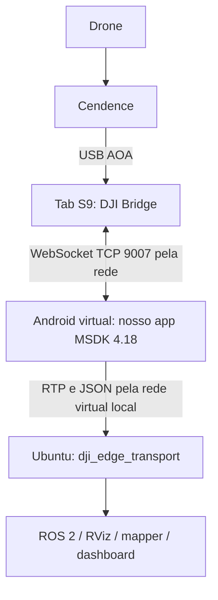

# DJI Android Bridge no Ubuntu - Plan

## Goal Capsule

- **Objetivo:** determinar se o caminho DJI→Edge entrega vídeo primary e telemetria com continuidade e proveniência temporal suficientes para o nosso uso.
- **Meio:** avaliar a Bridge oficial no tablet ligado por USB ao Cendence, com o cliente MSDK num Android virtual no Ubuntu e o transporte existente até ao Edge local.
- **Autoridade:** segurança de `AGENTS.md`, contrato Android→Edge e timestamps originais prevalecem sobre conveniência de implementação.
- **Limite:** isto é uma avaliação de viabilidade, não uma decisão de substituir a arquitetura operacional. Pode terminar legitimamente em rejeição documentada.
- **Paragem:** incompatibilidade JNI sem solução suportada, falha de isolamento da Bridge, comandos não solicitados ou perda do valor/timestamp original encerram a etapa e preservam o baseline. Se o valor existir mas a semântica de aquisição não puder ser demonstrada, o teste pode terminar com parecer limitado a desenvolvimento.
- **Execução:** bancada, hélices removidas, sem comandos automáticos. Instalações no tablet e ensaios com equipamento exigem autorização explícita do operador.

---

## Product Contract

### Summary

Avaliar a Bridge primeiro como ferramenta de desenvolvimento, sem migrar o produto. Separar a compatibilidade do Android virtual, a conexão Bridge/MSDK e o desempenho de ponta a ponta em provas independentes. Só propor adoção operacional depois de comparar com o caminho atual nas mesmas condições.

### Problem Frame

O objetivo original era eliminar a ligação de rede entre tablet e Ubuntu. A Bridge não faz isso: mantém um Android físico conectado ao Cendence e transfere o fluxo DJI pela rede para outro Android. Troca o local de execução do SDK e o protocolo do trecho de rede, mas não remove o rádio nem garante menor latência.

O plano `docs/plans/2026-09-28-1131-feat-cendence-emulator-mvp-plan.md` não deve ser executado como receita de passthrough: o Cendence desempenha o papel USB host no caminho AOA, enquanto o Android é dispositivo USB. Passthrough de um periférico para um host virtual não fornece automaticamente esse papel ao Ubuntu. A ausência de UDC utilizável observada no laptop reforça esse bloqueio, sem provar impossibilidade de todo hardware futuro.

### Requirements

**Preservação e segurança**

- R1. Manter APK, configurações e operação direta no Tab S9 recuperáveis, sem apagar alterações locais anteriores ao MVP nem substituir o launcher Edge.
- R2. Nenhum teste emite takeoff, arming, landing, missão, virtual-stick ou gimbal automaticamente; a avaliação inicial usa somente recepção.
- R3. Não expor a Bridge numa rede pública ou partilhada com clientes não autorizados; permitir apenas um cliente MSDK durante a bancada.

**Funcionalidade e tempo**

- R4. Demonstrar primary real, flight/GPS, heading e gimbal, com RTK distinguindo callback presente de fix disponível.
- R5. Preservar timestamps DJI existentes e timestamps de callback do cliente sem rebatizá-los como tempo de captura ou de recepção no tablet físico.
- R6. Publicar dados pelo contrato atual do Edge sem reescrever mapper, decoder, dashboard ou packetizer para acomodar o experimento.
- R7. A falha de associação segura frame→telemetria deve permanecer indisponível; nunca usar a última posição como prova de sincronização.

**Decisão baseada em evidência**

- R8. Comparar baseline e Bridge com a mesma resolução, taxa observada, cena, distância ao AP e carga ROS/RViz.
- R9. Registrar versões, hashes, logs e fronteiras temporais suficientes para separar falha de emulador, USB, Bridge, rede e Edge.
- R10. Distinguir três resultados: rejeitado; útil apenas para desenvolvimento; candidato operacional ainda sujeito a aprovação e validação de campo.

### Success Criteria

Critérios propostos para a bancada, não promessas de desempenho nem certificação de voo:

1. Três execuções de 10 minutos por alternativa, intercaladas A/B, sem crash e sem reinício manual durante o segmento válido. Esta amostra compara as opções nesta bancada; não estima confiabilidade em campo.
2. Zero congelamentos de imagem acima de 1 segundo nesses segmentos; medir mudança visual com cena móvel, não só FPS de callbacks.
3. p95 da latência visual não pior que o baseline e redução de pelo menos 50% do tempo total congelado quando o baseline tiver travadas. Se ambos forem estáveis, a Bridge não demonstrou benefício de continuidade.
4. Sem crescimento progressivo de atraso após uma perturbação de rede; recuperação para imagem atual, sem replay prolongado de vídeo antigo.
5. Nenhuma lacuna nova de telemetria acima de 1 segundo atribuível à Bridge nos segmentos em que a origem entrega callbacks normalmente.
6. Para adoção orientada a georreferenciamento, comprovar semântica temporal da origem e erro de associação compatível com o orçamento espacial do projeto. Sem esse orçamento ou prova, classificar no máximo como ferramenta de desenvolvimento.

### Scope Boundaries

Primary-only. FPV, voo real, nova UI completa, migração do dashboard, alteração de protocolos Edge e substituição de ROS estão fora deste MVP. Não tentar portar bibliotecas proprietárias ARM para x86 nem instalar tradução ARM de origem não verificável. Não implementar TLS, autenticação e serviço Android persistente como um novo produto Bridge antes de demonstrar valor; se forem necessários para uso operacional, quantificar o trabalho num plano separado.

---

## Assessment and Evidence

### Topologia real

O emulador é cliente da Bridge. O Edge não consome diretamente a porta 9007: nela não existe o nosso contrato RTP/JSON. O RTP continua existindo entre o app MSDK e o Edge, mas deixa de atravessar o Wi-Fi físico nesse trecho, desde que o destino seja o host local correto.

### Upstream verificado

Fonte canónica: [dji-sdk/Android-Bridge-App](https://github.com/dji-sdk/Android-Bridge-App), licença MIT, branch `master`, commit `d2b841e35801ad766bd074f3454d0723ba1c92bc`. O commit HEAD é de **2020-12-16**; o metadado GitHub `pushed_at` de 2022 não é prova de manutenção do código desde então. O repositório não se apresentava arquivado na consulta de 2026-10-11.

O código declara versão **1.2.6**, embora o HEAD também corresponda à tag `4.14-trial1`. Não confundir versão da Bridge com versão MSDK. O README apresenta a ferramenta como beta de desenvolvimento. Compatibilidade genérica anunciada com MSDK 4+ não demonstra Tab S9 atual + M210 RTK V2 + emulador atual.

Nos paths upstream abaixo, o prefixo é `android-wsbridge/` dentro desse repositório:

| Área | Evidência de código | Consequência |
|---|---|---|
| Protocolo | `app/src/main/java/com/dji/wsbridge/BridgeActivity.java`, porta 9007; `lib/connection/WSConnectionManager.java` usa Java-WebSocket | WebSocket sobre TCP, não uma conexão USB virtual local |
| Fluxo recebido | `lib/StreamRunner.java` lê USB em buffer de 16.384 bytes e escreve no stream de rede | Blocos de transporte DJI, não mensagens nossas de vídeo/telemetria separadas |
| Descarte de saída | `WSConnectionManager.send` não chama `conn.send` quando `outQueue.size()` excede `100 / número de conexões` | TCP não recupera blocos que a aplicação decide não enviar; o limite é quantidade de entradas, não bytes nem milissegundos |
| Descarte de entrada | `onMessage` remove a entrada mais antiga quando a fila de 100 elementos está cheia | Também existe descarte no sentido cliente→USB; não qualificar a ponte como canal confiável de comandos |
| Agrupamento e cópias | `lib/NetworkServerOutputStream.java` acumula e usa `toByteArray`, envia quando tamanho é maior que 2 KiB com vídeo | Há cópia e espera por limiar; `BUFFER_SIZE=10 MiB` declarado não é um limite efetivamente aplicado |
| Fluxo residual | O output não implementa flush temporal próprio; `StreamRunner.flush()` não fornece essa política | Cauda menor que o limiar pode aguardar novos dados; efeito real deve ser medido |
| Ciclo de vida | `BridgeActivity.onPause` destrói conexão USB e chama `stopStreamTransfer` | Sair da Activity pode cortar o feed; não é um relay de fundo robusto pronto para campo |
| Keepalive | `WSConnectionManager` usa timeout de 30 s e estado partilhado entre conexões | Conectado não significa imagem recente; usar um cliente e medir idade dos dados |
| Segurança | Servidor em `new InetSocketAddress(port)`; nenhuma configuração de TLS/autenticação localizada no fluxo inspecionado | Tratar clientes alcançáveis como capazes de enviar bytes ao RC; rede isolada é requisito de bancada |
| Contadores | `ByteStatCounter` soma bytes antes da decisão de descarte e agrega em intervalos maiores que 10 s | Seu throughput não comprova entrega ao cliente nem ausência de travada |

O ramo de USB e as filas foram lidos diretamente. O interior binário do DJI SDK e o comportamento do rádio/drone não foram demonstrados por esse exame. Não atribuir a travada atual à Bridge: ela ainda não foi utilizada neste teste.

### Compatibilidade Android e APK

| Componente | Estado conhecido | Decisão |
|---|---|---|
| App atual | MSDK 4.18; filtros `armeabi-v7a` e `arm64-v8a` em `Sample Code/app/build.gradle` | APK ARM não funciona nativamente num Android x86 sem suporte adicional comprovado |
| AAR DJI 4.18 | 31 bibliotecas por ABI ARM, 16 em x86 de 32 bits e nenhuma em x86_64 no artefacto local examinado | Existência parcial de x86 não prova vídeo, RTK e inicialização completos |
| Host | Ubuntu x86_64; nenhum UDC utilizável observado | Não retomar o passthrough direto como se fosse equivalente à Bridge |
| Bridge upstream | API compile/target 30, min16; AGP4.1.1, Gradle6.5, Build Tools27.0.3 | Build antigo e execução em Android moderno são gates, não fatos consumados |
| Dependências Bridge | Java-WebSocket1.3.3, RxJava2.1.12, RxAndroid2.0.2; JCenter/Clojars no build | Proveniência/reprodutibilidade e compatibilidade precisam ser verificadas antes de instalação |
| Cliente Bridge já existente | `MainContent.handleBridgeIPTextChange` já chama `enableBridgeModeWithBridgeAppIP` | Reutilizar, não inventar um segundo gerenciador de conexão |

Um APK Bridge alternativo só resolve a parte relay no tablet. Não torna o nosso cliente DJI independente das bibliotecas nativas. DJI Pilot não implementa automaticamente o nosso contrato ROS/UDP e não é substituto funcional do app.

### Sacrificios e ganhos possiveis

| Dimensão | Potencial ganho | Sacrifício ou risco |
|---|---|---|
| Rede | Retransmissão TCP dos bytes efetivamente enviados | Mantém Wi-Fi; retransmissões podem aumentar idade da imagem e bloquear bytes posteriores |
| Tablet | Menos trabalho do nosso parser/packetizer e UI MSDK nele | Continua obrigatório, executando outro app que precisa permanecer ativo |
| Ubuntu | SDK e diagnóstico próximos do ROS | Emulador, JNI, memória e possível segunda decodificação competem com ROS/RViz |
| Vídeo | Contorna nosso sender no trecho sem fio | Não corrige pausas do drone/RC/USB; a Bridge possui filas e descartes próprios |
| Operação | App controlado no computador | Tela do tablet passa a mostrar Bridge, não nossa interface de voo/telemetria |
| Segurança | Nenhum ganho demonstrado | Novo endpoint bidirecional de acesso ao RC, sem autenticação identificada |
| Manutenção | Código upstream pequeno e aberto | Fork potencial de app antigo, mais versões e compatibilidades a manter |
| Tempo | Clock cliente Android→Edge pode ficar menos ruidoso | Isso mede emulador→host e exclui o atraso RC→Bridge→emulador |

### Timestamp e georreferenciamento

Hoje um timestamp monotônico criado no callback do nosso app representa recepção nesse Android, não necessariamente exposição da câmera. Com Bridge, esse callback passa a ocorrer **no emulador, após o trecho de rede**. Conservar o número depois da atribuição continua necessário, mas não recupera o instante que nunca foi medido antes da ponte.

Não há timestamp por imagem de entrada USB adicionado pelo caminho Bridge examinado. Não atribuir tempo de chegada no host como tempo original DJI. Se vídeo e telemetria tiverem atrasos de processamento diferentes, proximidade de callbacks não garante proximidade de aquisição. TCP ordena bytes por conexão; não cria sincronização de sensores.

Para detecções no mapa, um vídeo fluido sozinho é insuficiente. Sem timestamp DJI semanticamente conhecido ou outra associação de origem validada, a opção fica restrita a desenvolvimento. Adicionar relógios/correlação ao protocolo proprietário da Bridge seria expansão substancial, não um ajuste KISS incluído aqui.

---

## Planning Contract

### Key Technical Decisions

- KTD1. **Experimento isolado, não migração.** Preservar o baseline de R1 e usar a Bridge pinada por commit num diretório de experimento separado, sem copiar suas classes para o transporte atual.
- KTD2. **ABI antes de hardware.** Provar carregamento do MSDK e bibliotecas necessárias numa imagem Android compatível antes de instalar Bridge no tablet. Não adotar ARM64 API33 em host x86 como rota presumidamente funcional.
- KTD3. **Reutilizar entrada Bridge existente.** Tratar a chamada em `MainContent` como ponto inicial, confirmar registro concluído e não executar conexão direta concorrente. Implementar apenas o que faltar ao experimento de R4.
- KTD4. **Manter RTP/JSON local.** Reutilizar `TransportRuntime`, packetizer e portas atuais para R6; não criar um cliente WebSocket DJI dentro do ROS.
- KTD5. **Relógios por domínio.** Emulador, host e Bridge físico têm relógios distintos. Registrar essa topologia na evidência conforme R5; não apresentar RTT local como latência total.
- KTD6. **Sem tuning oportunista.** Medir upstream primeiro; não remover seu descarte ou aumentar filas para ocultar travadas. Uma necessidade de redesenhar a Bridge reprova o objetivo de adoção simples.
- KTD7. **Um cliente, bancada isolada.** Aplicar R2/R3 sem alterar portas dos outros serviços. Não usar a capacidade upstream multi-cliente.
- KTD8. **A investigação atual de RTP precede o teste integrado da Bridge.** O `docs/PLAN.md` mantém a captura correlacionada Tablet/Edge como prioridade ativa. U1 e a inspeção de compatibilidade Android de U2 podem avançar, mas não iniciar o MSDK virtual, ligar o Cendence à Bridge ou executar a comparação A/B até a captura atual ser analisada. Usar essa evidência para definir a hipótese concreta da Bridge.

### Enderecos e conexoes

Há três destinos diferentes: IP LAN do tablet Bridge, destino de saída do transporte Android virtual e endereço do respondedor clock Android virtual. Não reutilizar automaticamente o IP do tablet como clock.

No emulador oficial, a rota especial ao host pode ser `10.0.2.2`, conforme a rede efetivamente criada. Confirmar bind do receptor no host/container. O caminho host→guest para clock precisa de redirecionamento UDP explícito e teste de resposta; uma rota guest→host funcionando não o prova. Evitar colisão entre a porta host redirecionada e portas já usadas pelo Edge. Se o clock envia também datagramas iniciados pelo Android, verificar esse sentido separadamente. Não abrir interfaces públicas para contornar NAT.

### Alternativas consideradas

- **Arquitetura atual:** menor mudança e mantém observabilidade antes do Wi-Fi; segue como fallback operacional.
- **Bridge + emulador:** opção avaliada; útil para isolar nosso sender, mas não para provar eliminação da rede.
- **Bridge + segundo Android ARM físico:** controle experimental para separar ABI do protocolo, somente se disponível; não cumpre o objetivo de SDK no Ubuntu.
- **Cendence diretamente no Ubuntu:** depende de uma interface USB device/AOA funcional e ambiente Android compatível; não solucionado por esta Bridge.
- **Trocar transporte próprio para TCP/SRT:** comparação arquitetural futura, não trabalho paralelo deste MVP. Não elimina perda na origem e exige política de backlog.

---

## Implementation Units

### U1. Congelar baseline e fechar inventario de compatibilidade

**Goal:** preservar a operação atual e identificar exatamente quais artefactos serão comparados. **Requirements:** R1, R9. **Dependencies:** nenhuma.

**Files:** `Sample Code/app/build.gradle`, `Sample Code/app/src/main/AndroidManifest.xml`, `scripts/build_android.sh`, `scripts/test_android.sh` para leitura; criar `docs/reports/dji-bridge-feasibility.md`; evidência privada em diretório ignorado `.runtime/bridge-mvp/` após confirmar regra de ignore.

**Approach:**

1. Registrar estado Git sem incluir segredos, arquivos modificados e não rastreados, hashes do APK baseline e do AAR DJI, ABI e versões efetivamente instaladas.
2. Inventariar imagens Android disponíveis e capacidades de execução nativa/tradução documentadas. Não instalar uma lista especulativa de emuladores.
3. Registrar revisão exata da imagem, emulator, build tools, JDK e SHA-256 de downloads antes de uso. As versões antigas do plano anterior não são aprovadas por este documento.
4. Verificar recursos mesclados de dependências antes de diagnosticar `accessory_filter` como ausente apenas porque não está no diretório do app.

**Test expectation:** inventário e hashes, sem alterar comportamento. **Verification:** baseline recuperável e matriz de compatibilidade com “confirmado”, “não suportado” ou “não testado”, sem misturar esses estados.

### U2. Provar o cliente MSDK no Android virtual

**Goal:** encerrar cedo uma combinação inviável de ABI/JNI. **Requirements:** R1, R4, R9. **Dependencies:** U1.

**Files:** variante experimental de `Sample Code/app/build.gradle` se estritamente necessária; `Sample Code/app/src/main/java/com/dji/sdk/sample/internal/view/MainContent.java`; relatório de U1. Os arquivos existentes podem conter diferenças locais; preservar as alterações anteriores e identificar separadamente cada alteração introduzida pelo experimento.

**Approach:**

1. Usar ambiente Android virtual com ABI compatível comprovada; a primeira tentativa deve aproveitar aceleração nativa, se todas as bibliotecas necessárias existirem.
2. Inspecionar dependências nativas transitivas e chamadas de carregamento, não apenas a lista de ABIs do APK.
3. Executar app, registrar SDK com credencial local existente e colher logcat de inicialização. Não publicar chave nem alterar package ID sem avaliar vínculo de registro DJI.
4. Se faltar biblioteca requerida ou ocorrer falha JNI, parar e registrar a limitação; não prometer que recompilar Java resolve binários proprietários.

**Test scenarios:** inicialização limpa; registro falho sem conexão automática; carga das bibliotecas de vídeo e RTK; encerramento/reabertura. **Verification:** cliente inicia e registra sem falha JNI. Isso ainda não prova callbacks reais nem desempenho.

**Execution note:** até a captura correlacionada Tablet/Edge ativa ser analisada, limitar U2 à compatibilidade estática de ABI/JNI. A execução do Android virtual segue a condição de entrada KTD8.

### U3. Provar Bridge no Tab S9 e conexao MSDK

**Goal:** demonstrar a ponte real sem editar o Edge. **Requirements:** R2, R3, R4, R9. **Dependencies:** U2 e autorização do operador para instalar/testar.

**Files:** checkout isolado upstream, principalmente `android-wsbridge/app/build.gradle`, `app/src/main/AndroidManifest.xml` e classes identificadas na avaliação; relatório de U1. Não adicionar a Bridge como módulo de produção do SDK.

**Approach:**

1. Reproduzir build pinado e verificar assinatura/hash do APK. Se dependência antiga estiver indisponível, documentar substituição mínima verificável antes de prosseguir; não usar APK de mirror desconhecido.
2. Antes de conectar USB ao Cendence, colocar tablet e cliente numa rede de bancada isolada, ou aplicar bloqueio equivalente no ponto de acesso; confirmar que clientes fora da bancada não alcançam TCP 9007 e que só o cliente previsto consegue ligar.
3. Garantir que somente a Bridge recebe permissão USB para esta execução; fechar app direto/Pilot que dispute o dispositivo.
4. Conectar explicitamente o cliente registrado ao IP da Bridge usando o ponto existente em `MainContent`.
5. Registrar produto conectado, callbacks primary, flight, RTK e gimbal separadamente; não exigir fix RTK dentro de edifício.
6. Com operador presente, testar sair/voltar da Activity e desligar apenas a conexão de rede de teste. Registrar perda e recuperação sem emitir comandos de aeronave.

**Test scenarios:** cliente não autorizado tenta alcançar TCP 9007 e é bloqueado pela rede; USB negado; Bridge em pausa; cliente desconectado; ausência de fix com callback ativo; vídeo presente sem telemetria válida. **Verification:** a rede permite apenas o cliente previsto e a primeira fronteira que falha fica identificada. O LED serve como indicação auxiliar.

### U4. Conectar ao Edge preservando os contratos

**Goal:** entregar o fluxo ao receptor existente com domínio temporal explícito. **Requirements:** R5–R7, R9. **Dependencies:** U3.

**Files:** `Sample Code/app/src/main/java/com/dji/sdk/sample/transport/network/TransportConfig.java`, `transport/network/AndroidClockResponder.java`, `transport/TransportEndpointPolicy.java`, `transport/TransportRuntime.java` para inspeção e ajustes somente se comprovadamente necessários; testes existentes de clock/endpoint, acrescentando cenários de rede virtual onde aplicável.

No repositório Edge `edge-matrice-transport`, consultar `src/dji_edge_transport/src/clock_pinger.cpp`, `clock_mapper.cpp`, `frame_context_builder.cpp`, `primary_video_pipeline.cpp` e configuração efetiva. Este plano não autoriza refatoração dessas classes.

**Approach:**

1. Selecionar host local como destino dos datagramas do cliente, mantendo portas e schema.
2. Mapear clock nos dois sentidos e provar que responde o emulador correto, não o tablet físico nem outra instância.
3. Registrar domínio do timestamp no relatório e iniciar nova sessão após reinício do cliente. Não comparar offsets de sessões distintas como contínuos.
4. Verificar publicação ROS e contexto seguro; quando o contexto falhar, manter o resultado indisponível conforme R7.
5. Capturar interface física e interface local/virtual separadamente para confirmar que só a conexão Bridge atravessa o Wi-Fi.

**Test scenarios:** clock sem redirecionamento deve falhar visivelmente; fonte reiniciada; metadata ausente; timestamps originais mantidos; dois receptores concorrentes não permitidos. **Verification:** primary e telemetrias recebidos, relógio local identificado e ausência de falsa alegação de sincronização com captura DJI.

### U5. Comparar continuidade, custo e atraso completo

**Goal:** decidir se há benefício real. **Requirements:** R8–R10. **Dependencies:** U4.

**Files:** relatório de U1; capturas/logs privados em `.runtime/bridge-mvp/`, sem versionar PCAP ou dados de voo.

**Approach:**

1. Intercalar baseline e Bridge conforme Success Criteria, mantendo encoder/câmera, cena e rede comparáveis.
2. Medir mudança visual e latência câmera→display por referência visual comum gravada, anotando resolução temporal do método. Clock emulador→Edge não serve como substituto.
3. Coletar PCAP TCP9007, retransmissões, RTT e zero-window; contar bytes únicos separadamente de retransmitidos.
4. Medir descartes da Bridge onde observáveis, callbacks no cliente, FPS decodificado/publicado, CPU/RAM por processo e idade da imagem. Se faltar contador de descarte, não declarar zero perda.
5. Repetir com ROS/RViz na carga normal e sem a visualização Android duplicada apenas se o app permitir sem mudar a recepção.
6. Registrar parada deliberada do operador e excluí-la do intervalo de travadas não solicitadas.

**Test scenarios:** cena estática e movimento; perturbação de rede marcada; retorno a imagem atual; comparação sem extrapolar PCAP para aquisição no drone. **Verification:** tabela A/B com percentis, congelamentos, bytes, CPU e limites de confiança; decisão de R10 justificada.

### U6. Entregar parecer e restaurar o baseline

**Goal:** deixar um resultado utilizável, mesmo que a Bridge seja rejeitada. **Requirements:** R1, R10. **Dependencies:** U5, ou primeiro gate conclusivamente inviável.

**Files:** `docs/reports/dji-bridge-feasibility.md`; documentação operacional somente se a opção for recomendada.

**Approach:**

1. Encerrar cliente/Bridge, devolver permissão USB ao app baseline e verificar conexão direta com o operador.
2. Remover apenas alterações experimentais que esta execução introduziu e registou em U1; nunca limpar diferenças anteriores ou não rastreadas de terceiros. Preservar logs e relatório.
3. Documentar capacidades provadas, capacidades não testadas, sacrifícios e custo para operacionalizar.
4. Se houver benefício, propor decisão explícita de adoção. Não trocar automaticamente `djiedge-run` nem remover a solução atual.

**Verification:** baseline restabelecido; nenhuma alteração clandestina no Edge/tablet; relatório pode concluir “não vale migrar” sem mascarar gates pendentes como sucesso.

---

## Verification Contract

| Gate | Prova necessária | O que não prova |
|---|---|---|
| G0 / U1 | Hashes, estado local e ABI identificados | Runtime compatível |
| G1 / U2 | App inicia/registra e carrega JNI | Recepção de aeronave |
| G2 / U3 | Callbacks reais por área via Bridge | Baixa latência ou fix RTK |
| G3 / U4 | Wire contract e ROS preservados; clock correto | Timestamp de exposição DJI |
| G4 / U5 | Comparação visual A/B completa | Segurança de voo ou determinismo em todas as redes |
| G5 / U6 | Recuperação e parecer rastreável | Aprovação automática para produção |

Usar os scripts de build/teste existentes após ler suas opções; no app Bridge o alvo Gradle de APK debug deve ser validado no checkout pinado. Testes locais cobrem regras de registro/endpoint/clock que forem alteradas, mas não substituem G2/G4. Falha em um gate evita investimento no seguinte; não se “corrige” alterando unrelated code até o teste passar.

### Perguntas que a execucao deve fechar

- Qual imagem Android exata consegue executar **todas** as bibliotecas exigidas pelo nosso caminho MSDK 4.18 no host x86_64?
- O Tab S9 atual mantém USB/Bridge durante o período de bancada sem problema de permissões ou lifecycle?
- Há timestamp DJI de aquisição disponível e preservado nesse caminho, ou somente callback-time do emulador?
- O orçamento espacial do mapa tolera a incerteza temporal observada? Sem resposta, não aprovar georreferenciamento.
- O throughput/atraso novo melhora com a mesma rede ou apenas troca perda por backlog?

Essas perguntas não impedem iniciar U1; impedem declarar equivalência ou adoção sem as provas correspondentes.

---

## Definition of Done

O plano está executado quando existe um parecer reproduzível de R10, com todos os gates aplicáveis documentados ou uma incompatibilidade conclusiva identificada, e o baseline está preservado/restaurado. Adoção operacional exige todos os Success Criteria, incluindo o temporal, e decisão do operador. “Abriu imagem” não encerra a avaliação.

---

## Sources

- [Bridge README pinado](https://github.com/dji-sdk/Android-Bridge-App/blob/d2b841e35801ad766bd074f3454d0723ba1c92bc/README.md): finalidade, topologia e entrada SDK.
- [WSConnectionManager pinado](https://github.com/dji-sdk/Android-Bridge-App/blob/d2b841e35801ad766bd074f3454d0723ba1c92bc/android-wsbridge/app/src/main/java/com/dji/wsbridge/lib/connection/WSConnectionManager.java): filas, descarte, keepalive e contadores.
- [NetworkServerOutputStream pinado](https://github.com/dji-sdk/Android-Bridge-App/blob/d2b841e35801ad766bd074f3454d0723ba1c92bc/android-wsbridge/app/src/main/java/com/dji/wsbridge/lib/NetworkServerOutputStream.java): agrupamento, cópia e ausência de flush temporal próprio.
- [BridgeActivity pinada](https://github.com/dji-sdk/Android-Bridge-App/blob/d2b841e35801ad766bd074f3454d0723ba1c92bc/android-wsbridge/app/src/main/java/com/dji/wsbridge/BridgeActivity.java): porta e lifecycle.
- [Build pinado](https://github.com/dji-sdk/Android-Bridge-App/blob/d2b841e35801ad766bd074f3454d0723ba1c92bc/android-wsbridge/app/build.gradle): versões reais da Bridge.
- [Android Emulator acceleration](https://developer.android.com/studio/run/emulator-acceleration): não confundir GPU de renderização com compatibilidade JNI/CPU.
- [Android Emulator networking](https://developer.android.com/studio/run/emulator-networking): validar a rede da versão escolhida, não assumir conectividade host→guest.
- [Android Emulator console port redirection](https://developer.android.com/studio/run/emulator-console#port-redirection): confirma que o console suporta redirecionamento UDP host→guest; portas livres e alvo do Edge ainda precisam ser validados nesta máquina.
- [Linux USB gadget](https://docs.kernel.org/usb/gadget_configfs.html) e [QEMU USB](https://www.qemu.org/docs/master/system/devices/usb.html): distinção entre controlador dispositivo e passthrough de periférico.

Pesquisa documental e inspeção de código realizadas em 2026-10-11. Não houve instalação, ensaio de voo nem benchmark de Bridge nesta revisão.
